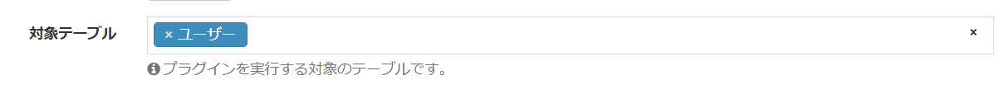
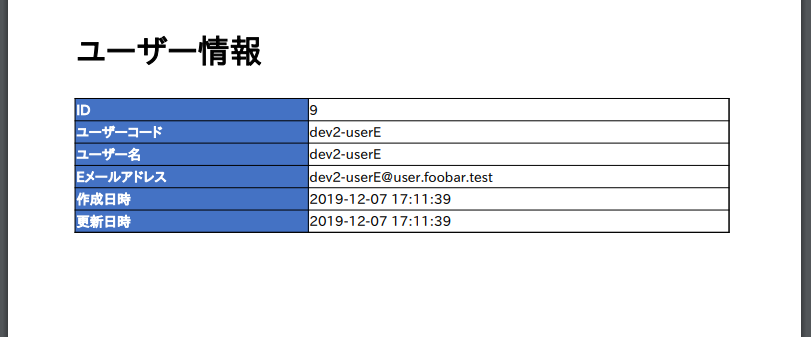

# Salida de documentos (Docurain)
Esta página explica cómo generar formularios en PDF con **Docurain**, un motor de formularios en la nube. Con Docurain, los formularios se desarrollan solo con Excel y json.

> Para la salida en formato Excel, consulte [Plugin (Salida de documentos)](/es/plugin_quickstart_document).

## Qué es Docurain
Docurain es un motor de formularios en la nube con el que los formularios se desarrollan solo con Excel y json.  
Permite crear formularios con diseños muy variados a partir de una plantilla en un archivo Excel. También admite la salida en formato PDF.
[Sitio de Docurain](https://docurain.jp/)

> Docurain es un servicio desarrollado y operado por Root42 Inc.
Para usarlo hace falta un token de licencia. El precio es de pago por uso, según el número de formularios generados. (Se puede emitir un token de prueba.)
Kajitori Co., Ltd., la empresa que desarrolla y opera Exment, es distribuidora de Docurain. Para pedir una prueba, contratar o hacer una consulta, use [esta página](https://exment.net/docurain).

## Cómo ejecutarlo
1. Descargue el [plugin de Docurain](https://github.com/exment-git/plugin-sample/tree/main/docurain/Docurain).

2. Súbalo como un plugin de Exment.
Para los pasos, consulte [Plugin](/es/plugin).

3. Después de subirlo, haga clic en la fila del plugin de Docurain y entre en la pantalla de configuración del plugin.

  

4. Escriba lo siguiente.

- Tabla de destino: la tabla en la que se ejecuta Docurain

  

- Token: el token de ejecución de Docurain. Para que se le emita un token, pregunte en la [página de consultas](https://exment.net/inquiry)

  

- Lista de nombres de tabla y de nombres de archivo de formulario: escriba, separados por comas, el nombre de la tabla de la que se genera el formulario, el nombre del archivo de plantilla, el nombre del archivo de formulario que se genera y la etiqueta del botón. Si hay varios, sepárelos con saltos de línea.
Nota: en el nombre del archivo de plantilla no se puede usar japonés. (Sí se puede usar en el nombre del archivo de formulario y en la etiqueta del botón)  
Nota: si se omite el nombre del archivo de formulario, se usa el nombre del archivo de plantilla.  
Nota: si se omite la etiqueta del botón, se usa la etiqueta configurada en común para el plugin.  
Nota: el nombre del archivo de formulario puede contener [parámetros](/es/params), como la fecha.

  

5. Coloque el archivo Excel que es el origen del formulario dentro de la carpeta "documents" de la carpeta descomprimida.
Si crea varios formularios con Docurain, coloque varios archivos Excel en documents.
Nota: la ruta de la carpeta es "(carpeta raíz del proyecto)/storage/app/plugins/Docurain/documents".
Nota: para saber cómo crear el formulario, consulte "Crear el archivo Excel de plantilla", más abajo.

  
  

6. Al terminar la configuración hasta aquí, aparece un botón en la tabla seleccionada en "Tabla de destino".

  

7. Al hacer clic en el botón, se crea el formulario.

  

### Crear el archivo Excel de plantilla
Cree el archivo Excel que es el origen del formulario.  
Nota: en el nombre del archivo Excel no se puede usar japonés. La extensión debe ser siempre xlsx.  
Nota: los parámetros del archivo de plantilla no se escriben como los parámetros normales de Exment. Hace falta la forma de escribir propia de Docurain.

#### Parámetros
Son los parámetros que se ponen en el archivo Excel de plantilla.
Si escribe en las celdas de Excel variables con un formato fijado, al generar el formulario se convierten en distintos valores.

##### Valores del sistema
| Elemento | Descripción |
| ---- | ---- |
| %{system.site_name} | Nombre del sitio del sistema |
| %{system.site_name_short} | Nombre del sitio del sistema (abreviado) |
| %{system.system_mail_from} | Remitente del sistema |
| %{system.system_url} | URL de inicio del sistema |
| %{system.login_url} | URL de inicio de sesión del sistema |

##### Datos
| Elemento | Descripción |
| ---- | ---- |
| %{id} | Recibe el ID del dato. (Ejemplo: 123) |
| %{suuid} | Recibe el suuid del dato (Short UUID, una cadena aleatoria de 20 caracteres). |
| %{value_url} | Recibe el enlace que muestra el dato. |
| %{value.(nombre de la columna)} | Recibe el valor de la columna del dato. (Ejemplo: si en un dato de usuario se escribe %{value.user_code}, recibe el código de usuario) |
| %{select_table.(nombre de la columna).(nombre de la columna de la tabla de referencia)} | Si la columna indicada en "nombre de la columna" es de tipo "Selección (desde tabla)", "Usuario" u "Organización", recibe el valor de la columna de la tabla de referencia. (Ejemplo: si la tabla "Contratos (contract)" tiene la columna "Cliente (client)", que hace referencia a la tabla "Clientes (client)", con %{select_table.client.client_code} se muestra el código de cliente (client_code) de la tabla "Clientes (client)") |
| %{parent.(nombre de la columna de la tabla de referencia)} | Recibe el valor de la columna de la tabla padre. (Ejemplo: para consultar desde la tabla "Detalles de contrato (contract_detail)" el código de contrato (contract_code) de su tabla padre, "Contratos (contract)", si se escribe %{parent.contract_code}, recibe el código de contrato) |
| $ENTITY.children.(nombre de la tabla hija) | La información de la tabla hija se pone con una sintaxis de bloque, como "#foreach". Como la tabla hija puede tener varios datos, no se puede escribir como %{children.(nombre de la tabla hija).(nombre de la columna de la tabla hija)}. Más abajo se explica un ejemplo. |

#### Ejemplo de configuración
##### Reglas básicas
- Se pueden usar las funciones y los formatos habituales de EXCEL.  
- La columna A es una columna solo para escribir la lógica. En ella se escribe la sintaxis de bloque, como #if, #foreach o #set.

##### Nota: un ejemplo de plantilla   

- Este es el PDF que resulta de generar la plantilla anterior.   

#### Descarga de las plantillas de ejemplo
[Información del usuario](https://exment.net/downloads/product/plugin/Docurain/user.xlsx)  
[Información de versiones de producto](https://exment.net/downloads/product/plugin/Docurain/product_version.xlsx)  
[Información de contratos](https://exment.net/downloads/product/plugin/Docurain/contract.xlsx)  
Nota: para usar la información de versiones de producto y la información de contratos, hay que importar antes la "plantilla para empresas de venta de productos".

### Sobre los errores
- Después de ejecutar la salida, puede aparecer un error.
En ese caso, revise el contenido del error y actúe según corresponda.

- Para el error cuyo "código de estado HTTP" es "413", hay que cambiar el límite permitido del servicio en el lado del servicio en la nube de Docurain.
En ese caso, pregunte desde [esta página](https://exment.net/docurain).
