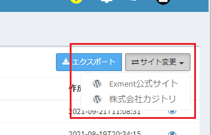
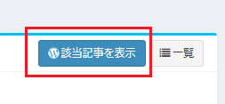

# Referencia de plugins (Página CRUD)
Esta página es para quienes desarrollan un plugin (Página CRUD).  
Reúne las funciones y propiedades que se pueden usar en la clase de la página CRUD.

**Significado de las marcas de las funciones**

| Marca | Significado |
| ---- | ---- |
| ★ | Casi siempre hay que definirla |
| ☆ | Hay que definirla según el caso |

- Esta página es solo para la página CRUD. Para los demás tipos de plugin, consulte la [Referencia de plugins](/es/plugin_reference).
- Para las funciones de las tablas personalizadas, las columnas personalizadas y los datos personalizados, consulte la [Referencia de funciones](/es/func_reference).
- Aquí se muestra sobre todo lo que define el desarrollador del plugin. Se omite lo que usa el sistema y que el desarrollador no debería cambiar.
- Las clases de la biblioteca de la pantalla de administración están escritas con el espacio de nombres de Exment v7.0.0 o posterior ("ExmentAdminCore\Admin"). Si usa v6.x o anterior, léalo como "Encore\Admin". Para más detalles, consulte [Procedimiento de actualización v7.0.0](/update/v7_0_0) (inglés).

## PluginCrudBase
Es la clase abstracta del plugin (Página CRUD). Si desarrolla un plugin de página CRUD, herede esta clase.  

- namespace Exceedone\Exment\Services\Plugin
- trait Exceedone\Exment\Services\Plugin\PluginBase
- trait Exceedone\Exment\Services\Plugin\PluginPageTrait

##### Propiedades

| Nombre | Tipo | Descripción |
| ---- | ---- | ---- |
| title | string | Título que se muestra en cada página |
| description | string | Texto explicativo que se muestra en cada página |
| icon | string | Icono que se muestra en cada página |


### Lista de funciones

#### ★getFieldDefinitions
Es la función que obtiene la definición de las columnas como array asociativo.  
- Añada siempre una clave, y solo una, con "primary" => true. (Por ahora no se admiten las claves compuestas)  
- "key" es el nombre del elemento, que se usa para obtener los datos, como name de cada elemento HTML, etc. Escríbalo con caracteres alfanuméricos.  
- "label" se usa como nombre del elemento en la pantalla de lista, etc.  
- Ponga "grid" en los elementos que se muestran en la pantalla de lista. Escriba un número entero con el orden de visualización.
- Ponga "show" en los elementos que se muestran en la pantalla de detalle. Escriba un número entero con el orden de visualización.
- Ponga "create" en los elementos que se muestran en la pantalla de creación. Escriba un número entero con el orden de visualización.
- Ponga "edit" en los elementos que se muestran en la pantalla de edición. Escriba un número entero con el orden de visualización.


##### Argumentos
Ninguno


##### Valor devuelto
| Tipo | Descripción |
| ---- | ---- |
| array | Array de la definición de las columnas |


##### Ejemplo
``` php
/**
     * (2) Obtener la definición de las columnas
     * Get fields definitions
     *
     * @return array|Collection
     */
    public function getFieldDefinitions()
    {
        return [
            ['key' => 'id', 'label' => 'ID', 'primary' => true, 'grid' => 1, 'show' => 1],
            ['key' => 'title', 'label' => 'Título', 'grid' => 2, 'show' => 2, 'create' => 1, 'edit' => 1],
            ['key' => 'date', 'label' => 'Fecha de creación', 'grid' => 3, 'show' => 3, 'create' => 2, 'edit' => 2],
            ['key' => 'content', 'label' => 'Contenido', 'show' => 4, 'create' => 3, 'edit' => 3],
        ];
    }
```

---


#### getAuthType
Devuelve la cadena del tipo de autenticación de la página CRUD.  
Nota: aparte del inicio de sesión de Exment, se puede establecer una autenticación para acceder a esta página CRUD. Establezca el tipo de autenticación según el tipo de servicio al que quiere acceder.


##### Tipos de autenticación
| Cadena que se devuelve | Tipo | Descripción |
| ---- | ---- | ---- |
| (null) | Sin autenticación | Cuando no se hace una autenticación exclusiva de la página CRUD. Es el valor predeterminado. |
| key | Clave de acceso | La clave de acceso se establece en la página de configuración del plugin. Si la clave de acceso no está introducida, se muestra un error. |
| id_password | ID y contraseña | El ID y la contraseña se establecen en la página de configuración del plugin. Si el ID y la contraseña no están introducidos, se muestra un error. |
| oauth | OAuth | La configuración de OAuth se hace en la pantalla de Configuración de inicio de sesión. Cuando el usuario accede a la página CRUD, inicia sesión con OAuth. Solo puede acceder a la página CRUD si el inicio de sesión con OAuth se hace bien. Además, también se puede usar el token de acceso. |


##### Argumentos
Ninguno

##### Valor devuelto
| Tipo | Descripción |
| ---- | ---- |
| ?string | Cadena que indica el tipo de autenticación |


##### Ejemplo
``` php
    /**
     * Get auth type.
     * Please set null or "key" or "id_password" or "oauth".
     *
     * @return string|null
     */
    public function getAuthType() : ?string
    {
        return 'oauth';
    }
```

---


#### enablePaginate
Indica si la lista de datos se muestra en formato de paginación.  
Si el servicio del que se obtienen los datos admite el formato de paginación (número total de datos, obtención de datos indicando el número de página, obtención de datos por página), devuelva true. Si no lo admite, devuelva false.

##### Argumentos
Ninguno


##### Valor devuelto
| Tipo | Descripción |
| ---- | ---- |
| boolean | Si admite o no el formato de paginación. Valor predeterminado: true |


##### Ejemplo
``` php
     /**
     * Whether use paginate
     * Default: true
     *
     * @return bool
     */
    public function enablePaginate() : bool
    {
        return true;
    }
```

---


#### ★getPaginate
Es la función que obtiene la lista de datos en formato de paginación.  
Devuelva los datos obtenidos en formato \Illuminate\Pagination\LengthAwarePaginator.  
Además, cada elemento de la lista debe ser un array asociativo, y las claves de ese array asociativo deben ser las mismas que las claves definidas en getFieldDefinitions.  
Nota: impleméntela si la función enablePaginate es true.


##### Argumentos
| Nombre | Tipo | Descripción |
| ---- | ---- | ---- |
| $options | array | Opciones que se usan al mostrar la pantalla de lista |
| $options['per_page'] | int | Número de elementos que se muestran en 1 página |
| $options['page'] | int | Número de página |
| $options['query'] | string | Cadena de búsqueda, cuando se hace una búsqueda |


##### Valor devuelto
| Tipo | Descripción |
| ---- | ---- |
| LengthAwarePaginator | Modelo del resultado de la búsqueda |


##### Ejemplo
``` php
    /**
     * (3) Obtener la lista de datos (Paginate)
     * Get data paginate
     *
     * @return LengthAwarePaginator
     */
    public function getPaginate(array $options = []) : ?LengthAwarePaginator
    {
        $client = new Client([
            'base_uri' => $this->getSiteUrl(),
        ]);

        $query = [
            'per_page' => $options['per_page'] ?? 20,
            'page' => $options['page'] ?? 1
        ];

        if(array_has($options, 'query')){
            $query['search'] = array_get($options, 'query');
        }

        $response = $client->get('wp-json/wp/v2/posts', ['query' => $query]);

        $json = json_decode((string)$response->getBody());

        $result = collect($json)->map(function($j){
            $j = json_decode(json_encode($j), true);
            return (object)[
                'id' => array_get($j, 'id'),
                'title' => array_get($j, 'title.rendered'),
                'content' => array_get($j, 'content.rendered'),
                'date' => array_get($j, 'date'),
            ];
        });
        
        return new LengthAwarePaginator(
            $result, 
            array_get($response->getHeaders(), 'X-WP-Total')[0], 
            $query['per_page'],
            $query['page'],
            [
                'path' => $this->getFullUrl(),
            ]
        );
    }
```


---

#### ☆getList
Es la función que obtiene la lista de datos.  
Devuelva los datos obtenidos en formato Collection.  
Además, cada elemento de la lista debe ser un array asociativo, y las claves de ese array asociativo deben ser las mismas que las claves definidas en getFieldDefinitions.  
Nota: impleméntela si la función enablePaginate es false.


##### Argumentos
| Nombre | Tipo | Descripción |
| ---- | ---- | ---- |
| $options | array | Opciones que se usan al mostrar la pantalla de lista |
| $options['query'] | string | Cadena de búsqueda, cuando se hace una búsqueda |


##### Valor devuelto
| Tipo | Descripción |
| ---- | ---- |
| \Illuminate\Support\Collection | Lista de resultados |


##### Ejemplo
``` php
    /**
     * (3) Obtener la lista de datos
     * Get data list
     *
     * @return Collection
     */
    public function getList(array $options = []) : Collection
    {
        $client = new Client([
            'base_uri' => $this->getSiteUrl(),
        ]);

        if(array_has($options, 'query')){
            $query['search'] = array_get($options, 'query');
        }

        $token = $this->getOauthAccessToken();
        $response = $client->get('v1.0/me/todo/lists', [
            'query' => $query, 
            'headers' => [
                'Authorization' => "Bearer $token",
                'Accept'        => 'application/json',
            ]
        ]);

        $json = json_decode((string)$response->getBody());

        $result = collect($json->value)->map(function($j){
            $j = json_decode(json_encode($j), true);
            return (object)[
                'id' => array_get($j, 'id'),
                'displayName' => array_get($j, 'displayName'),
            ];
        });

        return $result;
    }
```


---


#### getChunkCount
Devuelve el número de elementos que se obtienen de una vez cuando la lista de datos se obtiene en formato de paginación.  

##### Argumentos
Ninguno


##### Valor devuelto
| Tipo | Descripción |
| ---- | ---- |
| int | Número de elementos que se obtienen de una vez. Valor predeterminado: 1000 |


##### Ejemplo
``` php
    /**
     * Get max chunk count.
     *
     * @return int
     */
    public function getChunkCount() : int
    {
        return 1000;
    }
```


---

#### ★getData
Obtiene y devuelve 1 dato con el ID indicado.  
Además, cada elemento del dato debe ser un array asociativo, y las claves de ese array asociativo deben ser las mismas que las claves definidas en getFieldDefinitions.  

##### Argumentos
| Nombre | Tipo | Descripción |
| ---- | ---- | ---- |
| $id | string | Valor de la clave del dato |
| $options | array | Ahora no se usa. Argumento reservado. |


##### Valor devuelto
| Tipo | Descripción |
| ---- | ---- |
| array o Collection | Dato obtenido |


##### Ejemplo
``` php
    /**
     * (3) Obtener el detalle de los datos (1 dato)
     * read single data
     *
     * @return array|Collection
     */
    public function getData($id, array $options = [])
    {
        $client = new Client([
            'base_uri' => $this->getSiteUrl(),
        ]);
        $response = $client->request('GET', "wp-json/wp/v2/posts/{$id}");
        $json = json_decode((string)$response->getBody());
        
        $j = json_decode(json_encode($json), true);
        return (object)[
            'id' => array_get($j, 'id'),
            'title' => array_get($j, 'title.rendered'),
            'content' => array_get($j, 'content.rendered'),
            'date' => array_get($j, 'date'),
        ];
    }
```


---

#### ★postCreate
Crea un dato nuevo.  
Como valor devuelto, devuelva el valor de la clave del dato creado.  

##### Argumentos
| Nombre | Tipo | Descripción |
| ---- | ---- | ---- |
| $posts | array | Datos introducidos por el usuario. Array asociativo. |
| $options | array | Ahora no se usa. Argumento reservado. |


##### Valor devuelto
| Tipo | Descripción |
| ---- | ---- |
| string | Devuelva el valor de la clave del dato creado |


##### Ejemplo
``` php
    /**
     * post create value
     *
     * @return mixed
     */
    public function postCreate(array $posts, array $options = [])
    {
        $client = new Client([
            'base_uri' => $this->getSiteUrl(),
        ]);

        // create Authorization header 
        $id_password = $this->getAuthIdPassword();
        $Authorization = "Basic " . base64_encode("{$id_password['id']}:{$id_password['password']}");

        $response = $client->request('POST', "wp-json/wp/v2/posts", [
            'headers' => [
                'Authorization' => $Authorization,
                //'Content-Type' => 'application/json',
            ],
            'form_params' => [
                'title' => array_get($posts, 'title'),
                'content' => array_get($posts, 'content'),
                'status' => 'publish',
            ],
        ]);
        $json = json_decode((string)$response->getBody());
        $j = json_decode(json_encode($json), true);
        return array_get($j, 'id');
    }

```


---

#### ★putEdit
Edita un dato.  
Como valor devuelto, devuelva el valor de la clave del dato editado.  

##### Argumentos
| Nombre | Tipo | Descripción |
| ---- | ---- | ---- |
| $id | string | Valor de la clave del dato que se edita |
| $posts | array | Datos introducidos por el usuario. Array asociativo. |
| $options | array | Ahora no se usa. Argumento reservado. |


##### Valor devuelto
| Tipo | Descripción |
| ---- | ---- |
| string | Devuelva el valor de la clave del dato actualizado |


##### Ejemplo
``` php
    /**
     * edit posted value
     *
     * @return mixed
     */
    public function putEdit($id, array $posts, array $options = [])
    {
        $client = new Client([
            'base_uri' => $this->getSiteUrl(),
        ]);

        // create Authorization header 
        $id_password = $this->getAuthIdPassword();
        $Authorization = "Basic " . base64_encode("{$id_password['id']}:{$id_password['password']}");

        $response = $client->request('POST', "wp-json/wp/v2/posts/{$id}", [
            'headers' => [
                'Authorization' => $Authorization,
                //'Content-Type' => 'application/json',
            ],
            'form_params' => [
                'title' => array_get($posts, 'title'),
                'content' => array_get($posts, 'content'),
                'status' => 'publish',
            ],
        ]);
        $json = json_decode((string)$response->getBody());
        $j = json_decode(json_encode($json), true);
        return array_get($j, 'id');
    }

```


---

#### ★delete
Elimina un dato.  

##### Argumentos
| Nombre | Tipo | Descripción |
| ---- | ---- | ---- |
| $id | string | Valor de la clave del dato que se elimina |
| $options | array | Ahora no se usa. Argumento reservado. |


##### Valor devuelto
Ninguno


##### Ejemplo
``` php
    /**
     * delete value
     *
     * @param $id string
     * @return mixed
     */
    public function delete($id, array $options = [])
    {
        $client = new Client([
            'base_uri' => $this->getSiteUrl(),
        ]);

        // create Authorization header 
        $id_password = $this->getAuthIdPassword();
        $Authorization = "Basic " . base64_encode("{$id_password['id']}:{$id_password['password']}");

        $response = $client->request('DELETE', "wp-json/wp/v2/posts/{$id}", [
            'headers' => [
                'Authorization' => $Authorization,
                //'Content-Type' => 'application/json',
            ],
        ]);
    }
```


---

#### enableCreate
Determina si se puede crear un dato nuevo y lo devuelve como tipo boolean.  
Si el servicio vinculado no admite la creación, o si no quiere que ciertos usuarios creen datos, devuelva false.

##### Argumentos
| Nombre | Tipo | Descripción |
| ---- | ---- | ---- |
| $options | array | Ahora no se usa. Argumento reservado. |


##### Valor devuelto
| Tipo | Descripción |
| ---- | ---- |
| boolean | Devuelve true si se puede crear. Valor predeterminado: true |

---


#### enableEditAll
Determina si se puede editar y lo devuelve como tipo boolean.  
Si el servicio vinculado no admite la edición, o si no quiere que ciertos usuarios editen, devuelva false.

##### Argumentos
| Nombre | Tipo | Descripción |
| ---- | ---- | ---- |
| $options | array | Ahora no se usa. Argumento reservado. |


##### Valor devuelto
| Tipo | Descripción |
| ---- | ---- |
| boolean | Devuelve true si se puede editar. Valor predeterminado: true |

---


#### enableEdit
Determina si se puede editar el dato indicado y lo devuelve como tipo boolean.  
Si el servicio vinculado no admite la edición, o si no quiere que ciertos usuarios editen, devuelva false.

##### Argumentos
| Nombre | Tipo | Descripción |
| ---- | ---- | ---- |
| $value | mixed | Valor que corresponde al ID. |
| $options | array | Ahora no se usa. Argumento reservado. |


##### Valor devuelto
| Tipo | Descripción |
| ---- | ---- |
| boolean | Devuelve true si se puede editar. Valor predeterminado: true |

---


#### enableDeleteAll
Determina si se pueden eliminar datos y lo devuelve como tipo boolean.  
Si el servicio vinculado no admite la eliminación, o si no quiere que ciertos usuarios eliminen, devuelva false.

##### Argumentos
| Nombre | Tipo | Descripción |
| ---- | ---- | ---- |
| $options | array | Ahora no se usa. Argumento reservado. |


##### Valor devuelto
| Tipo | Descripción |
| ---- | ---- |
| boolean | Devuelve true si se puede eliminar. Valor predeterminado: true |

---

#### enableDelete
Determina si se puede eliminar el dato indicado y lo devuelve como tipo boolean.  
Si el servicio vinculado no admite la eliminación, o si no quiere que ciertos usuarios eliminen, devuelva false.

##### Argumentos
| Nombre | Tipo | Descripción |
| ---- | ---- | ---- |
| $value | mixed | Valor que corresponde al ID. |
| $options | array | Ahora no se usa. Argumento reservado. |


##### Valor devuelto
| Tipo | Descripción |
| ---- | ---- |
| boolean | Devuelve true si se puede eliminar. Valor predeterminado: true |

---


#### enableExport
Determina si se pueden exportar datos y lo devuelve como tipo boolean.  
Según el caso, la exportación de datos obtiene todos los datos del servicio. Por eso, tenga cuidado con la obtención de grandes cantidades de datos.

##### Argumentos
| Nombre | Tipo | Descripción |
| ---- | ---- | ---- |
| $options | array | Ahora no se usa. Argumento reservado. |


##### Valor devuelto
| Tipo | Descripción |
| ---- | ---- |
| boolean | Devuelve true si se pueden exportar datos. Valor predeterminado: false |

---


#### enableFreewordSearch
Determina si se pueden buscar datos y lo devuelve como tipo boolean.  

##### Argumentos
| Nombre | Tipo | Descripción |
| ---- | ---- | ---- |
| $options | array | Ahora no se usa. Argumento reservado. |


##### Valor devuelto
| Tipo | Descripción |
| ---- | ---- |
| boolean | Devuelve true si se pueden buscar datos. Valor predeterminado: false |

---


#### callbackGridTool
Se define, por ejemplo, cuando quiere mostrar un botón propio arriba a la derecha de la página, en la pantalla GRID (lista de datos).

##### Argumentos

| Nombre | Tipo | Descripción |
| ---- | ---- | ---- |
| $tools | \ExmentAdminCore\Admin\Widgets\Grid\Tools | Herramientas |


##### Valor devuelto
Ninguno


##### Ejemplo
``` php
    /**
     * Callback tools. If add event, definition.
     * Nota: en este ejemplo, se muestra un botón con la lista de WordPress y se cambia el WordPress del que se obtienen los datos
     *
     * @param $tools
     * @return void
     */
    public function callbackGridTool($tools)
    {
        $menulist = [];

        foreach ($this->getSiteDefinitions() as $site) {
            $menulist[] = [
                'href' => admin_urls('plugins', $this->plugin->getOption('uri'), array_get($site, 'endpoint')),
                'label' => array_get($site, 'label'),
                'icon' => 'fa-wordpress',
            ];
        }
        $tools->prepend(view('exment::tools.menu-button', [
            'button_label' => 'Cambiar de sitio',
            'menulist' => $menulist,
        ])->render(), 'right');
    }

```

  

---


#### callbackShowTool
Se define, por ejemplo, cuando quiere mostrar un botón propio arriba a la derecha de la página, en la pantalla SHOW (detalle de los datos).

##### Argumentos

| Nombre | Tipo | Descripción |
| ---- | ---- | ---- |
| $id | string | Valor de la clave |
| $box | \ExmentAdminCore\Admin\Widgets\Box | Box |


##### Valor devuelto
Ninguno


##### Ejemplo
``` php
    /**
     * Callback show page tools. If add event, definition.
     *
     * @param Box $box
     * @return void
     */
    public function callbackShowTool($id, Box $box)
    {
        $box->tools(view('exment::tools.button', [
            'href' => $this->getSiteUrl() . "?p={$id}",
            'label' => 'Ver el artículo',
            'icon' => 'fa-wordpress',
            'btn_class' => 'btn-primary',
            'target' => '_blank',
        ])->render());
    }
```

  

---


#### callbackFormTool
Se define, por ejemplo, cuando quiere mostrar un botón propio arriba a la derecha de la página, en la pantalla CREATE (creación de datos) o en la pantalla EDIT (edición de datos).

##### Argumentos

| Nombre | Tipo | Descripción |
| ---- | ---- | ---- |
| $id | string | Valor de la clave |
| $box | \ExmentAdminCore\Admin\Widgets\Box | Box |


##### Valor devuelto
Ninguno


##### Ejemplo
``` php
    /**
     * Callback create or edit page tools. If add event, definition.
     *
     * @param Box $box
     * @return void
     */
    public function callbackFormTool($id, Box $box)
    {
        $box->tools(view('exment::tools.button', [
            'href' => $this->getSiteUrl() . "?p={$id}",
            'label' => 'Ver el artículo',
            'icon' => 'fa-wordpress',
            'btn_class' => 'btn-primary',
            'target' => '_blank',
        ])->render());
    }
```

  

---


#### setForm
Se crea cuando quiere hacer de forma propia el formulario de entrada de datos, en la pantalla CREATE (creación de datos) o en la pantalla EDIT (edición de datos).  
Nota: la notación es, básicamente, la forma de añadir campos del [formulario](https://github.com/exceedone/exment-admin-core/blob/master/docs/en/model-form-fields.md) de la biblioteca de la pantalla de administración "exment-admin-core" (es igual que el [formulario de laravel-admin](https://laravel-admin.org/docs/en/model-form-fields), en el que se basa). Para saber cómo escribirlo, consulte esa página.  
Nota: si no define esta función (si devuelve null), las columnas que tienen definido en la función getFieldDefinitions el elemento "create" (en la pantalla CREATE) o el elemento "edit" (en la pantalla EDIT) se muestran en formato de texto de una línea.


##### Argumentos
| Nombre | Tipo | Descripción |
| ---- | ---- | ---- |
| $form | \ExmentAdminCore\Admin\Widgets\Form | Formulario de entrada |
| $isCreate | bool | true si es una creación |
| $options | array | Ahora no se usa. Argumento reservado. |


##### Valor devuelto
| Tipo | Descripción |
| ---- | ---- |
| ?\ExmentAdminCore\Admin\Widgets\Form | Formulario creado. Si devuelve null, el formulario de entrada se crea a partir de la definición de la función getFieldDefinitions. |


##### Ejemplo
``` php
    /**
     * set form info
     *
     * @return Form|null
     */
    public function setForm(Form $form, bool $isCreate, array $options = []) : ?Form
    {
        if(!$isCreate){
            $form->display('ID');    
        }
        $form->text('Name');

        // Obtener la lista de países
        $countries = \DB::connection('world')->table('country') ->pluck('Name', 'Code');
        $form->select('CountryCode')->options($countries);
        
        $form->number('Population');

        return $form;
    }
```

---


#### validate
Es la función para definir una validación antes de guardar los datos, en la pantalla CREATE (creación de datos) o en la pantalla EDIT (edición de datos).

##### Argumentos

| Nombre | Tipo | Descripción |
| ---- | ---- | ---- |
| $form | \ExmentAdminCore\Admin\Widgets\Form | Formulario de entrada |
| $values | array | Valores introducidos por el usuario |
| $isCreate | bool | true si es una creación |
| $id | string | Valor de la clave |


##### Valor devuelto
| Tipo | Descripción |
| ---- | ---- |
| Uno de los siguientes<br/>array<br/>\Illuminate\Support\MessageBag<br/>\Exceedone\Exment\Validator\ExmentCustomValidator | Resultado de la validación |


##### Ejemplo
``` php
    // Nota: ejemplo 1. Cómo añadir la validación al formulario en la función setForm.
    // Nota: por comodidad, el ejemplo está escrito dentro de la función validate, pero en este ejemplo no defina la función validate.
    /**
     * set form info
     *
     * @return Form|null
     */
    public function setForm(Form $form, bool $isCreate, array $options = []) : ?Form
    {
        if(!$isCreate){
            $form->display('ID');    
        }
        $form->text('Name')
            ->rules(['max:10']); // Añadido

        // Obtener la lista de países
        $countries = \DB::connection('world')->table('country')->pluck('Name', 'Code');
        $form->select('CountryCode')->options($countries);
        
        $form->number('Population')
            ->rules([new \Exceedone\Exment\Validator\NumberMinRule(10)]);  // Añadido

        return $form;
    }


    // Nota: ejemplo 2. Cómo usar la validación de Laravel.
    /**
     * Validate form
     *
     * @param WidgetForm $form
     * @return array|MessageBag|ExmentCustomValidator
     */
    public function validate(WidgetForm $form, array $values, bool $isCreate, $id)
    {
        $validator = \Validator::make($values, 
        // Definir las reglas de cada campo
        [
            'Name' => 'max:10',
            'Population' => new \Exceedone\Exment\Validator\NumberMinRule(10),
        ], 
        // (Opcional) Si se cambian los mensajes de cada regla
        [
            'max' => ':attribute debe tener 10 caracteres como máximo.',
            'min' => 'Introduzca en :attribute un valor de 10 o más',
        ], 
        // (Opcional) Si se cambian los nombres de cada campo
        [
            'Name' => 'Nombre',
            'Population' => 'Población (estimada)',
        ]);
        return $validator;
    }
    

    // Nota: ejemplo 3. Cómo validar de forma individual.
    // Si hay errores, se devuelve un array cuya clave es el nombre del campo y cuyo valor es el mensaje de error.
    /**
     * Validate form
     *
     * @param WidgetForm $form
     * @return array|MessageBag|ExmentCustomValidator
     */
    public function validate(WidgetForm $form, array $values, bool $isCreate, $id)
    {
        $errors = [];

        // Comprobar si tiene 10 caracteres como máximo
        $Name = array_get($values, 'Name');
        if(!is_nullorempty($Name) && mb_strlen($Name) > 10){
            $errors['Name'] = 'El nombre debe tener 10 caracteres como máximo.';
        }
        
        // Comprobar si es 10 o más
        $Population = array_get($values, 'Population');
        if(!is_nullorempty($Population) && intval($Population) < 10){
            $errors['Population'] = 'Introduzca en Población (estimada) un valor de 10 o más';
        }
        
        return $errors;
    }
```

---

