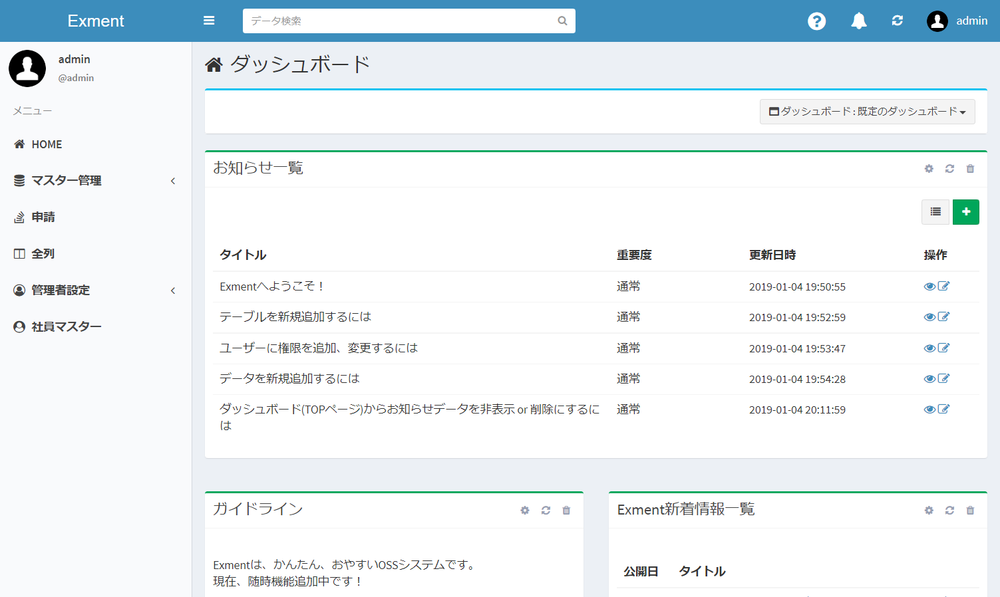
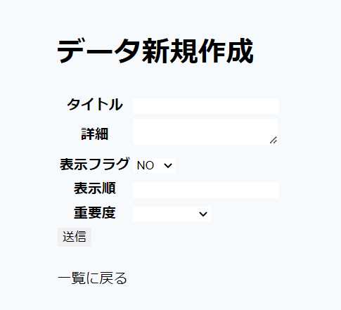

# Creación de un sitio para usuarios finales

Esta página es para quienes desarrollan.  
En Exment, si cambia el endpoint (la entrada de la URL), puede crear, además del sitio de Exment, un sitio para usuarios generales hecho por el propio desarrollador (sitio para usuarios finales).

En esta página, como ejemplo, se crean las siguientes páginas, que manejan los datos de la tabla «Avisos» de Exment.

- Lista de los datos de avisos
- Detalle de un dato de avisos
- Creación de un dato de avisos
- Edición de un dato de avisos
- Eliminación de un dato de avisos

El orden de trabajo es el siguiente.

1. Comprobar que se puede acceder
2. Crear la página de lista (enrutamiento → controlador → vista)
3. Añadir, una tras otra, las páginas de detalle, creación, edición y eliminación

## Comprobación del acceso
Se puede acceder al sitio para usuarios finales también después de instalar Exment.

| Final de la URL | Sitio que se abre |
|---|---|
| "/admin" | Sitio de administración (Exment) |
| "/" | Sitio para usuarios finales |

- Para poner el sitio para usuarios finales en "/", ponga `ADMIN_ROUTE_PREFIX` de `.env` en "admin". Es porque, en las instalaciones nuevas de v7.2.1 o posterior, Exment está en "/" de forma estándar. Para más detalles, consulte [Cambiar o eliminar el "admin" incluido en la URL](/es/additional_prefix).

■ Endpoint "/"

■ Endpoint "/admin"

## Creación de las páginas
El sitio para usuarios finales se crea, básicamente, con la misma estructura y los mismos pasos que un desarrollo normal de un sistema con Laravel.  
La imagen de abajo muestra la estructura de la carpeta raíz de Laravel. Los archivos php se crean sobre todo en las siguientes carpetas.

| Carpeta | Qué se pone |
|---|---|
| app/Http/Controllers | Controladores |
| routes | Información de los endpoints |
| resources/views | Vistas. Se escriben con la notación blade |
| public | css, js, imágenes, etc. |

#### routes: enrutamiento
En routes/web.php, escriba el enrutamiento de la página de lista de la siguiente manera.  
Nota: para otras formas de escribir el enrutamiento, consulte la [explicación del enrutamiento de Laravel](https://readouble.com/laravel/8.x/ja/routing.html) (en japonés).

~~~
<?php

use Illuminate\Support\Facades\Route;

/*
|--------------------------------------------------------------------------
| Web Routes
|--------------------------------------------------------------------------
|
| Here is where you can register web routes for your application. These
| routes are loaded by the RouteServiceProvider within a group which
| contains the "web" middleware group. Now create something great!
|
*/

//Route::get('/', function () {
//    return view('welcome');
//});

///// Página de lista
Route::get('/', [\App\Http\Controllers\IndexController::class, 'index']);
~~~

#### Controller: controlador
En la carpeta app/Http/Controllers, cree IndexController.php y escriba lo siguiente.

- CustomTable: es el Model que corresponde a la «tabla personalizada» de Exment.
- CustomTable::getEloquent('information')->getValueModel(): es el Model para los datos de la tabla de Exment. Representa cada dato introducido por el usuario.

Nota: para otras formas de escribir los controladores, consulte la [explicación de los controladores de Laravel](https://readouble.com/laravel/8.x/ja/controllers.html) (en japonés).

~~~
<?php

namespace App\Http\Controllers;

use Illuminate\Routing\Controller as BaseController;
use Illuminate\Http\Request;
use Exceedone\Exment\Model\CustomTable;

class IndexController extends BaseController
{
    //Pantalla de lista
    public function index(Request $request){
        $items = CustomTable::getEloquent('information')->getValueModel()->get();
        return view('index', [
            'items' => $items,
        ]);
    }
}
~~~

#### view: vista
Para la vista se crean 2 archivos: el marco común (_layout.blade.php) y el contenido de la lista (index.blade.php).

En resources/views, cree _layout.blade.php y escriba lo siguiente.  
~~~
<!DOCTYPE html>
<html lang="{{ str_replace('_', '-', app()->getLocale()) }}">
    <head>
        <meta charset="utf-8">
        <meta name="viewport" content="width=device-width, initial-scale=1">

        <title>Laravel</title>

        <!-- Fonts -->
        <link href="https://fonts.googleapis.com/css2?family=Nunito:wght@400;600;700&display=swap" rel="stylesheet">

        <!-- Styles -->
        

        
    </head>
    <body class="antialiased">
        

            @if (Route::has('login'))
                

                    @auth
                        <a href="{{ url('/home') }}" class="text-sm text-gray-700 dark:text-gray-500 underline">Home</a>
                    @else
                        <a href="{{ route('login') }}" class="text-sm text-gray-700 dark:text-gray-500 underline">Log in</a>

                        @if (Route::has('register'))
                            <a href="{{ route('register') }}" class="ml-4 text-sm text-gray-700 dark:text-gray-500 underline">Register</a>
                        @endif
                    @endauth
                

            @endif

            <main>
                @yield('content')
            </main>
        

    </body>
</html>

~~~

En resources/views, cree index.blade.php y escriba lo siguiente.  
Nota: para otras formas de escribir Blade, consulte la [explicación de Blade de Laravel](https://readouble.com/laravel/8.x/ja/blade.html) (en japonés).

~~~
@extends('_layout')

@section('content')
    <h1>Lista de avisos</h1>
    <table>
        <thead>
            <tr>
                <th>ID</th>
                <th>Título</th>
                <th>Fecha de creación</th>
                <th>Fecha de actualización</th>
                <th></th>
            </tr>
        </thead>

        <tbody>
        @foreach($items as $item)
            <tr>
                <td>{{$item->id}}</td>
                <td>{{$item->getValue('title', 'html')}}</td>
                <td>{{$item->created_at}}</td>
                <td>{{$item->updated_at}}</td>
                <td><a href="{{asset($item->id)}}">Detalles</a></td>
            </tr>
        @endforeach
        </tbody>
    </table>

    

        <a href="{{asset('/create')}}">Crear nuevo</a>
    

@endsection
~~~

#### Resultado
Si todo lo anterior está bien hecho, se muestra la lista de los datos de la tabla «Avisos» de Exment, como se ve a continuación.  
Nota: los enlaces "Crear nuevo" y "Detalles" todavía no se pueden abrir en este momento. Se crean después.

#### Creación de la pantalla de detalle de los datos
Se crea la pantalla de detalle de los datos. Añada lo siguiente en estos 3 archivos.

routes/web.php
~~~
///// Página de detalle
Route::get('/{id}', [\App\Http\Controllers\IndexController::class, 'show']);
~~~

app/Http/Controllers/IndexController.php (añadir debajo de la función index)
~~~
  //Pantalla de detalle
    public function show(Request $request, $id){
        $item = CustomTable::getEloquent('information')->getValueModel()->find($id);
        if(!$item){
            return redirect('');
        }
        return view('show', [
            'item' => $item,
        ]);
    }
~~~

resources/views/show.blade.php (archivo nuevo)
~~~
@extends('_layout')

@section('content')
    <h1>Detalle de los datos</h1>
    <table>
        <tbody>
            <tr>
                <th>ID</th>
                <td>{{$item->id}}</td>
            </tr>
            <tr>
                <th>Título</th>
                <td>{{$item->getValue('title', 'html')}}</td>
            </tr>
            <tr>
                <th>Contenido</th>
                <td>{!! $item->getValue('body', 'html') !!}</td>
            </tr>
            <tr>
                <th>Indicador de visualización</th>
                <td>{!! $item->getValue('view_flg', 'html') !!}</td>
            </tr>
            <tr>
                <th>Orden de visualización</th>
                <td>{!! $item->getValue('order', 'html') !!}</td>
            </tr>
            <tr>
                <th>Prioridad</th>
                <td>{!! $item->getValue('priority', 'html') !!}</td>
            </tr>
            <tr>
                <th>Fecha de creación</th>
                <td>{{$item->created_at}}</td>
            </tr>
            <tr>
                <th>Fecha de actualización</th>
                <td>{{$item->updated_at}}</td>
            </tr>
        </tbody>
    </table>

    

        <a href="{{asset('/')}}">Volver a la lista</a>
    

@endsection
~~~

#### Resultado
Si está bien hecho, se muestra el detalle del dato con el ID indicado de la tabla «Avisos» de Exment, como se ve a continuación.

#### Pantalla de creación de datos
Se crea la pantalla de creación de datos. Añada lo siguiente en estos 3 archivos.

routes/web.php (escribir por encima de la página de detalle)
~~~
///// Página de creación
Route::get('/create', [\App\Http\Controllers\IndexController::class, 'create']);
Route::post('/', [\App\Http\Controllers\IndexController::class, 'store']);
~~~

app/Http/Controllers/IndexController.php (añadir debajo de la función show)
~~~
    //Pantalla de creación
    public function create(Request $request){
        return view('create');
    }

    //Ejecutar el registro del dato nuevo
    public function store(Request $request){
        //Crear el Model para guardar los datos
        $custom_value = CustomTable::getEloquent('information')->getValueModel();

        //Establecer los valores
        $custom_value->setValueStrictly([
            'title' => $request->get('title'),
            'body' => $request->get('body'),
            'view_flg' => $request->get('view_flg'),
            'order' => $request->get('order'),
            'priority' => $request->get('priority'),
        ]);

        //Guardar los datos
        $custom_value->save();

        //Redirigir al dato correspondiente
        return redirect($custom_value->id);
    }
~~~

resources/views/create.blade.php (archivo nuevo)
~~~
@extends('_layout')

@section('content')
    <h1>Creación de datos</h1>

    <form method="post" action="{{asset('/')}}">
        @csrf
        <table>
            <tbody>
                <tr>
                    <th>Título</th>
                    <td><input type="text" name="title" value="{{old('title')}}" /></td>
                </tr>
                <tr>
                    <th>Contenido</th>
                    <td><textarea name="body">{{old('body')}}</textarea></td>
                </tr>
                <tr>
                    <th>Indicador de visualización</th>
                    <td>
                        <select name="view_flg">
                            <option value="0" selected>NO</option>
                            <option value="1">YES</option>
                        </select>
                    </td>
                </tr>
                <tr>
                    <th>Orden de visualización</th>
                    <td><input type="number" name="order" value="{{old('order')}}"></input></td>
                </tr>
                <tr>
                    <th>Prioridad</th>
                    <td>
                        <select name="priority">
                            <option value="{{old('priority')}}" selected></option>
                            <option value="1">Muy baja</option>
                            <option value="2">Baja</option>
                            <option value="3">Normal</option>
                            <option value="4">Alta</option>
                            <option value="5">Muy alta</option>
                        </select>
                    </td>
                </tr>
            </tbody>
        </table>

        <button type="submit">Enviar</button>
          
        
        

            <a href="{{asset('/')}}">Volver a la lista</a>
        

    </form>
@endsection
~~~

#### Resultado
Si está bien hecho, se muestra la página para añadir datos a la tabla «Avisos» de Exment, como se ve a continuación.

#### Pantalla de edición de datos
Se crea la pantalla de edición de datos. Añada (o cambie) lo siguiente en estos 5 archivos.

routes/web.php (escribir por encima de la página de detalle)
~~~
///// Página de edición
Route::get('/edit/{id}', [\App\Http\Controllers\IndexController::class, 'edit']);
Route::put('/{id}', [\App\Http\Controllers\IndexController::class, 'update']);
~~~

app/Http/Controllers/IndexController.php (añadir debajo de la función store)
~~~
 // Pantalla de edición
    public function edit(Request $request, $id){
        $item = CustomTable::getEloquent('information')->getValueModel()->find($id);
        if(!$item){
            return redirect('');
        }
        return view('edit', [
            'item' => $item,
        ]);
    }

    // Ejecutar la edición
    public function update(Request $request, $id){
        // Crear el Model para guardar los datos
        $custom_value = CustomTable::getEloquent('information')->getValueModel()->find($id);

        // Establecer los valores
        $custom_value->setValueStrictly([
            'title' => $request->get('title'),
            'body' => $request->get('body'),
            'order' => $request->get('order'),
            'view_flg' => $request->get('view_flg'),
            'priority' => $request->get('priority'),
        ]);

        // Guardar los datos
        $custom_value->save();

        // Redirigir al dato correspondiente
        return redirect($custom_value->id);
    }
~~~

resources/views/edit.blade.php (archivo nuevo)
~~~
@extends('_layout')

@section('content')
    <h1>Edición de datos</h1>

    <form method="post" action="{{asset('/' . $item->id)}}">
        @csrf
    <table>
        <tbody>
            <tr>
                <th>ID</th>
                <td>{{$item->id}}</td>
            </tr>
            <tr>
                <th>Título</th>
                <td><input type="text" name="title" value="{{old('title', $item->getValue('title', 'html'))}}" /></td>
            </tr>
            <tr>
                <th>Contenido</th>
                <td>
                    <textarea name="body">{{old('body', $item->getValue('body', 'html'))}}</textarea>
                </td>
            </tr>
            <tr>
                <th>Indicador de visualización</th>
                <td>
                    <select name="view_flg">
                    <option value="{{old('view_flg', $item->getValue('view_flg', 'html'))}}" selected>{{old('view_flg', $item->getValue('view_flg', 'html'))}}</option>
                            <option value="0">NO</option>
                            <option value="1">YES</option>
                    </select>
                </td>
            </tr>
            <tr>
                <th>Orden de visualización</th>
                <td>
                    <input type="number" name="order" value="{{old('order', $item->getValue('order', 'html'))}}"></input>
                </td>
            </tr>
            <tr>
                <th>Prioridad</th>
                <td>
                    <select name="priority">
                            <option value="{{old('priority', $item->getValue('priority', 'html'))}}" selected>{{old('priority', $item->getValue('priority', 'html'))}}</option>
                            <option value="1">Muy baja</option>
                            <option value="2">Baja</option>
                            <option value="3">Normal</option>
                            <option value="4">Alta</option>
                            <option value="5">Muy alta</option>
                        </select>
                </td>
            </tr>
            <tr>
                <th>Fecha de creación</th>
                <td>{{$item->created_at}}</td>
            </tr>
            <tr>
                <th>Fecha de actualización</th>
                <td>{{$item->updated_at}}</td>
            </tr>
        </tbody>
    </table>

        <button type="submit">Enviar</button>
          
        @method('PUT')
    </form>

    
    

        <a href="{{asset('/')}}">Volver a la lista</a>
    

@endsection
~~~

resources/views/show.blade.php (añadir encima de la etiqueta div de "Volver a la lista")
~~~
    

        <a href="{{asset('/edit/' . $item->id)}}">Editar</a>  
    

~~~

resources/views/index.blade.php (cambiar el contenido de la etiqueta td)
~~~
<td><a href="{{asset($item->id)}}">Detalles</a>&nbsp;&nbsp;<a href="{{asset('edit/'.$item->id)}}">Editar</a></td>
~~~

#### Resultado

#### Pantalla de eliminación de datos
Se hace que los datos se puedan eliminar. Añada (o cambie) lo siguiente en estos 4 archivos.

routes/web.php
~~~
///// Eliminación
Route::get('/delete/{id}', [\App\Http\Controllers\IndexController::class, 'delete']);
~~~

app/Http/Controllers/IndexController.php (añadir debajo de la función update)
~~~
// Ejecutar la eliminación
    public function delete(Request $request, $id){
        // Obtener el dato que se elimina
        $custom_value = CustomTable::getEloquent('information')->getValueModel()->find($id);

        // Eliminar el dato
        $custom_value->delete();

        // Redirigir a la lista
        return redirect('/');
    }
~~~

resources/views/show.blade.php (cambiar el contenido de la primera etiqueta div)
~~~
    

        <a href="{{asset('/edit/' . $item->id)}}">Editar</a>
        &nbsp;&nbsp;<a href="{{asset('/delete/' . $item->id)}}">Eliminar</a>
    

~~~

resources/views/index.blade.php (cambiar el contenido de la etiqueta td)
~~~
<td><a href="{{asset($item->id)}}">Detalles</a>&nbsp;&nbsp;<a href="{{asset('edit/'.$item->id)}}">Editar</a>&nbsp;&nbsp;<a href="{{asset('/delete/' . $item->id)}}">Eliminar</a></td>
~~~

#### Resultado
