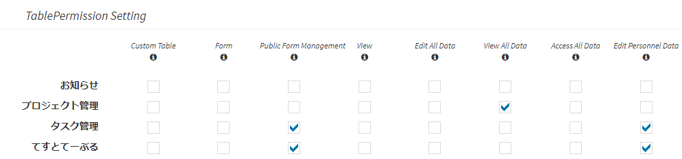
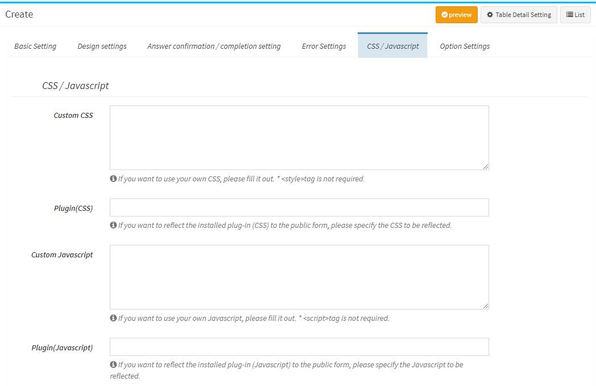
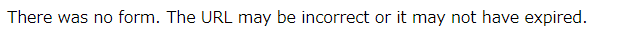
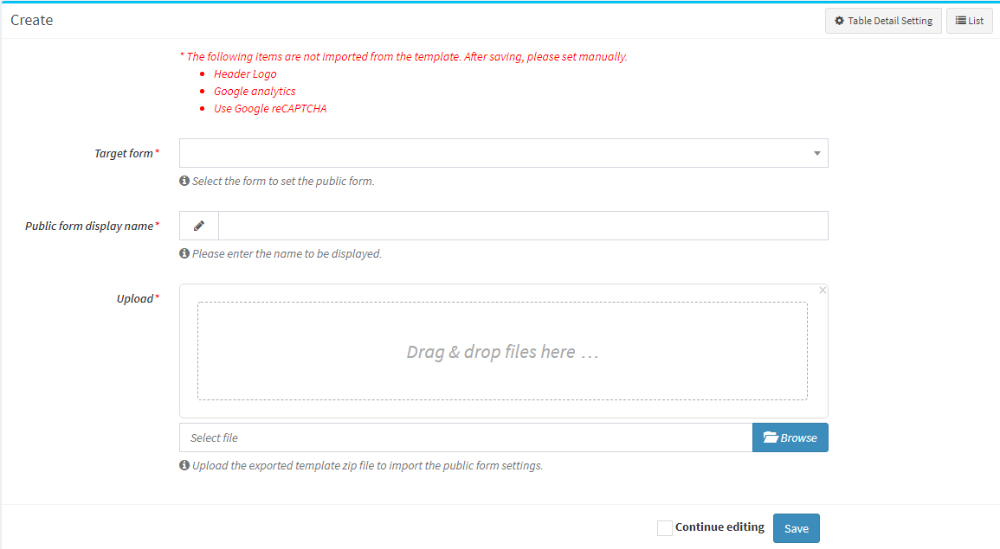

# Configuración del formulario público
En esta página se configura el "formulario público", en el que pueden introducir datos las personas que no han iniciado sesión (usuarios generales).  
Puede crear encuestas, formularios de contacto, formularios de solicitud, etc., y publicarlos ampliamente hacia el exterior compartiendo la URL.

- La [pantalla del formulario de datos](/es/data_form) normal necesita que se preparen antes los usuarios y que estos inicien sesión con su ID y su contraseña.
- En el formulario público, cualquiera puede introducir datos sin iniciar sesión.

## Sobre el comportamiento de la configuración del formulario público

<span class="red bold">En los datos introducidos desde un formulario público, el usuario que registró la configuración del formulario público queda como usuario creador y usuario de actualización.</span>  
Los roles y permisos con los que, en la pantalla de entrada de datos, se obtienen o se buscan las opciones de otras tablas también son los del usuario que registró la configuración del formulario público.  
  
Por eso, evite que el administrador del sistema registre formularios públicos.  
Le recomendamos configurar un usuario y un grupo de roles nuevos con los pasos de "<a href="#/es/publicform?id=role_user">Configurar el usuario y el grupo de roles que hacen la configuración del formulario público</a>", explicados más abajo.   
  
Además, las siguientes tablas quedan fuera de la configuración del formulario público.  
- Las tablas maestras, como "Usuario" u "Organización"
- Las tablas que tienen "Permitir solo un registro" en la configuración de la tabla


## Orden de la configuración
Se configura en el siguiente orden. Para los pasos con detalle, vea "Pasos de configuración", más abajo.

1. Ejecute el comando. (Solo si usa Google reCAPTCHA)
2. En la pantalla de Configuración del sistema, haga que se puedan usar los formularios públicos.
3. En la [Configuración del formulario personalizado](/es/form), configure los elementos, los títulos, etc. que se muestran en el formulario.
4. Registre el usuario y el grupo de roles que hacen la configuración del formulario público.
5. Inicie sesión con ese usuario y haga la configuración del formulario público (diseño, pantalla de confirmación, Google Analytics, etc.).
6. Habilite el formulario público. Se emite la URL.

## Pasos de configuración

### 1. Ejecutar el comando
Hágalo solo si usa Google reCAPTCHA (un mecanismo que evita los envíos hechos por robots) en el formulario público.  
En la carpeta raíz del proyecto, ejecute el comando que corresponde a la versión de Exment que usa.  
※Desde la v7.0.0 se usa "google/recaptcha" como biblioteca de Google reCAPTCHA. En Exment v6.x y anteriores se usa "arcanedev/no-captcha".  

- Para Exment v7.0.0 o posterior

```
composer require google/recaptcha=^1.3.1
```

- Para Exment v6.x o anterior

```
composer require arcanedev/no-captcha=^10.1
```

### 2. Pantalla de Configuración del sistema
- Vaya a "STEP2 Configuración detallada" de la [pantalla de Configuración del sistema](/es/system_setting) y ponga en YES "Usar formularios públicos".  
※De forma predeterminada está en NO. Es así para que usted elija de forma explícita usar los formularios públicos.  


- Si usa Google reCAPTCHA, ponga el elemento "Google reCAPTCHA" en V2 o en V3.  
Al elegirlo, se muestran los elementos de la clave del sitio y la clave secreta. Ponga los valores copiados de la [página de administración de Google reCAPTCHA](http://www.google.com/recaptcha/admin).  
※Después de configurarlo, en la pantalla de configuración de cada formulario público se elige si se usa o no Google reCAPTCHA.  
※El umbral de la puntuación cuando se elige V3 se puede cambiar en los [valores de configuración](/es/config) (valor predeterminado: 0.5).


### 3. Configuración del formulario personalizado
- En la [Configuración del formulario personalizado](/es/form), configure los elementos, los títulos, etc. que se muestran en el formulario. Los pasos son, en lo básico, los mismos que en la configuración normal de un formulario.  
※Esta configuración la puede hacer también alguien que no sea el usuario de la configuración del formulario público, como un administrador.

<h3 id="role_user"><a href="#/es/publicform#role_user" data-id="role_user" class="anchor"><span>4. Configurar el usuario y el grupo de roles que hacen la configuración del formulario público</span></a></h3>
Registre el usuario y el grupo de roles que hacen la configuración del formulario público.  
Los datos enviados desde el formulario público se tratan como registrados y actualizados por este usuario.

- Cree una [configuración de grupo de roles](/es/role_group) nueva.
    - Añada el permiso "Gestión de formularios públicos".
	- Añada el permiso de edición sobre la tabla en la que quiere configurar el formulario público.
    - Añada también el permiso de ver sobre las tablas a las que accede ese formulario público.  

- Ejemplo: si va a configurar el formulario público de la tabla "Consultas" y la tabla Consultas consulta todos los datos de las tablas "Productos" y "Categorías":  
    - Los permisos "Gestión de formularios públicos" y "Editar datos asignados" de la tabla "Consultas"
    - El permiso "Ver todos los datos" de las tablas "Productos" y "Categorías"



- Añada el usuario que gestiona los formularios públicos.
    - Como grupo de roles, elija el grupo de roles creado arriba.

- Inicie sesión con el usuario creado arriba, abra la pantalla de configuración del formulario público y registre el formulario público.


### 5. Configuración del formulario público

- En la lista de tablas personalizadas, marque 1 sola tabla, la que quiere configurar, y haga clic en "Configuración detallada de la tabla", arriba a la derecha.  

> ※ También se abre desde la pantalla de lista de datos o la pantalla de registro de datos de la tabla personalizada. En ese caso, haga clic igualmente en "Configuración detallada de la tabla", arriba a la derecha.  

- En la pantalla de configuración detallada de la tabla que se muestra, haga clic en el icono de configuración de formularios.


- En la parte de abajo de la pantalla de lista de formularios está el cuadro "Configuración del formulario público".  
Haga clic en el botón "+Nuevo", arriba a la derecha de ese cuadro.


- Se abre la pantalla de configuración del formulario público. Configure los elementos necesarios. El contenido de la configuración es el siguiente.

#### Contenido de la configuración - Configuración básica


- ##### Formulario de destino
Elija el formulario que se configura como formulario público. Elija el formulario creado en "Configuración del formulario personalizado", arriba.

- ##### Nombre visible del formulario público
Introduzca el nombre visible que se muestra en la pantalla de lista, etc.

- ##### Periodo de publicación
Si quiere fijar el periodo en que se publica el formulario, introduzca la fecha y hora de inicio y la de fin.  
※También puede introducir solo la "fecha y hora de inicio" o solo la "fecha y hora de fin". Si no introduce ninguna, está siempre activo.  
※Fuera del periodo de publicación, este formulario público no se puede usar.


#### Contenido de la configuración - Configuración del diseño


Aquí se configuran los elementos de diseño: si se usan el encabezado y el pie de página, la imagen del logotipo y los textos, el color de fondo del formulario, etc.  


#### Contenido de la configuración - Configuración de confirmación y finalización de respuestas
Es la configuración de la "pantalla de confirmación de respuestas" y de la "pantalla de finalización", que se muestran cuando el usuario termina de rellenar el formulario. Se decide si se usan, y sus títulos y textos.


- ##### Usar confirmación de respuestas
Si es YES, el usuario pasa por las pantallas en este orden.

```
Pantalla de entrada → Pantalla de confirmación → Pantalla de finalización (registro del dato)
```

※Si es NO, el usuario pasa por las pantallas en este orden.

```
Pantalla de entrada → Pantalla de finalización (registro del dato)
```

- ##### Título de confirmación
Introduzca el texto del título de la pantalla de confirmación de respuestas.

- ##### Texto de confirmación
Introduzca el texto o el HTML que se muestra en la parte de arriba de la pantalla de confirmación.  
※Se pueden usar [parámetros](/es/params). No se pueden ejecutar scripts.


- ##### Título de finalización
Introduzca el texto del título de la pantalla de finalización.

- ##### Texto de finalización
Introduzca el texto o el HTML que se muestra en la parte de arriba de la pantalla de finalización.  
※Se pueden usar [parámetros](/es/params). No se pueden ejecutar scripts.

- ##### URL del enlace de finalización
En la pantalla de finalización se puede mostrar un enlace. Si quiere llevar al usuario a otra pantalla después de la entrada, introduzca la URL de destino.  
※Si no se introduce "Texto del enlace de finalización", la URL introducida se muestra tal cual como texto del enlace.

- ##### Texto del enlace de finalización
En la pantalla de finalización se puede mostrar un enlace. Si quiere llevar al usuario a otra pantalla después de la entrada, introduzca el texto que se muestra en pantalla como enlace.  


#### Notificación de finalización (usuario general)
Al usuario general que introdujo los datos se le puede enviar un correo cuando termina el registro.

- Como es una notificación para usuarios generales que no han iniciado sesión, el único método de notificación es el envío de correo electrónico.
- El único destino es la dirección de correo electrónico que escribió el usuario general.
- Para usar esta función, la tabla personalizada necesita una columna del tipo de columna Correo electrónico.

- ##### Notificar la finalización a los usuarios generales
Al ponerlo en YES, se activa la notificación de finalización. 

- ##### Plantilla de notificación
Elija la plantilla de notificación que se envía al usuario general. Antes tiene que crear una plantilla nueva en la [configuración de plantillas de notificación](/es/mail).  
※En la notificación se pueden usar [variables (parámetros)](/es/params). Con las variables puede añadir al asunto y al cuerpo los datos registrados, el nombre del sistema, los valores introducidos por el usuario, etc.  

- ##### Destinatarios de la notificación
Elija la columna personalizada que contiene la dirección de correo a la que se notifica.  
Ejemplo: si entre los elementos de entrada hay una columna "Dirección de correo de respuesta", al elegir esa columna como destinatario de la notificación, la notificación se envía a esa dirección cuando termina la entrada de datos.  


#### Notificación de finalización (administrador)
Cuando termina la entrada de datos, se puede enviar una notificación al administrador.  
※Aunque dice "administrador", además del administrador también se puede notificar a los usuarios registrados en Exment, a Slack, etc.

- ##### Notificar la finalización al administrador
Al ponerlo en YES, se activa la notificación de finalización. 

- ##### Plantilla de notificación
Elija la plantilla de notificación que se envía al administrador. Antes tiene que crear una plantilla nueva en la [configuración de plantillas de notificación](/es/mail).  
※En la notificación se pueden usar [variables (parámetros)](/es/params). Con las variables puede añadir al asunto y al cuerpo los datos registrados, el nombre del sistema, los valores introducidos por el usuario, etc.  

- ##### Destinatarios de la notificación
Elija los destinatarios de la notificación.  
※Para los elementos de los destinatarios de la notificación y cómo configurarlos, consulte la [Configuración de acciones de notificación](/es/notify).


#### Contenido de la configuración - Configuración de errores
Aquí se controla lo que ocurre cuando se produce un error.


- ##### Título de error
Introduzca el texto del título de la pantalla de error.

- ##### Texto de error
Introduzca el texto o el HTML que se muestra en la parte de arriba de la pantalla de error.  

- ##### URL del enlace de error
En la pantalla de error se puede mostrar un enlace. Si quiere llevar al usuario a otra pantalla cuando se produce un error, introduzca la URL de destino.  
※Si no se introduce "Texto del enlace de error", la URL introducida se muestra tal cual como texto del enlace.

- ##### Texto del enlace de error
En la pantalla de error se puede mostrar un enlace. Si quiere mostrar un enlace a otra pantalla cuando se produce un error, introduzca el texto que se muestra en pantalla.  

#### Notificación de errores
Cuando se produce un error, se puede notificar al administrador.  
※Aunque dice "administrador", además del administrador también se puede notificar a los usuarios registrados en Exment, a Slack, etc.

- ##### Notificar errores
Si es YES, se notifica al administrador cuando se produce un error.

- ##### Plantilla de notificación
Elija la plantilla que se envía al administrador. Antes tiene que crear una plantilla nueva en la [configuración de plantillas de notificación](/es/mail).  
※En la notificación se pueden usar [variables (parámetros)](/es/params). Con las variables puede añadir al asunto y al cuerpo los datos registrados, el nombre del sistema, los valores introducidos por el usuario, el contenido del error, etc.  

- ##### Destinatarios de la notificación
Elija los destinatarios de la notificación.  
※Para los elementos de los destinatarios de la notificación y cómo configurarlos, consulte la [Configuración de acciones de notificación](/es/notify).


#### CSS / Javascript
Se pueden añadir CSS y Javascript propios.



- ##### CSS personalizado
Escriba directamente el CSS que quiere usar.  
※No hace falta la etiqueta &lt;style&gt;. Escriba solo el contenido del css.

- ##### Plugin (CSS)
Si quiere que un plugin (CSS) instalado se aplique también al formulario público, elija el nombre del plugin.

- ##### Javascript personalizado
Escriba directamente el Javascript que quiere usar.  
※No hace falta la etiqueta &lt;script&gt;. Escriba solo el contenido del Javascript.  
※El Javascript se añade dentro del siguiente jquery.

``` javascript
<script data-exec-on-popstate>
    $(function () {
        (código añadido)
    });
</script>
```

- ##### Plugin (Javascript)
Si quiere que un plugin (Javascript) instalado se aplique también al formulario público, elija el nombre del plugin.


#### Contenido de la configuración - Configuración de opciones
Aquí se hacen los demás ajustes opcionales.


- ##### Permitir establecer valores iniciales desde la URL
Si es YES, los valores de la cadena de consulta de la URL se pueden usar como valores iniciales del formulario. Para más detalles, consulte [Establecer valores iniciales desde la URL](/es/publicform?id=Establecer-valores-iniciales-desde-la-URL).

- ##### Google Analytics
Si quiere poner Google Analytics en el formulario, introduzca la etiqueta de Google Analytics, que empieza por "UA-" o por "G-".

- ##### Usar Google reCAPTCHA
Si usa Google reCAPTCHA, póngalo en YES.  
※Solo tiene efecto si se han introducido las claves de Google reCaptcha en la pantalla de Configuración del sistema.


#### Vista previa
- Puede mostrar la vista previa del formulario público con el contenido que está configurando.  
※Se puede ver la vista previa aunque no haya guardado el formulario.

- Al hacer clic en el botón "Vista previa", arriba a la derecha de la pantalla, la vista previa del formulario público se muestra en otra ventana.  
※La otra ventana se abre con javascript. Según la configuración del navegador, la ventana emergente se bloquea. En ese caso, quite el bloqueo y haga clic otra vez en el botón.


#### Habilitar el formulario público
- Para publicar el formulario para los usuarios generales, hay que "habilitarlo". Guarde una vez, abra de nuevo la pantalla de edición y haga clic en el botón "Habilitar", arriba a la derecha de la página.  


- Si el formulario que se publica consulta otras tablas, los usuarios generales podrán leer los datos de esas tablas.  
Se muestra un mensaje de confirmación como el siguiente. Compruebe bien que no hay problema con las tablas a las que se accede.  


- El "acceso a otras tablas" es, sobre todo, lo siguiente.
    - Si el formulario público tiene elementos de los tipos de columna "Selección (desde tabla)", "Usuario", etc., los datos se muestran y se buscan como opciones candidatas.
    - Si el formulario público es de una tabla hija de una relación 1:n, los datos de la tabla principal se muestran y se buscan como opciones.


#### Después de habilitar: se muestran la URL y otros datos
- Al habilitar el formulario público, en la configuración básica se añaden los siguientes elementos.

- ##### URL del formulario público
Se muestra la URL del formulario público. Copie esta URL y compártala con los usuarios generales por correo, en el sitio web de su empresa, etc.  
※Al hacer clic en el elemento, se copia la URL.

- ##### Usuario que ejecutó
Es el usuario que registró el formulario público. Todos los registros y consultas de datos desde este formulario público se hacen con los permisos de este usuario.  
※Aunque otro usuario actualice la configuración del formulario público, el usuario que ejecutó no cambia. Para cambiarlo, inicie sesión con otro usuario y cree una configuración de formulario público nueva.


### 6. Usar el formulario público
- Al abrir la URL copiada arriba, se muestra el formulario público.  


- Si la configuración del formulario público no está "habilitada", si está fuera del periodo de validez o si la URL tiene un error, se muestra el siguiente error.  



### 7. Usar plantillas
Con una plantilla puede crear un formulario público nuevo que hereda los valores de configuración de un formulario público ya creado.
>Los siguientes elementos hay que configurarlos a mano.<br />- Logotipo del encabezado<br />- Google Analytics<br />- Usar Google reCAPTCHA

#### Exportar
Al hacer clic en [Plantilla: Exportar] de la pantalla de configuración del formulario público, el formulario público abierto se exporta como plantilla.


#### Crear desde plantilla
Haga clic en [+Crear desde plantilla], que está en la configuración del formulario público de la pantalla de configuración del formulario personalizado.


##### Formulario de destino
Elija el formulario de destino para crear el formulario público con la plantilla.

##### Nombre visible del formulario público
Introduzca el nombre visible en pantalla del formulario público que se crea.

##### Subir
Elija la plantilla que se usa para crear el formulario público.




## Otros ajustes de detalle

### Establecer valores iniciales desde la URL
- Si pone en YES el ajuste "Permitir establecer valores iniciales desde la URL", puede escribir los valores iniciales de los elementos en la URL del formulario público.  
Cuando ya conoce los valores que corresponden a la persona con la que comparte la URL, como el nombre de la empresa o la categoría, ponerlos de antemano en la URL ahorra trabajo de entrada.

#### Cómo añadirlos
Ponga una cadena de consulta como la siguiente.

```
http://(URL hasta el formulario público)?value.(nombre de la columna personalizada)=(valor inicial)

Para configurar varias columnas, una con & el segundo value y los siguientes.
http://(URL hasta el formulario público)?value.(nombre de la columna personalizada)=(valor inicial)&value.(nombre de la columna personalizada)=(valor inicial)


# Ejemplos
http://localhost/publicform/c4f31330-7a75-11eb-a8b0-279816836d79?value.title=Hola

http://localhost/publicform/c4f31330-7a75-11eb-a8b0-279816836d79?value.client_name=ABC S.A.&value.category=Implantación inicial
```

- Ejemplo: supongamos un formulario como el siguiente  


- Al añadir a la URL de este formulario la siguiente cadena de consulta, los valores iniciales quedan puestos cuando se abre el formulario.

```
http://localhost/publicform/ab3d55e4-1afc-d1de-ac1b-bc64c51d4d7d?value.title=Sobre una consulta&value.body=Este es el cuerpo.
```


#### Si quiere que en las columnas personalizadas "Selección (desde tabla)", "Usuario" y "Organización" el valor inicial solo se pueda poner con el suuid (cadena aleatoria de 20 caracteres)
El valor inicial de las columnas personalizadas "Selección (desde tabla)", "Usuario" y "Organización" (en adelante, solo "Selección (desde tabla)") se indica normalmente con el ID (un número entero correlativo).  
Pero como el ID es correlativo, la persona a la que se publica el formulario puede cambiar el parámetro de la URL y adivinar fácilmente otros valores.  
Si quiere que el valor inicial de estas columnas se indique con el suuid (cadena aleatoria de 20 caracteres) y no con el ID, configúrelo así.  

- En la [lista de valores de configuración de Exment](/es/config), haga el ajuste "En 'Establecer valores iniciales desde la URL' del formulario público, admitir solo el suuid y no el ID".  

``` .env
EXMENT_PUBLICFORM_URLPARAM_SUUID=true
```

- Con este ajuste, el valor inicial de las columnas "Selección (desde tabla)" solo admite el suuid.

- El suuid se puede consultar de las siguientes maneras.
    - Elegir ID del sistema (20 caracteres) en "Seleccionar columnas de la vista" de la vista
    - Exportar los datos

### Cambiar el "publicform" de la URL
- Estos son los pasos para cambiar la cadena "publicform" que va en la URL de los formularios públicos.  
※Esta cadena es la misma para todos los formularios públicos. No se puede cambiar formulario por formulario.

#### Pasos del cambio

- Para cambiarla, haga un [cambio de los valores de configuración](/es/config).

- Abra el archivo ".env" en el directorio raíz de Exment.

- Añada el siguiente valor.

~~~
### Para cambiar "publicform" por otro nombre
EXMENT_PUBLICFORM_ROUTE_PREFIX=afiewqbfwehghwb
# http://localhost/afiewqbfwehghwb/(UUID) pasa a ser la URL del formulario público
~~~

※Tenga en cuenta que en este manual todo está escrito suponiendo "publicform".


### Comportamiento propio del formulario público
Otros comportamientos propios del formulario público.  

- El botón "Buscar" que se muestra en las columnas personalizadas "Selección (desde tabla)", "Usuario", "Organización", etc. no se muestra en el formulario público.  

- Las notificaciones con el disparador "Creación de datos nuevos", que se registran en "Configuración de notificaciones" de la configuración detallada de la tabla, no se envían desde el formulario público.  
Es para no enviarlas por duplicado con las notificaciones "para usuarios generales" y "para administradores", que la configuración del formulario público tiene aparte.