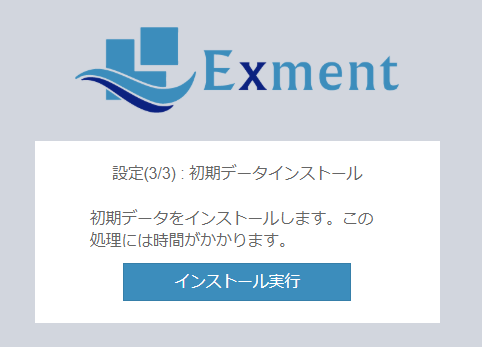

# Pasos de instalación (instalación fácil)
Estos son los pasos para instalar Exment colocando el archivo zip y siguiendo las indicaciones de la pantalla.  

Los pasos son estos 3.

1. Preparar el servidor
2. Descargar el archivo zip y descomprimirlo en el servidor
3. Abrir Exment en el navegador e instalar siguiendo las indicaciones de la pantalla

> ※Si va a hacer la instalación manual o instalar una versión concreta, consulte [Instalación manual](/es/quickstart_manual).

## Notas
- Si hay un error en la instalación, consulte [Solución de problemas](/es/troubleshooting).
- ※No atendemos consultas individuales sobre los pasos de instalación ni sobre el montaje del servidor. Si necesita atención individual, use el soporte de pago.  

## Montaje del servidor
Si todavía no tiene un servidor web o un servidor de base de datos, prepárelos antes.  
Para ver los pasos, consulte [Configuración del servidor](/es/server).

## Configuración de la aplicación Exment
Cuando el servidor esté preparado, coloque la aplicación Exment.

### Descarga y descompresión del zip

- Descargue el archivo zip desde el siguiente enlace.  
<a id="link" href="https://exment.net/downloads/en/exment.zip" target="_blank">[Archivo zip de Exment (última versión)]</a>  
La última versión ahora es **v7.2.4** (publicada el 2026/11/24, PHP 8.2 o superior). El zip de cada versión, su fecha de publicación, su SHA-256 y el PHP compatible están en la [página de descargas](https://exment.net/es/download/) (allí también puede comprobar que el archivo descargado no está dañado).            
  
- Si no tiene más remedio que usar PHP7.4, descárguelo desde el siguiente enlace. Esta versión queda fuera del soporte, las consultas, los issues de Github, etc. Además, puede eliminarse sin previo aviso.  
<a href="https://exment.net/downloads/en/exment_v4_4_2.zip" target="_blank">[Archivo zip de Exment (la última versión que funciona con PHP 7.4: v4.4.2)]</a>

- Descomprima el archivo zip en un lugar donde funcione PHP.  
Ejemplo 1 (XAMPP Windows): C:\xampp\local\exment  
Ejemplo 2 (XAMPP Mac): /Applications/XAMPP/local/exment  
Ejemplo 3 (XServer): $HOME/domain.com.foobar/exment/  
  
- No coloque el archivo zip tal cual directamente debajo de la carpeta pública del servidor (por ejemplo, en linux: /var/www/html). Los archivos de configuración, donde están los ajustes de la base de datos, la contraseña del correo, etc., quedarían visibles desde fuera, y eso causaría una fuga grave de información.  

## Instalación de los datos iniciales
Instale Exment siguiendo las indicaciones de la pantalla.  
※Si pulsa «Restablecer» en cualquier pantalla de configuración, la instalación empieza de nuevo desde la configuración del idioma y la zona horaria.

### Acceso a la pantalla de instalación
Primero, abra la página de Exment en el navegador.  
Ejemplo: http(s)://(URL de su sitio)  

### Configuración del idioma y la zona horaria
Decida el idioma y la zona horaria.  
Si hace falta, cambie los valores iniciales.  
  

### Configuración de la base de datos
Introduzca los ajustes de la base de datos.  
Introduzca los siguientes datos según su entorno.   
※Si no conoce los valores, están escritos en los pasos de cada entorno de [Configuración del servidor](/es/server); compruébelos de nuevo.
~~~
Tipo de base de datos
Nombre de host de la base de datos
Número de puerto de la base de datos
Nombre de la base de datos para Exment
Nombre de usuario de la base de datos para Exment
Contraseña de la base de datos para Exment
~~~  

  
  

### Comprobar los requisitos del sistema
Es la pantalla que comprueba la configuración del servidor necesaria para que Exment funcione.  
Examina los valores de configuración del servidor web y otros, y muestra un aviso o un error si hay ajustes no recomendados o con problemas.  
※Si hay errores, no puede pasar a la pantalla siguiente.  
※Para ver la explicación detallada de esta pantalla, consulte la comprobación de los requisitos del sistema en [Configuración del servidor](/es/server).

  

### Ejecutar la instalación
Pulse «Ejecutar la instalación».  
  

> **Opcional: coste del hash de las contraseñas**  
> Las contraseñas se convierten en hash con bcrypt, y el valor por defecto del coste de cálculo (número de rondas) es 12. Si quiere cambiarlo, añada `BCRYPT_ROUNDS` a ".env". Para ver un ejemplo de configuración, consulte [Instalación manual](/es/quickstart_manual).

### Configuración completada
Cuando termine la instalación, continúe con la [Configuración inicial](/es/first_setting).  

## Otros ajustes adicionales
Con lo hecho hasta aquí ya puede empezar a usar Exment. Sin embargo, para usar algunas funciones hacen falta ajustes adicionales.  
Consulte la siguiente página.  
- [Configuración adicional](/es/quickstart_more)

[←Volver al resumen de la instalación](/es/quickstart)
