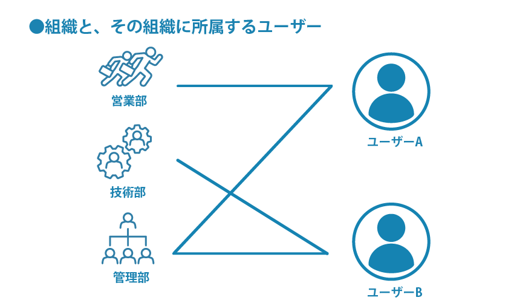
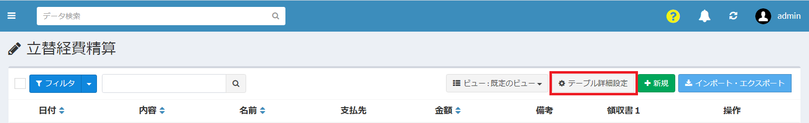

# Configuración de relaciones
Los datos de una tabla y los de otra a veces tienen una conexión (relación).  
Ejemplos:
- Un presupuesto y las líneas de detalle de ese presupuesto  
- Una organización de la empresa y los usuarios que pertenecen a esa organización  

Esta página explica cómo se configura la conexión entre tablas.

- Primero se decide «con qué método se conectan» («El concepto de relación en Exment», más abajo).
- Si solo quiere conocer las operaciones de la pantalla, vea «Cómo usar la configuración de relaciones», más abajo.

## El concepto de relación en Exment
La forma de conectar tablas en Exment es un poco compleja.  
Hay que conocer 2 cosas: «1. Tipos de relación» y «2. Métodos de configuración».  
Antes de configurar en la pantalla, lea lo siguiente.

### 1. Tipos de relación
Normalmente hay estos 2 tipos de conexión entre datos.  
#### Uno a varios
A 1 dato de la tabla padre se conectan, como detalle, varios datos de la tabla hija   

- Ejemplo: un presupuesto y sus líneas de detalle  
En la tabla «Presupuesto» se registran la «fecha del presupuesto», los «datos del cliente» y el «asunto». En «Detalle del presupuesto» se registran, como varias líneas de detalle, el nombre del artículo, la cantidad y el importe de ese presupuesto  

- Ejemplo: un contrato y el responsable principal de ese contrato  
Un usuario puede ser el responsable principal de varios contratos, así que el usuario y el contrato tienen una relación de uno a varios  

#### Varios a varios
A los datos de varias tablas (tablas padre) se conectan varios datos de la tabla hija  

- Ejemplo: una organización y los usuarios que pertenecen a esa organización  
Un usuario puede pertenecer a varias organizaciones (por ejemplo, con cargos simultáneos), así que es una relación de varios a varios  
  

Primero, piense a cuál de los dos tipos de arriba corresponden los datos que quiere conectar.  

### 2. «(1) Configuración de tablas relacionadas» y «(2) Selección (desde tabla) de una columna personalizada»
En Exment hay 2 métodos para conectar datos: «(1) Tablas relacionadas» y «(2) Selección (desde tabla)».  

##### (1) Configuración de tablas relacionadas
Es el método que se explica en esta página.
Se registra desde la página «Tabla personalizada», pulsando el botón [Configuración de relaciones].    

##### (2) Selección (desde tabla) de una columna personalizada
Es el método que se configura en la pantalla de [columnas personalizadas](/es/column).  
Uno de los tipos de columna de las columnas personalizadas es «Selección (desde tabla)». Se crea una columna de este tipo.  

Con este ajuste, en la [pantalla del formulario de datos](/es/data_form) se pueden elegir valores de otra tabla.  
Ejemplo (los clientes son datos de prueba):

>El texto que aparece en la lista como opción se puede cambiar en la configuración de columnas de encabezado ([Configuración de tablas](/es/table)).

### Decidir el método de configuración de la relación
Es fácil dudar entre (1) y (2).
Decídalo con los siguientes criterios.

| Tipo de relación | Cuándo | Método que se usa |
|---|---|---|
| Uno a varios | El padre y el hijo van siempre juntos. Al eliminar el padre, lo correcto es eliminar también los hijos (ejemplo: presupuesto y detalle del presupuesto) | (1) Configuración de relaciones |
| Uno a varios | No siempre van juntos. Aunque se elimine el dato referenciado, es un problema eliminar también los datos que lo referencian (ejemplo: presupuesto y responsable principal) | (2) Selección (desde tabla) de una columna personalizada |
| Varios a varios | Básicamente este | (1) Configuración de relaciones |

#### 1. Cuando el tipo de relación es «Uno a varios»
Decídalo con estos 2 criterios.
1. **Si los datos padre y los datos hijo van siempre juntos y están muy unidos**  
Por ejemplo, en las tablas «Presupuesto» y «Detalle del presupuesto», los datos del detalle del presupuesto siempre tienen un dato de presupuesto, y van juntos.  
En estos casos, conéctelos con «(1) Configuración de relaciones».  
En cambio, la tabla «Presupuesto» y el «responsable principal» de ese presupuesto están conectados como referencia de datos, pero no van siempre juntos.  
En estos casos, conéctelos con «(2) Selección (desde tabla) de una columna personalizada».  

2. **Si, al eliminar el dato padre, siempre es correcto eliminar los datos hijo**  
Por ejemplo, en las tablas «Presupuesto» y «Detalle del presupuesto», al eliminar el dato padre «Presupuesto», lo correcto es eliminar también todos los datos hijo «Detalle del presupuesto».  
En estos casos, conéctelos con «(1) Configuración de relaciones».  

En cambio, en la tabla «Presupuesto» y el «responsable principal» de ese presupuesto, es un problema eliminar todos los datos de «Presupuesto» en los que una persona es responsable principal solo porque se ha eliminado el dato de ese «responsable principal».  
En estos casos, conéctelos con «(2) Selección (desde tabla) de una columna personalizada».  

#### 2. Cuando el tipo de relación es «Varios a varios»
Básicamente, conéctelos con «(1) Configuración de relaciones».  
También se puede resolver con «Permitir selección múltiple» en «(2) Selección (desde tabla) de una columna personalizada», pero tiene inconvenientes, como que es débil en la búsqueda de datos.  

   
Con esto queda decidido con qué método se conectan las tablas.  
Lo siguiente son los pasos para hacer la «(1) Configuración de tablas relacionadas».  

## Cómo usar la configuración de relaciones

### Mostrar la página
- En la lista de tablas personalizadas, marque solo 1 tabla, la que quiere configurar, y pulse «Configuración detallada de la tabla», arriba a la derecha.  

- O elija en el menú la tabla que quiere configurar y, de la misma forma, pulse «Configuración detallada de la tabla», arriba a la derecha.  
※Antes hace falta el ajuste para mostrar esa tabla en el menú.  

- En la pantalla de configuración detallada de la tabla que aparece, pulse el icono de la configuración de relaciones.

- Con esto aparece la lista de la configuración de relaciones de esa tabla personalizada.  

### Añadir
- En la pantalla «Configuración de relaciones», pulse el botón [Nuevo], arriba a la derecha de la página.

- Elija la tabla hija que se conecta y el tipo de relación, y pulse «Enviar».
  

### Editar
Si quiere editar una relación, haga clic en el enlace [Editar] de la fila correspondiente.  
  

### Eliminar
Si quiere eliminar una relación, haga clic en el enlace [Eliminar] de la fila correspondiente.  

