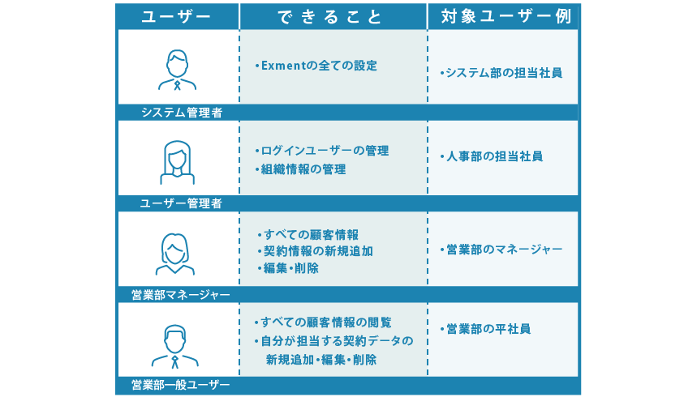

# Grupos de roles y configuración de permisos

El "Grupo de roles" es el mecanismo que decide quién puede hacer qué (los permisos).  
En esta página se explica cómo crear un grupo de roles, decidir sus permisos y poner en él usuarios y organizaciones.

- Con los grupos de roles puede hacer que solo los usuarios indicados trabajen con ciertos datos o páginas.
- Un usuario recién añadido, tal cual, casi no puede usar ninguna función aunque inicie sesión. El administrador del sistema debe asignarle el grupo de roles que le corresponda.

> Antes de configurar los grupos de roles, le recomendamos leer la página [Resumen de roles y permisos en Exment](/es/permission).

## Esquema de los grupos de roles
Puede decidir lo que cada usuario puede hacer según su departamento o su cargo.  
Por ejemplo, como en la figura de abajo, los permisos se reparten por departamento o por cargo.

## Lista de los grupos de roles iniciales
Aquí se explican los grupos de roles que vienen desde la instalación.

### Grupo de administración de todos los datos
Es el grupo de roles que puede editar y ver los datos de todas las tablas registradas por los usuarios.

### Grupo de administración de usuarios y organizaciones
Es el grupo de roles que gestiona la información de usuarios y organizaciones, y la configuración de los usuarios con acceso.  
También puede cambiar los usuarios y las organizaciones que pertenecen a los grupos de roles.

### Grupo de administración de avisos
Es el grupo de roles que puede crear, editar y eliminar datos en "Avisos", que viene instalado al principio en Exment.  

### Grupo de usuarios
Es el grupo para los usuarios que no entran en ninguno de los anteriores.  
※En la instalación inicial no tiene ningún permiso configurado.

## Estructura de datos del grupo de roles
Un grupo de roles está formado por 2 partes: "(1) Configuración de permisos" y "(2) Usuarios y organizaciones".

### (1) Configuración de permisos
Un permiso decide si en Exment se puede hacer o no una operación.  
Por ejemplo, hay permisos como los siguientes.
##### Gestión de los usuarios con acceso   
Permiso para dar a cada usuario el permiso de inicio de sesión y para restablecer contraseñas
##### Edición de todos los datos  
Permiso para añadir, editar y eliminar todos los datos de una tabla concreta
##### Ver los datos asignados
Permiso para ver los datos de los que uno mismo es el responsable
La configuración de permisos es propia de cada grupo de roles.

### (2) Usuarios y organizaciones
Aquí se configuran los usuarios y las organizaciones que pertenecen al grupo de roles.  
Los usuarios puestos aquí, al iniciar sesión, pueden hacer las operaciones de los permisos de ese grupo de roles.

## Cómo configurarlo

### Flujo general de la configuración
1. Cree el grupo de roles (nombre del grupo de roles, etc.).
1. Decida lo que se puede hacer con ese grupo de roles (los permisos).
1. Ponga los usuarios y las organizaciones que pertenecen a ese grupo de roles.

※La configuración del administrador del sistema se hace en la [página de Configuración del sistema](/es/system_setting).

### Lista
Haga clic en "Grupo de roles" del menú.  
Se muestra la pantalla de lista con los grupos de roles ya creados.  

### Crear un grupo de roles nuevo
1. Haga clic en el botón [Nuevo], arriba a la derecha de la pantalla de lista.

2. Se muestra la pantalla para crear un grupo de roles. Introduzca los datos necesarios y haga clic en [Enviar].  

3. Al guardar, vuelve a la pantalla de lista y se muestra el grupo de roles creado.

### Cómo cambiar la configuración de permisos
1. En la pantalla de lista de grupos de roles, haga clic en la fila del grupo de roles creado.  
O bien haga clic en el enlace [Configuración de permisos].

2. Se muestra la pantalla de configuración de permisos. Configure los permisos. Para los tipos de permisos, vea "Tipos de permisos y lista", más abajo.

### Tipos de permisos y lista
Los permisos que se pueden configurar son de los siguientes tipos.

| Tipo | Lo que se decide |
|---|---|
| Todo el sistema | Las operaciones de todo Exment |
| Grupo de roles | Las operaciones sobre los grupos de roles |
| Configuración de permisos de plugins | Cambiar la configuración de los plugins y usarlos |
| Configuración de permisos de maestros | Las operaciones sobre las tablas que gestionan datos maestros |
| Permisos de tabla | Las operaciones de cada tabla |

#### Todo el sistema
Son los permisos que deciden las operaciones de todo Exment.  

##### Lista de permisos
- ##### Tabla personalizada  
Puede añadir tablas personalizadas y cambiar o eliminar todas las tablas personalizadas. Además, puede añadir, cambiar y eliminar todos los datos de las tablas personalizadas.
- ##### Todos los datos  
Puede añadir, cambiar y eliminar todos los datos de las tablas personalizadas.
- ##### Configuración de inicio de sesión de usuarios  
Puede gestionar los usuarios que inician sesión en Exment. Puede dar el permiso de inicio de sesión, restablecer contraseñas, etc.
- ##### Configuración del flujo de trabajo  
Puede cambiar la configuración de los flujos de trabajo.
- ##### Gestionar aplicaciones de API  
Puede añadir, cambiar y eliminar todas las aplicaciones de API.
- ##### Aplicación de API  
Puede añadir, cambiar y eliminar solo las aplicaciones de API creadas por uno mismo. ※No puede ver, añadir, cambiar ni eliminar las aplicaciones de API creadas por otros usuarios.
- ##### Gestionar plugins
Puede añadir, cambiar y eliminar todos los plugins. Además, puede usar los plugins.

#### Grupo de roles
Son los permisos que deciden las operaciones sobre los grupos de roles.  

##### Lista de permisos
- ##### Gestionar todos los grupos de roles  
Puede cambiar toda la configuración de los grupos de roles. Puede añadir, cambiar y eliminar grupos, cambiar la configuración de permisos de un grupo y cambiar la configuración de usuarios y organizaciones.
- ##### Cambiar la configuración de permisos  
Puede cambiar la configuración de permisos de los grupos de roles.
- ##### Gestión de usuarios/organizaciones  
Puede cambiar la configuración de los usuarios y las organizaciones registrados en los grupos de roles.

#### Configuración de permisos de plugins
Aquí se pueden asignar los permisos de acceso a los plugins de Exment.  
  
##### Lista de permisos
- ##### Gestionar configuración
En los plugins que tienen configuración, puede cambiar la configuración de ese plugin.  
※No puede eliminar ni subir plugins. Para eliminar, añada "Gestionar plugins".

- ##### Acceso
Puede usar de verdad el plugin y acceder a sus páginas. Lo que se controla cambia según el tipo de plugin.

- **Botón, salida de documentos** ： Se controla si se muestran o no los botones en la pantalla.
- **Página, panel** ： Cambia si se puede o no acceder a la página.
- **API** ： Cambia si se puede o no ejecutar la API. (Si no hay acceso, se produce un error 403.)
- **Importación, exportación** ： Se controla si se puede o no ejecutar la importación y la exportación de datos.
- **Otros** : No se pueden controlar con los grupos de roles. Se ejecutan para todos los usuarios.
    

#### Configuración de permisos de maestros
Aquí se pueden asignar los permisos de las tablas que gestionan los datos maestros de Exment.  
  
##### Lista de permisos
- ##### Gestión de maestros  
Puede cambiar la definición del maestro. Además, puede añadir, editar y eliminar datos maestros.
- ##### Vista del sistema  
Puede gestionar las vistas del sistema de la tabla personalizada indicada.  
- ##### Editar datos  
Puede añadir, editar y eliminar datos maestros.
- ##### Ver datos  
Puede ver los datos maestros. ※No puede editar ni eliminar los datos.

#### Permisos de tabla
En Exment se pueden crear tablas para gestionar datos.  
Los permisos se pueden asignar tabla por tabla.  
Por ejemplo, se usan así.  
- Los usuarios del Departamento de Ventas pueden editar y ver todos los datos de la tabla "Actividades de ventas".
- Los usuarios del Departamento Técnico pueden editar y ver todos los datos de la tabla "Gestión técnica".
- Los usuarios de una empresa asociada solo pueden ver, en la tabla "Solicitudes de pedido", los datos sobre los que tienen permiso.  
  
##### Lista de permisos
- ##### Tabla personalizada  
En la tabla personalizada indicada, permite corregir la definición de la tabla, los formularios, etc.  
Además, es el permiso que permite añadir, editar y eliminar todos los datos de la tabla personalizada indicada.
- ##### Formulario  
En la tabla personalizada indicada, permite añadir, editar y eliminar formularios.  
- ##### Gestión de formularios públicos  
En la tabla personalizada indicada, permite añadir, editar y eliminar la configuración de formularios públicos.  
※Solo se muestra cuando "Usar formularios públicos" está en YES en la Configuración del sistema.  
※No permite añadir, editar ni eliminar el formulario en sí.  
- ##### Vista del sistema  
Puede gestionar las vistas del sistema de la tabla personalizada indicada.  
- ##### Editar todos los datos  
Es el permiso que permite añadir, editar y eliminar todos los datos de la tabla personalizada indicada.
- ##### Ver todos los datos  
Es el permiso que permite ver todos los datos de la tabla personalizada indicada.  
※No puede editar ni eliminar los datos.
- ##### Editar datos asignados  
Es el permiso que permite añadir, editar y eliminar, en la tabla personalizada indicada, los datos en los que el propio usuario con acceso figura como responsable.  
- ##### Ver datos asignados  
Es el permiso que permite ver, en la tabla personalizada indicada, los datos en los que el propio usuario con acceso figura como responsable.  
※No puede editar ni eliminar los datos.
- ##### Compartir datos  
Es el permiso que permite compartir con otros usuarios u organizaciones los datos sobre los que uno tiene permiso de edición.  
- ##### Importar  
Puede importar datos a la tabla personalizada indicada desde un archivo en formato csv o Excel.  
- ##### Exportar  
Puede exportar los datos de la tabla personalizada indicada a un archivo en formato csv o Excel.  
- ##### Mostrar datos eliminados  
Puede volver a mostrar los datos eliminados de forma lógica. ※Para restaurar un dato hace falta el permiso de edición sobre ese dato.  

### Cómo configurar los usuarios y las organizaciones
Cómo cambiar los usuarios y las organizaciones que pertenecen a un grupo de roles.

- En la pantalla de lista, haga clic en el enlace de usuarios.
  
O bien haga clic en el botón [Configuración de usuarios/organizaciones], arriba a la derecha de la pantalla de configuración de permisos.  
  

- Se muestra la pantalla de configuración de usuarios y organizaciones. Registre los usuarios y las organizaciones que pertenecen a este grupo de roles.  

### Eliminar
- En la pantalla de lista de grupos de roles, haga clic en el enlace [Eliminar].

### Otros

#### Cuando se añaden varios grupos de roles
Si a 1 usuario o a 1 organización se le ponen varios grupos de roles, sus permisos son la suma de todos los permisos de cada grupo de roles.

- Ejemplo: Usuario A
    - Grupo de roles X
        - Tabla 1
            - Editar datos asignados
        - Tabla 2
            - Ver datos asignados
        - Tabla 3
            - Ver todos los datos
        
    - Grupo de roles Y
        - Tabla 1
            - Ver todos los datos
        - Tabla 4
            - Editar datos asignados

    - →Permisos finales del Usuario A
        - Tabla 1
            - Ver todos los datos
            - Editar datos asignados
        - Tabla 2
            - Ver datos asignados
        - Tabla 3
            - Ver todos los datos
        - Tabla 4
            - Editar datos asignados
