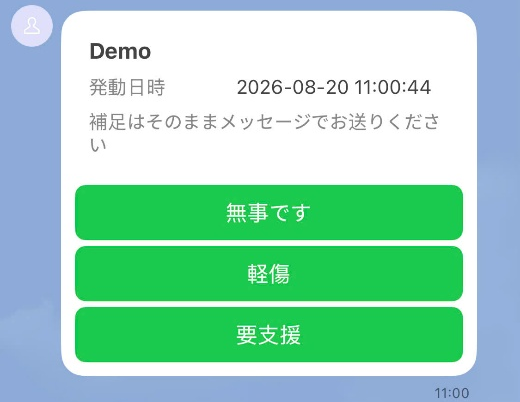
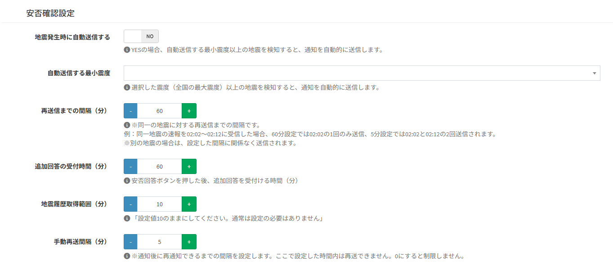
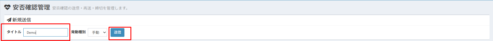
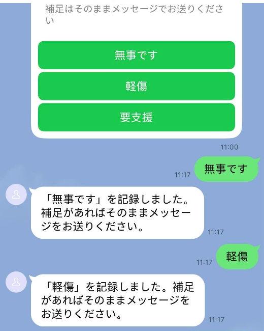
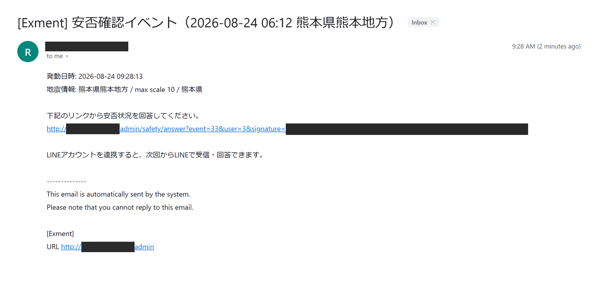
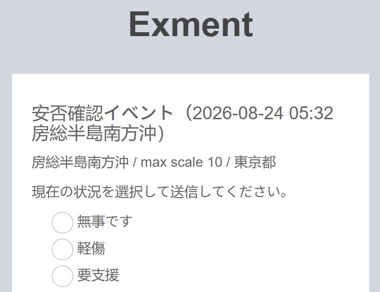
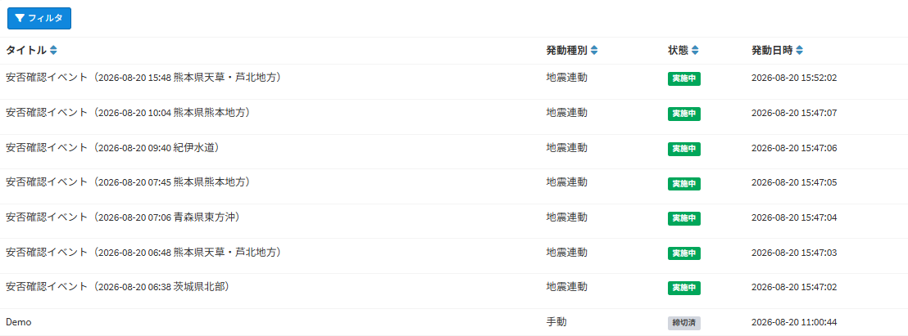
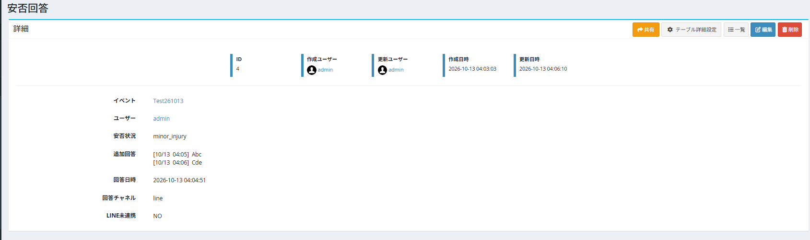
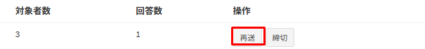
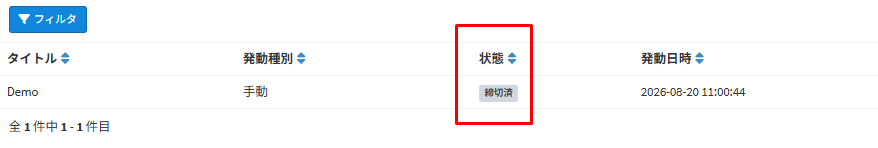

# Comprobación de seguridad del personal
Es una función para preguntar a los empleados, por LINE y por correo, si están a salvo en una emergencia como un terremoto o un tifón.  
El administrador puede enviarla desde la pantalla. También se puede enviar automáticamente cuando se produce un terremoto de la intensidad sísmica configurada o superior.  
El estado de las respuestas se consulta en la pantalla de gestión de la comprobación de seguridad y en la tabla de respuestas.  
Nota: la comprobación de seguridad se puede usar desde v7.0.0.

El proceso hasta usarla es el siguiente.

1. Haga la [preparación previa](/es/safety_check?id=Preparación-previa) (LINE, correo y programación de tareas).
2. Haga la [configuración de la confirmación de seguridad](/es/safety_check?id=Configuración-de-la-confirmación-de-seguridad) (si se envía automáticamente con un terremoto, etc.).
3. [Envíe la comprobación de seguridad](/es/safety_check?id=Enviar-una-comprobación-de-seguridad).
4. Los empleados [responden](/es/safety_check?id=Responder).
5. [Consulte el estado de las respuestas](/es/safety_check?id=Consultar-el-estado-de-las-respuestas) y, si hace falta, haga el [reenvío o el cierre](/es/safety_check?id=Reenvío-y-cierre).

## Cómo funciona la comprobación de seguridad
- Cada vez que se envía una comprobación de seguridad, se crea 1 dato de "Eventos de comprobación de seguridad".
- Al mismo tiempo, para todos los usuarios se crea un dato de "Respuestas de comprobación de seguridad" con el estado de la respuesta "not_answered" (sin responder).
- A cada usuario se le envía de las formas siguientes. Los usuarios que reciben tanto LINE como correo pueden responder desde cualquiera de los dos.

| Forma de envío | A quién se envía | Forma de responder |
| --- | --- | --- |
| LINE | Usuarios que han [vinculado su cuenta de LINE](/es/line) | Botones "Estoy bien", "Herida leve" y "Necesito ayuda" de la tarjeta |
| Correo | Usuarios que tienen registrada una dirección de correo electrónico (incluidos los que han vinculado su cuenta de LINE) | Pantalla de respuesta que se abre desde el enlace del correo (sin iniciar sesión) |

Nota: no se envía a los usuarios que no han vinculado su cuenta de LINE y tampoco tienen registrada una dirección de correo electrónico.

### Tipo de activación
La comprobación de seguridad tiene los tipos de activación siguientes.

| Tipo de activación | Contenido |
| --- | --- |
| Manual | El administrador la envía desde la pantalla de gestión de la comprobación de seguridad. Se puede usar en emergencias de todo tipo, como terremotos, tifones o incendios. |
| Simulacro | Se envía de la misma forma que la manual. Al principio del título del mensaje enviado se añade "[Simulacro]". |
| Automático (JMA) | Se envía automáticamente cuando se produce un terremoto de la intensidad sísmica configurada o superior. |

## Preparación previa
La preparación necesaria cambia según el uso.

| Uso | Preparación necesaria |
| --- | --- |
| **Para enviar por LINE** | Haga la configuración de la [integración con LINE](/es/line) (preparar la cuenta oficial de LINE, "Configuración de LINE" de la configuración del sistema y configuración del Webhook) y pida a cada usuario que vincule su cuenta de LINE. |
| **Para enviar por correo** | Haga la [configuración del envío de correo](/es/mailsend_setting). Consulte también [Configuración del correo](/es/safety_check?id=Configuración-del-correo). |
| **Para enviar automáticamente cuando se produce un terremoto** | Hace falta configurar la [programación de tareas](/es/additional_task_schedule). Además, el servidor de Exment debe poder acceder a la API de la que se obtiene la información de terremotos (https://api.p2pquake.net). |

Nota: la pantalla de gestión de la comprobación de seguridad solo la pueden usar los usuarios con permiso de administrador del sistema.

## Instalación
Las tablas y los menús que usa la comprobación de seguridad se crean automáticamente al instalar o actualizar Exment.  
En un entorno existente, ejecute "php artisan exment:update" siguiendo los pasos de [Actualización](/es/update).

Se crea lo siguiente.

| Tipo | Nombre | Contenido |
| --- | --- | --- |
| Tabla | Eventos de comprobación de seguridad | Se crea 1 dato cada vez que se envía una comprobación de seguridad. |
| Tabla | Respuestas de comprobación de seguridad | Se crea 1 dato por cada comprobación de seguridad y por cada usuario. |
| Menú | Comprobación de seguridad del personal | Es la pantalla para enviar, reenviar y cerrar las comprobaciones de seguridad. |
| Plantilla de notificación | Correo de comprobación de seguridad | Es la plantilla del correo de la comprobación de seguridad. |
| Plantilla Flex de LINE | Comprobación de seguridad | La clave Flex es "safety_check". El contenido de la tarjeta de LINE de la comprobación de seguridad es fijo, así que la tarjeta no cambia aunque se edite esta plantilla. No la elija en la configuración de notificaciones, ni la edite ni la elimine. |

Nota: si no se crean, ejecute "php artisan exment:patchdata line_safety_check".

## Configuración de la confirmación de seguridad
1. Pulse "Configuración de administración" → "Configuración del sistema" en el menú de la izquierda y cambie a [Configuración detallada] con el botón de arriba a la derecha.
2. En "Configuración de la confirmación de seguridad" (debajo de "Configuración de LINE"), configure los campos siguientes y pulse [Guardar].

| Campo | Contenido |
| --- | --- |
| Enviar automáticamente al producirse un terremoto | Si es SÍ, cuando se produce un terremoto igual o superior a la "Intensidad sísmica mínima para el envío automático", la comprobación de seguridad se envía automáticamente. Si es NO, solo se puede enviar desde la pantalla de gestión de la comprobación de seguridad. Valor inicial: NO |
| Intensidad sísmica mínima para el envío automático | Elija la intensidad sísmica que sirve de referencia para el envío automático entre Shindo 4, Shindo 5 inferior, Shindo 5 superior, Shindo 6 inferior, Shindo 6 superior y Shindo 7. Se decide con la intensidad máxima de todo el país de la información del terremoto. No se puede limitar por regiones. Valor inicial: Shindo 5 inferior |
| Intervalo de reenvío (minutos) | Es el tiempo (minutos) durante el que no se vuelve a enviar automáticamente por el mismo terremoto. De un mismo terremoto se publican varias informaciones: avance, detalle, corrección, etc. Después de enviar por un terremoto, no se envía con las informaciones que llegan dentro de este tiempo. Si es otro terremoto, se envía sin tener en cuenta este tiempo. Valor inicial: 60 |
| Plazo para respuestas adicionales (minutos) | Es el tiempo (minutos) durante el que los mensajes enviados a continuación de pulsar un botón de respuesta en LINE se anotan como "respuesta adicional". Cada vez que se envía una respuesta adicional, el plazo se prolonga. Valor inicial: 60 |
| Rango del historial de terremotos (minutos) | No se envía automáticamente con informaciones de terremotos publicadas hace más de este tiempo (minutos). Evita que, justo después de activar la función o después de que la programación de tareas haya estado parada, se envíe de golpe por terremotos pasados. Normalmente, déjelo en "10" sin cambiarlo. Valor inicial: 10 |
| Intervalo de reenvío manual (minutos) | Es el tiempo (minutos) que debe pasar después de ejecutar [Reenviar] hasta que se puede ejecutar el siguiente [Reenviar]. Si es 0, no hay límite. Valor inicial: 5 |

Nota: en los campos numéricos que no sean "Intervalo de reenvío manual (minutos)", si se guarda 0 o se deja en blanco, se usa el valor inicial.

## Configuración del correo

### Enlace de respuesta
El correo de la comprobación de seguridad lleva un enlace para abrir la pantalla de respuesta (enlace de respuesta). Tenga en cuenta los 2 puntos siguientes.

- **Que sea una URL que los empleados puedan abrir**: el enlace de respuesta se crea a partir de la URL de Exment.
    - En el envío automático por terremoto se usa "APP_URL" del archivo ".env". En "APP_URL", configure una URL a la que los empleados puedan acceder también desde fuera de la empresa.
    - Al enviar desde la pantalla, abra también Exment con una URL a la que los empleados puedan acceder y envíe desde ahí.
- **Si se cambia "APP_KEY", los enlaces ya enviados dejan de ser válidos**: el enlace de respuesta lleva una firma hecha con "APP_KEY" del archivo ".env". Si cambia "APP_KEY" después de enviar el correo, envíe un enlace nuevo con [Reenviar].

### Plantilla del correo
El asunto y el cuerpo del correo se pueden cambiar en "Correo de comprobación de seguridad" de las [plantillas de notificación](/es/mail). Los valores iniciales son los siguientes.

~~~
Asunto:
[${system:site_name}] ${safety_title}

Cuerpo:
${safety_body}

Indique su estado de seguridad desde el siguiente enlace.
${answer_url}

Si vincula su cuenta de LINE, la próxima vez podrá recibir y responder a través de LINE.
~~~

| Variable | Contenido |
| --- | --- |
| ${safety_title} | Es el título de la comprobación de seguridad. En un simulacro, lleva "[Simulacro]" al principio. |
| ${safety_body} | Es la fecha y hora de activación y la información del terremoto (en el tipo automático). |
| ${answer_url} | Es el enlace de respuesta. |

Nota: si se elimina "${answer_url}" del cuerpo, no se puede responder desde el correo. Déjelo siempre.

## Enviar una comprobación de seguridad

### Abrir la pantalla
Pulse "Configuración de administración" → "Comprobación de seguridad del personal" en el menú de la izquierda (en v7.0 está en lo más alto del menú de la izquierda). También se puede abrir con la URL siguiente.

~~~
http(s)://(URL de Exment)/safety_check
~~~

> Nota: la URL corresponde a la configuración estándar sin "/admin" (sitios instalados por primera vez con v7.2.1 o posterior). Si `ADMIN_ROUTE_PREFIX` de `.env` tiene un valor (en los sitios instalados con versiones anteriores es "admin"), añada ese valor después de la URL del sitio (ejemplo: `http(s)://(URL de Exment)/admin/safety_check`). Para más detalles, consulte [Cambiar o eliminar el "admin" incluido en la URL](/es/additional_prefix).

### Enviar de forma manual o como simulacro
1. En "Título" de "Nuevo envío", escriba el título de la comprobación de seguridad (ejemplo: Tifón n.º 15 - comprobación de seguridad).
2. En "Tipo de activación", elija "Manual" o "Simulacro".
3. Pulse [Enviar]. Aparece "Se ha iniciado el envío de la comprobación de seguridad." y en la lista se añade una comprobación de seguridad "En curso".
4. El envío se hace después de mostrarse la pantalla. Cuando el envío termina, se actualizan "Número de envíos" y "Número de destinatarios" de la lista. Vuelva a cargar la pantalla para comprobarlo.

- **El "Simulacro" también se envía a todos los usuarios**. También cuenta en el número de mensajes de LINE.
- **No pulse [Enviar] varias veces**. Hasta que termina el envío anterior hecho por el mismo usuario (10 minutos como máximo), no se puede enviar una nueva comprobación de seguridad. Si aparece "Ya hay un envío en curso. Espere un momento y actualice la página.", se está procesando el envío anterior. Espere un momento y actualice la pantalla.
- Si hay muchos usuarios, el envío puede tardar en terminar.

**Si usa la ejecución diferida de las notificaciones (cola)**

- El proceso de envío en sí se ejecuta sin usar el trabajador de la cola.
- Si ha configurado la [ejecución diferida de las notificaciones](/es/additional_queue), la entrega por LINE y por correo se ejecuta en la cola, así que el trabajador de la cola debe estar en marcha.
- Si se ejecuta en la cola, los mensajes cuyo envío falla se reenvían automáticamente (se intenta 3 veces como máximo, contando el primer envío). En LINE solo se reenvía cuando falla por saturación del servidor de LINE (HTTP 429) o por error del servidor (HTTP 5xx).

### Enviar automáticamente al producirse un terremoto
Si "Enviar automáticamente al producirse un terremoto" de la "Configuración de la confirmación de seguridad" está en SÍ, Exment obtiene cada minuto la información de terremotos de la Agencia Meteorológica de Japón desde la API de P2P Earthquake Information.  
Cuando hay una información de terremoto que cumple todas las condiciones siguientes, se envía automáticamente una comprobación de seguridad con el tipo de activación "Automático (JMA)".

- La intensidad máxima de todo el país es igual o superior a la "Intensidad sísmica mínima para el envío automático"
- No ha pasado el "Rango del historial de terremotos (minutos)" desde la publicación de la información del terremoto
- No se ha enviado por el mismo terremoto dentro del "Intervalo de reenvío (minutos)"

- El título de la comprobación de seguridad enviada automáticamente es "Eventos de comprobación de seguridad ((fecha y hora del terremoto) (hipocentro))".
- Si se envía con una información anterior a la determinación del hipocentro (avance de intensidad sísmica), el hipocentro aparece como "Hipocentro en investigación". Cuando una información posterior determina el hipocentro, el título se actualiza (no se reenvía).

Nota: para el envío automático hace falta configurar la [programación de tareas](/es/additional_task_schedule). La programación de tareas ejecuta cada minuto el comando "exment:safetywatch".

## Responder
Son los pasos con los que responde el usuario. Úselos para informar a los empleados.

### Responder por LINE
Los usuarios que han vinculado su cuenta de LINE reciben una tarjeta con los botones "Estoy bien", "Herida leve" y "Necesito ayuda".

- **Responder**: pulse uno de los botones. Llega una respuesta como "Se ha registrado «Estoy bien». Si tiene detalles adicionales, envíelos como mensaje."
- **Cambiar la respuesta**: pulse otra vez otro botón. Se anota el contenido del último botón pulsado.
- **Añadir detalles de la situación**: después de pulsar el botón, envíe a continuación un mensaje. Llega la respuesta "Se ha añadido la respuesta adicional." y el mensaje se anota como "respuesta adicional".

Nota: envíe la respuesta adicional dentro del "Plazo para respuestas adicionales (minutos)" (60 minutos con la configuración inicial) desde que pulsó el botón o desde que envió la respuesta adicional anterior. Si ha pasado el plazo, pulse otra vez el botón y después envíela.

### Responder por correo
Los usuarios que tienen registrada una dirección de correo electrónico reciben un correo con el enlace de respuesta.

1. Pulse el enlace del correo. La pantalla de respuesta se abre sin iniciar sesión.
2. Elija la situación actual ("Estoy bien", "Herida leve" o "Necesito ayuda"), escriba "Respuesta adicional (opcional)" si hace falta y pulse [Enviar].

3. Si aparece "Su respuesta se ha registrado", la respuesta ha terminado.

- Si vuelve a abrir el mismo enlace, aparece la respuesta actual. La respuesta se puede cambiar hasta que se cierra la comprobación de seguridad.
- El enlace de respuesta no tiene fecha de caducidad. Cuando se cierra la comprobación de seguridad, ya no se puede responder.
- **No reenvíe el correo de la comprobación de seguridad a otras personas**. Quien conozca el enlace puede responder como ese usuario.
- Aunque esté hecha la [configuración del filtro de IP](/es/additional_ip_filter), la pantalla de respuesta se puede abrir desde fuera de la empresa.

En la pantalla de respuesta pueden aparecer los mensajes siguientes.

| Mensaje | Contenido |
| --- | --- |
| Esta comprobación de seguridad se ha cerrado. | La comprobación de seguridad está cerrada, así que no se puede responder. |
| Este enlace no es válido. Póngase en contacto con su administrador. | El enlace no es correcto. Aparece cuando falta una parte del enlace o cuando "APP_KEY" se ha cambiado después de enviar el correo. |

## Consultar el estado de las respuestas

### Pantalla de gestión de la comprobación de seguridad
En la lista de la pantalla de gestión de la comprobación de seguridad se puede consultar la situación de cada comprobación de seguridad.

| Columna | Contenido |
| --- | --- |
| Título | Es el título de la comprobación de seguridad. |
| Tipo de activación | Es "Manual", "Simulacro" o "Automático (JMA)". |
| Estado | Es "En curso" o "Cerrado". |
| Fecha de activación | Es la fecha y hora en que se envió la comprobación de seguridad. |
| Número de envíos | Es el número de usuarios a los que, en el primer envío, se envió al menos LINE o correo. No cambia con [Reenviar]. |
| Número de destinatarios | Es el número de usuarios a los que se dirige la comprobación de seguridad. |
| Número de respuestas | Es el número de usuarios que ya han respondido. |
| Operación | Son los botones [Reenviar] y [Cerrar]. No aparecen en las comprobaciones de seguridad cerradas. |

### Tabla de respuestas de comprobación de seguridad
La respuesta de cada usuario se puede consultar en la tabla "Respuestas de comprobación de seguridad".  
Esta tabla no aparece en el menú de la izquierda. Acceda a la URL siguiente.

~~~
http(s)://(URL de Exment)/data/safety_check_answer
~~~

| Columna | Contenido |
| --- | --- |
| Evento | Es la comprobación de seguridad a la que corresponde la respuesta. |
| Usuario | Es el usuario que responde. |
| Estado de la respuesta | Es "not_answered" (sin responder), "safe" (Estoy bien), "minor_injury" (Herida leve) o "need_help" (Necesito ayuda). |
| Respuesta adicional | Es el contenido de la respuesta adicional. En cada envío se añade con la fecha y hora de envío (mes/día hora:minuto). |
| Fecha de respuesta | Es la fecha y hora de la última respuesta. |
| Canal de respuesta | Es la forma usada para responder. Es "line" o "mail". |
| LINE no vinculado | Es SÍ si, en el momento del envío, el usuario no había vinculado su cuenta de LINE. |

Nota: aunque "LINE no vinculado" sea SÍ, el usuario puede haber respondido por correo. Para ver a qué usuarios no se envió ni por LINE ni por correo, busque los usuarios con "LINE no vinculado" en SÍ que no tienen registrada una dirección de correo electrónico.

#### Ejemplos de vistas
Si crea una [vista personalizada](/es/view) en la tabla de respuestas de comprobación de seguridad, la situación se consulta con más facilidad.

- **Lista de quienes no han respondido**: cree una vista (Vista normal) y, en "Filtro de la vista", ponga la condición de que "Estado de la respuesta" sea "not_answered". Si añade una condición sobre "Evento", se limita a una comprobación de seguridad concreta.
- **Número de personas por estado de la respuesta**: cree una Vista de resumen, agrupe por "Estado de la respuesta" y muestre el número de datos.

## Reenvío y cierre
En la lista de la pantalla de gestión de la comprobación de seguridad se pueden ejecutar [Reenviar] y [Cerrar] en cada comprobación de seguridad.

### Reenviar
Pulse [Reenviar] y, en el cuadro de diálogo de confirmación, pulse [Confirmar]. Aparece "Se ha iniciado el reenvío."

- Se reenvían LINE y correo **solo a los usuarios que todavía no han respondido**. No se envía a los usuarios que ya han respondido.
- También se envía a los usuarios añadidos después del primer envío, y se actualiza "Número de destinatarios".
- El reenvío también se hace después de mostrarse la pantalla.

- No se puede reenviar hasta que pasa el "Intervalo de reenvío manual (minutos)" (5 minutos con la configuración inicial) desde el [Reenviar] anterior. Aparece un mensaje como "Espere al menos 5 minutos entre reenvíos."
- "Número de envíos" conserva el valor del primer envío. Consulte el estado más reciente de las respuestas en "Número de respuestas" o en la tabla de respuestas de comprobación de seguridad.

### Cerrar
Pulse [Cerrar] y, en el cuadro de diálogo de confirmación, pulse [Confirmar].  
El estado pasa a "Cerrado" y, desde entonces, ya no se puede responder ni por LINE ni por correo. Las respuestas ya anotadas se conservan tal cual.

- **Una comprobación de seguridad cerrada no se puede volver a poner "En curso"**. Para comprobar la seguridad otra vez, envíe una nueva comprobación de seguridad.
- Si, después del cierre, se pulsa un botón de LINE o se abre el enlace del correo, aparece "Esta comprobación de seguridad se ha cerrado."

## Si no funciona bien
| Síntoma | Causas principales | Qué hacer |
| --- | --- | --- |
| En la pantalla de gestión de la comprobación de seguridad aparece "Las tablas de comprobación de seguridad no existen o están incompletas." | No ha terminado la actualización o la creación de las tablas de la comprobación de seguridad | Ejecute "php artisan migrate". Si sigue apareciendo, ejecute "php artisan exment:patchdata line_safety_check". |
| No se envía automáticamente aunque se produzca un terremoto | • "Enviar automáticamente al producirse un terremoto" está en NO • La programación de tareas no funciona • La intensidad máxima de todo el país es inferior a la "Intensidad sísmica mínima para el envío automático" • La información del terremoto es más antigua que el "Rango del historial de terremotos (minutos)" | Compruebe la configuración y la [programación de tareas](/es/additional_task_schedule). Busque en "storage/logs/laravel.log" los registros que contienen "safety check". |
| Un rato después de enviar, "Número de envíos" y "Número de destinatarios" de la lista no se actualizan | • El proceso de envío todavía no ha terminado • Se ha producido un error en el proceso de envío | Espere un momento y vuelva a cargar la pantalla. Si no se actualizan, busque en "storage/logs/laravel.log" los registros que contienen "safety check", como "safety check send failed" o "safety check LINE dispatch failed". |
| El correo no llega | • La configuración del envío de correo no es correcta • El usuario no tiene registrada una dirección de correo electrónico | Compruebe con "Enviar correo de prueba" de la configuración del sistema si se puede enviar correo. Busque en "storage/logs/laravel.log" los registros que contienen "safety check mail". |
| Al abrir el enlace del correo aparece "Este enlace no es válido." | • "APP_KEY" se ha cambiado después de enviar el correo • Falta una parte del enlace | Envíe un enlace nuevo con [Reenviar]. |
| No se puede abrir el enlace del correo | No se puede acceder desde fuera de la empresa a la URL del enlace de respuesta (localhost, una dirección IP interna, etc.) | Revise [Enlace de respuesta](/es/safety_check?id=Enlace-de-respuesta) y envíe un enlace nuevo con [Reenviar]. |
| Al enviar un mensaje por LINE, se responde "Comando no válido." | • No se ha pulsado un botón de respuesta • Ha pasado el "Plazo para respuestas adicionales (minutos)" • La comprobación de seguridad está cerrada | Pulse un botón de respuesta y, a continuación, envíe el mensaje. La respuesta adicional también se puede escribir en la pantalla de respuesta del correo. |
