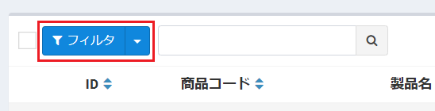
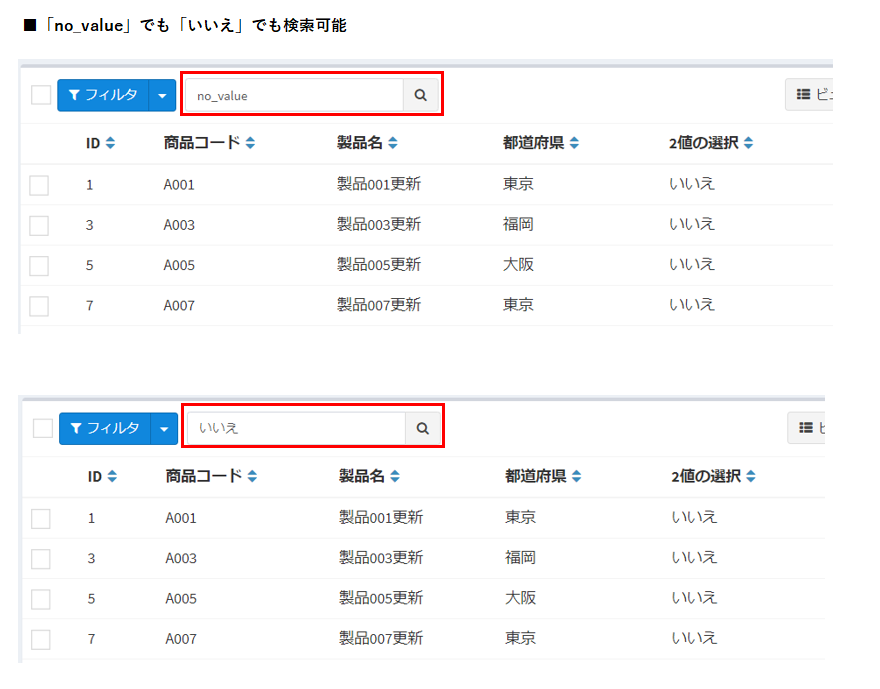

# Búsqueda
Esta página explica cómo buscar los datos de Exment. Hay 2 grandes formas de buscar.

| Forma de buscar | Dónde se busca |
|---|---|
| La barra de búsqueda de la parte superior de la página | Todas las tablas que entran en la búsqueda |
| La búsqueda de la pantalla de lista de datos (barra de búsqueda y filtro) | La tabla que está abierta |

- **Al principio, la búsqueda es por coincidencia al inicio** (se buscan los datos que empiezan por el texto introducido). Para cambiarla a coincidencia parcial, consulte "Cambiar la búsqueda de datos a coincidencia parcial", más abajo.

## Búsqueda con la barra de búsqueda (búsqueda de texto libre)
En la parte superior de cada página hay una barra de búsqueda.  
  
Al introducir una palabra en esta barra de búsqueda, se pueden buscar los datos registrados en Exment.  
Hay 2 tipos de búsqueda: "búsqueda por palabra" y "búsqueda de datos relacionados".  

### Búsqueda por palabra
Es la búsqueda normal. En el resultado aparecen los datos que contienen la palabra introducida (por coincidencia al inicio).  
  

Introduzca una palabra en la barra de búsqueda y haga clic directamente en el botón de búsqueda para buscar.  
Primero aparece la lista de tablas que entran en la búsqueda y después se buscan los datos que coinciden.

**Qué entra en la búsqueda**

- Tablas: las tablas que tienen "Permitir búsqueda" en YES en la configuración de la tabla personalizada.  

- Columnas personalizadas: las columnas que tienen "Índice de búsqueda" en YES y también "Incluir en la búsqueda de texto libre" en YES en la configuración de columnas personalizadas.  
Nota: las tablas que no tienen ninguna columna personalizada con "Índice de búsqueda" en YES no aparecen en el resultado de la búsqueda.  

> Desde v3.4.0, para entrar en la búsqueda hace falta que "Incluir en la búsqueda de texto libre" esté en YES.  
Antes se buscaba en todas las columnas con "Índice de búsqueda" en YES. Pero con 10 o 20 índices de búsqueda configurados el rendimiento puede bajar, así que se hizo posible limitar lo que entra en la búsqueda de texto libre.

- Solo se busca en las tablas que el usuario tiene permiso para ver.  

- **La configuración de búsqueda predeterminada es la coincidencia al inicio.** Es por la velocidad de la búsqueda.  
Para cambiarla a coincidencia parcial, consulte "Cambiar la búsqueda de datos a coincidencia parcial", más abajo.

**Resultado de la búsqueda**

En los datos del resultado de la búsqueda aparecen los iconos [Ver], [Editar] y [Buscar datos relacionados].  
    
Al hacer clic en el icono [Buscar datos relacionados], se hace la "Búsqueda de datos relacionados" descrita más abajo.  

### Búsqueda de datos relacionados
La búsqueda de datos relacionados es una función para buscar los datos vinculados a un dato.  
Por ejemplo, si hay una tabla "Clientes", a veces se quiere ver la lista de datos de "Contratos" vinculados a un cliente.  
  
En ese caso, con esta "búsqueda de datos relacionados" se pueden ver en una lista los datos de contratos vinculados al cliente.  

La búsqueda de datos relacionados se hace en los siguientes casos.  
- Al introducir una palabra en la barra de búsqueda y elegir uno de los candidatos que aparecen  
  
>El texto que aparece en la lista de candidatos se puede cambiar en la [configuración de columnas de encabezado](/es/table).

- Al hacer una búsqueda por palabra y elegir el icono [Buscar datos relacionados] que aparece en el resultado  
  
  
En la lista de la búsqueda de datos relacionados aparecen los datos vinculados por las siguientes condiciones.  
- Los datos que tienen elegido, en una columna personalizada de "selección", el dato elegido en la búsqueda (pero "Índice de búsqueda" debe estar en YES en la configuración de columnas personalizadas)  
- Los datos que tienen registrado como dato principal, en una configuración de relaciones 1:n o n:n, el dato elegido en la búsqueda  
  
En la búsqueda de datos relacionados aparecen en una lista el propio dato elegido y los datos relacionados por las condiciones anteriores.  
En el ejemplo de abajo aparecen en una lista el dato del cliente elegido, "ABC, S.A.", y los contratos relacionados con ese cliente.  
  

## Búsqueda en la pantalla de lista de datos
También se puede buscar en la pantalla de lista de datos.
Hay 2 métodos: la búsqueda con la barra de búsqueda y la búsqueda con filtro indicando columnas.

  

### Búsqueda con la barra de búsqueda (búsqueda de texto libre)
Al introducir una palabra en esta barra de búsqueda, se pueden buscar los datos de la tabla que se está mostrando.  

  

Introduzca una palabra en la barra de búsqueda y haga clic directamente en el botón de búsqueda para buscar.  

  

- La búsqueda de texto libre es una función distinta de la vista personalizada elegida ahora.  
Se busca en todos los datos de esa tabla, en todas las columnas de búsqueda de texto libre.  
Por eso, el resultado no aparece con la forma de la vista personalizada elegida ahora, sino con la de la vista de todos los datos.

- Las columnas personalizadas que entran en la búsqueda son las que tienen "Índice de búsqueda" en YES y también "Incluir en la búsqueda de texto libre" en YES en la configuración de columnas personalizadas.  

> Desde v3.4.0, para entrar en la búsqueda hace falta que "Incluir en la búsqueda de texto libre" esté en YES.  
Antes se buscaba en todas las columnas con "Índice de búsqueda" en YES. Pero con 10 o 20 índices de búsqueda configurados el rendimiento puede bajar, así que se hizo posible limitar lo que entra en la búsqueda de texto libre.

- **La configuración de búsqueda predeterminada es la coincidencia al inicio.** Es por la velocidad de la búsqueda.  
Para cambiarla a coincidencia parcial, consulte "Cambiar la búsqueda de datos a coincidencia parcial", más abajo.

### Búsqueda con filtro indicando columnas
Al hacer clic en el botón "Filtro", aparece un cuadro para buscar con detalle indicando columnas.

  

  

- Como campos de búsqueda aparecen los siguientes.
    1. ID, fecha de creación, fecha de actualización
    2. En las tablas con configuración de flujo de trabajo, el "estado del flujo de trabajo" y el filtro de "datos de los que soy responsable"
    3. Si hay una configuración de relaciones en la que esa tabla es la secundaria, se muestran opciones para filtrar por el dato principal
    4. Las columnas personalizadas de esa tabla que tienen "Índice de búsqueda" en YES en la configuración de columnas personalizadas

Nota: de estos, el 1 y el 2 se pueden ocultar en la pantalla de configuración detallada de la configuración del sistema.

  

## Información complementaria

### Cambiar la búsqueda de datos a coincidencia parcial
La búsqueda de datos por palabra es, de forma predeterminada, por coincidencia al inicio.  
Es para que la búsqueda sea rápida. Con la coincidencia parcial, la búsqueda no alcanza una velocidad suficiente.  
  
Pero se puede cambiar a coincidencia parcial.  
En el menú "Configuración de administración > Configuración del sistema (configuración detallada)", cambie "Método de búsqueda de datos" a coincidencia parcial.  
  
  

Con esto, la búsqueda pasa a ser por coincidencia parcial.  
Nota: con esta configuración la búsqueda puede ser más lenta. Téngalo en cuenta.

### Uso del motor de búsqueda de texto completo (Meilisearch)
En entornos con muchos datos, la búsqueda por coincidencia parcial puede ser lenta.  
En ese caso, con el motor de búsqueda de texto completo "Meilisearch" se puede buscar rápido.  
Para más detalles, consulte [Motor de búsqueda de texto completo (Meilisearch)](/es/additional_meilisearch).

### Especificación de la búsqueda de texto libre según el tipo de columna personalizada
Con la búsqueda de texto libre se pueden buscar, en principio, solo los valores guardados en la base de datos.  
Pero en algunas columnas personalizadas el sistema reescribe antes el valor de búsqueda introducido por el usuario y después busca.  
Esa especificación se explica a continuación.

> Actualmente no se admite la búsqueda AND en varias columnas introduciendo espacios, como en la búsqueda de Google.

#### Selección (guardar valor y etiqueta)
Se puede buscar por el valor configurado en "valor" o por el valor configurado en "texto".

  

  

#### Selección (desde tabla)
Se puede buscar por el texto configurado en la "columna de encabezado".  

Ejemplo:  
- Existe un "Maestro de productos".  

  

- En ese "Maestro de productos", en la "configuración de columnas de encabezado" de la "configuración de la tabla (configuración ampliada)" está configurado "Código de producto".  

  

- A la tabla "Información de existencias de productos" se le añade una columna "Maestro de productos" que tiene ese "Maestro de productos" como tabla de referencia.  

  

- Con esta configuración, al introducir el código de producto "A001" en la búsqueda de texto libre, aparece la lista de "Información de existencias de productos" que tiene como referencia el maestro de productos "A001".

  

#### SÍ/NO
Se puede buscar con las cadenas 0/1 o NO/YES.  
(Como se busca con cadenas que están en todas partes, como "0", "1", "NO" o "YES", no se recomienda mucho incluirla en la "búsqueda de texto libre".)

#### Selección de 2 valores
Se puede buscar por el valor de la opción o por su etiqueta.  

  

