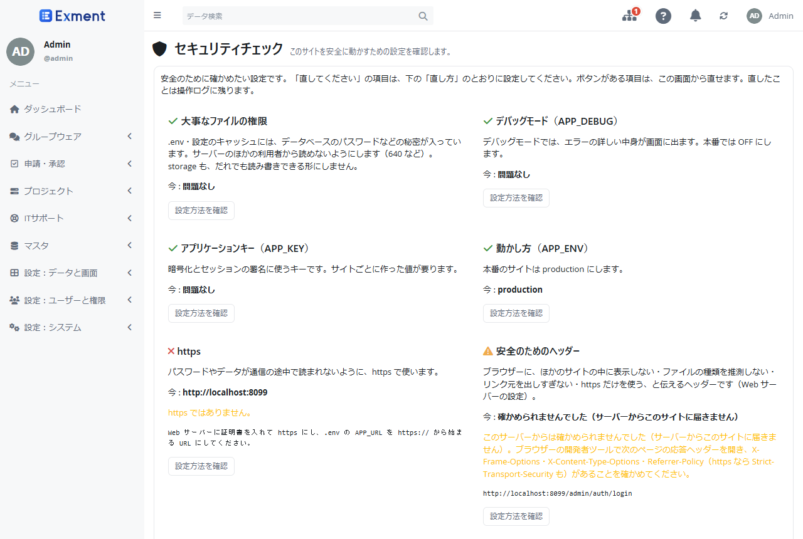

# Comprobación de seguridad
Compruebe los ajustes que mantienen seguro este sitio. En «Configuración: sistema» → «Comprobación de seguridad» (la URL es `/security_check`) aparece una lista con los ajustes que conviene comprobar y con su estado actual.

※Esta pantalla se puede usar en Exment v7.2.1 o posterior.  
※Solo el administrador del sistema puede ver esta pantalla.

## Cómo leer la pantalla
- Cada elemento lleva ✓ si no hay problemas, ✕ si hay que corregirlo y ⚠ si no se pudo comprobar desde este servidor.
- En los elementos con «Corríjalo», configure lo que indica la explicación de cómo corregirlo, que aparece debajo.
- Los elementos que tienen un botón se pueden corregir desde esta pantalla. Lo corregido queda en el registro de operaciones.
- Al pulsar «Ver el método de configuración», se abre la forma de configurar ese elemento.
- Para la configuración del servidor (servidor web, php.ini, .env), pídaselo al administrador del servidor.

También durante la instalación, en la pantalla «Comprobar los requisitos del sistema» aparecen los elementos del servidor que conviene corregir (solo para verlos; no detiene la instalación).

## Elementos
| Elemento | Qué se comprueba |
|---|---|
| Permisos de los archivos importantes | `.env` y la caché de configuración contienen secretos, como la contraseña de la base de datos. Haga que los demás usuarios del servidor no puedan leerlos (640 o similar). Tampoco deje storage de forma que cualquiera pueda leer y escribir |
| Modo de depuración (APP_DEBUG) | En el modo de depuración, los detalles de los errores se muestran en la pantalla. En producción se pone en OFF |
| Clave de la aplicación (APP_KEY) | Es la clave que se usa para el cifrado y para firmar la sesión. Hace falta un valor creado para cada sitio |
| Entorno (APP_ENV) | Un sitio en producción se pone en `production` |
| https | Use https para que las contraseñas y los datos no se puedan leer durante la comunicación. Instale un certificado en el servidor web y ponga en `APP_URL` de `.env` una URL que empiece por `https://` |
| Encabezados de seguridad | Son los encabezados que indican al navegador que no muestre el sitio dentro de otros sitios, que no adivine el tipo de los archivos, que no dé demasiada información del origen del enlace y que use solo https (X-Frame-Options, X-Content-Type-Options, Referrer-Policy, Strict-Transport-Security). Se configuran en el servidor web |
| Lo que no debe verse desde el exterior | Haga que `.env`, `.git`, `storage` y `vendor` no se puedan abrir desde el navegador (tiene que dar 403 o 404) |
| Contraseñas de los administradores del sistema | No se usa la contraseña puesta al principio ni una contraseña igual al código de usuario. Se cambia en «Configuración» del menú de usuario, arriba a la derecha |
| Autenticación de dos factores | Además de la contraseña, se confirma el inicio de sesión con un código enviado por correo o de una aplicación de autenticación ([Configuración de inicio de sesión](/es/login_setting)) |

### Ejemplo de configuración de los encabezados de seguridad
Añada las siguientes líneas al servidor web. Después, recargue el servidor web (el .htaccess de Apache tiene efecto tal cual) y compruébelo otra vez en esta pantalla.

~~~
# nginx (dentro de server { })
add_header X-Frame-Options "SAMEORIGIN" always;
add_header X-Content-Type-Options "nosniff" always;
add_header Referrer-Policy "strict-origin-when-cross-origin" always;
# Solo con https
add_header Strict-Transport-Security "max-age=31536000" always;
~~~

~~~
# Apache (al principio de public/.htaccess de Exment, o en la configuración de Apache. Hace falta mod_headers)
<IfModule mod_headers.c>
    Header always set X-Frame-Options "SAMEORIGIN"
    Header always set X-Content-Type-Options "nosniff"
    Header always set Referrer-Policy "strict-origin-when-cross-origin"
    # Solo con https
    Header always set Strict-Transport-Security "max-age=31536000"
</IfModule>
~~~

- Strict-Transport-Security se pone solo en los sitios que se usan con https. Si lo pone, el navegador abre ese sitio solo con https durante 1 año.
- En nginx, si también hay `add_header` dentro de un `location { }`, escriba las mismas líneas dentro de ese `location` (si se escribe dentro, los `add_header` de fuera no se usan).
- En los servidores de alquiler (Xserver, etc.), escríbalo en .htaccess.

### Cuando aparece «No se pudo comprobar»
Los encabezados de seguridad y lo que no debe verse desde el exterior se comprueban consultando al propio sitio desde el servidor. En los entornos donde el servidor no llega a su propio sitio (dentro de Docker, detrás de un cortafuegos, etc.), no se pueden comprobar. En ese caso, abra la dirección que aparece en la pantalla con el navegador de un ordenador de fuera del servidor y compruébelo.

## Temas relacionados
- [Optimización](/es/tuning)
- [Gestión de funciones](/es/feature)
- [Configuración de inicio de sesión](/es/login_setting)
