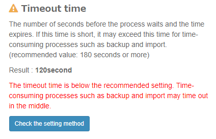
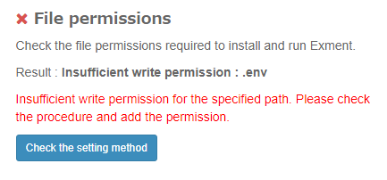

# Configuración del servidor
Esta página reúne los ajustes del servidor web y de la base de datos que hay que preparar antes de instalar Exment.  
Haga la configuración con los pasos que correspondan a su entorno.

En esta página se hacen estas 4 cosas.

1. Preparar el servidor web («Servidor web», más abajo)
2. Instalar composer («Instalación de composer», más abajo)
3. Preparar la base de datos («Base de datos», más abajo)
4. Instalar la aplicación Exment («Instalación de la aplicación», más abajo)

Las versiones necesarias de PHP y de la base de datos están en «Entorno de funcionamiento», más abajo.

- <span class="red bold">※No atendemos consultas individuales sobre los pasos de instalación ni sobre el montaje del servidor. Si necesita atención individual, use el soporte de pago.</span>  
- No tenemos manuales para los entornos que no están en la lista de abajo. Le pedimos su comprensión.

## Servidor web
Prepare el servidor web con uno de estos procedimientos.  
※Si va a crear desde cero un entorno de desarrollo con PHP, Apache y MySQL, le recomendamos XAMPP.  

- [Montaje con XAMPP (entorno de desarrollo y pruebas) Windows](/es/install_xampp)  
→Si primero quiere probar a instalar Exment en su propio ordenador (versión para Windows)

- [Montaje con XAMPP (entorno de desarrollo y pruebas) Mac](/es/install_xampp_mac)  
→Si primero quiere probar a instalar Exment en su propio ordenador (versión para Mac)

- [Montaje en un servidor de alquiler](/es/install_rental)  
→Si quiere publicar Exment y usarlo fácilmente también con otros miembros o desde un smartphone

- [Montaje en Linux](/es/install_centos_stream)  
→Los pasos para instalar Exment en Linux (CentOS Stream)  
 ※Si lo montó con CentOS8, vea [esta página](/es/install_linux)

- [Montaje en IIS](/es/install_iis)  
→Los pasos para instalar Exment en IIS

- [Montaje en AWS: configuración simple](/es/install_aws_single)  
→Los pasos para instalar Exment en AWS con una configuración simple (un solo servidor)

- [Montaje en AWS: redundancia](/es/install_aws)  
→Los pasos para instalar Exment en AWS con una configuración redundante

- [Montaje con Docker](/es/install_docker)  
→Los pasos para ejecutar Exment con Docker


### Configuración de los permisos de archivos

Dentro de la carpeta del proyecto de Exment, las siguientes carpetas y archivos necesitan permiso de escritura para el usuario que ejecuta el servidor web (apache, www-data, etc.).  

| Tipo | Nombre del archivo o carpeta | Función que lo necesita |
| ---- | ---- | ---- |
| Carpeta | storage | Todas las funciones |
| Carpeta | bootstrap/cache | Todas las funciones |
| Archivo | .env | Instalación fácil, restauración |
| Carpeta | config | Instalación fácil, restauración |
| Carpeta | app | Instalación fácil |
| Carpeta | public | Instalación fácil |
| Carpeta | resources | Instalación fácil |

- Los permisos para la instalación fácil solo hacen falta durante la instalación. Si quiere unos permisos más estrictos, quite el permiso de escritura de las carpetas después de la instalación fácil.

#### Creación automática de las carpetas iniciales
- La estructura de carpetas que hace falta al principio también se puede crear automáticamente con el siguiente comando.  
    - --user=(nombre del usuario. Si no se indica, se pide después de ejecutar)
    - --group=(nombre del grupo. Si no se indica, se pide después de ejecutar)
    - --easy=(1 si va a instalar Exment con la instalación fácil. El valor por defecto es 0)
    - --easy_clear=(1 si quiere devolver los permisos de las carpetas a los adecuados después de la instalación fácil. El valor por defecto es 0)

```
php artisan exment:setup-dir {--user=} {--group=} {--easy=0} {--easy_clear=0}

# Para la instalación manual
php artisan exment:setup-dir
# Para la instalación fácil
php artisan exment:setup-dir --easy=1
# Para devolver los permisos de las carpetas a los originales después de la instalación fácil
php artisan exment:setup-dir --easy_clear=1
```


## Instalación de composer
Para usar Exment hay que instalar composer en el servidor web. composer se usa para instalar los paquetes que necesita Exment y para actualizar Exment.  
Para ver cómo instalarlo, consulte estas páginas.  
- [Sitio oficial](https://getcomposer.org/download/)
- [Sitio explicativo para Windows](https://weblabo.oscasierra.net/php-composer-windows-install/) (japonés)
- [Sitio explicativo para Linux](https://weblabo.oscasierra.net/php-composer-centos-install/) (japonés)
- [Sitio explicativo para Mac](https://weblabo.oscasierra.net/php-composer-macos-homebrew-install/) (japonés)


## Base de datos
La base de datos de Exment tiene que ser una de estas.

- MySQL 8.0 o superior
- MariaDB 10.11 o superior
- SQL Server 13.0.0 o superior (por ahora no admite la copia de seguridad ni la restauración automáticas)

### Preparación del entorno de la base de datos
- Si todavía no tiene un servidor de base de datos, prepárelo antes.  
Para ver los pasos, consulte estas páginas.  
※Si ya lo tiene preparado, no hace falta.  

    - [MySQL](/es/install_mysql)
    - [SQL Server](/es/install_sqlserver)

### Creación de la base de datos

- En la base de datos que use, cree una base de datos para Exment.  


## Instalación de la aplicación
Cuando el entorno esté preparado, instale la aplicación Exment con uno de estos dos procedimientos.

1. **Instalación fácil**  
→Es la forma de instalar siguiendo las indicaciones que aparecen en la pantalla web. Para ver los pasos, consulte [Instalación fácil](/es/quickstart_easy).

1. **Instalación manual**  
→Es la forma de instalar a mano, con comandos. Para ver los pasos, consulte [Instalación manual](/es/quickstart_manual).


## Entorno de funcionamiento
### Servidor
- PHP 8.2 o superior (`^8.2.0`. En Exment7.0.0 hace falta PHP8.2 o superior, según los requisitos de Laravel12, que es el que se usa)
- Laravel12.X (desde Exment7.0.0, la versión de Laravel pasó a ser 12.X)
- ※En Exment v6.x, es PHP 8.2 y Laravel10.X.
- Base de datos: una de las siguientes
    - MySQL 8.0 o superior
    - MariaDB 10.11 o superior
    - SQL Server 13.0.0 o superior
- La extensión gd de PHP (con FreeType; tiene que poder usarse `imagettftext`): se usa para el PDF de las etiquetas de códigos de barras bidimensionales. Si falta, hay un error al crear el PDF de las etiquetas. Para ver cómo comprobarla e instalarla, consulte [Configuración de códigos de barras bidimensionales](/es/2d_barcode).

### Navegadores comprobados
- Google Chrome
- Microsoft Edge


### Ajustes recomendados

- Memoria máxima permitida de PHP: 512MB
- Tamaño máximo de carga de archivos: 10MB
- Tiempo de espera: 180 segundos


## Comprobación de los requisitos del sistema

Puede comprobar, en la pantalla o con un comando, si el servidor cumple los requisitos de Exment y si los valores de configuración son suficientes.  

  


### Cómo comprobarlo
Puede comprobarlo de una de estas formas.

- La pantalla de instalación de la [instalación fácil](/es/quickstart_easy)
- La [pantalla de configuración del sistema](/es/system_setting), después de instalar
- Un comando («Ejecutar con un comando», más abajo)

### Detalle de los elementos que se comprueban

#### Límite de uso de memoria
Es el límite de memoria que se puede usar para ejecutar PHP.    
Para ver cómo cambiarlo, consulte [Cambio de los valores de configuración de PHP](/es/additional_php_ini).

#### Número máximo de parámetros POST a la vez
Es el límite del número de parámetros POST que PHP puede recibir de una vez. Algunas pantallas envían muchos elementos al guardar, así que le recomendamos cambiar este límite.  
Para ver cómo cambiarlo, consulte [Cambio de los valores de configuración de PHP](/es/additional_php_ini).

#### Límite de tamaño de carga de archivos
Es el límite del tamaño de los archivos que se pueden subir. El tamaño necesario depende de los archivos que quiera gestionar.  
Para ver cómo cambiarlo, consulte [Cambio de los valores de configuración de PHP](/es/additional_php_ini).

#### Tiempo de espera
Son los segundos que se espera un proceso antes de darlo por agotado. Si es corto, los procesos largos, como la copia de seguridad o la importación, pueden superar este tiempo.  
Para ver cómo cambiarlo, consulte [Cambio de los valores de configuración de PHP](/es/additional_php_ini).

#### Permisos de archivos
Comprueba si existen los permisos de archivos necesarios para que Exment funcione.  
Para más detalles, consulte [Configuración de los permisos de archivos](/es/server?id=Configuración-de-los-permisos-de-archivos), más arriba.


#### Instalación de Composer
Comprueba si Composer, que se usa para actualizar Exment, está instalado en el servidor web.  
※A veces aparece un aviso aunque composer esté instalado. La causa puede ser que el usuario que ejecuta el servidor web no tenga la ruta de composer en el PATH, que le falten permisos, etc.  
Si composer está bien instalado y el usuario que realmente hace la actualización puede ejecutarlo, ignore este aviso.  
※Para añadir composer al PATH, pruebe lo que se explica en «Cómo añadir composer al PATH» de [Solución de problemas](/es/troubleshooting).


#### Copia de seguridad/Restauración
Comprueba si el servidor está configurado para hacer copias de seguridad y restauraciones.  
※Si hay un error, consulte «La copia de seguridad o la restauración fallan» en [Solución de problemas](/es/troubleshooting).  
※Si usa SQL Server, siempre aparece un aviso. Hay que hacer la copia de seguridad y la restauración a mano. Para ver los pasos, consulte [Copia de seguridad y restauración de SQL Server](/es/backup_sqlserver).


### Cómo se muestra el resultado
#### Correcto
Aparece una marca de verificación verde.

  

Al pulsar la fila, aparece el detalle.

  

#### Aviso
Aparece una marca de aviso amarilla. Es un elemento que se recomienda configurar o que tiene algún punto que cuidar al usarlo.

  

#### Error
Aparece una cruz roja. Hay que cambiar la configuración.

  


### Ejecutar con un comando

También puede comprobar los requisitos del sistema con el siguiente comando.

```
php artisan exment:checkrequire
```

[←Volver al resumen de la instalación](/es/quickstart)
