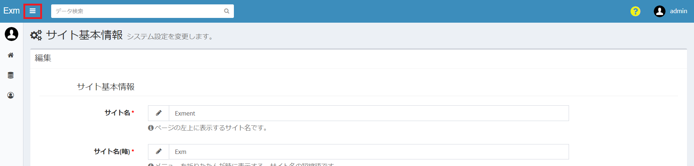
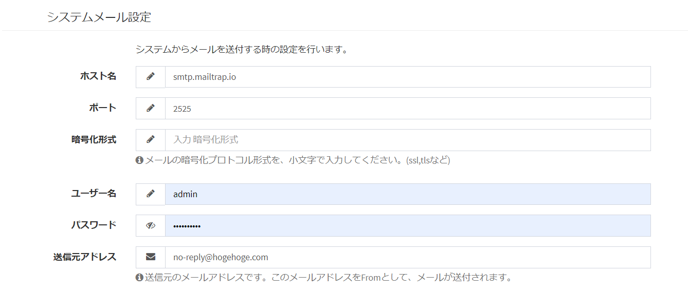

# Configuración del sistema
Es la pantalla donde se hacen los ajustes que afectan a todo el sistema Exment, como el nombre, el logotipo y el diseño del sitio, o la forma de usar los permisos.  
Esta página explica los campos de la pantalla en orden, de arriba abajo. Para el correo, LINE, el filtro de IP, etc., hay enlaces a sus páginas.  

## Pantalla de configuración
Pulse «Configuración del sistema» en el menú.  
Aparece la pantalla de configuración del sistema.  
La configuración del sistema se divide en [Configuración básica] y [Configuración detallada].  
Para cambiar entre ellas, pulse el botón de arriba a la derecha y elija en el diálogo que aparece.

  
  

## Información básica del sitio
Aquí se decide la información básica del sitio, como el nombre, el logotipo y la forma del menú.

- El diseño del menú de Exment (la forma del menú) tiene 2 tipos: «Predeterminado» e «Iconos pequeños».  
Vea la diferencia en las imágenes de abajo.  
- El diseño del menú que aparece al principio se decide en [Diseño del menú del sitio](/es/system_setting?id=Diseño-del-menú-del-sitio). También puede cambiarlo en cada momento pulsando la zona del recuadro rojo de la imagen.

Predeterminado
  

Iconos pequeños
  

#### Nombre del sitio ※obligatorio
- Es el nombre del sitio que aparece arriba a la izquierda de la página cuando el diseño del menú es «Predeterminado».  
- El valor inicial es «Exment».  

#### Nombre del sitio (abreviado) ※obligatorio
- Es el nombre del sitio que aparece arriba a la izquierda cuando el diseño del menú es «Iconos pequeños».
- El valor inicial es «Exm».  

#### Logotipo del sitio
- Es el logotipo del sitio que aparece arriba a la izquierda de la página cuando el diseño del menú es «Predeterminado».  
- Haga clic en el botón [Examinar] y elija la imagen que quiere usar.  
- Tamaño recomendado: 200px * 40px  

※Si configura el logotipo del sitio, cuando el diseño del menú es «Predeterminado», arriba a la izquierda aparece el logotipo del sitio en lugar del nombre del sitio.

#### Logotipo del sitio (pequeño)
- Es el logotipo del sitio que aparece arriba a la izquierda de la página cuando el diseño del menú es «Iconos pequeños».  
- Haga clic en el botón [Examinar] y elija la imagen que quiere usar.  
- Tamaño recomendado: 40px * 40px  

※Si configura el logotipo del sitio (pequeño), cuando el diseño del menú es «Iconos pequeños», arriba a la izquierda aparece el logotipo del sitio (pequeño) en lugar del nombre del sitio.

#### Favicon del sitio (ico)  
- Es la imagen del icono que se usa al ver el sitio o al guardarlo en marcadores, como en la imagen de abajo.  
- Haga clic en el botón [Examinar] y elija la imagen que quiere usar.  
- Tamaño recomendado: 16px * 16px  

  

#### Apariencia del sitio
- Es el color del tema del sitio. Elija el color del encabezado y de la barra lateral entre estas combinaciones.  
- Encabezado (el valor inicial es azul): azul, amarillo, verde, morado, rojo, blanco
- Barra lateral (el valor inicial es blanco): negro, blanco

※Cuando el [Diseño de pantalla](/es/system_setting?id=Diseño-de-pantalla) es «Moderno», el encabezado y la barra lateral siguen en blanco y gris, y el color elegido pasa a ser el «color de acento» (botones importantes, enlaces, el menú seleccionado, el borde del campo en el que se escribe, etc.). Con los colores que no son el azul, aparece una línea fina de ese color en el borde superior del encabezado. Los colores con «-light» tienen el mismo color de acento que los colores sin él.  
※Desde v7.1.0, se aplica en cuanto se guarda. En v7.0 y anteriores, se aplica al recargar la página web después de guardar.

#### Diseño del menú del sitio
- Elija el diseño del menú del sitio entre «Predeterminado» e «Iconos pequeños».  
Vea un ejemplo de cada uno en las imágenes de arriba.
- El valor inicial es «Predeterminado».  

※Se aplica al recargar la página web después de guardar.

#### Diseño de pantalla
- Elija el diseño de la pantalla de inicio de sesión y de las pantallas de administración entre «Moderno» y «Clásico».
    - Moderno: es el diseño nuevo, basado en blanco y gris.
    - Clásico: es el mismo diseño que en v7.0 y anteriores.
- El valor inicial es «Moderno».

※Se puede usar desde v7.1.0.  
※Al actualizar a v7.1.0, el diseño de pantalla cambia a «Moderno». Si quiere volver al diseño anterior, elija «Clásico» en este campo y guarde.  
※Con «Moderno», el encabezado y la barra lateral se muestran en blanco y gris, y el color elegido en [Apariencia del sitio](/es/system_setting?id=Apariencia-del-sitio) pasa a ser el color de acento. Si ha puesto una imagen como logotipo del sitio, detrás del logotipo aparece un fondo del color de acento.  
※En la lista de datos de «Moderno», la columna de operaciones (mostrar, editar, eliminar) aparece justo a la derecha de la casilla de verificación (en el lado izquierdo).  
※Si el diseño está fijado en la configuración del servidor («EXMENT_UI_DESIGN» del archivo .env), tiene prioridad esa configuración. En ese caso, este campo no se puede cambiar y aparece «(fijado por la configuración del servidor)». Para más detalles, consulte [Lista de valores de configuración](/es/config).  
※Se aplica en cuanto se guarda. Si la pantalla se ve descolocada, pulse Ctrl+F5 (recarga forzada) en el navegador.

#### Usar API
- Si lo pone en «YES», se puede usar la API.
- El valor inicial es «NO».

#### Permitir comunicación externa del servidor
- Si lo pone en YES, se pueden hacer los procesos que se comunican con servidores externos (solo para recibir datos), como el aviso de la última versión de Exment.
- El valor inicial es «YES».  

#### Usar la gestión de permisos
- Si está en YES, puede configurar los [permisos sobre todo el sistema y los permisos de cada tabla personalizada](/es/role_group).  
- Cuando está en YES, puede dar permisos indicando usuarios.
- El valor inicial es «YES».  

#### Usar la gestión de organizaciones
- Si está en YES, al [usar la gestión de permisos](/es/system_setting?id=Usar-la-gestión-de-permisos) puede dar permisos indicando organizaciones.  
- El valor inicial es «YES».  

#### Habilitar el registro de rendimiento del sistema
- Si lo pone en YES, las operaciones de las pantallas lentas se anotan en el «Registro de rendimiento del sistema».
- Se anotan la URL de la pantalla (los valores de búsqueda y similares se ocultan con «***»), el usuario, el tiempo de proceso y el SQL. El SQL se anota sin insertar los valores, con «?» tal cual.
- El valor inicial es «NO».

Si lo pone en YES, aparecen estos 3 campos (desde v7.1.0).

| Campo | Contenido | Valor inicial |
| --- | --- | --- |
| Registro de rendimiento: segundos de una pantalla lenta | Se anota cuando el proceso de una pantalla tarda estos segundos o más. Con 0, no se anota por esta condición. | 3 |
| Registro de rendimiento: segundos de una consulta SQL lenta | Se anota cuando un solo SQL tarda estos segundos o más. Con 0, no se anota por esta condición. | 1 |
| Registro de rendimiento: máximo de registros por hora | Es el número máximo de registros que se anotan en 1 hora. Lo que pasa del máximo no se anota. Con 0, no hay máximo. | 100 |

※Si pone a 0 tanto «segundos de una pantalla lenta» como «segundos de una consulta SQL lenta», se anotan todas las operaciones (el mismo comportamiento que en v7.0 y anteriores). Hágalo solo durante una investigación. Los entornos que tenían el registro activado desde v7.0 o antes siguen con este «anotar todo» después de actualizar.  
※Para ver el registro, abra «Configuración de administración» → «Registro de rendimiento del sistema» en el menú de la izquierda.  
※Desde v7.0.3, al ponerlo en YES y guardar, la tabla del registro y el menú (dentro de «Configuración de administración») se crean automáticamente. No hace falta instalar ninguna plantilla.  
※En v7.0.2 y anteriores, instale la plantilla ([Template zip file](https://exment.net/template/system_logs.zip)) y ejecute `php artisan exment:update`.

#### Administrador del sistema
- Puede configurar los usuarios que son administradores del sistema.
- El valor inicial es el usuario que hizo la configuración inicial al instalar Exment.

#### Número de elementos en la lista de datos
- Es el número de datos que se muestran al principio en la página de la lista de datos.  
  Elija entre «10», «20», «30», «50» y «100».
- El valor inicial es «20».  

#### Número de elementos en la búsqueda y el panel
- Es el número de datos que se muestran al principio al hacer una [búsqueda por palabra clave](/es/search) o en la [lista de datos del panel](/es/dashboard).  
Elija entre «5», «10» y «20».  
- El valor inicial es «5».  

#### Formato de visualización de fecha y hora
- Puede elegir el formato de visualización de las fechas entre 3 tipos («Predeterminado (Y-m-d H:i:s)», «Personalizado (Y/m/d H:i:s)» y «Local (d/m/Y H:i:s)»). El valor inicial es «Predeterminado (Y-m-d H:i:s)».

#### Método de búsqueda de datos
- Elija el método de búsqueda de los datos registrados entre «Coincidencia al inicio» (los que empiezan igual) y «Coincidencia parcial» (los que lo contienen en medio).
- El valor inicial es «Coincidencia al inicio».

#### Ocultar el filtro de la lista de datos
- Los elementos marcados dejan de aparecer en el filtro de la pantalla de lista de datos.

#### Posición de los elementos del sistema en la pantalla de datos
- Decide dónde aparecen los elementos del sistema en la pantalla de edición de datos y en la pantalla de detalle de datos.  
- Puede elegir entre «Mostrar en la parte superior», «Mostrar en la parte inferior» y «Ocultar». El valor inicial es «Mostrar en la parte superior».  

#### Destino predeterminado tras guardar datos
- La pantalla de [registro de datos](/es/data_form) tiene casillas de verificación para elegir a qué pantalla se pasa después de guardar los datos. Aquí puede dejar esas casillas marcadas desde el principio.

#### Información del usuario en el encabezado
- Puede decidir qué se muestra en la información del usuario del encabezado. Si lo deja vacío, no se muestra nada.
- Puede elegir entre las columnas personalizadas de la tabla de usuarios y la fecha de creación.

#### Idiomas que pueden elegir los usuarios
- Son los idiomas que los usuarios pueden elegir en el menú de arriba a la derecha, en la pantalla de inicio de sesión y en la configuración del usuario de inicio de sesión (desde v7.2.4). Si está vacío, se pueden elegir todos los idiomas instalados. El idioma del sitio siempre se puede elegir.
- Para más detalles, consulte [Idioma y zona horaria por usuario](/es/user_locale).

#### Usar el idioma del navegador cuando un usuario no ha elegido uno
- Si lo pone en YES, a los usuarios que no han elegido idioma se les muestra la pantalla en el idioma del navegador (entre los idiomas que pueden elegir los usuarios). Si lo pone en NO, se muestra en el idioma del sitio (desde v7.2.4).
- El valor inicial es «YES». Si quiere que todos sigan con el idioma del sitio, póngalo en NO.

## Configuración de organizaciones
Decide hasta dónde se incluyen las organizaciones en los ajustes de permisos y de uso compartido.

#### Jerarquía de organizaciones (grupo de roles)
-  Cuando se pone una organización en «Configuración de usuarios/organizaciones» de un grupo de roles, decide hasta dónde se incluyen las organizaciones superiores e inferiores de esa organización.
- El valor inicial es «Incluir las jerarquías superiores e inferiores de la organización».

#### Jerarquía de organizaciones (datos)
- Cuando se pone una organización en la configuración de uso compartido de cada dato personalizado, decide hasta dónde se incluyen las organizaciones superiores e inferiores de esa organización.
- El valor inicial es «Solo la organización».

#### Configuración para compartir datos
-  Decide si, cuando un usuario crea un dato nuevo, se comparte automáticamente solo con ese usuario o también con las organizaciones a las que pertenece.
- El valor inicial es «Solo el usuario con acceso».

## Configuración del correo del sistema
Son los ajustes para enviar correos desde el sistema.  
Si lo configura desde la pantalla, introduzca los valores de configuración de SMTP.  
Para más detalles, consulte [Configuración del envío de correo](/es/mailsend_setting).

## Configuración de LINE
En «Configuración de LINE» de [Configuración detallada] se configuran los datos de la cuenta oficial de LINE (token de acceso del canal, secreto del canal, ID básico) que se usan en la [Integración con LINE](/es/line).  
Para más detalles, consulte la configuración del sistema en [Integración con LINE](/es/line).

## Configuración de la confirmación de seguridad
En «Configuración de la confirmación de seguridad» de [Configuración detallada] se configuran, entre otras cosas, el envío automático al producirse un terremoto de la [Comprobación de seguridad del personal](/es/safety_check).  
Para más detalles, consulte la configuración en [Comprobación de seguridad del personal](/es/safety_check).

## Configuración del filtro de IP
Configure las direcciones IP con las que se permite la comunicación, como IP fija (ejemplo: 12.3.5.6) o en formato de rango (ejemplo: 123.4.5.0/24).  
Si no se configura, se permiten todas las direcciones IP.
Para más detalles, consulte [Filtro de IP](/es/additional_ip_filter).

## Política de contraseñas

> Se ha movido a [Configuración de inicio de sesión](/es/login_setting).

## Configuración de SSO

> Se ha movido a [Configuración de inicio de sesión (SSO)](/es/login_sso).
