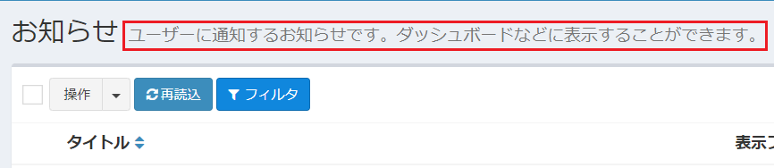
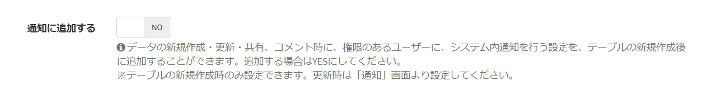
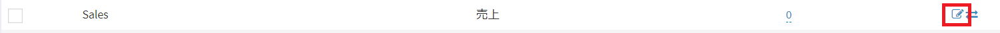
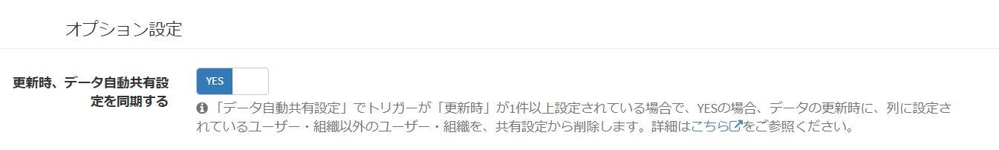

# Configuración de tablas personalizadas
En Exment, los datos se gestionan dentro de «tablas personalizadas». Se crea una tabla para cada cosa que se quiere gestionar, como clientes, presupuestos o tareas.  
Esta página explica cómo crear, modificar y eliminar tablas, y los ajustes de cada tabla (las funciones que se pueden usar con los datos, los permisos, etc.).

- Si crea una tabla por primera vez: vea, en este orden, «Crear», «Detalle de los ajustes» y «Guardar», más abajo.
- Para los ajustes que usan varias columnas, como la comprobación de duplicados o el texto que aparece en las sugerencias de búsqueda: vea «Configuración ampliada», más abajo.

## Lista
Pulse «Tabla personalizada» en el menú.  
Aparece la lista de las tablas personalizadas que existen ahora.  

※«Información básica», «Usuario», «Organización», «Plantilla de notificación», «Historial de envío de correos» y «Avisos»  
Estas tablas están desde que se instala Exment.  
Las tablas importadas con plantillas también aparecen en esta lista.  

## Crear

- Pulse el botón [Nuevo], arriba a la derecha de la pantalla de lista.
  
  
- Aparece la pantalla de creación de tablas; introduzca los campos necesarios. La explicación de los campos está en «Detalle de los ajustes», más abajo.

## Detalle de los ajustes

#### Nombre de la tabla (alfanumérico) ※obligatorio
- Es el nombre de la tabla. (Ejemplo: user , information , estimate )  
- Las letras y números decididos aquí se usan en la URL al abrir la tabla, entre otros lugares. (Ejemplo: http(s)://(URL de Exment)/data/user)  
- Se pueden usar letras y números de ancho medio y los símbolos "-" y "_".
- No se puede usar un nombre de tabla que ya usa otra tabla.  
- El nombre de la tabla tiene que tener 30 caracteres como máximo y empezar por una letra.  
- Solo se puede decidir al crear la tabla. Después de guardar, no se puede cambiar.  

> ※La URL es la de la configuración estándar, sin «/admin» (sitios instalados de nuevo con v7.2.1 o posterior). Si `ADMIN_ROUTE_PREFIX` de `.env` tiene un valor (en los sitios instalados con versiones anteriores es «admin»), añada ese valor después de la URL del sitio (ejemplo: `http(s)://(URL de Exment)/admin/oauth/token`). Para más detalles, consulte [Cambiar o quitar «admin» de la URL](/es/additional_prefix).

#### Nombre visible de la tabla ※obligatorio
- Es el nombre que se muestra en la pantalla. También se puede usar el japonés. (Ejemplo: Usuario, Avisos, Presupuesto)  

  

#### Descripción
- Es la descripción de la tabla.

- La descripción introducida aparece en la pantalla de datos, a la derecha del nombre visible de la tabla, como en la imagen de abajo.  

#### Orden de visualización
- Es el orden en la pantalla de lista de la configuración de tablas personalizadas.  
- Indique el número escribiéndolo con caracteres de ancho medio o con los botones [-] y [+] de los lados.

#### Color
- Decide el color de la tabla. Este color se usa en las sugerencias de la búsqueda, entre otros lugares.

- Al pulsar el color actual, aparece la pantalla para elegir el color.

#### Icono
- Decide el icono de la tabla. Este icono aparece en el menú y en los resultados de búsqueda.  

- Al pulsar el icono actual, aparece la pantalla para elegir el icono.

#### Permitir búsqueda
- Decide si esta tabla se incluye en la búsqueda cuando se [busca](/es/search) desde la barra de búsqueda. El valor por defecto es YES.  
Si no quiere que aparezca en los resultados de búsqueda, por ejemplo en una tabla que quiere mantener oculta, póngalo en NO.

#### Usar el ID como etiqueta
- En las sugerencias de búsqueda que aparecen en la barra de búsqueda, se puede poner el ID del dato al principio de la etiqueta. Para más detalles, consulte [Configuración de columnas de encabezado](/es/table?id=Configuración-de-columnas-de-encabezado). El valor por defecto es NO.  

#### Permitir solo un registro
- Póngalo en YES para que en la tabla se pueda registrar solo 1 dato, y no varios. El valor por defecto es NO.  

#### Usar archivos adjuntos
- Póngalo en YES para que se puedan subir [archivos adjuntos](/es/data_details) a los datos de la tabla. El valor por defecto es YES.  

#### Usar comentarios
- Póngalo en YES para que se puedan escribir [comentarios](/es/data_details) en los datos de la tabla. El valor por defecto es YES.  

#### Usar historial de cambios de datos
- Póngalo en YES si quiere conservar como revisiones (historial) quién actualizó los datos y con qué contenido. El valor por defecto es YES.  

#### Número de versiones del historial de cambios
- Cuando «Usar historial de cambios de datos» está en YES, introduzca con un número entero cuántos cambios del historial se conservan (número de versiones).  
Si introduce «200», en la actualización número 201 se borra el primer cambio del historial. El valor por defecto es 100.  

#### Optimizar la visualización de la lista
- Si lo pone en YES, la pantalla de lista de datos se muestra primero y después las filas se cargan automáticamente. En las tablas con muchos datos o muchas columnas, acorta el tiempo hasta que aparece la pantalla de lista. El valor por defecto es NO.
- Es un ajuste que dibuja las filas más tarde. No reduce las consultas a la base de datos.
- El ajuste se aplica al volver a abrir la lista de datos.

※Se puede usar desde v7.1.0.

#### Todos los usuarios pueden editar

> Para ver un resumen de los permisos de las tablas, consulte primero la página [Resumen de roles y permisos en Exment](/es/permission).

- Si lo pone en YES, todos los usuarios pueden editar todos los datos de esta tabla. Ya no hace falta dar permisos a cada usuario. El valor por defecto es NO.  

#### Todos los usuarios pueden ver

> Para ver un resumen de los permisos de las tablas, consulte primero la página [Resumen de roles y permisos en Exment](/es/permission).

- Si lo pone en YES, todos los usuarios pueden ver todos los datos de esta tabla. Ya no hace falta dar permisos a cada usuario. El valor por defecto es NO.  

※Al instalar Exment, solo la tabla «Avisos» tiene «Todos los usuarios pueden ver» en YES como valor inicial. Es para que todos los usuarios puedan ver los avisos.  
En cambio, solo los administradores pueden editar los avisos.

#### Todos los usuarios pueden consultar

> Para ver un resumen de los permisos de las tablas, consulte primero la página [Resumen de roles y permisos en Exment](/es/permission).

- Si lo pone en YES, todos los usuarios pueden consultar (referenciar) todos los datos de esta tabla. Ya no hace falta dar permisos a cada usuario. El valor por defecto es NO.  

※Si pone en YES solo «Todos los usuarios pueden consultar», la tabla no se puede mostrar en el menú ni en la pantalla de lista, pero sí se puede referenciar desde otras tablas.  

Ejemplo: en la tabla «Impuesto sobre el consumo» no hace falta mostrar la pantalla de lista a los usuarios generales, pero sí hace falta que puedan elegir el «impuesto sobre el consumo» como opción. En tablas como esta, ponga «Todos los usuarios pueden consultar» en YES.  

#### Visible con los permisos de los datos principales

> Para ver un resumen de los permisos de las tablas, consulte primero la página [Resumen de roles y permisos en Exment](/es/permission).

- Si lo pone en YES, los datos se pueden ver con los permisos de los datos padre (uno a varios). Sin embargo, hay que tener en esta misma tabla un permiso como el de ver los datos de los que se es responsable. El valor por defecto es NO.  

※ Es una opción que solo aparece en las tablas hijas de una relación uno a varios.  

※ Aunque se tenga permiso de edición de los datos padre, no se pueden editar los datos hijo. Solo se pueden ver.  

#### Requiere permiso de edición de los datos principales

> Para ver un resumen de los permisos de las tablas, consulte primero la página [Resumen de roles y permisos en Exment](/es/permission).

- Si lo pone en YES, para editar los datos de esta tabla hace falta el permiso de edición de los datos padre (uno a varios). El valor por defecto es YES.  

※ Es una opción que solo aparece en las tablas hijas de una relación uno a varios.  

#### Agregar al menú
- Si lo pone en YES, la tabla se añade al menú al mismo tiempo que se guarda. El valor por defecto es NO.  

※Es un campo que solo aparece al crear la tabla. Para cambiar los ajustes del menú después de añadirla, hágalo en la pantalla de [Menú](/es/menu).  

#### Menú principal de destino
- Es un campo que aparece al poner «Agregar al menú» en YES. Elija el nombre del menú que será el padre del menú que se añade.  

Ejemplo: al crear la tabla «Manual», si elige «Configuración de administración» como menú padre, el menú de la tabla «Manual» se crea al final de «Configuración de administración», como en la imagen.

#### Agregar a la notificación
- Si lo pone en YES, se añade una configuración de notificación al mismo tiempo que se guarda la tabla. Es una configuración que envía una notificación dentro del sistema a los usuarios con permiso cuando se crea, se actualiza o se comparte un dato, o cuando se comenta.  

※Es un campo que solo aparece al crear la tabla. Para cambiar los ajustes de la notificación después de añadirla, hágalo en la pantalla de [Notificación](/es/notify).  

## Guardar
- Al pulsar el botón [Enviar], la configuración se guarda y la tabla se crea con ese contenido.

- Cuando se crea una tabla, después de guardar se pasa a la [pantalla de lista de columnas personalizadas](/es/column).  
A continuación, registre las columnas personalizadas.

## Editar
- En la lista de tablas personalizadas, pulse el botón [Editar] de la tabla que quiere modificar.  
Se pasa a la pantalla de edición, donde puede cambiar la configuración.  

## Eliminar
- Si quiere eliminar una tabla, primero abra la pantalla de edición con los mismos pasos de «Editar», más arriba.

- Después, pulse el botón [Eliminar], arriba a la derecha de la pantalla de edición.  

  

- Aparece una pantalla de confirmación como la de la imagen de abajo. Al escribir delete me en el área de texto y pulsar el botón [Confirmar], la tabla se elimina.  
**※Sin embargo, los siguientes tipos de tablas no se pueden eliminar. - Tablas instaladas por el sistema - Tablas configuradas como hijas en una relación**

## Configuración ampliada
Aquí se hacen los ajustes que usan varias columnas de la tabla (comprobación de duplicados, comparación entre columnas, encabezados, uso compartido automático de datos, etc.).

- En la lista de tablas personalizadas, pulse el botón [Configuración ampliada] de la tabla que quiere configurar.  

- Se pasa a la pantalla de configuración.

  

### Configuración de clave única compuesta
Si reúne varias columnas en una clave única (una combinación que no admite duplicados), evita que se registre dos veces la misma combinación de valores al registrar datos nuevos.  

- Elija 2 o 3 columnas cuya combinación no quiere que se duplique.
- Al registrar un dato nuevo, hay un error cuando, en todas las columnas elegidas, los valores que se van a registrar son iguales a valores ya registrados.  

Ejemplo: si pone «Próxima fecha prevista» y «Nombre» como clave única, como en la imagen de abajo, evita que se registre varias veces el mismo nombre en la misma próxima fecha prevista.  

※Si quiere evitar los duplicados con 1 sola columna, ponga en YES el ajuste de valor único de esa columna en la [Configuración de columnas personalizadas](/es/column).

※ En una relación 1:N (vea la [configuración de relaciones de Exment](/es/relation)), al poner una clave única compuesta en la tabla hija, también puede elegir la tabla padre como una de las claves únicas.  
Así puede comprobar los duplicados solo dentro del mismo dato padre.

### Comparar 2 columnas
Al crear y al actualizar datos, se comparan 2 columnas. Solo se puede guardar cuando los valores de las columnas cumplen la condición configurada. Si no la cumplen, aparece un mensaje de error.  
Se puede usar en casos como estos.  

- Solo se puede guardar si la «Fecha de inicio» es anterior o igual a la «Fecha de fin».
-  Solo se puede guardar si el valor de «X» es mayor o igual que el valor de «Y».
- Solo se puede guardar si el «Responsable» y el «Revisor» son distintos.

    

#### Qué pasa cuando no se ha introducido un valor
Cuando uno de los campos o los dos están sin introducir, el resultado cambia según la condición elegida.  
Aquí se escribe "true" cuando se puede guardar y "false" cuando hay un error.

- **A y B coinciden** : true si los dos valores están sin introducir. false si solo uno está sin introducir.
- **A y B no coinciden** : true si solo uno de los valores está sin introducir. false si los dos están sin introducir.
- **Las demás** : siempre true. Es porque las fechas y los números normalmente no se pueden comparar cuando el valor está vacío.  
Si no quiere que se dejen sin introducir, hágalos obligatorios en la configuración de columnas personalizadas o en la configuración de formularios personalizados.

#### Qué pasa según el tipo de columna
- La comparación de mayor y menor (A es mayor que B, A es menor que B, A es mayor o igual que B, A es menor o igual que B) solo se puede hacer con los siguientes tipos de columna.
    - Entero
    - Decimal
    - Moneda
    - Fecha
    - Hora
    - Fecha y hora

- Si se intenta comparar mayor y menor con otros tipos de columna, siempre es true.

- Si los tipos de las columnas no coinciden, no se puede comparar mayor y menor (por ejemplo, «Entero» y «Fecha y hora»). En realidad, debería haber un error al guardar esta configuración.  
Sin embargo, ahora no se hace esta comprobación al guardar. Elija 2 columnas de tipos compatibles.

#### Otros
- Si quiere comparar valores de 3 columnas o más, comparar con condiciones especiales, comparar con valores de otras tablas, etc., cree un [plugin de validación](/es/plugin_quickstart_validate).

### Configuración de columnas de encabezado
Es el ajuste que decide con los valores de qué columnas se crea el texto (encabezado) que aparece en las sugerencias de la barra de búsqueda y en las listas de opciones.  
  
Por ejemplo, suponga que hay una tabla «Datos de clientes» como la de abajo.  
La tabla de datos de clientes tiene columnas como «Código de cliente», «Nombre del cliente», «Teléfono» y «Correo electrónico».  
    

Al introducir una palabra en la barra de búsqueda, aparecen las sugerencias de búsqueda.  
Suponga que quiere que esas sugerencias aparezcan así.  
«(código de cliente) (nombre del cliente)»  
    
  
En ese caso, en la pantalla de configuración ampliada de la tabla personalizada, registre así las columnas que quiere mostrar en el encabezado.  
  
  
Con este registro, al escribir en la barra de búsqueda de la parte superior de la página, las sugerencias aparecen así.  
El texto de las sugerencias sigue el orden de las columnas registradas, de arriba abajo, en la pantalla de configuración ampliada.  
  
  
Si también quiere mostrar el «Correo electrónico», añada la columna «Correo electrónico».  
  
  
  
Además, en la configuración de tablas personalizadas hay un campo «Usar el ID como etiqueta».
  
Si pone este ajuste en YES, se añade el texto «#(id)» al principio de la etiqueta.  
  

#### Otros
- Si no se ha registrado esta configuración de columnas de encabezado, se muestra el valor de la primera columna de la configuración de columnas personalizadas.
- Si el valor de la primera columna de la configuración de columnas personalizadas está vacío, se muestra el ID.
- El ID solo se puede añadir al principio de la etiqueta. No se puede añadir en otro lugar.  

### Configuración de uso compartido automático de datos

> Sobre la configuración de uso compartido de datos, consulte primero la página [Resumen de roles y permisos en Exment](/es/permission).

Al guardar un dato, se puede compartir automáticamente con las organizaciones y los usuarios que están en los valores de sus columnas.  
Se puede usar en casos como estos.  

- Al crear un dato de «Contratos», añadir automáticamente el permiso de edición al usuario asignado en la columna «Responsable principal».  
- Al actualizar un dato de «Contratos», añadir automáticamente el permiso de visualización a la organización asignada en la columna «Organización relacionada».  
- Al crear un dato de «Gestión de tareas», añadir automáticamente el permiso de edición al usuario asignado en la columna «Responsable».  

※Antes, la tabla personalizada tiene que tener una columna de tipo «Usuario» u «Organización».

#### Ejemplo  
Si en la tabla «Gestión de clientes» están definidas estas columnas,

se hace el ajuste «"Al crear", añadir el permiso "Editar" al usuario asignado en la columna "Responsable"».

Después, al crear un dato cuyo responsable es el usuario «user1»,

este dato se comparte con el usuario «user1» con permiso de edición.

#### Cómo configurarlo

- ##### Desencadenador
Es el momento en que se comparte el dato.  
Se puede elegir «Al crear» o «Al actualizar».  

- ##### Columna de destino
Es el usuario o la organización con quien se comparte el dato.

- ##### Permiso de destino
Elija si se comparte con permiso de edición o con permiso de visualización.

#### Sincronización del uso compartido
Con la configuración inicial, cuando el desencadenador es «Al actualizar», aunque cambie los usuarios u organizaciones de la columna de destino, el uso compartido con los usuarios u organizaciones que estaban antes no se quita, y siguen compartidos.  

Si cambia la configuración, al actualizar el dato se pueden quitar del uso compartido los usuarios y organizaciones que no sean «los usuarios y organizaciones que están en la columna» ni «el usuario que actualiza».

Para ello, ponga en YES «Sincronizar la configuración de uso compartido automático al actualizar», en la configuración de opciones.

### Impedir la ejecución desde la pantalla

Se configura cuando no quiere que se creen, editen o eliminen datos, ni que se importen o exporten, desde la pantalla.  
Al configurarlo, esos botones dejan de aparecer en la pantalla.  

- Aparece el campo «No se puede cambiar desde la pantalla».

  

- Ejemplo de configuración: cuando se oculta «Exportar»

  

  

### Posición de los elementos del sistema en la pantalla de datos

Decide dónde aparecen los elementos del sistema en la pantalla de edición de datos y en la pantalla de detalle de datos.  
Se puede elegir entre «Según la configuración del sistema», «Mostrar en la parte superior», «Mostrar en la parte inferior» y «Ocultar». (El valor inicial es «Según la configuración del sistema»)  
※La posición para todo el sistema se puede cambiar en la configuración del sistema.  

  

### Transición de pantalla al hacer clic en una fila

Decide qué pantalla se abre al pulsar una fila en la pantalla de lista de datos.  
Se puede elegir entre «Según el valor predeterminado», «Pantalla de edición de datos», «Pantalla de detalles de datos» y «Sin transición». (El valor inicial es «Según el valor predeterminado»)  
※El valor predeterminado de todo el sistema es «Pantalla de detalles de datos», pero se puede cambiar con los valores de configuración de .env (`EXMENT_GRIDROW_SELECT_EDIT` y `EXMENT_GRIDROW_SELECT_DISABLED`; [valores de configuración](/es/config)).  

  

### Configuración del formato de encabezado
> Este ajuste solo aparece cuando está activado el [modo experto](/es/additional_expert).

Con las variables de parámetros puede decidir con libertad el formato del valor que aparece en el encabezado.  

- Active el modo experto y abra la pantalla de configuración ampliada.

- Aparece el campo para introducir la «Cadena de formato».  

  

- Para mostrar en el encabezado los valores guardados en los datos, use las [variables de parámetros](/es/params).  
Ejemplo: para mostrar «Nombre de usuario&lt;admin@admin.admin&gt;» en los datos de usuarios  
${value:user_name}&lt;${value:email}&gt;  
  

- Introduciéndolo así, puede decidir los elementos que aparecen en el encabezado.  
  

#### Otros
- Si está configurado este formato de encabezado, la «Configuración de columnas de encabezado» no tiene efecto.
