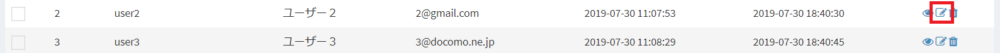

# Usuarios y usuarios con acceso
Esta página explica las pantallas para gestionar los usuarios y los usuarios con acceso.

| Qué quiere hacer | Dónde mirar |
|---|---|
| Añadir, editar o eliminar usuarios | "Gestión de usuarios" |
| Hacer que un usuario pueda iniciar sesión y decidir su contraseña | "Gestión de usuarios con acceso" |
| Configurar el inicio de sesión de muchos usuarios de una vez | "Importación masiva de la información de usuarios con acceso" |
| Hacer que el usuario pueda ver y cambiar su propia información | "Ver y editar la información personal por el propio usuario con acceso" |

## Definición de términos
### Usuario
Es una persona, por ejemplo un empleado de la empresa o de la organización.  
También se pueden añadir como usuarios personas que no usan este sistema.  
El código de usuario y la dirección de correo electrónico son obligatorios.  
Un usuario se puede registrar vinculado a los datos de otras tablas. Pero, solo por ser usuario, no puede iniciar sesión en el sistema.

### Usuario con acceso
Es, entre los usuarios, una persona que puede iniciar sesión en Exment.  
Como la información del usuario lleva una contraseña, puede iniciar sesión desde la pantalla de inicio de sesión de Exment y registrar datos, consultarlos, etc.  

#### Procedimiento de configuración de usuarios y usuarios con acceso

El flujo hasta poder iniciar sesión en Exment es el de la figura de arriba.  
(1) En la pantalla de gestión de usuarios, registre el código de usuario, el nombre de usuario y la dirección de correo electrónico del usuario.  
(2) En la pantalla de gestión de usuarios con acceso, configure la contraseña del usuario registrado en (1).  
Con esto, el usuario registrado puede iniciar sesión en Exment.  

> Si al iniciar sesión se falla la contraseña un número determinado de veces, ese usuario no puede iniciar sesión durante un tiempo.  

## Gestión de usuarios
Aquí se explica cómo gestionar la información de todos los usuarios.  

### Mostrar la pantalla de lista
Haga clic en "Usuario" en el menú de la izquierda.  
O bien abra la siguiente URL.  
Con esto se muestra la pantalla de lista de usuarios.
http(s)://(URL de Exment)/data/user  
Aparece la lista de usuarios registrados ahora en el sistema.

> Nota: la URL corresponde a la configuración estándar sin "/admin" (sitios instalados de nuevo con v7.2.1 o posterior). Si `ADMIN_ROUTE_PREFIX` tiene un valor en `.env` (en los sitios instalados con una versión anterior es "admin"), añada ese valor después de la URL del sitio (ejemplo: `http(s)://(URL de Exment)/admin/data/user`). Para más detalles, consulte [Cambiar o quitar "admin" de la URL](/es/additional_prefix).

### Añadir un usuario nuevo
- En la pantalla de lista de "Usuario", haga clic en el botón [Nuevo], arriba a la derecha de la página.

- Aparece la pantalla para añadir. Introduzca los datos necesarios.

#### Organizaciones a las que pertenece
Si hay organizaciones a las que debe pertenecer el usuario, elíjalas en la lista de datos candidatos y páselas a los datos seleccionados.  
Nota: si no se ha creado ninguna organización, este campo no aparece.

#### Configuración de grupos de roles
Si hay grupos de roles que asignar al usuario, elíjalos en la lista de datos candidatos y páselos a los datos seleccionados.

#### Configuración de inicio de sesión
Con "Conceder acceso de inicio de sesión" en YES, el usuario se puede crear como usuario con acceso.  
Para saber cómo se configura, consulte [Gestión de usuarios con acceso](/es/user?id=Gestión-de-usuarios-con-acceso), más abajo.

### Guardar
Cuando haya introducido la configuración, haga clic en [Enviar].

### Editar
Para editar un usuario, haga clic en el enlace [Editar] de su fila.  

### Eliminar
Para eliminar un usuario, haga clic en el enlace [Eliminar] de su fila.  

## Gestión de usuarios con acceso
Aquí se gestionan como usuarios con acceso los usuarios creados en la pantalla anterior.  
Se puede añadir una contraseña, volver a emitir la contraseña, quitar el acceso de inicio de sesión, etc.  

### Mostrar la pantalla
Haga clic en "Usuarios con acceso" en el menú de la izquierda.  
O bien abra la siguiente URL.  
Con esto se muestra la pantalla de configuración de usuarios con acceso.
http(s)://(URL de Exment)/loginuser  
Aparecen los usuarios registrados ahora en el sistema y su información de inicio de sesión.  

### Añadir la información de inicio de sesión
Haga clic en el enlace [Editar] de la fila del usuario al que quiere añadir la información de inicio de sesión.  

- Aparece la pantalla de edición de la información de inicio de sesión.  
  
Para añadir el acceso de inicio de sesión, ponga "Conceder acceso de inicio de sesión" en YES.  
Con YES aparece el campo "Generar contraseña automáticamente".

#### Generar contraseña automáticamente
Con YES, la contraseña se crea automáticamente al añadir el acceso de inicio de sesión.  
Después de crearla, se envía automáticamente un correo con la contraseña a la dirección de correo electrónico de ese usuario.  
**Nota: para usar esta función hace falta la configuración de correo de la [Configuración del sistema](/es/system_setting).**  
  
Con NO aparecen un cuadro de texto para introducir la contraseña y el campo "Enviar datos del usuario por correo".

#### Introducir la contraseña
Aparece cuando "Generar contraseña automáticamente" está en NO.  
Introduzca la contraseña del usuario con acceso.  

#### Enviar datos del usuario por correo
Aparece cuando "Generar contraseña automáticamente" está en NO.  
Si este campo está en YES, se envía un correo con la contraseña a la dirección de correo electrónico de ese usuario.  
**Nota: para usar esta función hace falta la configuración de correo de la [Configuración del sistema](/es/system_setting).**

#### Cambiar la contraseña en el primer inicio de sesión
Con YES, cuando el usuario inicia sesión por primera vez se muestra la pantalla para cambiar la contraseña.  
Se aplica a los usuarios recién registrados y a los usuarios a los que se ha restablecido la contraseña.

### Quitar el acceso de inicio de sesión
Quita el acceso de inicio de sesión.  
En la pantalla de lista, haga clic en el enlace [Editar] de un usuario que tiene "YES" en la columna "Configuración de usuarios con acceso".  
  

Cambie "Conceder acceso de inicio de sesión" a NO.  
  
Después, haga clic en [Enviar].  

### Importación masiva de la información de usuarios con acceso
La información de los usuarios con acceso se puede importar de una vez.  
Así se puede configurar el inicio de sesión de una vez, sin hacerlo usuario por usuario desde la pantalla de usuarios.

El flujo es el siguiente.

1. Registrar los usuarios ("Registrar la información de usuarios")  
2. Exportar la información de usuarios con acceso ("Exportar la información de usuarios con acceso")  
3. Editar el archivo exportado ("Crear el archivo de importación")  
4. Importar ("Importar")

#### Registrar la información de usuarios
Antes, añada en la pantalla de [Gestión de usuarios](/es/user?id=Gestión-de-usuarios) los usuarios a los que quiere dar información de inicio de sesión.

#### Exportar la información de usuarios con acceso
- Haga clic en "Usuarios con acceso" en el menú de la izquierda.  
O bien abra la siguiente URL.  
Con esto se muestra la pantalla de configuración de usuarios con acceso.
http(s)://(URL de Exment)/loginuser  
Aparecen los usuarios registrados ahora en el sistema y su información de inicio de sesión.  

- Haga clic en el botón "Importar/Exportar", arriba a la derecha de la pantalla.  
Después, haga clic en "Exportar".

  

- Se exportan la información de los usuarios registrados y la información de acceso de esos usuarios.

  

#### Contenido de cada columna
- id  
Es el id del usuario. No cambie este valor al importar después.  

- Nombre de usuario, Código de usuario, Correo electrónico  
Son la información del usuario.  
Nota: aunque se cambien estos valores al importar después, no se reflejan en la información del usuario. La información del usuario se cambia en la pantalla "Usuario".

- Conceder acceso de inicio de sesión  
Indica si ese usuario tiene la información de inicio de sesión estándar de Exment. Con 1, tiene información de inicio de sesión.

- Generar contraseña automáticamente, Contraseña, Enviar datos del usuario por correo  
Al exportar, el valor está vacío. Se usan al importar.

#### Crear el archivo de importación
Edite el archivo exportado antes para crear el archivo que se importa.  
En cada columna, introduzca lo siguiente.

- Conceder acceso de inicio de sesión  
    - Si quiere dar a ese usuario el acceso de inicio de sesión estándar de Exment, ponga 1.  
    - Si ya tiene acceso de inicio de sesión y quiere mantenerlo, deje 1.  
    - Si quiere quitar el acceso de inicio de sesión a un usuario que ya lo tiene, ponga 0.

- Generar contraseña automáticamente  
Si quiere que la contraseña de ese usuario se cree automáticamente, introduzca 1.  
Si se configura para un usuario que ya tiene acceso de inicio de sesión, se restablece la contraseña.

- Contraseña  
Si quiere decidir usted la contraseña del usuario, introduzca la cadena de la contraseña.  
Si se configura para un usuario que ya tiene acceso de inicio de sesión, se restablece la contraseña.

- Enviar datos del usuario por correo  
Si quiere enviar la contraseña por correo al dar por primera vez la información de inicio de sesión o al cambiar la contraseña, introduzca 1.

#### Importar
- En la pantalla de configuración de usuarios con acceso, haga clic en el botón "Importar/Exportar", arriba a la derecha de la pantalla.  
Después, haga clic en "Importar".

  

- Suba el archivo de importación creado.

- Se asigna la información de inicio de sesión.

## Ver y editar la información personal por el propio usuario con acceso
Los usuarios tienen registrada información como "Código de usuario", "Nombre de usuario", "Correo electrónico", "Avatar" y "Contraseña".

- "Avatar" y "Contraseña" los puede mostrar y cambiar desde el principio el propio usuario con acceso.  
- "Código de usuario", "Nombre de usuario", "Correo electrónico" y "las demás columnas creadas" los puede ver y editar el propio usuario con acceso si se hace la siguiente configuración.  

#### Configuración de columnas personalizadas: Ver o editar la información personal

En la configuración de columnas personalizadas de la tabla de usuarios se puede configurar "Ver o editar la información personal".  
Se puede elegir entre 3 opciones: "No mostrar", "Solo lectura" y "Editable".  
Con cada una, el usuario con acceso puede hacer lo siguiente.

##### No mostrar
El usuario con acceso no puede mostrar la información registrada.  

##### Solo lectura
El usuario con acceso puede mostrar la información registrada, pero no puede editarla.  

##### Editable
El usuario con acceso puede mostrar y editar la información registrada.
> Si hay configurada una opción como "solo se puede introducir una vez", esa opción tiene prioridad.

#### Ver y editar en la pantalla del usuario con acceso

Haga clic en el nombre del usuario con acceso, arriba a la derecha de la pantalla de Exment, y haga clic en [Configuración].  

Aparece la información que el usuario con acceso puede mostrar.  
Las columnas en las que se puede introducir las puede editar y guardar el propio usuario.    

Nota: en el ejemplo de la imagen, "Código de usuario" está en solo lectura, y "Nombre de usuario" y "Correo electrónico", en editable.
