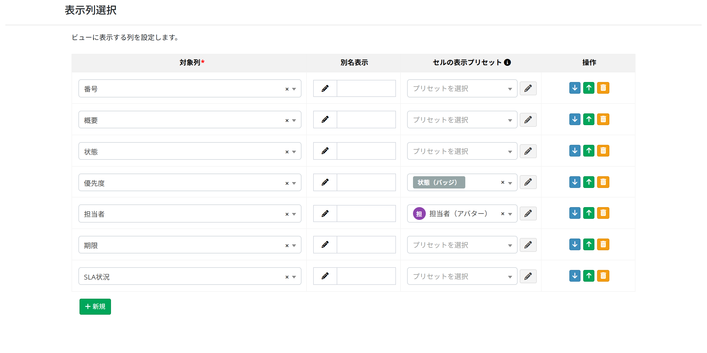
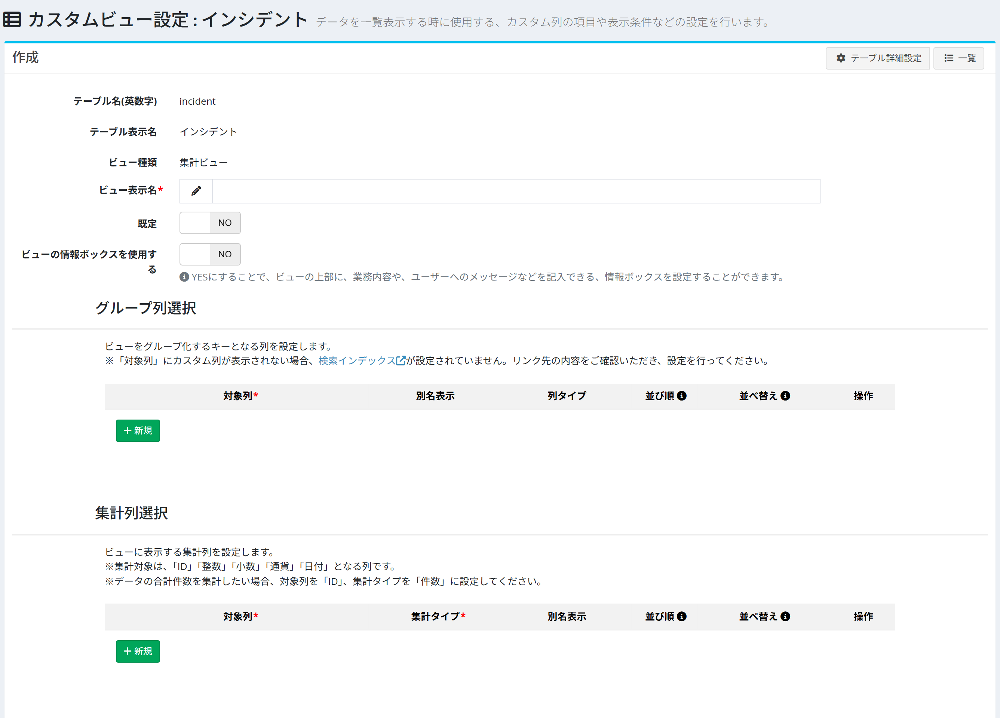
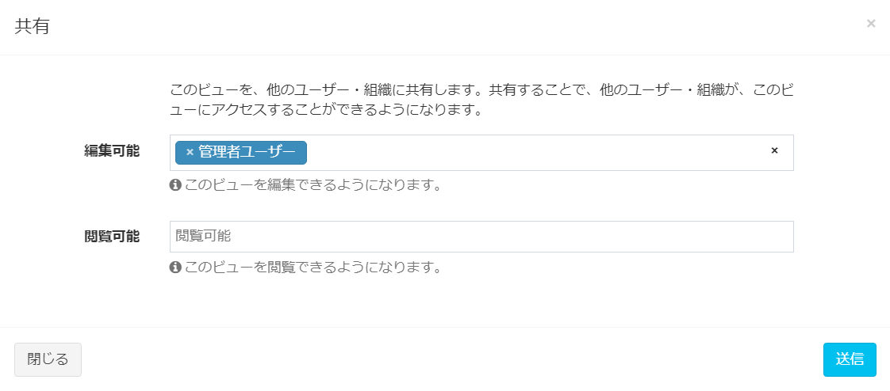

# Vista personalizada
Una vista es la "forma de mostrar" la [pantalla de lista de datos](/es/data_grid). En cada vista se decide qué columnas se muestran, qué datos se filtran y en qué orden aparecen.  
Esta página explica los tipos de vista, cómo crear una vista y sus opciones de configuración.

El flujo de configuración es el siguiente.

1. Abrir la lista de vistas ("Abrir la página")  
2. Con [Nuevo], elegir el tipo de vista que se quiere crear ("Añadir una vista nueva")  
3. Rellenar las opciones y guardar con [Enviar]

## Tipos de vista
Actualmente existen los siguientes tipos.

| Tipo | Uso |
|---|---|
| Vista (vista normal) | Ver los datos en una lista |
| Vista de resumen | Ver totales, recuentos, etc. por grupo |
| Vista de calendario | Ver los datos en forma de calendario |
| Vista Kanban | Ver los datos como tarjetas, en columnas por estado |
| Vista de diagrama de Gantt | Ver una barra horizontal desde la fecha de inicio hasta la fecha límite |
| Vista de todos los datos | Vista con la misma forma que la vista normal, creada automáticamente por el sistema |
| Vista de condiciones | Se usa solo para filtrar, por ejemplo en las condiciones de una notificación |

### Vista (vista normal)

Es la vista habitual: una lista de datos.  
Muestra en una lista los datos registrados.

### Vista de resumen

Agrupa los datos registrados y muestra valores de resumen como la suma, el recuento o el máximo.  
En el panel se puede mostrar como gráfico.

### Vista de calendario

Muestra los datos registrados en forma de calendario.

### Vista Kanban

Muestra los datos registrados como tarjetas, en columnas por estado.  
Al arrastrar una tarjeta a otra columna, se cambia el valor de ese campo.  
Para más detalles, consulte [Vista Kanban](/es/view_kanban).

### Vista de diagrama de Gantt
Muestra los datos registrados en orden cronológico, como barras horizontales desde la fecha de inicio hasta la fecha límite (fin).  
Para más detalles, consulte [Vista de diagrama de Gantt](/es/view_gantt).

### Vista de todos los datos
En lo básico es igual que la vista normal, pero se diferencia en lo siguiente.  
- La crea el sistema automáticamente.  
- Solo se crea una. El usuario no puede crear otra ni eliminarla.  
- Se usa en la pantalla de [búsqueda](/es/search) para mostrar la lista.  
- Se usa para mostrar los datos de detalle desde una vista de resumen.

### Vista de condiciones
Es una vista que se usa solo para filtrar. Se usa en las condiciones de una [notificación](/es/notify) y para filtrar cuando el tipo de una columna personalizada es "Selección (desde tabla)".  
- No tiene configuración de columnas visibles.  
- No aparece en la pantalla de lista de datos.  
- Solo los administradores pueden configurarla. Los usuarios generales no pueden.

## Abrir la página
- En la lista de tablas personalizadas, marque una sola tabla (la que quiere configurar) y haga clic en "Configuración detallada de la tabla", arriba a la derecha.  
  
- O bien elija en el menú la tabla que quiere configurar y, del mismo modo, haga clic en "Configuración detallada de la tabla", arriba a la derecha.  
Nota: Esa tabla debe estar añadida al menú de antemano.  
  
- En la pantalla de configuración detallada de la tabla, haga clic en el icono de configuración de vistas.  

- Con esto aparece la lista de vistas de esa tabla personalizada.  

## Añadir una vista nueva
- En la pantalla "Configuración de vista personalizada", haga clic en el botón [Nuevo], arriba a la derecha de la página.

En el cuadro de diálogo, haga clic en el botón del tipo que quiere crear.  
  
- Aparece la pantalla para añadir una vista nueva. Introduzca los datos necesarios.

## Opciones de configuración de la vista
#### Nombre visible de la vista
Introduzca el nombre de la vista.  

#### Permiso de la vista
Decide quién puede usar esta vista. Se elige entre Vista del sistema y Vista de usuario.

- Vista del sistema  
Solo puede configurarla el administrador del sistema.  
Es una vista que pueden usar todos los usuarios con permiso de acceso a la tabla.

- Vista de usuario  
Es una vista que se puede configurar sin ser administrador del sistema.  
Solo puede usarla el usuario que la creó.

Nota: Una vista del sistema no se puede cambiar después a vista de usuario.  
**Una vista de usuario creada por un administrador del sistema** sí se puede cambiar después a vista del sistema.  
Nota: Si se configura la opción de [desactivar las vistas de usuario](/es/config), los usuarios generales ya no pueden crear vistas.

#### Elementos por página
Elija cuántos datos se muestran en una página de la lista de datos.

#### Predeterminado
Cuando hay varias vistas, la que aparece primero al abrir la lista de datos es la que tiene "YES".  
Nota: Las vistas con "NO" también se pueden mostrar eligiéndolas en la lista de vistas.  
Nota: En una tabla personalizada, solo una vista puede tener "Predeterminado" en "YES".  
Si se pone "YES" en dos o más vistas, todas menos la última en la que se puso "YES" cambian a "NO".

#### Usar el cuadro de información de la vista
Con [YES], se puede mostrar un cuadro de información encima de la vista.  
Introduzca un título y un texto para mostrar el contenido del trabajo o un mensaje para los usuarios.

#### Seleccionar columnas de la vista
Es la configuración de las columnas que se muestran en la vista.  
Las columnas configuradas aquí aparecen en la pantalla de lista de datos, entre otras.

##### Columna de destino
La columna que se muestra en la vista.  
  
##### Nombre visible alternativo  
La columna aparece en la vista con el nombre escrito aquí.  

##### Ajuste predefinido de aspecto de celda  
Elija con qué aspecto se muestra esa columna en esta vista.  
Nota: Tiene prioridad sobre la configuración de la columna personalizada. Para más detalles, consulte [Ajustes predefinidos de estilo de celda](/es/cell_style_preset).  

##### Botón [↓]  
Mueve el elemento de la vista hacia la derecha.  

##### Botón [↑]  
Mueve el elemento de la vista hacia la izquierda.  

##### Botón [Eliminar]  
Elimina la columna de la vista.

##### Botón [Nuevo]  
Añade una columna nueva a la vista.

#### Filtro de la vista
Son las condiciones para filtrar los datos que se muestran en la vista.  
Añada condiciones cuando quiera filtrar, por ejemplo, "mostrar solo lo que está dentro de un periodo" o "mostrar solo lo que tiene un estado concreto".  
Nota: Aparte de esta configuración, se aplica un filtro para mostrar solo los datos sobre los que el usuario con sesión iniciada tiene permiso. Los datos sin permiso no aparecen, sea cual sea esta configuración.

>Si el tipo de la columna de la condición es Selección (desde tabla), el texto que aparece en el valor de la condición se puede cambiar en la [configuración de columnas de encabezado](/es/table).

##### Columna de destino
La columna que se usa en la condición de filtro.  
  
##### Condición
Elija el contenido de la condición.  
Para más detalles, consulte [Acerca de las condiciones de filtro](/es/view?id=Acerca-de-las-condiciones-de-filtro).  

##### Valor de la condición de filtro
Introduzca el valor con el que se compara la condición.  
  
##### Botón [Eliminar]
Elimina la condición de filtro de la vista.
  
##### Botón [Nuevo]
Añade una condición de filtro nueva a la vista.

#####   Combinación de condiciones
Con "Cumplir todas las condiciones", se muestran los datos que cumplen todas las condiciones.  
Con "Cumplir cualquiera de las condiciones", se muestran los datos que cumplen al menos una condición.

#####   Invertir condición
Si se marca "Invertir la condición", se muestran los datos que no cumplen las condiciones.  
Nota: En la vista de resumen no se puede invertir la condición.

#### Acerca de las condiciones de filtro
Las opciones de condición cambian según el tipo de la columna elegida en "Columna de destino" ("Fecha", "Usuario", etc.).  
Aquí solo se describen las condiciones que necesitan explicación.

##### Cuando el tipo de la columna de destino es "Fecha"
- A partir de hace X días  
- A partir de dentro de X días  
- Hasta hace X días  
- Hasta dentro de X días  
El dato aparece en la vista cuando su fecha está dentro de ese intervalo.  

Ejemplo: la fecha actual es el 15/1 y el valor de la condición registrado es "8"  

##### Cuando el tipo de la columna de destino es "Usuario"
- Coincide con el usuario con acceso  
El dato aparece en la vista cuando su valor es el usuario con sesión iniciada.  

- No coincide con el usuario con acceso    
El dato aparece en la vista cuando su valor no es el usuario con sesión iniciada.  

#### Ordenar datos
Configura la ordenación (orden de visualización) de los datos de la vista.

 
##### Columna de destino  
La columna que se usa para ordenar.  

##### Ordenar  
Indica si se ordena de forma "Ascendente (de menor a mayor)" o "Descendente (de mayor a menor)".  

##### Botón [↓]  
Baja la prioridad de la ordenación.  

##### Botón [↑]  
Sube la prioridad de la ordenación.  

##### Botón [Eliminar]  
Elimina la ordenación de datos de la vista.  

##### Botón [Nuevo]
Añade una ordenación de datos nueva.

#### Elementos del "Filtro" de la vista

Indica qué columnas aparecen como opciones en el "Filtro" que se muestra encima de la vista.
  

##### Columna de destino  
La columna que aparece en el "Filtro".  

##### Botón [↓]  
Mueve el elemento del "Filtro" hacia abajo.  

##### Botón [↑]  
Mueve el elemento del "Filtro" hacia arriba.  

##### Botón [Eliminar]  
Elimina el elemento del "Filtro" de la vista.  

##### Botón [Nuevo]
Añade una columna nueva al "Filtro" de la vista.  

## Añadir una vista de resumen nueva
- En la pantalla "Configuración de vista personalizada", haga clic en "Crear vista de resumen" dentro de [Nuevo], arriba a la derecha de la página.

- Aparece la pantalla para añadir una vista de resumen nueva. Introduzca los datos necesarios.

## Opciones de configuración de la vista de resumen

#### Nombre visible de la vista, Permiso de la vista y Predeterminado
Son las mismas opciones que en [Opciones de configuración de la vista](/es/view?id=Opciones-de-configuración-de-la-vista), más arriba.

#### Seleccionar columnas de agrupación
Los datos se agrupan y se resumen por cada valor de la columna elegida aquí.  
Si se configuran varias columnas, se resume por separado cada combinación de esos campos.

##### Columna de destino  
La columna que sirve de base para agrupar.  

- Ejemplo 1: si se configuran dos columnas de destino, los datos se agrupan y se resumen por la combinación de las dos columnas, como en la imagen.  
Nota: "Importe de ventas" no es una columna de agrupación: está configurada como columna de resumen.

  

- Ejemplo 2: si solo la columna "Mes de venta" es columna de agrupación, los datos que en el ejemplo 1 se separaban también por la columna "Nombre del empleado" se resumen en grupos de una sola columna.  

  

##### Nombre visible alternativo
La columna aparece en la vista con el nombre escrito aquí.  

##### Tipo de columna
Solo se puede elegir entre las siguientes opciones cuando el tipo de la columna personalizada de destino es "Fecha" o "Fecha y hora".  
"Año", "Año-Mes", "Año-Mes-Día", "Mes", "Día", "Día de la semana"  
La columna de destino se agrupa por la unidad de fecha elegida aquí.  
Nota: Las imágenes de los ejemplos 1 a 3 muestran la vista con el tipo de columna de "Mes de venta" en "Año-Mes".

##### Orden
Es la configuración del orden en que se muestran los datos en la vista de resumen.  
Decide la prioridad de las columnas: los valores de qué columna se miran primero para ordenar los datos.  
El orden se asigna contando juntas las columnas de agrupación y las columnas de resumen.  

- Ejemplo 3: el ejemplo 2 de arriba muestra la vista con "Mes de venta" en 1 e "Importe de ventas" en 2. Si se pone "Mes de venta" en 2 e "Importe de ventas" en 1, el orden da prioridad a los valores de la columna "Importe de ventas", como en la imagen de abajo.  

  

##### Ordenar  
Configura si la columna de destino se ordena de menor a mayor o de mayor a menor.  
Elija "Ascendente (de menor a mayor)" o "Descendente (de mayor a menor)".  

- Ejemplo 4: el ejemplo 3 de arriba muestra la vista con "Importe de ventas" en orden descendente. En orden ascendente queda como en la imagen de abajo.  

  

##### Botones [de flecha]
Configuran el orden de las columnas en la vista de resumen.  
Cuanto más arriba está un elemento en la selección de columnas de agrupación, más a la izquierda aparece en la vista de resumen.  

##### Botón [Eliminar]  
Elimina la columna de agrupación de la vista.

##### Botón [Nuevo]  
Añade una columna de agrupación nueva a la vista.

#### Seleccionar columnas de resumen
Se resumen los valores de la columna elegida aquí.  

##### Columna de destino  
La columna cuyos valores se resumen.  

##### Tipo de resumen  
"Suma", "Recuento", "Mínimo", "Máximo"  
Elija uno de estos 4 tipos de resumen. El resultado del resumen elegido aparece en la columna de destino de la vista.

##### Nombre visible alternativo  
La columna aparece en la vista con el nombre escrito aquí.  

##### Botón [Eliminar]  
Elimina la columna de resumen de la vista.
  
##### Botón [Nuevo]  
Añade una columna de resumen nueva a la vista.

#### Condiciones de visualización
Son las condiciones para filtrar los datos que se muestran en la vista.  
Añada condiciones cuando quiera filtrar, por ejemplo, "mostrar solo lo que está dentro de un periodo" o "mostrar solo lo que tiene un estado concreto".  
Nota: Aparte de esta configuración, se aplica un filtro para mostrar solo los datos sobre los que el usuario con sesión iniciada tiene permiso. Los datos sin permiso no aparecen, sea cual sea esta configuración.

>Si el tipo de la columna de la condición es Selección (desde tabla), el texto que aparece en el valor de la condición se puede cambiar en la [configuración de columnas de encabezado](/es/table).

##### Columna de destino  
La columna que se usa en la condición de filtro.  
  
##### Condición de filtro  
Elija el contenido de la condición.  
Para más detalles, consulte [Acerca de las condiciones de filtro](/es/view?id=Acerca-de-las-condiciones-de-filtro).  
  
##### Valor de la condición de filtro  
Introduzca el valor con el que se compara la condición.  
  
##### Botón [Eliminar]  
Elimina la condición de filtro de la vista.
  
##### Botón [Nuevo]  
Añade una condición de filtro nueva a la vista.

## Añadir una vista de calendario nueva

- En la pantalla "Configuración de vista personalizada", haga clic en "Crear vista de calendario" dentro de [Nuevo], arriba a la derecha de la página.

- Aparece la pantalla para añadir una vista de calendario nueva. Introduzca los datos necesarios.

## Opciones de configuración de la vista de calendario

#### Nombre visible de la vista, Permiso de la vista y Predeterminado
Son las mismas opciones que en [Opciones de configuración de la vista](/es/view?id=Opciones-de-configuración-de-la-vista), más arriba.

#### Seleccionar columnas de la vista
Es la configuración de las columnas que se muestran en la vista.  
En la vista de calendario, si se configuran la fecha de inicio y la fecha de fin, los datos de las columnas de fecha se pueden mostrar como un periodo.  
Nota: Para mostrar un solo día, indique solo la fecha de inicio.

##### Fecha de inicio  
Configure la columna que será la fecha de inicio del periodo.  
Nota: Si no se configura la fecha de fin, el dato aparece un solo día: el de la columna configurada como fecha de inicio.

##### Fecha de fin  
Configure la columna que será la fecha de fin del periodo.

##### Color de visualización  
Configura el color de fondo de los datos que se muestran en la vista.

##### Color del texto  
Configura el color del texto de los datos que se muestran en la vista.

##### Botón [Eliminar]  
Elimina la columna de la vista.

##### Botón [Nuevo]  
Añade una columna nueva a la vista.

#### Condiciones de visualización
Son las condiciones para filtrar los datos que se muestran en la vista.  
Añada condiciones cuando quiera filtrar, por ejemplo, "mostrar solo lo que está dentro de un periodo" o "mostrar solo lo que tiene un estado concreto".  
Nota: Aparte de esta configuración, se aplica un filtro para mostrar solo los datos sobre los que el usuario con sesión iniciada tiene permiso. Los datos sin permiso no aparecen, sea cual sea esta configuración.

>Si el tipo de la columna de la condición es Selección (desde tabla), el texto que aparece en el valor de la condición se puede cambiar en la [configuración de columnas de encabezado](/es/table).

##### Columna de destino  
La columna que se usa en la condición de filtro.  
  
##### Condición de filtro  
Elija el contenido de la condición.  
Para más detalles, consulte [Acerca de las condiciones de filtro](/es/view?id=Acerca-de-las-condiciones-de-filtro).  
  
##### Valor de la condición de filtro  
Introduzca el valor con el que se compara la condición.  
  
##### Botón [Eliminar]  
Elimina la condición de filtro de la vista.
  
##### Botón [Nuevo]  
Añade una condición de filtro nueva a la vista.

#### Encabezado en la vista de calendario
Como en el ejemplo de la imagen, en la vista de calendario aparece un encabezado en la fecha del dato.  

- El encabezado que aparece es el configurado en la [configuración de columnas de encabezado](/es/table).

- Además, si en la fecha de inicio de la selección de columnas se configura una columna personalizada de tipo "Fecha y hora", la hora del dato aparece al principio del encabezado.  

## Guardar
Cuando haya introducido la configuración, haga clic en [Enviar].

## Vista previa
En la pantalla de creación o edición de una vista, al hacer clic en el botón [Vista previa], arriba a la derecha de la página, se puede comprobar en otra ventana cómo se ven los datos (lista de datos, Kanban o diagrama de Gantt) con la configuración que se está introduciendo.  
Así se puede comprobar el aspecto antes de guardar la configuración.

- El botón [Vista previa] aparece en la vista normal, la vista de todos los datos, la vista Kanban y la vista de diagrama de Gantt. No aparece en la vista de resumen, la vista de calendario, la vista de condiciones, etc.  
- La vista previa no guarda la configuración. Para actualizar lo que se muestra después de cambiar la configuración, vuelva a hacer clic en el botón [Vista previa] en la pantalla original.  
- Las filas de "Seleccionar columnas de la vista", "Filtro de la vista" y "Ordenar datos" que no tienen elegida la columna de destino o la condición no se reflejan en la vista previa. En ese caso, la pantalla de vista previa muestra un mensaje que indica que ○ fila(s) se omiten en esta vista previa porque aún no se ha elegido su columna de destino o su condición de filtro.

## Editar
Para editar una vista, haga clic en el enlace [Editar] de su fila.  

## Eliminar
Para eliminar una vista, haga clic en el enlace [Eliminar] de su fila.  

## Duplicar una vista personalizada
Al hacer clic en el enlace [Copia de esta vista], se crea una vista con la misma configuración y solo el nombre visible de la vista en blanco.

## Mostrar la lista de datos
Al hacer clic en el botón [Mostrar la lista de datos con esta vista], aparece la lista de datos con la configuración de esa vista.

## Compartir una vista personalizada
Comparte con otros usuarios u organizaciones la vista personalizada que ha creado.  
Nota: Solo se pueden compartir las "Vistas de usuario". (Las "Vistas del sistema" están publicadas desde el principio para todos los usuarios con permiso.)  
Nota: Como destino se pueden elegir los usuarios u organizaciones con permiso de acceso a la tabla.  

#### Cómo compartir
1. Haga clic en el botón "Compartir" de la pantalla de edición de la vista personalizada.  
Nota: Este botón no aparece al crear una vista nueva.  

2. Aparece el cuadro de diálogo para compartir la vista personalizada.  

3. Añada los usuarios u organizaciones con los que quiere compartir y haga clic en "Enviar". Con esto queda compartida.  

