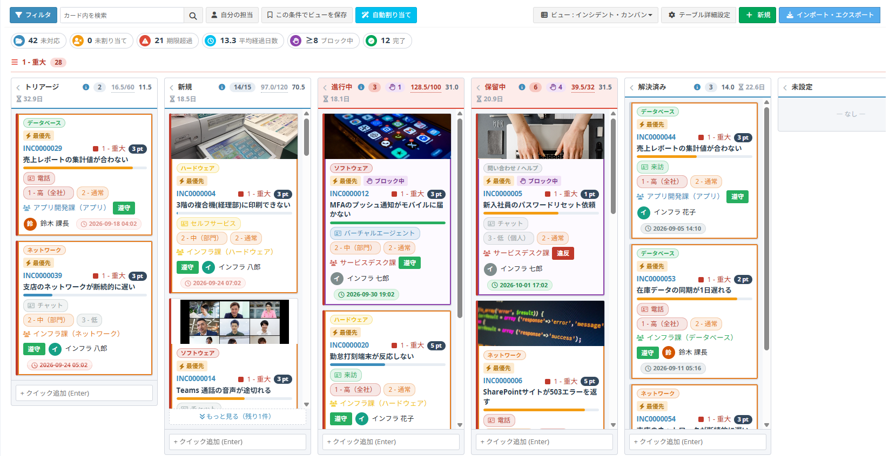
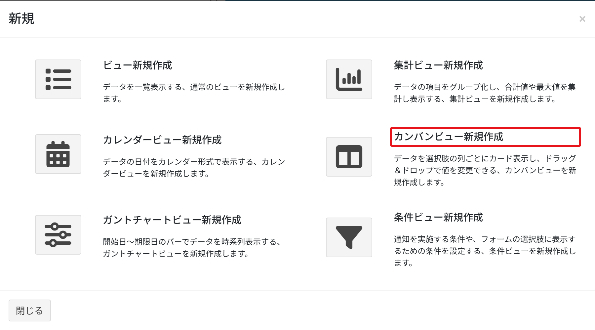
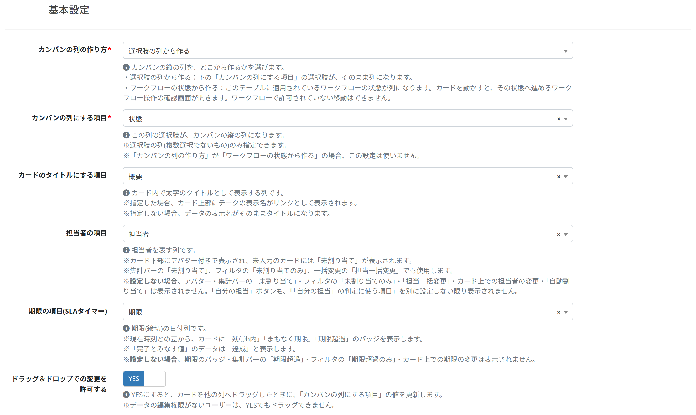
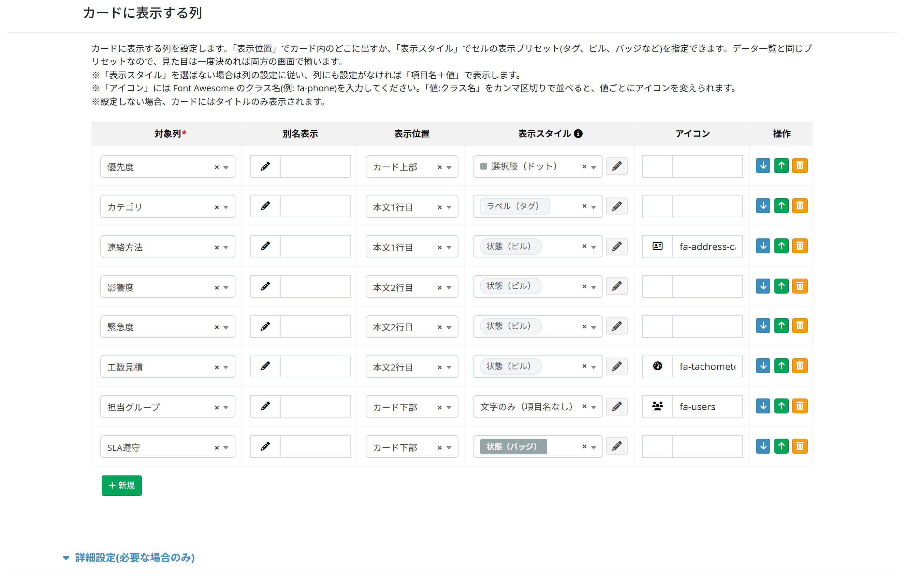
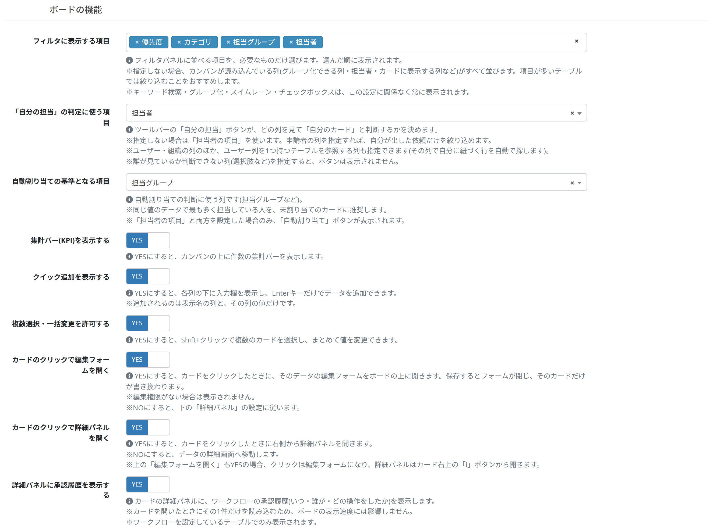
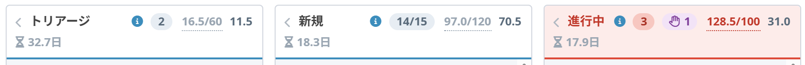
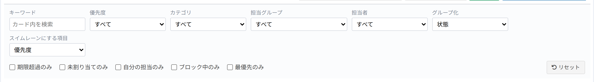
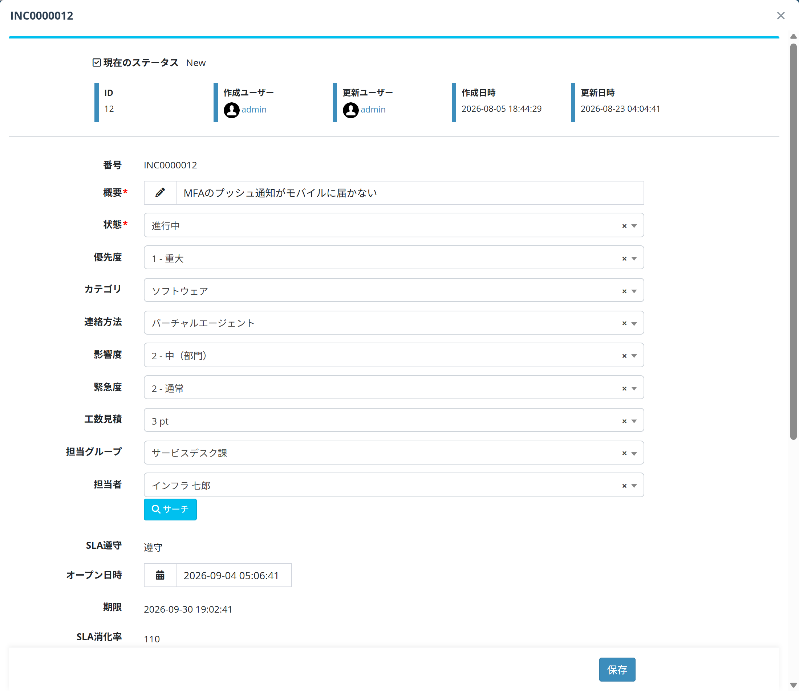
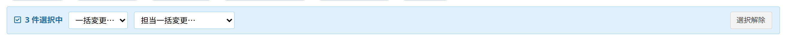
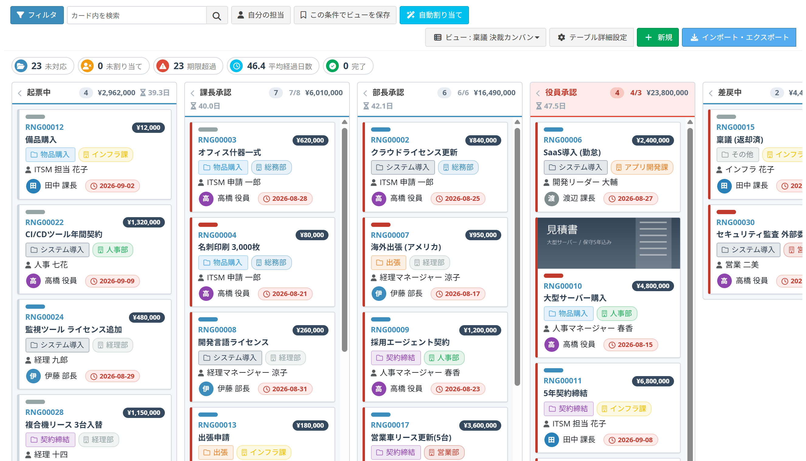

# Vista Kanban

Es una vista que muestra los datos como tarjetas ordenadas en "columnas por estado" y permite cambiar el estado arrastrando y soltando.

## Qué es la vista Kanban

Kanban es un método de gestión en el que cada trabajo se representa con una tarjeta y las tarjetas se ordenan en columnas de proceso como "Abiertos", "En curso" y "Terminados".  
De un vistazo se ve qué trabajo está detenido en qué proceso, y basta con mover la tarjeta a la columna siguiente para avanzar el estado.

Con la vista Kanban de Exment se puede hacer lo siguiente.

- Convertir directamente en columnas verticales una columna de opciones (estado, prioridad, etc.) o los estados de un flujo de trabajo
- Arrastrar una tarjeta para actualizar el valor de ese campo
- Mostrar en la tarjeta el responsable, la fecha límite, etiquetas, una barra de progreso, etc.
- Mostrar en el encabezado de cada columna el número de tarjetas, el importe total y el promedio de días de permanencia
- Hacer clic en una tarjeta para abrir el formulario de edición sobre el tablero

## Añadir una vista nueva

1. Abra la pantalla de configuración de vista personalizada (consulte [Vista personalizada](/es/view)).
2. Haga clic en el botón [Nuevo], arriba a la derecha.
3. En el cuadro de diálogo que aparece, elija "Crear vista Kanban".

## Configuración básica

#### Cómo se crean las columnas del tablero
Elija de dónde se crean las columnas verticales del Kanban.

| Opción | Contenido |
| --- | --- |
| A partir de los valores de una columna de opciones | Las opciones de "Columna para las columnas del tablero" (abajo) se convierten directamente en columnas. |
| A partir de los estados del flujo de trabajo | Los estados del flujo de trabajo aplicado a esta tabla se convierten en columnas. Al mover una tarjeta, se abre la pantalla de confirmación de la acción del flujo de trabajo que avanza a ese estado. No se pueden hacer movimientos que el flujo de trabajo no permite. |

Nota: esta opción no aparece en las tablas que no tienen un flujo de trabajo configurado.

#### Columna para las columnas del tablero
Las opciones de esta columna se convierten en las columnas verticales del Kanban.  
Nota: solo se pueden indicar columnas de opciones (que no sean de selección múltiple).  
Nota: si "Cómo se crean las columnas del tablero" es "A partir de los estados del flujo de trabajo", esta opción no se usa.

#### Columna usada como título de la tarjeta
Es la columna que se muestra dentro de la tarjeta como título en negrita.  
Nota: si se indica, el nombre visible del dato aparece como enlace en la parte superior de la tarjeta.  
Nota: si no se indica, el nombre visible del dato se usa directamente como título.

#### Columna del responsable
Es la columna que representa al responsable. Se muestra con avatar en la parte inferior de la tarjeta, y en las tarjetas sin valor aparece "Sin asignar".  
También se usa en "Sin asignar" de la barra de resumen, en "Solo sin asignar" del filtro y en "Asignación masiva" del cambio masivo.

Nota: si no se configura, no aparecen el avatar, "Sin asignar" de la barra de resumen, "Solo sin asignar" del filtro, "Asignación masiva", el cambio de responsable en la tarjeta ni "Asignación automática".

#### Columna de la fecha límite (temporizador SLA)
Es la columna de fecha de la fecha límite (vencimiento). Según la diferencia con la hora actual, la tarjeta muestra la insignia "Quedan ○h", "Vence pronto" o "Vencido".  
Nota: los datos con un valor de "Valores considerados como terminados" se muestran como "Cumplido".  
Nota: si no se configura, no aparecen la insignia de fecha límite, "Vencidos" de la barra de resumen, "Solo vencidos" del filtro ni el cambio de fecha límite en la tarjeta.

#### Permitir cambiar valores arrastrando y soltando
Con YES, al arrastrar una tarjeta a otra columna se actualiza el valor de "Columna para las columnas del tablero".  
Nota: los usuarios sin permiso de edición de datos no pueden arrastrar, aunque esté en YES.

## Columnas mostradas en la tarjeta

Configure los campos que se colocan dentro de la tarjeta. Si no se configura, la tarjeta solo muestra el título.

| Elemento | Contenido |
| --- | --- |
| Columna de destino | La columna que se muestra en la tarjeta |
| Nombre visible alternativo | Se rellena para cambiar el nombre que aparece en la tarjeta |
| Posición | En qué parte de la tarjeta se muestra |
| Estilo | Con qué aspecto se muestra |
| Icono | Nombre de clase de Font Awesome (ejemplo: fa-phone) |

### Posición

| Opción | Lugar donde se muestra |
| --- | --- |
| Encabezado de la tarjeta | Encima del título |
| Línea 1 del cuerpo | Debajo del título, primera línea |
| Línea 2 del cuerpo | Debajo del título, segunda línea |
| Pie de la tarjeta | En la parte más baja de la tarjeta |

### Estilo

Se elige entre los mismos "Ajustes predefinidos de aspecto de celda" de la lista de datos. Una vez decidido el aspecto, se ve igual en la lista y en el Kanban.

| Configuración | Aspecto en la tarjeta |
| --- | --- |
| Se elige un ajuste predefinido | Se muestra con el aspecto de ese ajuste (etiqueta, píldora, insignia, punto, avatar, etc.). **Tiene prioridad sobre la configuración de la columna** |
| Sin seleccionar | Sigue la "Apariencia predefinida" de la columna o la configuración de visualización de la columna |
| Ninguna de las dos configurada | Se muestra con la forma "nombre del campo: valor" |

Los colores por valor se toman tal cual de la configuración de la columna. El ajuste predefinido solo decide la forma, así que el mismo ajuste sirve para cualquier columna.

Con el botón del lápiz se pueden crear y editar ajustes predefinidos. Para más detalles, consulte [Ajustes predefinidos de estilo de celda](/es/cell_style_preset).

> Los "campos que no son columnas", como el estado del flujo de trabajo o la fecha de creación, también se pueden mostrar con el mismo aspecto si se elige un ajuste predefinido. Pero los colores por valor son una configuración de la columna, así que no se aplican a estos campos.

### Icono
Introduzca el nombre de clase de Font Awesome (ejemplo: fa-phone). Aunque el ajuste predefinido incluya un icono, tiene prioridad lo indicado aquí.  
Para cambiar el icono según la opción, introduzca "valor:nombre de clase" separados por comas.  
Ejemplo: `phone:fa-phone,mail:fa-envelope,chat:fa-comments`

## Configuración avanzada (opcional)

El Kanban funciona con los valores iniciales. Configure estas opciones solo cuando las necesite.

### Configuración de la tarjeta

#### Columna de la imagen de portada
Es la columna de imagen que se muestra como portada en la parte superior de la tarjeta.  
Nota: los datos sin imagen registrada se muestran sin portada. Si hay varias imágenes, se usa la primera.

#### Visualización de la imagen de portada
"Rellenar (se recorta lo que sobresale)" llena todo el marco y recorta la parte que sobresale.  
"Ajustar la imagen completa (con márgenes)" encaja la imagen entera y deja márgenes.

#### Columna de las etiquetas de color
Es la columna de opciones que se muestra como etiquetas de color en la parte superior de la tarjeta. También se pueden indicar columnas de selección múltiple.  
Nota: mientras no se indique "Columnas mostradas en el panel de filtros", la columna indicada se añade también al filtro.

#### Visualización de las etiquetas
"Chip con texto" es una etiqueta pequeña con texto; "Solo barra de color" es una barra fina solo con el color.

#### Columna de la insignia de esquina
Es la columna que se muestra como una insignia pequeña arriba a la derecha de la tarjeta (cantidad, puntos, número, etc.). No aparece en los datos con el valor vacío.

#### Columna numérica mostrada como barra de progreso / Valor que completa la barra de progreso
Muestra una barra de progreso debajo del título de la tarjeta.  
Del 0% al 49% es azul, del 50% al 99% es naranja y el 100% es verde.  
"Valor que completa la barra de progreso" es el valor con el que la barra llega al 100% (si está vacío, 100).

#### Columna desde la que se cuentan los días transcurridos / Pasos de color por antigüedad
Es la columna de fecha que sirve de base para calcular los días transcurridos (fecha de recepción, etc.). El color del borde izquierdo de la tarjeta cambia según los días transcurridos.  
En "Pasos de color por antigüedad" se introducen tres números de días, de menor a mayor y separados por comas, en los que cambia el color.  
Ejemplo: `1,2,3` → amarillo con 1 día, naranja con 2 días, rojo con 3 días o más.  
Ejemplo: `3,7,14` → para procesos largos.  
Si no se cambia, es `1,2,3`.

#### Avisar con esta antelación (horas) antes de la fecha límite
Las tarjetas a las que les queda menos de este tiempo hasta la fecha límite pasan a "Vence pronto" (amarillo).  
Ejemplo: 2 (horas) para consultas; 48 (= 2 días) si los plazos de entrega son por días. Si está vacío, son 2 horas.

### Columnas del tablero

#### Columna para los carriles
Divide el Kanban en horizontal por cada valor de esta columna. Si no se indica, se muestra sin divisiones.

#### Columna totalizada en el encabezado de la columna del tablero
Muestra debajo del encabezado de la columna la suma de este campo numérico.  
Ejemplo: si se elige el importe, se ve de un vistazo el importe detenido en esa columna, como "Aprobación de dirección ¥34,700,000".  
Nota: es solo para mostrar. No afecta al límite WIP.

#### Mostrar el promedio de días de permanencia en cada columna
Muestra debajo del encabezado de la columna cuántos días de media llevan en ella sus tarjetas. Así se ve en qué proceso se acumula el trabajo (el cuello de botella).  
Nota: con flujo de trabajo se cuenta desde "la fecha y hora en que pasó a ese estado"; en los demás casos, desde "la fecha y hora de la última actualización".

#### Límite WIP por columna
Configura para cada columna "el número máximo de tarjetas que puede tener a la vez". El encabezado de una columna que supera el límite se pone en rojo.

| Elemento | Contenido |
| --- | --- |
| Columna de destino | La columna a la que se pone el límite (se elige entre las opciones de la tabla) |
| Límite | Cantidad que se puede tener a la vez en esa columna (de 1 a 999; al añadir una fila, 5) |

#### Contar el límite WIP con (columna numérica)
El límite WIP se cuenta con la suma de este campo numérico, y no con el "número de tarjetas".  
Ejemplo: si se elige la cantidad, el encabezado de la columna muestra la suma y el límite, como "1550/1200".  
Nota: solo se pueden indicar campos de tipo entero, decimal o moneda.

#### Mover a una columna llena

| Opción | Comportamiento |
| --- | --- |
| Permitirlo (solo encabezado en rojo) | Como hasta ahora. Solo se pone en rojo el encabezado; se puede mover. |
| Preguntar antes | Muestra un mensaje de confirmación y mueve la tarjeta si se acepta. |
| No permitirlo | La columna que ha llegado al límite se pone en gris mientras se arrastra y no se puede mover a ella. |

Nota: las tarjetas con un valor de "Valores considerados como urgentes" no tienen esta restricción. Pero sí se cuentan en la cantidad.

#### Política de la columna
Muestra en el encabezado de la columna las reglas de esa columna. Al pasar el ratón por la marca aparece el contenido.  
Ejemplo: si en la columna "En pruebas" se escribe "Pasar a la siguiente cuando todos los puntos de la especificación de pruebas estén en OK", todos ven la condición para avanzar.

#### Valores considerados como terminados
Elija, entre las opciones de la tabla, las columnas del Kanban que se tratan como "terminadas".  
En los datos de las columnas elegidas se detiene la cuenta de la fecha límite, y se cuentan en "Terminados" de la barra de resumen.  
Nota: si las columnas se crean desde un flujo de trabajo, los estados configurados como "completados" se tratan automáticamente como terminados, así que no hace falta indicarlos aquí.

#### Valores considerados como bloqueados
Elija los valores que representan "trabajo detenido". Las tarjetas con esos valores llevan un marco rojo y una marca de bandera, y se añade "Bloqueados" a la barra de resumen y al filtro.

#### Valores considerados como urgentes
Elija los valores que representan "asuntos de máxima prioridad que se cuelan". Las tarjetas con esos valores llevan un marco llamativo y, si los carriles se dividen por ese valor, ese carril queda fijo arriba del todo.  
Nota: si se marcan muchos valores como urgentes, deja de tener sentido. Limítelo a uno o dos.

#### Columnas del tablero que se ocultan
Las columnas de los valores elegidos no se muestran en el tablero.  
Ejemplo: si se eligen "Terminado" y "Cancelado", desaparece el trabajo acabado y queda un tablero solo con el trabajo en curso.  
Nota: los datos de las columnas ocultas no se cargan. En tablas con muchos datos, solo con esto la visualización es mucho más rápida.

### Funciones del tablero

| Elemento | Contenido |
| --- | --- |
| Columna que usa el botón "Míos" | Decide qué columna mira el botón "Mis tarjetas" de la barra de herramientas para considerar que una tarjeta es "mía". Si no se indica, se usa "Columna del responsable". |
| Columna usada por la asignación automática | Es la columna que se usa para decidir la asignación automática (grupo responsable, etc.). A las tarjetas sin asignar se les recomienda la persona que más datos con el mismo valor tiene asignados (consulte "Asignación automática", más abajo). |
| Columnas mostradas en el panel de filtros | Son los campos que se colocan en el panel de filtros. Aparecen en el orden en que se eligen. Si no se indica, aparecen todas las columnas que carga el tablero. |
| Mostrar la barra de resumen (KPI) | Muestra encima del Kanban una barra de resumen con las cantidades. |
| Mostrar la adición rápida | Muestra un campo de entrada debajo de cada columna, y se pueden añadir datos solo con la tecla Enter. |
| Permitir la selección múltiple y el cambio masivo | Con Mayús + clic se seleccionan varias tarjetas y se cambia su valor de una vez. |
| Abrir el formulario de edición al hacer clic en una tarjeta | Al hacer clic en una tarjeta, abre sobre el tablero el formulario de edición de ese dato. |
| Abrir un panel de detalles al hacer clic en una tarjeta | Al hacer clic en una tarjeta, abre el panel de detalles desde la derecha. |
| Mostrar el historial de aprobaciones en el panel de detalles | Muestra en el panel de detalles de la tarjeta el historial de aprobaciones del flujo de trabajo. Solo se puede elegir en tablas con un flujo de trabajo configurado. |

Nota: en una vista recién creada, la barra de resumen, la adición rápida, la selección múltiple, el formulario de edición, el panel de detalles y el historial de aprobaciones están todos en YES.

Nota: si "abrir el formulario de edición" y "abrir un panel de detalles" están los dos en YES, el clic abre el formulario de edición, y el panel de detalles se abre con el botón "i", arriba a la derecha de la tarjeta.  
Nota: si los dos están en NO, el clic lleva a la pantalla de detalles del dato.

### Cantidad de carga

#### Tarjetas cargadas por columna
Es el número de tarjetas que se cargan al principio en cada columna (de 0 a 500; en una vista nueva, 0).  
Con 0 (vacío), se carga en todo el tablero hasta el "Número máximo de registros mostrados".  
Con un valor como 50, se cargan 50 tarjetas por columna y debajo de la columna aparece el botón [Cargar más].

Nota: las cantidades, las sumas, el promedio de días de permanencia y la barra de resumen son los valores correctos calculados sobre toda la base de datos, y no sobre las tarjetas cargadas.  
Nota: cuando, por un filtro o una palabra clave, solo se resumen las tarjetas ya cargadas, aparece "Solo se muestran las ○ tarjetas ya cargadas (de ○). …".  
Nota: **se recomienda este método cuando hay miles de datos.** No queda limitado por el máximo de "Número máximo de registros mostrados".

#### Número máximo de registros mostrados
Es el número máximo de datos que se muestran en el Kanban (de 1 a 2000). Con muchos datos, la visualización es más lenta.  
En una vista nueva es 300 o, si se ha configurado la clave de entorno `EXMENT_KANBAN_MAX_SIZE_COUNT`, ese valor.

## Cómo usar el tablero

### Cómo leer la pantalla

#### Barra de herramientas

| Botón | Contenido |
| --- | --- |
| Filtro | Abre el panel de filtros |
| Buscar en las tarjetas | Filtra las tarjetas por palabra clave |
| Mis tarjetas | Muestra solo las tarjetas de las que uno es responsable |
| Guardar como vista | Crea una vista nueva con las condiciones de filtro actuales |
| Asignación automática | Asigna un responsable a las tarjetas sin asignar de la pantalla que tienen una confianza alta (ver abajo) |

#### Asignación automática

[Asignación automática] no solo recomienda: **escribe** el responsable.

- A las tarjetas sin asignar de la pantalla con una confianza del 85% o más se les asigna el responsable en el momento.
- Las demás tarjetas siguen sin asignar. En la tarjeta aparece el responsable recomendado con su porcentaje, y en el panel de detalles aparecen "Solo sugerencia (confírmelo manualmente)" y el botón [Aplicar este responsable].
- Quedan fuera las tarjetas ocultas por un filtro o por "Buscar en las tarjetas" y las tarjetas de las columnas tratadas como terminadas.
- El resultado se muestra como "N asignados automáticamente (confianza del 85 por ciento o más) / M solo sugerencias".

#### Barra de resumen (KPI)

Muestra hasta 6 cifras. Cada una aparece solo si se ha hecho la configuración correspondiente.

| Cifra | Condición para que aparezca |
| --- | --- |
| Abiertos | Aparece siempre |
| Sin asignar | Está configurada "Columna del responsable" |
| Vencidos | Está configurada "Columna de la fecha límite (temporizador SLA)" |
| Prom. días transcurridos | Está configurada "Columna desde la que se cuentan los días transcurridos" |
| Bloqueados | Está configurado "Valores considerados como bloqueados" |
| Terminados | Está configurado "Valores considerados como terminados" (en un tablero de flujo de trabajo, los estados marcados como completados) |

Nota: cuando se carga por columnas, "Bloqueados" puede aparecer como "esa cantidad o más", por ejemplo "≥8".  
Nota: para filtrar, use las casillas de [Filtro], como "Solo vencidos" o "Solo sin asignar".

#### Encabezado de la columna

De izquierda a derecha están: "‹" para contraer la columna, el nombre de la columna, la marca de la política, la cantidad, la cantidad de bloqueados, el WIP, la suma y el promedio de días de permanencia.

- La cantidad es el número de tarjetas que se muestran. Si se carga por columnas y aún quedan tarjetas, aparece como "mostradas/total" (ejemplo: 14/15).
- El WIP ("cargadas/límite") es una indicación distinta de la cantidad y solo aparece en las columnas con límite WIP configurado.
- La cantidad de bloqueados solo aparece en las columnas que tienen tarjetas bloqueadas.
- La suma y el promedio de días de permanencia aparecen, si se activaron en la configuración de la vista, solo en las columnas que tienen tarjetas.

#### Tarjeta

Según la configuración, aparecen las etiquetas, el número, la prioridad, los días transcurridos, el título, la barra de progreso, los distintos campos, el responsable y la fecha límite.

### Mover una tarjeta

Al arrastrar una tarjeta a otra columna, se actualiza el valor de "Columna para las columnas del tablero".  
Después de la actualización aparece [Deshacer] en la parte inferior de la pantalla, y se puede anular el último movimiento.

Nota: sin permiso de edición no se puede arrastrar.  
Nota: en las columnas creadas desde un flujo de trabajo se abre la pantalla de confirmación de la acción del flujo de trabajo.

### Filtro

Al hacer clic en [Filtro], se abre el panel de filtros.

- Se puede filtrar por el valor de cada campo
- "Agrupar por" y "Columna para los carriles" se pueden cambiar temporalmente desde esta pantalla
- Se pueden usar casillas de filtro. Cada una aparece solo cuando se puede usar
  - "Solo vencidos": está configurada "Columna de la fecha límite (temporizador SLA)"
  - "Solo sin asignar": está configurada "Columna del responsable"
  - "Solo asignados a mí": la columna que usa el botón "Míos" es una columna de usuario y el tablero puede reconocer quién es "yo"
  - "Solo bloqueados": está configurado "Valores considerados como bloqueados"
  - "Solo urgentes": está configurado "Valores considerados como urgentes"
- Con [Restablecer] se borra el contenido del panel

Si se hace clic en [Guardar como vista] con un filtro aplicado, se puede crear una vista nueva con esas condiciones.

### Formulario de edición

Si "Abrir el formulario de edición al hacer clic en una tarjeta" está en YES, al hacer clic en una tarjeta se abre el formulario de edición sobre el tablero.

- Al guardar, el formulario se cierra y se reescribe **solo esa tarjeta**. No se vuelve a cargar todo el tablero.
- Si hay errores de entrada, el formulario sigue abierto y aparece un mensaje junto al campo.
- Se puede cerrar con la tecla Esc.

### Panel de detalles

Con el botón "i", arriba a la derecha de la tarjeta (o con un clic en la tarjeta si solo está activado el panel de detalles), se abre el panel de detalles desde la derecha.

- Además de los campos configurados en "Columnas mostradas en la tarjeta", se pueden ver la columna para las columnas del tablero, la imagen de portada, el título, la barra de progreso, las etiquetas y la insignia de esquina
- Con la selección de [Mover a] se puede cambiar de columna sin arrastrar
- Con [Abrir registro] se pasa a la pantalla de detalles normal

En un tablero creado "A partir de los estados del flujo de trabajo" aparecen los botones de las acciones del flujo de trabajo que se pueden ejecutar y (si "Mostrar el historial de aprobaciones en el panel de detalles" está en YES) el historial de aprobaciones. En este tablero no aparece [Mover a].  
En un tablero creado a partir de una columna de opciones no aparecen las acciones del flujo de trabajo ni el historial de aprobaciones, aunque la tabla tenga un flujo de trabajo configurado.

### Selección múltiple y cambio masivo

Si "Permitir la selección múltiple y el cambio masivo" está en YES, se pueden seleccionar varias tarjetas con **Mayús + clic** (o Ctrl + clic).

- Con [Cambio masivo...] se cambia de una vez la columna (estado, etc.) de las tarjetas seleccionadas
- Con [Asignación masiva...] se cambia de una vez el responsable
- Con [Borrar selección] se quita la selección

### Adición rápida

Si "Mostrar la adición rápida" está en YES, aparece un campo de entrada en la parte más baja de cada columna.  
Basta con escribir el título y pulsar la tecla Enter para registrar un dato nuevo con el valor de esa columna.

Nota: solo se registran la columna del nombre visible y el valor de esa columna (estado, etc.). Los demás campos se editan después.

## Crear las columnas desde un flujo de trabajo

Si en "Cómo se crean las columnas del tablero" se elige "A partir de los estados del flujo de trabajo", los estados del flujo de trabajo aplicado a la tabla se convierten directamente en columnas.

- Al mover una tarjeta, se abre la pantalla de confirmación de la acción del flujo de trabajo que avanza a ese estado
- No se pueden hacer movimientos que el flujo de trabajo no permite
- Los estados configurados como "completados" se tratan automáticamente como terminados

En los trabajos de solicitud y aprobación se pueden mostrar por columna la cantidad y el importe pendientes de aprobación, así que se ve enseguida dónde está detenida la aprobación.

## Cuando se manejan muchos datos

En tablas con más de unos miles de datos se recomienda la siguiente configuración.

1. **Poner unos 50 en "Tarjetas cargadas por columna"**  
   Se carga poco a poco por columna y se añade solo lo necesario con [Cargar más]. Las cantidades y las sumas muestran los valores correctos de toda la base de datos, y no los de las tarjetas cargadas.
2. **Quitar las columnas de trabajo terminado con "Columnas del tablero que se ocultan"**  
   Solo con no cargar el trabajo acabado, la velocidad de visualización mejora mucho.
3. **Reducir los datos con el "Filtro de la vista" de la vista**  
   Con el periodo, el departamento responsable, etc., se reduce desde el principio el intervalo que se carga.

## Temas relacionados

- [Vista personalizada](/es/view)
- [Herramientas de la lista de datos](/es/data_grid_tools)
- [Configuración del flujo de trabajo](/es/workflow_setting)
- [Diseñador de flujos](/es/workflow_design)
