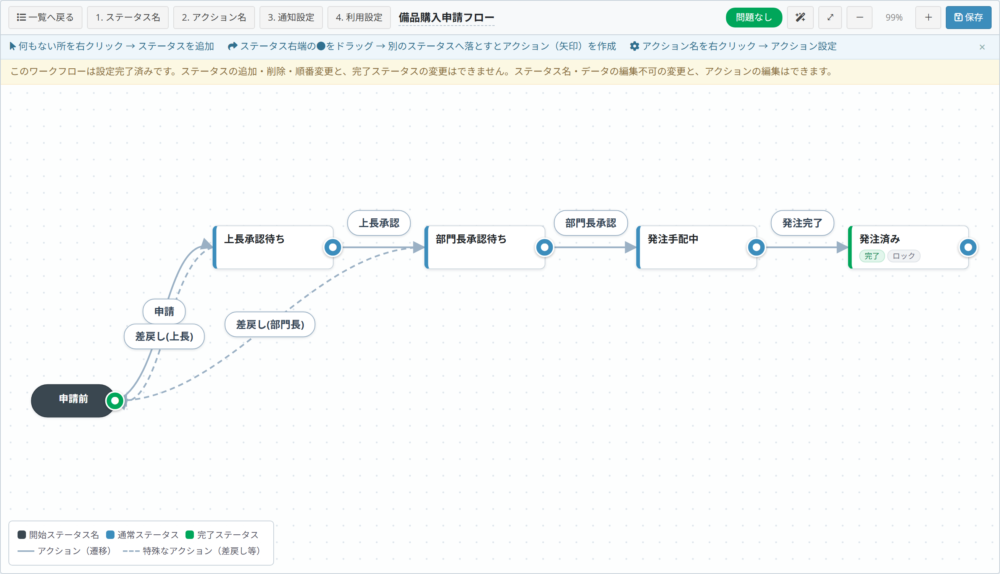
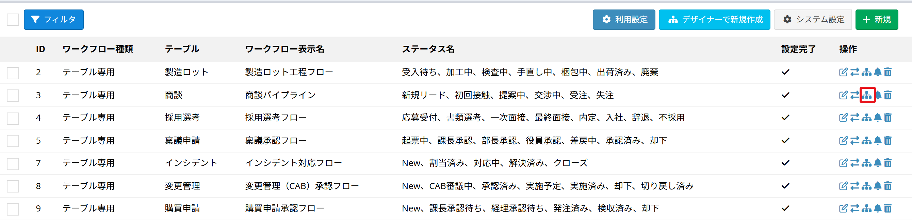
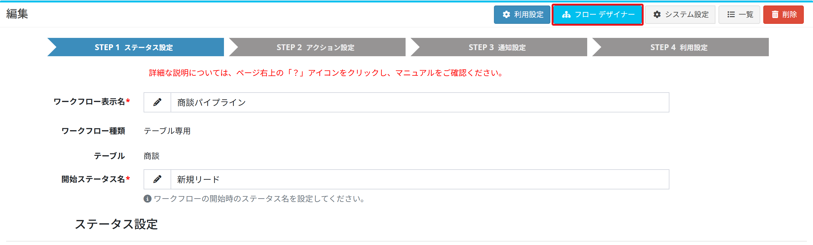
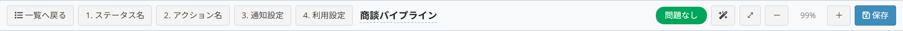
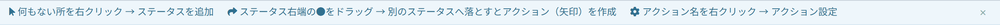
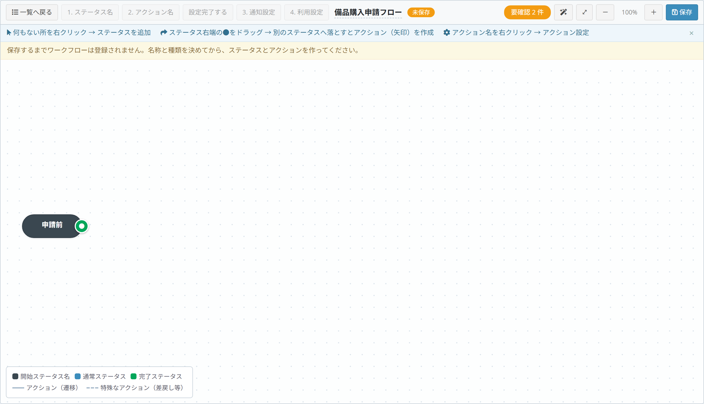
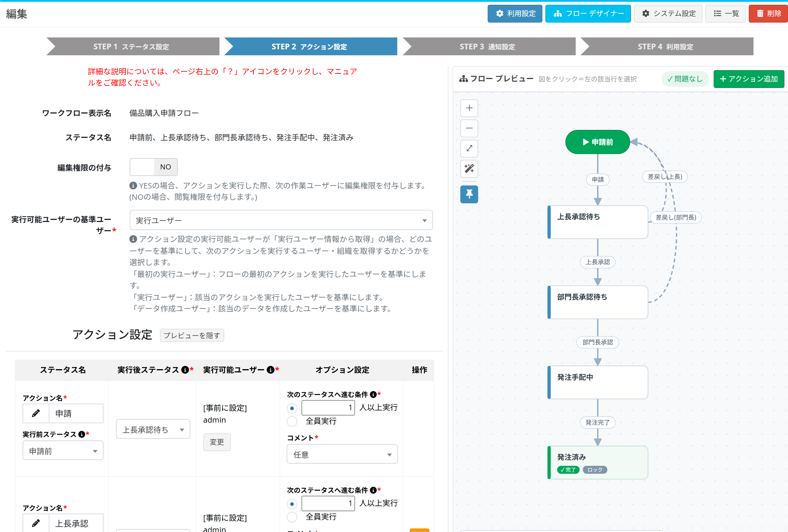

# Diseñador de flujos

Es la pantalla en la que los estados (situaciones) y las acciones (operaciones) de un flujo de trabajo se crean y se editan directamente sobre el diagrama de flujo.

## Qué es el Diseñador de flujos

En la [Configuración del flujo de trabajo](/es/workflow_setting), los estados se configuran en la tabla del "paso 1" y las acciones en la tabla del "paso 2".  
Cuando se configura solo con tablas, cuesta ver cosas como estas.

- Desde qué estado se puede avanzar a qué estado
- Si hay algún estado sin salida
- Si las rutas de devolución están bien conectadas

El Diseñador de flujos es la pantalla para crear y editar ese contenido **viéndolo como un diagrama**.

- Se guarda en el mismo lugar que los pasos 1 y 2. Lo que se crea en el diseñador se refleja tal cual en las tablas de los pasos 1 y 2
- Puede configurar desde cualquiera de las dos pantallas. También puede crear con el diagrama y ajustar las condiciones de detalle en las tablas

## Abrir la pantalla

### 1. Editar con el diagrama un flujo de trabajo existente

En la lista de la configuración del flujo de trabajo, haga clic en el icono [Diseñador de flujos] de la fila que quiera.

También se abre desde las pantallas de los pasos 1 y 2, con el botón [Diseñador de flujos] de arriba a la derecha.

### 2. Crear un flujo de trabajo nuevo desde el diagrama

En la lista de la configuración del flujo de trabajo, haga clic en el botón [Crear con el diseñador], arriba a la derecha.

## Cómo leer la pantalla

### Barra de herramientas

| Elemento | Descripción |
| --- | --- |
| Volver a la lista | Vuelve a la lista de la configuración del flujo de trabajo |
| 1. Nombre del estado / 2. Nombre de la acción | Va a las pantallas de configuración en forma de tabla (paso 1 y paso 2) |
| Completar configuración | Completa la configuración del flujo de trabajo. Está a la derecha de "2. Nombre de la acción" y no se muestra después de completar la configuración. Para más detalles, vea [Configuración del flujo de trabajo](/es/workflow_setting) |
| 3. Configuración de notificaciones / 4. Configuración de uso | Se pueden usar después de completar la configuración |
| (Nombre del flujo de trabajo) | Es el nombre del flujo de trabajo que se está editando |
| Sin problemas / ○ elemento(s) por revisar | Es el resultado de la comprobación de lo introducido. Al hacer clic se muestra el contenido |
| Organizar automáticamente | Vuelve a colocar los nodos automáticamente |
| ⤢ (Ajustar) | Muestra el diagrama de forma que quepa entero |
| －／＋ | Cambia el aumento de la vista |
| Guardar | Guarda lo editado |

### Consejos de uso

En la parte de arriba de la pantalla se muestran siempre las operaciones básicas.

### Leyenda

| Lo que se ve | Significado |
| --- | --- |
| Nodo negro | Estado inicial |
| Nodo azul | Estado normal |
| Nodo verde | Estado completado |
| Flecha de línea continua | Acción (operación para avanzar al siguiente estado) |
| Flecha de línea discontinua | Acción especial (operación que no se incluye en los usuarios responsables, como una devolución) |

Las marcas "Completado" y "Bloqueado" de un nodo indican, respectivamente, el estado completado y que no se permite editar los datos.

## Operaciones básicas

### Añadir un estado

Haga **clic derecho en un lugar vacío** del diagrama y elija [Agregar estado].

| Elemento | Descripción |
| --- | --- |
| Agregar estado | Crea un estado nuevo en el lugar donde hizo clic derecho |
| Organizar automáticamente | Vuelve a colocar los nodos automáticamente |
| Ajustar | Muestra el diagrama de forma que quepa entero |

### Crear una acción (flecha)

**Arrastre el ● del borde derecho** de un estado y suéltelo sobre otro estado.  
Se crea una acción (flecha) que une los 2 estados.

Si lo suelta en un lugar vacío, puede elegir "Crear un estado nuevo y conectar". Así crea el estado y la acción seguidos.

### Cambiar la configuración de una acción

Haga **clic derecho en el nombre de la acción** y elija [Configuración de la acción].

| Elemento | Descripción |
| --- | --- |
| Configuración de la acción | Configura el nombre de la acción, los usuarios ejecutores y las opciones |
| Eliminar acción | Elimina esta flecha (acción) |

### Cambiar la configuración de un estado

Con **clic derecho en el estado** puede cambiar el nombre del estado, indicar el estado completado y eliminarlo.

※Un estado que tiene datos no se puede eliminar. Si intenta eliminarlo, se muestra "En uso, no se puede eliminar".  
※El estado inicial no se puede eliminar. Solo se le puede cambiar el nombre.

### Ordenar el diagrama

- Los nodos se mueven libremente arrastrándolos
- Con [Organizar automáticamente] se vuelven a colocar solos, de izquierda a derecha
- Con [⤢ (Ajustar)] se pone el aumento con el que todo el diagrama cabe en la pantalla

### Guardar

Haga clic en el botón [Guardar], arriba a la derecha.  
Hasta que guarda, los cambios no pasan a la base de datos. Cuando hay cambios sin guardar, en la barra de herramientas se muestra "Sin guardar".

※Si intenta salir de la página sin guardar, se muestra un mensaje de confirmación.  
※Si otra persona ha actualizado antes el mismo flujo de trabajo, se muestra "Este flujo de trabajo se ha actualizado en otra pantalla". Vuelva a cargar la página y guarde otra vez.

## Elementos por revisar (comprobación de lo introducido)

En la parte derecha de la barra de herramientas se muestra siempre el resultado de la comprobación de lo introducido.

- Si no hay problemas, "Sin problemas" en verde
- Si hay problemas, "○ elemento(s) por revisar" en naranja

Al hacer clic se muestra la lista del contenido, y con otro clic se va al lugar correspondiente.

Las comprobaciones principales son las siguientes.

| Mensaje | Significado |
| --- | --- |
| El nombre del flujo de trabajo está vacío. No se puede guardar así. | No se puede guardar sin poner el nombre |
| El nombre del flujo de trabajo supera los 30 caracteres. No se puede guardar así. | El nombre tiene 30 caracteres como máximo |
| Seleccione el tipo de flujo de trabajo. / Seleccione la tabla de destino. | Elija el tipo de flujo de trabajo y, si es "Solo para una tabla", la tabla de destino |
| El nombre del estado inicial está vacío. No se puede guardar así. | Introduzca el nombre del estado inicial |
| No hay ninguna acción que comience en "○○". | No hay ninguna flecha que avance desde el estado inicial |
| No hay ningún estado. / No hay ninguna acción. | Añada 1 o más estados y acciones |
| Establezca al menos un estado completado. | El estado completado debe ser exactamente 1 |
| Ninguna acción llega a "○○". | Hay un estado al que no se llega desde ninguna parte |
| "○○" no tiene acciones de salida y no es un estado completado. | Hay un estado sin salida |
| No se ha establecido el estado antes de la ejecución / el estado después de la ejecución en la acción "○○". | Elija los dos estados de la acción, el de antes y el de después |
| La acción "○○" hace referencia a un estado eliminado. | La flecha apunta a un estado que no existe |
| Hay una fila sin nombre de acción. No se puede guardar así. | Todas las acciones necesitan nombre |
| El nombre de la acción "○○" supera los 30 caracteres. | El nombre de la acción tiene 30 caracteres como máximo |
| La acción "○○" tiene el mismo estado antes y después de la ejecución. No se puede guardar así. | No se puede poner una flecha que vuelva al mismo estado |
| No se han establecido los usuarios ejecutores en la acción "○○". No se puede guardar así. | Configure quién puede ejecutarla |
| El número de personas de "Condición para avanzar al siguiente estado" en la acción "○○" debe ser un número de 0 a 10. | Corrija el número de personas |

Sobre los usuarios ejecutores de una acción, también se muestra un mensaje cuando se combinan "Acción especial" y "Los selecciona el usuario que ejecutó la acción anterior", cuando en la primera acción se indica "Los selecciona el usuario que ejecutó la acción anterior" o algo distinto de "Establecer de antemano", y cuando con el mismo estado antes de la ejecución se usan a la vez "Los selecciona el usuario que ejecutó la acción anterior" y otro ajuste.

"Ninguna acción llega a…" y "…no tiene acciones de salida…" son avisos y no impiden guardar. Los demás mensajes impiden guardar.

## Crear con el diseñador

Si abre desde [Crear con el diseñador], primero se muestra el cuadro de diálogo "Información básica".

| Elemento | Descripción |
| --- | --- |
| Nombre visible del flujo de trabajo | El nombre del flujo de trabajo (hasta 30 caracteres) |
| Tipo de flujo de trabajo | "Genérico" o "Solo para una tabla" |
| Tabla | La tabla de destino del flujo de trabajo. Solo se introduce cuando el tipo es "Solo para una tabla" |
| Nombre del estado inicial | El nombre del primer estado ("En redacción", "Antes de solicitar", etc.) |

Al introducir los datos y pulsar [Guardar], el estado inicial se muestra a la izquierda del diagrama.

Después, añada estados con clic derecho y vaya uniendo acciones arrastrando el ●.

> **El flujo de trabajo no se registra hasta que guarda.**  
> Cuando crea los estados y las acciones y guarda, se puede pulsar [Completar configuración] en la barra de herramientas y avanzar al paso 3 (configuración de notificaciones) y al paso 4 (configuración de uso).

## La "Vista previa del flujo" del paso 2

En la pantalla del paso 2 (configuración de acciones) también se muestra el diagrama de flujo, a la derecha.

- Al editar la tabla, el diagrama se actualiza enseguida
- Al hacer clic en una acción del diagrama, se selecciona su fila en la tabla de la izquierda
- Con [+Agregar acción] se añade una fila a la tabla
- [○ elemento(s) por revisar] es la misma comprobación de lo introducido que en el diseñador

### Guardar disposición (botón de la chincheta)

Cambia si se registra o no la disposición de los nodos que ha movido.

- Si guarda la pantalla con la chincheta pulsada, se registra la disposición actual y la próxima vez que abra se verá igual
- Si no está pulsada, la disposición no se guarda y cada vez se muestra organizada automáticamente

### Ocultar vista previa

Si no necesita el diagrama, puede ocultarlo con [Ocultar vista previa]. Así tiene más espacio para los campos de la tabla.

## Puntos a tener en cuenta

#### Al editar un flujo de trabajo con la configuración completada
En un flujo de trabajo en el que se ha ejecutado [Completar configuración], los estados quedan fijos, igual que en el paso 1.

- No se pueden añadir, eliminar ni reordenar estados, ni cambiar el estado completado. [Agregar estado] y [Eliminar estado] del menú de clic derecho muestran "Bloqueado porque la configuración está completada" y no se pueden elegir.
- El nombre del estado, "No permitir editar los datos" y todas las acciones se pueden seguir editando.

Aparte de esto, **los estados que se usan en datos en solicitud o en historiales no se pueden eliminar, ni siquiera antes de completar la configuración.**

#### Estado completado
En un flujo de trabajo con la configuración sin completar, el estado completado es **exactamente 1**.

- Solo se puede poner 1 estado completado. Si hay varios, deje 1, quite los demás y después guarde.
- Tampoco se puede guardar si no hay ningún estado completado.
- Si guarda en la pantalla del paso 1, también solo el de la última fila de la tabla queda como estado completado.

Un flujo de trabajo con la configuración completada puede tener varios estados completados, por ejemplo porque viene de una plantilla. En ese caso se conservan tal cual y no se pueden cambiar en el Diseñador de flujos.

#### Sobre las condiciones de filtro (ramas)
Las condiciones de filtro de una acción se configuran en la pantalla del paso 2.  
Aunque guarde en el Diseñador de flujos, las condiciones ya puestas no se borran. En el diagrama, las ramas se muestran como "Condición 1" y "Condición 2".

## Temas relacionados

- [Configuración del flujo de trabajo](/es/workflow_setting)
- [Ejemplos de configuración del flujo de trabajo](/es/workflow_example)
- [Ejecución del flujo de trabajo](/es/workflow_execution)
- [Vista Kanban](/es/view_kanban)
