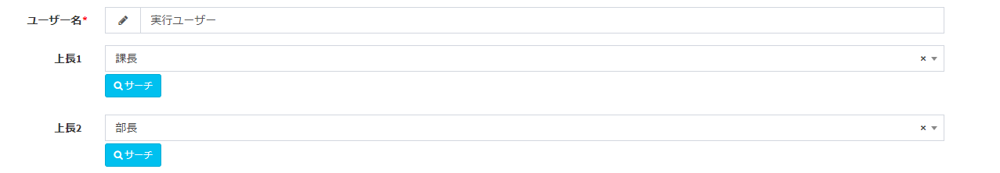
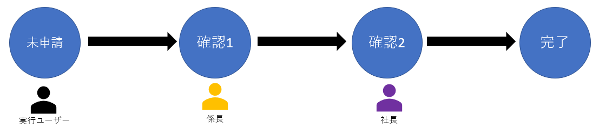
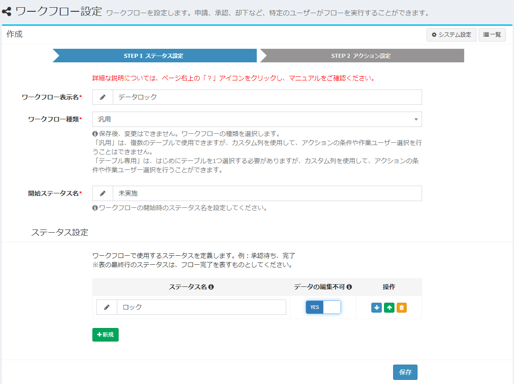
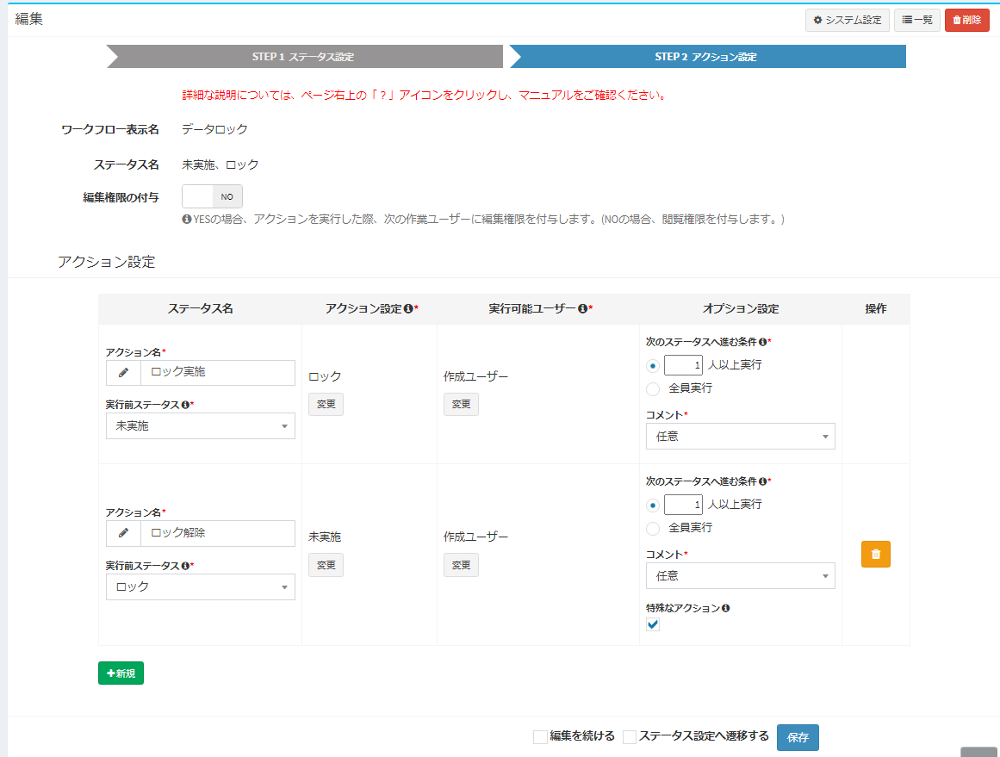

# Ejemplos de configuración del flujo de trabajo
Estos son ejemplos de configuración de flujos de trabajo. Elija el ejemplo que más se parezca al flujo que quiere crear e introduzca los datos tal como se indica.  
Para el significado de cada elemento, vea [Configuración del flujo de trabajo](/es/workflow_setting).

| El flujo que quiere crear | Ejemplo |
|---|---|
| Un flujo sencillo: solo solicitar y aprobar o rechazar | [Solicitar → Aprobar / Rechazar](#example1) |
| Separar a quien aprueba (la acción) según el importe del dato solicitado | [Solicitar → Aprobación del director o del jefe de sección / Rechazar](#example2) |
| Revisar en 2 etapas. Las dos personas que revisan se deciden con las columnas de superior del solicitante | [Sin solicitar → Revisión 1 → Revisión 2 → Completado (obtener de la información del primer usuario ejecutor)](#example4) |
| Revisar en 2 etapas. La segunda persona es el superior de la primera persona que revisó | [Sin solicitar → Revisión 1 → Revisión 2 → Completado (obtener de la información del usuario ejecutor)](#example5) |
| Bloquear un dato (no se puede editar ni eliminar) | [Bloqueo de datos](#example3) |

<h2 id="example1"><a href="#/es/workflow_example?id=example1" data-id="example1" class="anchor">Solicitar → Aprobar / Rechazar</a></h2>

Cómo configurar un flujo sencillo en el que se solicita un dato y se aprueba o se rechaza.  

  
- El usuario hace la solicitud al departamento de administración
- El departamento de administración aprueba la solicitud, o la rechaza
- Un dato aprobado ya no se puede modificar después

### Step1.Configuración de estados

  

- **Nombre visible del flujo de trabajo**: el nombre que quiera

- **Tipo de flujo de trabajo**: "Genérico"

- **Nombre del estado inicial**: "Sin realizar"

- **Estado, fila 1**  
Nombre del estado: "En solicitud"  
No permitir editar los datos: "YES"  

- **Estado, fila 2**  
Nombre del estado: "Completado"  
No permitir editar los datos: "YES"  

### Step2.Configuración de acciones

  

- **Configuración de acciones, fila 1**  
Nombre de la acción: "Solicitar"  
Estado antes de la ejecución: "Sin realizar"  
Configuración de acciones > Estado después de la ejecución: "En solicitud"  
Usuarios ejecutores: "Usuario creador"  
Configuración de opciones > Condición para avanzar al siguiente estado: "1 o más personas ejecutan"  
Configuración de opciones > Comentario: "Opcional"  

- **Configuración de acciones, fila 2**  
Nombre de la acción: "Aprobar"  
Estado antes de la ejecución: "En solicitud"  
Configuración de acciones > Estado después de la ejecución: "Completado"  
Usuarios ejecutores: "Grupo de administración" ※Cree antes la organización "Grupo de administración"  
Configuración de opciones > Condición para avanzar al siguiente estado: "2 o más personas ejecutan"  
Configuración de opciones > Comentario: "Opcional"  
Configuración de opciones > Acción especial: sin marcar  

- **Configuración de acciones, fila 3**  
Nombre de la acción: "Rechazar"  
Estado antes de la ejecución: "En solicitud"  
Configuración de acciones > Estado después de la ejecución: "Sin realizar"  
Usuarios ejecutores: "Grupo de administración" ※Cree antes la organización "Grupo de administración"  
Configuración de opciones > Condición para avanzar al siguiente estado: "1 o más personas ejecutan"  
Configuración de opciones > Comentario: "Obligatorio"  
Configuración de opciones > Acción especial: marcado  

<h2 id="example2"><a href="#/es/workflow_example?id=example2" data-id="example2" class="anchor">Solicitar → Aprobación del director o del jefe de sección / Rechazar</a></h2>

Cómo configurar el flujo cuando la acción y el responsable se separan según el importe del dato solicitado.    

  
- El usuario solicita un gasto
- Si el "Importe" del dato solicitado es de 100,000 yenes o más, se asigna automáticamente al director, y si es de menos de 100,000 yenes, al jefe de sección
- El director o el jefe de sección aprueba la solicitud, o la rechaza
- Un dato aprobado ya no se puede modificar después

### Step1.Configuración de estados

  

- **Nombre visible del flujo de trabajo**: el nombre que quiera

- **Tipo de flujo de trabajo**: "Solo para una tabla"

- **Tabla**: elija la tabla en la que se ejecuta el flujo de trabajo

- **Nombre del estado inicial**: "Sin solicitar"

- **Estado, fila 1**  
Nombre del estado: "En solicitud al director"  
No permitir editar los datos: "YES"  

- **Estado, fila 2**  
Nombre del estado: "En solicitud al jefe de sección"  
No permitir editar los datos: "YES"  

- **Estado, fila 3**  
Nombre del estado: "Completado"  
No permitir editar los datos: "YES"  

### Step2.Configuración de acciones

  

- **Configuración de acciones, fila 1**  
Nombre de la acción: "Solicitar"  
Estado antes de la ejecución: "Sin solicitar"  
Configuración de acciones > Estado después de la ejecución: vea la imagen de abajo  

  
>Si el tipo de columna del elemento de la condición es Selección (desde tabla), el texto que se muestra en el valor de la condición se puede cambiar en la [Configuración de columnas de encabezado](/es/table).

Usuarios ejecutores: "Usuario creador"  
Configuración de opciones > Condición para avanzar al siguiente estado: "1 o más personas ejecutan"  
Configuración de opciones > Comentario: "Opcional"  

- **Configuración de acciones, fila 2**  
Nombre de la acción: "Aprobar"  
Estado antes de la ejecución: "En solicitud al director"  
Configuración de acciones > Estado después de la ejecución: "Completado"  
Usuarios ejecutores: "Director" ※Cree antes la organización "Director"  
Configuración de opciones > Condición para avanzar al siguiente estado: "1 o más personas ejecutan"  
Configuración de opciones > Comentario: "Opcional"  
Configuración de opciones > Acción especial: sin marcar  

- **Configuración de acciones, fila 3**  
Nombre de la acción: "Aprobar"  
Estado antes de la ejecución: "En solicitud al jefe de sección"  
Configuración de acciones > Estado después de la ejecución: "Completado"  
Usuarios ejecutores: "Jefe de sección" ※Cree antes la organización "Jefe de sección"  
Configuración de opciones > Condición para avanzar al siguiente estado: "1 o más personas ejecutan"  
Configuración de opciones > Comentario: "Opcional"  
Configuración de opciones > Acción especial: sin marcar  

- **Configuración de acciones, fila 4**  
Nombre de la acción: "Rechazar"  
Estado antes de la ejecución: "En solicitud al director"  
Configuración de acciones > Estado después de la ejecución: "Sin solicitar"  
Usuarios ejecutores: "Director" ※Cree antes la organización "Director"  
Configuración de opciones > Condición para avanzar al siguiente estado: "1 o más personas ejecutan"  
Configuración de opciones > Comentario: "Obligatorio"  
Configuración de opciones > Acción especial: marcado  

- **Configuración de acciones, fila 5**  
Nombre de la acción: "Rechazar"  
Estado antes de la ejecución: "En solicitud al jefe de sección"  
Configuración de acciones > Estado después de la ejecución: "Sin solicitar"  
Usuarios ejecutores: "Jefe de sección" ※Cree antes la organización "Jefe de sección"  
Configuración de opciones > Condición para avanzar al siguiente estado: "1 o más personas ejecutan"  
Configuración de opciones > Comentario: "Obligatorio"  
Configuración de opciones > Acción especial: marcado  

<h2 id="example4"><a href="#/es/workflow_example?id=example4" data-id="example4" class="anchor">Sin solicitar → Revisión 1 → Revisión 2 → Completado (obtener de la información del primer usuario ejecutor)</a></h2>

Cómo configurar el flujo "Sin solicitar → Revisión 1 → Revisión 2 → Completado". Los usuarios ejecutores de las acciones se obtienen "de la información del primer usuario ejecutor".   

  
- La acción "Revisión 1" la puede ejecutar el usuario puesto en la columna "Superior 1" del solicitante (el primer usuario ejecutor del flujo)
- La acción "Revisión 2" la puede ejecutar el usuario puesto en la columna "Superior 2" del solicitante (el primer usuario ejecutor del flujo)

### Step0.Configuración de las columnas de usuario

Primero, en la configuración de columnas personalizadas de la tabla "Usuario", añada las siguientes columnas.

  

- Columna 1:
    - Nombre de la columna (alfanumérico): "boss1"
    - Nombre visible de la columna: "Superior 1"
    - Índice de búsqueda: YES
    - Tipo de columna: Usuario

- Columna 2:
    - Nombre de la columna (alfanumérico): "boss2"
    - Nombre visible de la columna: "Superior 2"
    - Índice de búsqueda: YES
    - Tipo de columna: Usuario
  
Después, edite la información de cada usuario y registre los elementos de las columnas "Superior 1" y "Superior 2".

  

※Si en el usuario "Usuario ejecutor" los datos están registrados como arriba, el flujo de trabajo se ejecuta de la siguiente manera.

  

### Step1.Configuración de estados

- **Nombre visible del flujo de trabajo**: el nombre que quiera

- **Tipo de flujo de trabajo**: "Genérico"

- **Nombre del estado inicial**: "Sin solicitar"

- **Estado, fila 1**  
Nombre del estado: "Revisión 1"  
No permitir editar los datos: "NO"  

- **Estado, fila 2**  
Nombre del estado: "Revisión 2"  
No permitir editar los datos: "NO"  

- **Estado, fila 3**  
Nombre del estado: "Completado"  
No permitir editar los datos: "YES"  

### Step2.Configuración de acciones

  

- **Configuración común**  
Usuario de referencia de los usuarios ejecutores: "Primer usuario ejecutor"  

- **Configuración de acciones, fila 1**  
Nombre de la acción: "Acción 1"  
Estado antes de la ejecución: "Sin solicitar"  
Estado después de la ejecución: Revisión 1  
Usuarios ejecutores: "Usuario creador"  
Configuración de opciones > Condición para avanzar al siguiente estado: "1 o más personas ejecutan"  
Configuración de opciones > Comentario: "Opcional"  

- **Configuración de acciones, fila 2**  
Nombre de la acción: "Acción 2"  
Estado antes de la ejecución: "Revisión 1"  
Estado después de la ejecución: "Revisión 2"  
Usuarios ejecutores: (Obtener de la información del usuario ejecutor) Superior 1  
Configuración de opciones > Condición para avanzar al siguiente estado: "1 o más personas ejecutan"  
Configuración de opciones > Comentario: "Opcional"  
Configuración de opciones > Acción especial: sin marcar  

- **Configuración de acciones, fila 3**  
Nombre de la acción: "Acción 3"  
Estado antes de la ejecución: "Revisión 2"  
Estado después de la ejecución: "Completado"  
Usuarios ejecutores: (Obtener de la información del usuario ejecutor) Superior 2  
Configuración de opciones > Condición para avanzar al siguiente estado: "1 o más personas ejecutan"  
Configuración de opciones > Comentario: "Opcional"  
Configuración de opciones > Acción especial: sin marcar  

#### Referencia: cuadro de diálogo que aparece al hacer clic en el botón Cambiar de "Usuarios ejecutores"

  

<h2 id="example5"><a href="#/es/workflow_example?id=example5" data-id="example5" class="anchor">Sin solicitar → Revisión 1 → Revisión 2 → Completado (obtener de la información del usuario ejecutor)</a></h2>

Cómo configurar el flujo "Sin solicitar → Revisión 1 → Revisión 2 → Completado". Los usuarios ejecutores de las acciones se obtienen con "Obtener de la información del usuario ejecutor".   

  
- La acción "Revisión 1" la puede ejecutar el usuario puesto en la columna "Superior" del solicitante (el primer usuario ejecutor del flujo)
- La acción "Revisión 2" la puede ejecutar el usuario puesto en la columna "Superior" del usuario que ejecutó la acción "Revisión 1"

### Step0.Configuración de las columnas de usuario

Primero, en la configuración de columnas personalizadas de la tabla "Usuario", añada las siguientes columnas.

  

- Columna:
    - Nombre de la columna (alfanumérico): "boss"
    - Nombre visible de la columna: "Superior"
    - Índice de búsqueda: YES
    - Tipo de columna: Usuario

  
Después, edite la información de cada usuario y registre el elemento de la columna "Superior".  
Primero, deje los datos del primer usuario, "Usuario ejecutor", como sigue.

  

Además, deje los datos del usuario "Jefe de equipo" como sigue.

  

※Si los datos están registrados como arriba, el flujo de trabajo se ejecuta de la siguiente manera.

  

### Step1.Configuración de estados

- **Nombre visible del flujo de trabajo**: el nombre que quiera

- **Tipo de flujo de trabajo**: "Genérico"

- **Nombre del estado inicial**: "Sin solicitar"

- **Estado, fila 1**  
Nombre del estado: "Revisión 1"  
No permitir editar los datos: "NO"  

- **Estado, fila 2**  
Nombre del estado: "Revisión 2"  
No permitir editar los datos: "NO"  

- **Estado, fila 3**  
Nombre del estado: "Completado"  
No permitir editar los datos: "YES"  

### Step2.Configuración de acciones

  

- **Configuración común**  
Usuario de referencia de los usuarios ejecutores: "Usuario ejecutor"  

- **Configuración de acciones, fila 1**  
Nombre de la acción: "Acción 1"  
Estado antes de la ejecución: "Sin solicitar"  
Estado después de la ejecución: Revisión 1  
Usuarios ejecutores: "Usuario creador"  
Configuración de opciones > Condición para avanzar al siguiente estado: "1 o más personas ejecutan"  
Configuración de opciones > Comentario: "Opcional"  

- **Configuración de acciones, fila 2**  
Nombre de la acción: "Acción 2"  
Estado antes de la ejecución: "Revisión 1"  
Estado después de la ejecución: "Revisión 2"  
Usuarios ejecutores: (Obtener de la información del usuario ejecutor) Superior  
Configuración de opciones > Condición para avanzar al siguiente estado: "1 o más personas ejecutan"  
Configuración de opciones > Comentario: "Opcional"  
Configuración de opciones > Acción especial: sin marcar  

- **Configuración de acciones, fila 3**  
Nombre de la acción: "Acción 3"  
Estado antes de la ejecución: "Revisión 2"  
Estado después de la ejecución: "Completado"  
Usuarios ejecutores: (Obtener de la información del usuario ejecutor) Superior  
Configuración de opciones > Condición para avanzar al siguiente estado: "1 o más personas ejecutan"  
Configuración de opciones > Comentario: "Opcional"  
Configuración de opciones > Acción especial: sin marcar  

#### Referencia: cuadro de diálogo que aparece al hacer clic en el botón Cambiar de "Usuarios ejecutores"

  

<h2 id="example3"><a href="#/es/workflow_example?id=example3" data-id="example3" class="anchor">Bloqueo de datos</a></h2>

Cómo configurar el flujo cuando quiere bloquear un dato concreto (que no se pueda editar ni eliminar).  

  
- El creador bloquea o desbloquea el dato
- Un dato bloqueado no se puede modificar hasta que se desbloquea

### Step1.Configuración de estados

  

- **Nombre visible del flujo de trabajo**: el nombre que quiera

- **Tipo de flujo de trabajo**: "Genérico"

- **Nombre del estado inicial**: "Sin realizar"

- **Estado, fila 1**  
Nombre del estado: "Bloqueado"  
No permitir editar los datos: "YES"  

### Step2.Configuración de acciones

  

- **Configuración de acciones, fila 1**  
Nombre de la acción: "Bloquear"  
Estado antes de la ejecución: "Sin realizar"  
Configuración de acciones > Estado después de la ejecución: "Bloqueado"  
Usuarios ejecutores: "Usuario creador"  
Configuración de opciones > Condición para avanzar al siguiente estado: "1 o más personas ejecutan"  
Configuración de opciones > Comentario: "Opcional"  

- **Configuración de acciones, fila 2**  
Nombre de la acción: "Desbloquear"  
Estado antes de la ejecución: "Bloqueado"  
Configuración de acciones > Estado después de la ejecución: "Sin realizar"  
Usuarios ejecutores: "Usuario creador"  
Configuración de opciones > Condición para avanzar al siguiente estado: "1 o más personas ejecutan"  
Configuración de opciones > Comentario: "Opcional"  
Configuración de opciones > Acción especial: marcado  

