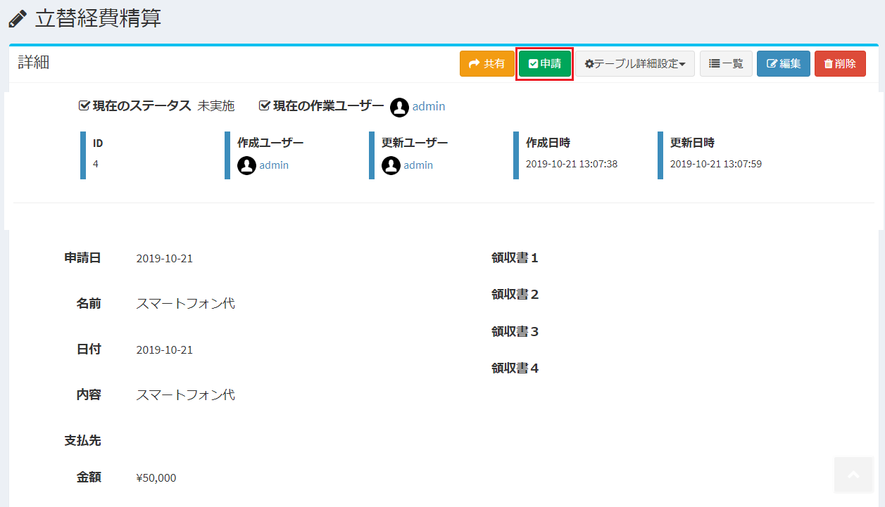

# Ejecución del flujo de trabajo
Estos son los pasos con los que un usuario ejecuta las acciones de un flujo de trabajo (solicitar, aprobar, etc.).  
Antes, el administrador tiene que haber hecho la [Configuración del flujo de trabajo](/es/workflow_setting).

## Ejecutar el flujo de trabajo
1. Al abrir un dato, se muestran el estado actual y los usuarios u organizaciones responsables que hacen la siguiente acción.
  

2. Si el usuario con acceso tiene permiso para hacer la siguiente acción, arriba a la derecha de la página se muestra el botón de la acción.  
  

3. Al hacer clic en el botón, se muestra el cuadro de diálogo de confirmación de la acción.  
  

   - Nombre de la acción  
   Se muestra el nombre de la acción que se va a ejecutar.  

   - Estado  
   Se muestran los estados de antes y de después de ejecutar esta acción.  

   - Siguientes usuarios responsables  
   Se muestran los usuarios u organizaciones responsables después de ejecutar esta acción.  

   - Comentario  
   Escriba el comentario de la ejecución de la acción.  

4. Si todo está bien, haga clic en [Enviar]. Se ejecuta la acción.

5. Cuando se ejecuta la acción, cambian el "Estado actual" y los "Usuarios responsables actuales".  
※Según la configuración del flujo de trabajo, en el "Estado actual" se muestra un candado. En ese caso el dato queda bloqueado y no se puede editar ni eliminar.

  

※Desde la v7.1.0 también se pueden ejecutar de una vez las acciones de varios datos marcados en la lista de datos. Para más detalles, vea [Herramientas de la lista de datos](/es/data_grid_tools).

## Revisar las tareas pendientes
Los datos en los que usted tiene que ejecutar una acción se pueden revisar juntos, de todas las tablas, con el icono de tareas pendientes de arriba a la derecha de la página y en la pantalla Tareas pendientes.  
Para más detalles, consulte [Tareas pendientes](/es/workflow_task).

## Restablecer los datos del flujo de trabajo

Los datos de un flujo de trabajo en curso se pueden restablecer. Hágalo cuando, por algún motivo, el flujo de trabajo no se pueda continuar.  
El restablecimiento se hace con un comando. Ejecute el siguiente comando en el directorio raíz del proyecto.

~~~
php artisan exment:workflow-clear (nombre de la tabla) (ID)

# Ejemplo: restablecer el avance del flujo de trabajo del dato con nombre de tabla "estimate" e ID "6"
php artisan exment:workflow-clear estimate 6

# Ejemplo: restablecer el avance del flujo de trabajo del dato con nombre de tabla "syusseki" e ID "600"
php artisan exment:workflow-clear syusseki 600
~~~
