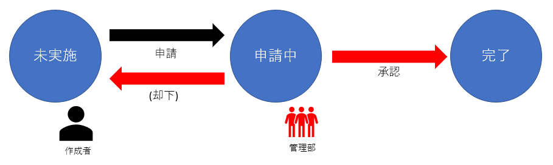
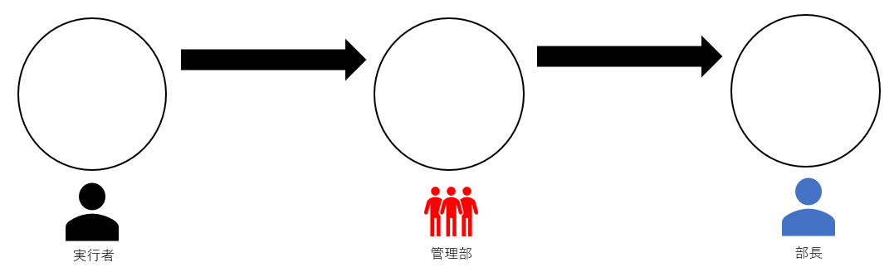

# Configuración del flujo de trabajo
En esta página se crea un "flujo de trabajo" de solicitud, aprobación, etc., y se deja listo para usarlo en las tablas. Lo configura el administrador del sistema.

El orden de la configuración es el siguiente.

1. **Step1.Configuración de estados**: se deciden los estados, como "Sin solicitar", "Pendiente de aprobación" o "Completado".
2. **Step2.Configuración de acciones**: se deciden las operaciones, como "Solicitar" o "Aprobar", y quién puede ejecutarlas.
3. **Completar configuración**: se completa la configuración del flujo de trabajo. Después ya no se pueden añadir, eliminar ni reordenar estados.
4. **Step3.Configuración de notificaciones**: se deciden las notificaciones que se envían al ejecutar el flujo de trabajo.
5. **Step4.Configuración de uso**: se decide en qué tablas se usa.

※Los estados y las acciones también se pueden crear y editar directamente sobre el diagrama de flujo. Para más detalles, vea [Diseñador de flujos](/es/workflow_design).

## Qué es un flujo de trabajo
Un flujo de trabajo es "la secuencia de intercambios de un trabajo".  
Muchos trabajos tienen una secuencia: "quién empieza, quién decide o tramita, y cómo se termina".  
Si configura un flujo de trabajo en Exment, puede ejecutar, por ejemplo, una secuencia como esta.

  
- El usuario solicita un gasto al departamento de administración
- El departamento de administración aprueba la solicitud de gasto, o la rechaza
- Un gasto aprobado ya no se puede modificar después

## Glosario
Estos son los términos que se usan en los flujos de trabajo de Exment.

  

##### Flujo de trabajo  
Representa toda la secuencia del trabajo, como la solicitud y la aprobación.  

##### Estado  
Representa la situación actual del flujo de trabajo.  
Ejemplo: Sin solicitar, Pendiente de aprobación, Completado  

##### Acción  
Es la operación que ejecuta un usuario. Al ejecutarla, se pasa de un estado a otro.  
Ejemplo: Solicitar, Aprobar, Rechazar, Devolver

##### Usuario responsable  
Es el usuario al que le toca ejecutar la siguiente acción.

## Mostrar la pantalla de lista
El administrador del sistema hace clic en "Configuración de administración > Flujo de trabajo" del menú.  
Se muestra la lista de los flujos de trabajo guardados.

## Crear uno nuevo

1. Haga clic en el botón [Nuevo], arriba a la derecha de la pantalla de lista.
2. Se muestra "Step1.Configuración de estados" de la pantalla de creación del flujo de trabajo. Introduzca los datos necesarios.

### Step1.Configuración de estados
Aquí se configuran los estados del flujo de trabajo.

  

#### Nombre visible del flujo de trabajo ※Obligatorio
- Es el nombre del flujo de trabajo que se muestra en pantalla. También se puede escribir en japonés. (Ejemplo: Flujo de aprobación)  

#### Tipo de flujo de trabajo ※Obligatorio
- Es el tipo del flujo de trabajo que se crea. Elija "Genérico" o "Solo para una tabla".  
※No se puede cambiar después de crearlo.  
##### Genérico  
El flujo de trabajo se puede usar en varias tablas.  
Elija este tipo si solo quiere usar estados y acciones estándar, como "Solicitar", "Aprobar" o "Rechazar".  
##### Solo para una tabla  
Solo se puede usar en la tabla elegida al crearlo. A cambio, puede cambiar el destino de la acción usando las columnas personalizadas de esa tabla.  
Ejemplo: en la tabla "Liquidación de gastos", si la columna personalizada "Importe" es de 100,000 yenes o más, se ejecuta la acción "Aprobación del director", y si es de menos de 100,000 yenes, la acción "Aprobación del jefe de sección".

#### Nombre del estado inicial ※Obligatorio
- Aquí se pone el nombre del estado cuando el flujo de trabajo todavía no se ha ejecutado.

#### Configuración de estados
- Aquí se define la configuración del flujo de trabajo y los estados que se usan.  
※El estado de la última fila de la tabla debe ser el que representa el fin del flujo.
##### Nombre del estado  
Es el nombre de ese estado.
##### No permitir editar los datos  
Indica si, mientras dura este estado, se impide editar el dato. Si no quiere que se edite, póngalo en YES.  
Ejemplo: en "Sin solicitar" el dato se puede editar y eliminar, pero en "En solicitud" y "Completado" no quiere que se edite ni se elimine. En este caso, ponga YES en "En solicitud" y "Completado".

### Step2.Configuración de acciones

  
#### Nombre visible del flujo de trabajo  
Se muestra el nombre visible puesto en la configuración de estados.
#### Nombre del estado  
Se muestra el nombre del estado puesto en la configuración de estados.
#### Conceder permiso de edición  
Al ejecutar el flujo de trabajo, se puede dar el permiso de edición a los "Siguientes usuarios responsables".
#### Usuario de referencia de los usuarios ejecutores ※Obligatorio  
Aquí se pone el usuario que sirve de referencia cuando los usuarios ejecutores de la acción son "Obtener de la información del usuario ejecutor". Se puede elegir entre "Primer usuario ejecutor", "Usuario ejecutor" y "Usuario creador de los datos".

#### Configuración de acciones
- Aquí se configuran las acciones que se realizan en el flujo de trabajo.  
##### Nombre de la acción  
Es el nombre de esa acción.
##### Estado antes de la ejecución  
Aquí se pone el estado en el que se puede ejecutar esa acción.  
Ejemplo: si el estado antes de la ejecución es "Sin realizar", la acción se puede ejecutar cuando el estado del dato es "Sin realizar".  
##### Configuración de acciones  
Aquí se configura qué acción se puede ejecutar. Para cambiar la configuración, haga clic en el botón [Cambiar].  
El contenido cambia según el tipo de flujo de trabajo.  

  ※Cuando el tipo de flujo de trabajo es "Genérico":  
    Se pone el estado al que se pasa después de ejecutar esta acción. Elija un estado distinto del "Estado antes de la ejecución".

  ※Cuando el tipo de flujo de trabajo es "Solo para una tabla":  
Se ponen las condiciones para ejecutar la acción y el estado después de la ejecución. Se pueden poner hasta 3 combinaciones de condición y estado.

> Si el tipo de columna del elemento de la condición es Selección (elegir de la lista de valores de otra tabla), el texto que se muestra en el valor de la condición se puede cambiar en la [Configuración de columnas de encabezado](/es/table).

#### Usuarios ejecutores  

Aquí se eligen los usuarios, las organizaciones, etc. que pueden ejecutar esta acción. Para cambiar la configuración, haga clic en el botón [Cambiar].
  

##### Usuarios ejecutores: Los selecciona el usuario que ejecutó la acción anterior
El usuario que ejecuta la acción elige cada vez a qué usuario u organización se dirige.  
  

##### Usuarios ejecutores: Establecer de antemano
El administrador decide de antemano a qué usuario u organización se dirige. El flujo avanza según esa configuración.  
  

**■Elementos de configuración**

- Usuario  
El usuario indicado puede ejecutar la acción.  

- Organización  
Los usuarios que pertenecen a la organización indicada pueden ejecutar la acción.  

- Columna personalizada  
El usuario o la organización puestos en la columna personalizada del dato pueden ejecutar la acción. Es una función solo de "Solo para una tabla".  

- Sistema > Usuario creador  
El usuario que creó el dato personalizado puede ejecutar la acción.

##### Usuarios ejecutores: Obtener de la información del usuario ejecutor
El destino se decide a partir de la información del usuario que ejecuta el flujo de trabajo. Se toma el valor de un elemento de usuario u organización puesto en ese usuario (por ejemplo, su superior) y la acción se dirige a ese usuario u organización.

- Ejemplo 1: si el superior del Usuario A es el "Director X", la acción se dirige al Director X
- Ejemplo 2: si los superiores del Usuario B son el "Director Y" y el "Director Z", la acción se dirige al Director Y y al Director Z
  

※Para usar esta función, el administrador del sistema tiene que añadir antes, en la tabla "Usuario", columnas del tipo de columna personalizada "Usuario" u "Organización". Además, esas columnas deben tener "Índice de búsqueda" en YES.

**■Usuario de referencia**

Es el usuario que sirve de referencia al obtener los usuarios ejecutores. Se [configura por flujo de trabajo](/es/workflow_setting?id=Usuario-de-referencia-de-los-usuarios-ejecutores-※Obligatorio).  

- "Primer usuario ejecutor": la referencia es el usuario que ejecutó la primera acción del flujo.  
- "Usuario ejecutor": la referencia es el usuario que ejecutó la acción en cuestión.  
- "Usuario creador de los datos": la referencia es el usuario que creó el dato.  

> Para ver cómo cambia el comportamiento según el usuario de referencia, consulte [Ejemplos de flujos de trabajo](/es/workflow_example).

**■Columna personalizada**

Como candidatas se muestran las columnas "Usuario" y "Organización" de la tabla de usuarios. Al ejecutar la acción, el usuario o la organización puestos en esa columna del usuario de referencia pueden ejecutar la siguiente acción.  

#### Configuración de opciones > Condición para avanzar al siguiente estado  
Aquí se pone cuántas personas tienen que ejecutar esta acción para avanzar al siguiente estado.  
※Normalmente el flujo avanza cuando la ejecuta 1 persona. Cambie este valor cuando quiera algo como "solo se avanza al siguiente estado si aprueban 3 personas o más" o "solo se avanza al siguiente estado si aprueban todos los usuarios de la organización de administración".  

#### Configuración de opciones > Comentario  
Indica si se puede escribir un comentario al ejecutar la acción.  
Se puede elegir entre "Obligatorio", "Opcional" y "No usar".  
※Una acción configurada como "Obligatorio" no muestra botón en la tarjeta de notificación de [LINE](/es/line) y no se puede ejecutar desde LINE.

#### Configuración de opciones > Acción especial  
Si lo marca, los "Usuarios ejecutores" de esta acción no se incluyen en los usuarios responsables actuales.  
(Los usuarios responsables actuales son los usuarios que, en el estado de ahora, pueden ejecutar alguna acción del flujo de trabajo.)  
Márquelo, por ejemplo, en las acciones con las que un administrador aprueba de forma excepcional.  
※Si un usuario responsable solo está asignado a una "Acción especial", ese usuario no recibe notificación. Tampoco se muestra en "Usuarios responsables actuales".

※Su uso principal es como acción para que un administrador, con sus permisos, devuelva al principio un flujo de trabajo en curso o lo lleve hasta el final de forma excepcional.

#### Diferencias con una acción normal
| Resumen | Normal | Acción especial |
| ---- | ---- | ---- |
| Configuración de usuarios ejecutores | Sin límite | Solo "Establecer de antemano" |
| Notificación a los usuarios de destino | Se hace | No se hace |
| Aparición en "Usuarios responsables actuales" | Aparece | No aparece |
| Aparición en [Tareas pendientes](/es/workflow_task) | Aparece | No aparece |

### Completar configuración
Cuando se han hecho tanto la configuración de estados como la de acciones, arriba a la derecha de la página aparece el botón "Completar configuración".  

  

Al hacer clic, se completa la configuración del flujo de trabajo.  
※Una vez completada la configuración, ya no se puede hacer lo siguiente. 
- Añadir, eliminar o reordenar estados

### Step3.Configuración de notificaciones
Los pasos 3 y 4 se muestran después de ejecutar [Completar configuración].  
Aquí se configuran las notificaciones que se envían al ejecutar el flujo de trabajo. Para los elementos de configuración, vea [Configuración de notificaciones y envío de correo](/es/notify).

### Step4.Configuración de uso
Aquí se configura qué flujo de trabajo se ejecuta en cada tabla.  
  

- En cada tabla se muestran los flujos de trabajo "Genérico" o creados solo para esa tabla que tienen la configuración completada.

- Para usar un flujo de trabajo, marque la casilla "Usar".  

- Para cambiar de flujo de trabajo según la fecha, ponga las fechas en "Fecha de inicio de uso" y "Fecha de fin de uso". Guarde de forma que los periodos no se solapen.

Con esto termina la configuración del flujo de trabajo.  
Para ejecutar de verdad el flujo de trabajo, consulte [Ejecución del flujo de trabajo](/es/workflow_execution).

### Eliminar un flujo de trabajo
La configuración de un flujo de trabajo registrado se puede eliminar.  
Si elimina un flujo de trabajo que ya tiene configuración de uso, tenga en cuenta lo siguiente.

- Ya no podrá restaurar la configuración del flujo de trabajo.
- Los flujos de trabajo en curso quedan desactivados.
- **Aunque "No permitir editar los datos" esté en YES en la configuración de estados, los datos que no se podían editar vuelven a poder editarse.**

  

### Otros detalles del comportamiento

- Con "Usuarios ejecutores: Obtener de la información del usuario ejecutor" y "Usuario de referencia de los usuarios ejecutores: Usuario ejecutor", si pone 2 personas o más en "Configuración de opciones > Condición para avanzar al siguiente estado", los siguientes usuarios responsables se obtienen tomando como referencia al último usuario que ejecutó.  
Ejemplo: si "Condición para avanzar al siguiente estado" es de 3 personas, el usuario de referencia para obtener "los usuarios que ejecutan la siguiente acción" es solo la tercera persona que ejecutó la acción. No se obtiene la información de la primera ni de la segunda.

- En acciones con el mismo "Estado antes de la ejecución" no se pueden configurar a la vez "Usuarios ejecutores: Establecer de antemano" y "Usuarios ejecutores: Los selecciona el usuario que ejecutó la acción anterior". (Excepto cuando "Usuarios ejecutores: Establecer de antemano" es una "Acción especial".)

- En acciones con el mismo "Estado antes de la ejecución" no se pueden configurar a la vez "Usuarios ejecutores: Obtener de la información del usuario ejecutor" y "Usuarios ejecutores: Los selecciona el usuario que ejecutó la acción anterior". (Excepto cuando "Usuarios ejecutores: Obtener de la información del usuario ejecutor" es una "Acción especial".)

