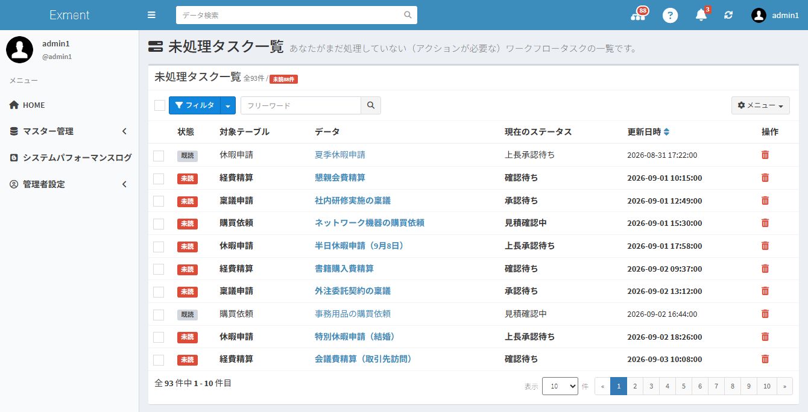
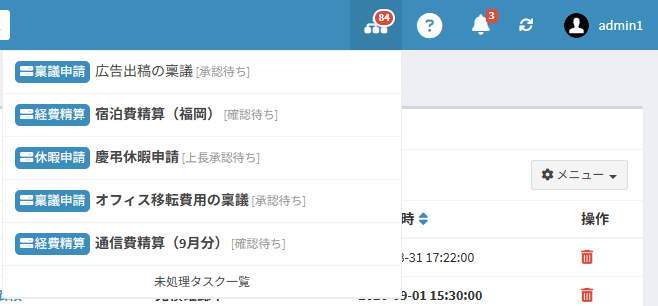
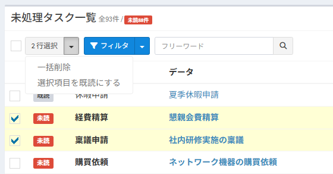
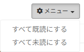
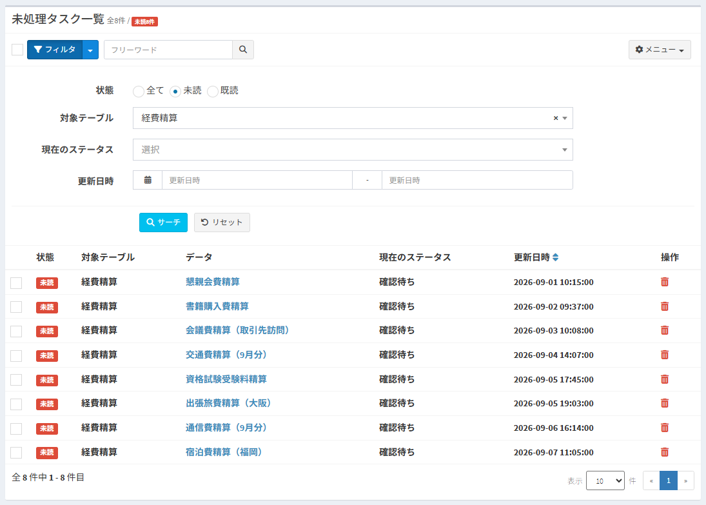
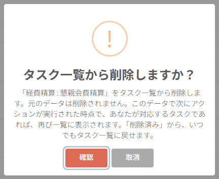
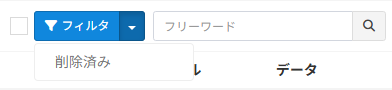
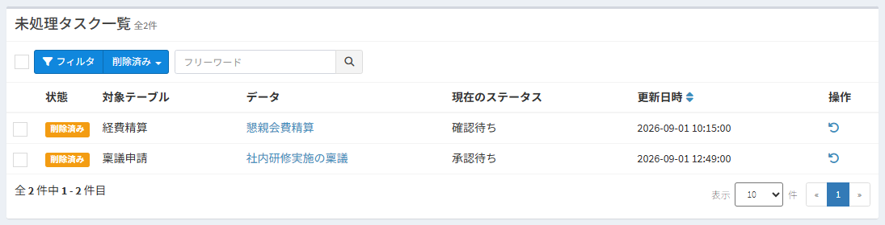

# Tareas pendientes

Es la pantalla que muestra juntos, de todas las tablas, los datos de flujos de trabajo (tareas) en los que el usuario con acceso tiene que ejecutar una acción.  
Con el icono de arriba a la derecha de la página también puede revisar en cualquier momento las tareas pendientes.

## Qué son las tareas pendientes

Cuando se usan flujos de trabajo, suelen pasar cosas como estas.

- No se sabe en qué tabla hay datos esperando aprobación si no se abren las tablas una por una
- Nadie se da cuenta de que ha llegado una solicitud y el trámite se queda parado

La lista de tareas pendientes muestra en una sola lista, de todas las tablas, **los datos en los que el usuario con acceso puede ejecutar una acción ahora**.  
Al abrir uno desde la lista, se va a la pantalla de detalle de ese dato y se puede ejecutar la acción allí mismo.

### Datos que se muestran en la lista

Se muestran como tareas los datos que cumplen todas las condiciones siguientes.

- Es un dato de un flujo de trabajo con la configuración completada y puesto en "Usar"
- El usuario con acceso, o una organización a la que pertenece, es usuario responsable del estado actual
- En la pantalla de detalle del dato se muestra el botón de una acción que el usuario con acceso puede ejecutar
  - No se muestran los datos que no cumplen las condiciones de la configuración de acciones
  - En una acción con "Condición para avanzar al siguiente estado" de 2 personas o más, no se muestra si el usuario con acceso ya ejecutó la acción
  - La "Acción especial" no cuenta para las tareas
- El usuario con acceso tiene permiso para consultar ese dato

※En la lista solo se muestran las tareas del propio usuario con acceso. Ni siquiera el administrador del sistema ve las tareas de otros usuarios.  
※Los datos en el estado inicial (por ejemplo, datos que todavía no se han solicitado) se muestran como tarea a los usuarios que pueden ejecutar la primera acción (solicitar, etc.).  
※Aunque haya pasado la "Fecha de fin de uso" del flujo de trabajo, los datos que ya están en curso se muestran como tarea hasta que se completan.

## Abrir la pantalla

### Abrir con el icono de arriba a la derecha de la página

Al iniciar sesión, arriba a la derecha de la página se muestra el icono de tareas pendientes.  
El número rojo es la cantidad de tareas que todavía no ha abierto (no leídas).

Al hacer clic en el icono, se muestran hasta 5 tareas, empezando por las de fecha de actualización más reciente.

- Las tareas no leídas se muestran en negrita
- Al hacer clic en una tarea, se abre la pantalla de detalle de ese dato. La tarea pasa a leída
- Al hacer clic en "Tareas pendientes", abajo del todo, se abre la pantalla de lista
- Si no hay tareas, se muestra "No tiene tareas pendientes."

※El número del icono se actualiza automáticamente cada 5 minutos. Si opera desde la lista de tareas pendientes o desde el icono (abrir una tarea, marcarla como leída, quitarla de la lista, etc.), se actualiza enseguida. Los demás cambios (por ejemplo, cuando otro usuario ejecuta una acción) se reflejan en las siguientes actualizaciones automáticas. El intervalo de actualización se puede cambiar en los [valores de configuración](/es/config).  
※Cuando aumenta el número de no leídas, el icono se mueve para avisarle.

### Abrir con la URL

También se puede mostrar abriendo la siguiente URL.

~~~
http(s)://(URL de Exment)/workflow_task
~~~

> ※La URL corresponde a la configuración estándar, sin "/admin" (sitios instalados de nuevo con la v7.2.1 o posterior). Si `ADMIN_ROUTE_PREFIX` del archivo `.env` tiene un valor (en los sitios instalados con una versión anterior es "admin"), añada ese valor después de la URL del sitio (ejemplo: `http(s)://(URL de Exment)/admin/workflow_task`). Para más detalles, vea [Cambiar o quitar el "admin" de la URL](/es/additional_prefix).

Para añadirla al menú de la izquierda, en [Menú](/es/menu) ponga el tipo de menú "URL personalizada" y, en URI, "workflow_task".

## Cómo leer la pantalla

### Cantidades

A la derecha del título de la lista se muestran las cantidades.

| Lo que se ve | Descripción |
| --- | --- |
| ○ en total | Es la cantidad de tareas que se muestran en la lista. Si hay un filtro, es la cantidad que cumple las condiciones |
| ○ no leídas | Es la cantidad de tareas que todavía no ha abierto |
| ○ quitadas | Es la cantidad de tareas que ha quitado de la lista. Se muestra cuando hay 1 o más. Al hacer clic, muestra la [lista de las tareas quitadas](/es/workflow_task?id=Devolver-a-la-lista-una-tarea-quitada) |

### Columnas de la lista

| Columna | Descripción |
| --- | --- |
| (Casilla) | Selecciona las tareas sobre las que se opera a la vez |
| Estado | Es "No leído" o "Leído". En las tareas no leídas, toda la fila se muestra en negrita |
| Tabla de destino | Es la tabla en la que está registrado el dato |
| Datos | Es el encabezado del dato. Al hacer clic, se abre la pantalla de detalle del dato |
| Estado actual | Es el estado actual del flujo de trabajo. Si el dato no se puede editar, se muestra un candado |
| Fecha de actualización | Es la fecha y hora de actualización del dato |
| Acción | Con el icono de la papelera se quita la tarea de la lista. Para más detalles, consulte [Quitar una tarea de la lista](/es/workflow_task?id=Quitar-una-tarea-de-la-lista) |

- Al principio se ordenan de la fecha de actualización más antigua a la más reciente. Cuanto más tiempo lleva esperando una tarea, más arriba se muestra.
- Con el icono de la derecha de "Fecha de actualización" se cambia entre el orden de más reciente y el de más antigua.
- En la parte de abajo de la pantalla se puede cambiar la cantidad que se muestra por página (10, 20, 30, 50 o 100). Al principio son 20.

## Tramitar una tarea

1. Haga clic en una fila de la lista.
2. Se abre la pantalla de detalle del dato y la tarea pasa a leída.
3. Ejecute la acción con el botón de acción de arriba a la derecha de la página. Para los pasos, consulte [Ejecución del flujo de trabajo](/es/workflow_execution).
4. El dato en el que ha ejecutado la acción pasa a ser tarea de los siguientes usuarios responsables. Si el usuario con acceso no es usuario responsable del siguiente estado, deja de mostrarse en la lista.

## No leídas y leídas

- Una tarea que no se ha abierto desde la lista ni desde el icono está "no leída".
- Al abrir la tarea, pasa a "leída".
- Una tarea leída vuelve a estar "no leída" cuando en ese dato se ejecuta la siguiente acción. No solo cuando cambia el estado: también cuando alguien aprueba en un paso que necesita la aprobación de varias personas.
- Lo de no leída o leída se registra por usuario. No afecta a lo que ven otros usuarios ni al dato en sí.

### Marcar varias como leídas o no leídas

- **Marcar como leídas las tareas seleccionadas**: selecciónelas con las casillas y, en el ▼ de la derecha del botón [○ items selected] que aparece, haga clic en "Marcar seleccionados como leídos".

- **Marcar todo como leído / Marcar todo como no leído**: se eligen en [Menú], arriba a la derecha. Se ejecuta al hacer clic en [Confirmar] en el cuadro de diálogo de confirmación.

※Si hay un filtro, solo cuentan las tareas que cumplen las condiciones.

## Filtrar las tareas

### Texto libre

Escriba texto en el campo de la derecha del botón [Filtrar] y haga clic en el icono de búsqueda.  
Se muestran las tareas cuyo encabezado del dato (las columnas puestas en la [Configuración de columnas de encabezado](/es/table)) contiene el texto escrito.  
También se puede buscar por el ID del dato (ejemplo: "#15" o "15").

### Filtrar

Al hacer clic en el botón [Filtrar], se abren los campos de las condiciones. Introduzca las condiciones y haga clic en [Buscar].

| Elemento | Descripción |
| --- | --- |
| Estado | Se elige entre "Todas", "No leído" y "Leído" |
| Tabla de destino | Muestra solo las tareas de la tabla indicada |
| Estado actual | Muestra solo las tareas del estado indicado. Si varios flujos de trabajo tienen un estado con el mismo nombre, se muestran juntos en una sola opción |
| Fecha de actualización | Muestra solo las tareas actualizadas en el periodo indicado |

- Al hacer clic en [Restablecer], se borran las condiciones del filtro. El texto libre, el orden y la cantidad por página se quedan como están.
- Mientras hay condiciones indicadas, los campos del filtro se muestran abiertos.
- Las condiciones van en la URL. Si guarda en marcadores la pantalla filtrada, la próxima vez puede mostrarla con las mismas condiciones.

## Quitar una tarea de la lista

Las tareas que no hace falta tener en la lista (porque otra persona se ha hecho cargo, porque ya se resolvieron de otra manera, etc.) se pueden quitar de la lista propia.

- **Quitar de una en una**: haga clic en el icono de la papelera, en el extremo derecho de la fila, y en [Confirmar] en el cuadro de diálogo de confirmación.
- **Quitar varias a la vez**: selecciónelas con las casillas y, en el ▼ de la derecha del botón [○ items selected], haga clic en "Eliminar por lotes".

- **El dato en sí no se elimina.** Solo deja de mostrarse en su lista de tareas pendientes. Tampoco afecta a las listas de otros usuarios.
- Cuando en ese dato se ejecute la siguiente acción, si en ese momento el usuario con acceso es usuario responsable, vuelve a mostrarse en la lista como "no leída".
- Los datos en los que se ha ejecutado una acción después de mostrar la lista no se quitan. Vuelva a mostrar la lista y revise el estado más reciente. La cantidad que no se ha quitado se muestra en un mensaje.
- Para que no pierda de vista todas las tareas por error, no hay función de "quitar todas".

## Devolver a la lista una tarea quitada

Si elige "Quitado" en el ▼ de la derecha del botón [Filtrar], se muestran las tareas que ha quitado de la lista.  
También se pueden mostrar con el enlace "○ quitadas" de las cantidades.

- Al hacer clic en el icono de devolver, en el extremo derecho de la fila, esa tarea vuelve a la lista.
- Para devolver varias a la vez, selecciónelas con las casillas y, en el ▼ de la derecha del botón [○ items selected], haga clic en "Devolver seleccionados a su lista de tareas".
- Las tareas devueltas a la lista quedan "no leídas".
- Para volver a la lista normal, elija "Cancelar" en el ▼.

※Los datos que ya se han tramitado y han dejado de ser tarea del usuario con acceso tampoco se muestran en "Quitado".

## Notificación a los miembros de la misma organización

Cuando una acción que tiene una "Organización" como usuarios ejecutores la ejecuta 1 de los miembros de la organización y cambia el estado, se avisa a los demás miembros de la misma organización con una [Alerta en el sistema](/es/notify).  
Así se sabe que alguien ha tramitado la tarea dirigida a la organización y se evita revisar dos veces la misma tarea.

- Asunto: Se ha procesado un flujo de trabajo asignado a su organización
- Cuerpo: (usuario que ejecutó) ha cambiado el estado de "(nombre de la tabla): (encabezado del dato)" a "(estado después del cambio)".

Las condiciones de la notificación son las siguientes.

- Se avisa a los miembros de la organización que es usuario responsable de la acción y que pueden consultar los datos de esa tabla. No se avisa al propio usuario que ejecutó la acción.
- Si los usuarios responsables son solo "Usuario", no se avisa.
- En una acción con "Condición para avanzar al siguiente estado" de 2 personas o más, solo se avisa cuando cambia el estado (cuando ejecuta la última persona).
- Si no se usa la función de organizaciones, no se avisa.
- Esta notificación se envía aparte de la configuración de notificaciones del flujo de trabajo. Si no quiere enviarla, ponga en false "EXMENT_SAME_ORG_WORKFLOW_NOTIFY" de los [valores de configuración](/es/config).

## Valores de configuración

En el archivo ".env" se pueden cambiar los siguientes ajustes. Para más detalles, consulte la [lista de valores de configuración](/es/config).

| Clave | Valor predeterminado | Descripción |
| --- | --- | --- |
| EXMENT_WORKFLOW_TASK_NAVBAR | true | Si es false, no se muestra el icono de tareas pendientes de arriba a la derecha de la página |
| EXMENT_WORKFLOW_TASK_NAVBAR_INTERVAL | 300 | Es el intervalo (en segundos) con el que se actualiza automáticamente el número del icono |
| EXMENT_SAME_ORG_WORKFLOW_NOTIFY | true | Si es false, no se envía la notificación a los miembros de la misma organización |
