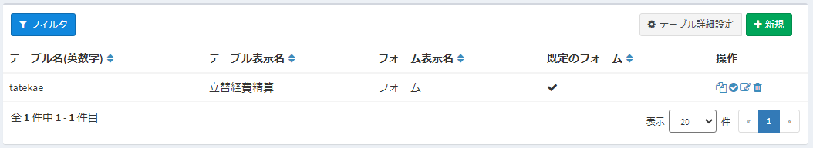
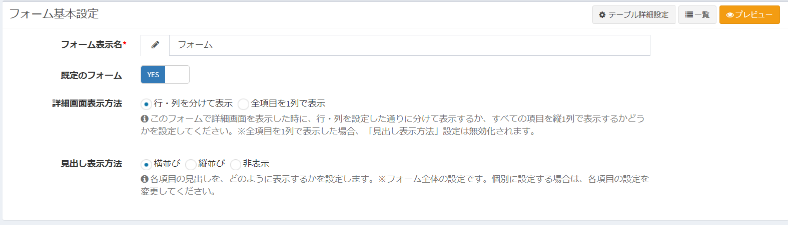
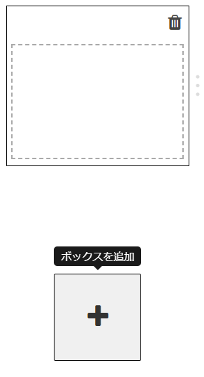
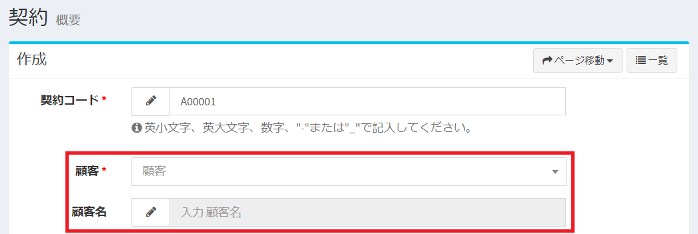

# Custom form
This page decides the items shown on the [data form screen](/data_form) of Exment (the screen where data is entered) and how they are arranged. You can change the placement of the items (the layout of the boxes), hidden fields, the data linkage settings and so on.  
What you set here is reflected in the [data form screen](/data_form) of each table.

- How to open the screen: "Page display" and "Form editing" below
- How to arrange the items: "Custom form settings" below
- Copying the values of data chosen from another table: "Data linkage settings" below
- Narrowing down other options by the chosen value: "Related refinement settings" below
- Switching the form used by conditions: "Form priority settings" below

## Page display
- In the custom table list, check the table you want to set and press "Table Detail Setting" at the top right.  

> Note: you can also open it directly from the data list screen or the data entry screen of that custom table. In that case too, press "Table Detail Setting" at the top right.  

- On the Table Detail Setting screen that appears, press the icon of the form setting, and the list of forms appears.  
Note: one default form is made for each table from the start.



## Form editing
To change a form, press the [Edit] link of that form.  


## Custom form settings


### Form preferences
Enter the basic information of the form.

- ##### Form display name
Enter the name of the form.  

- ##### Default form
Set it to YES to make this form the default form.  
When the [Form priority settings](/form?id=form-priority-settings) are set, they take priority.

- ##### Detailed screen display method
Choose how the items are shown on the [data detail screen](/data_details): matching the layout of rows and columns decided on this screen, or in a simple single vertical column.  



- ##### Heading display method
Decide how the heading of each item is shown.  
Note: this is the setting for the whole form. To change it for each item, change the setting of each item.

### Form block settings
Set the blocks of the form.  
A block is a group of data; usually there is one per table.  
However, when there is a 1:n relation setting, the data of the child table can also be entered on the same screen. Check "Available" of the child table block and set it.


#### Form block items
Note: the following are all setting items of child tables.

- ##### Make the form in table form  
The input fields of the child table are shown in the form of a table.

- ##### Optimize loading of child-table data  
When YES, the rows of this child table are loaded automatically after the edit screen is shown. For data with many child table rows, it shortens the time until the edit screen appears. The default is NO.  
It can be used, when existing data is edited, in a one-to-many block where "Make the form in table form" is YES. You cannot save until the loading is finished.  
When "Make the form in table form" is set to NO and the form is saved, this setting also becomes NO.  
Note: available from v7.1.0.


- ##### Form block name  
The name shown on each block of the form.  

- ##### Form Block Display Order  
When there are several child tables, you can decide the order in which they are shown.  


#### Form items
Choose and arrange the items shown on the input form.  
The items can be chosen from the "Form item candidate list" below.


On a form you can place boxes of 1 to 4 columns.  
You place the form items inside these boxes.


With a box, you can do the following.  

- Press the "+" button next to a box to add a new column to the current row.  


- Press the "+" button under a box to add a new row. (When the next row already exists, a new column is added to that row)  


- Drag and drop the margin on the right side of a box to change the size of the box.  


- Press the trash can icon at the top right of a box to delete the box.  


By adding and removing rows and columns of boxes and changing their width, you can make layouts like the following, for example.  

- 1 column - 2 columns


- 3 columns - 1 column


- 1 column - 2 columns - 1 column


### Form item candidate list:  
The candidates of the items that can be added to the form.  
There are two kinds: "Table Column" and "Other".  


#### Table column  
The items of the custom columns set on the custom table.  
Drag and drop one into a box of "Form Items", and it is placed on the data form. The behavior differs by the type of the custom column and the settings of [Form item details](/form?id=form-item-details), but usually the value of the item can be edited or shown.

#### Other  
Items that are only shown on the form and are not connected to data, such as headings, explanations and HTML.  
Drag and drop one into a box of "Form Items", and it is placed on the data form.

- ##### Heading:
Shown on the form in the form of a heading.

- ##### Explanatory text:
Shows an explanation on the form. HTML cannot be used.

- ##### HTML:
Shows HTML on the form.  
Note: for safety, the `<script>` and `<iframe>` tags and the `id` attribute are not output (v6.2.15 or later). To run a script on the screen, use a [script plugin](/plugin_quickstart_script).  

- ##### Extended HTML：
In addition to HTML, strings in the format given by [parameters](/params) can be used. When the screen is drawn, they are replaced with the values of the saved data to make the HTML.  
Note: as with "HTML", the `<script>` and `<iframe>` tags and the `id` attribute are not output (v6.2.15 or later).  
Example:
```
<h4>ID: ${id}, Company code: ${value:company_code}</h4>
```
Note: the column values are replaced only when the screen is drawn. Please note that even if you edit the value of the column on the data edit screen, the value does not change along with it.  

- ##### Image：
Shows an image on the form.

- ##### Hairline：
Shows a ruled line on the form.


#### Form item details
An item added to a box appears with a label like the following.  
- An item made required in the custom column settings has a red mark next to its name.  
- Press the trash can icon to the right of the label to remove the item from the box.  
- Press the gear icon to the right of the label to show the detail setting dialog.  


##### Heading display format
You can decide how the heading is shown for each item.
(It takes priority over the setting of the whole form)

##### Field Type
Decide how the item is shown on the data form screen. There are the following four.

| Type | How it looks on the screen | The user changes the value | Used from calculated fields and data linkage settings |
|---|---|---|---|
| Read Only | Shown grayed out | Cannot | Can |
| View Only | Shown as text | Cannot | Cannot |
| Hidden Field | Not shown (added as a hidden field) | - | Can |
| Hide | Not shown (added inside the system just before saving) | - | - |

- Read Only:  
When checked, the user cannot change the value. The value can be changed and read only from the system, calculated fields and the [Data linkage settings](/form?id=data-linkage-settings).  
When set, it is shown grayed out on the form, as below.  
  
- View Only:  
When checked, the user cannot change the value. The value cannot be changed or read from the system, calculated fields or the [Data linkage settings](/form?id=data-linkage-settings) either.  
When set, it is shown as text on the form, as below.  
  
- Hidden Field:  
When checked, the item is not shown on the screen and is added as a hidden field.  
Use this setting when you want to use the item in calculated fields and the [Data linkage settings](/form?id=data-linkage-settings) but do not want to show it on the screen.  

- Hide:  
When checked, the item is not added to the screen. It is added inside the system just before the data is saved.  
Because it is not on the screen, it cannot be used in calculated fields or data linkage settings.  
Use this setting for items you do not want tampered with or changed, such as internal parameter values.


##### Data linkage settings (item)  
See [Data linkage settings](/form?id=data-linkage-settings).  

##### Related refinement settings (items)  
See [Related refinement settings](/form?id=related-refinement-settings).  


## Data linkage settings
When the form has an item that chooses data of another table, the content of the chosen data can be copied to another item of the form.  
Example: when "Customer" is chosen in the "Contract" form, the value of "Customer name" in the "Customer" data is copied to "Customer name" in the "Contract" form.


The "Contract" form has a "Customer" option and a "Customer name" one-line text,  
  
 
and when "Customer" is chosen, 


the value is set automatically in the "Customer name" text  


<br />  

#### Procedure
- Open the custom form screen.  
Press the setting icon of "Customer name" in the form items.  


- The dialog that opens has the "Data Linkage Setting" item.  


- In "Select Column", choose the custom column that is the trigger of the copy.  
**Note: you can choose columns in the same form whose column type is "Select (From Table)", "User" or "Organization".**
In this example, choose "Customer".  


- When "Select Column" is chosen, the options of the second item "Select Link Column" appear.  
The custom columns of the table chosen in "Select Column" appear as a list.  
In this example, choose "Customer name".  


- Finally, press the [Setting] button.  
The dialog closes, and "Already Setting" appears next to the [Data Linkage Setting] button.  


- Press the [Submit] button at the bottom of the page to save the settings.


## Related refinement settings
When the column type is "Select (From Table)", "User" or "Organization", the options are narrowed down by what is chosen in another item of the same form. It can be set only when a column of the parent table or of a referenced table of the target table exists in the same form.  

#### Example
The "Customer information" table and the "Contact person information" table have a 1:n relation, and the "Contract information" table has a "Customer" column and a "Contact person" column.  
When the "Customer" column is chosen, you want to narrow down the option candidates of the "Contact person" column to only the contact persons whose parent is the chosen "Customer".

  

With data like the following,
  

on the contract information screen,
 

when "Company A" is chosen in "Customer", the contact persons who belong to Company A become the option candidates,
  

and when "Company B" is chosen in "Customer", the contact persons who belong to Company B become the option candidates.
  

#### Procedure
- Open the custom form screen.  
Press the setting icon of the "Contact person" column in the form items.  


- The dialog that opens has the "Relation Filter Setting" item.  
The options shown are the list of the columns, in the same form, that are the parent of the chosen column.  
In this example, the column of the "Customer" table, which is the parent table of the "Contact person" table, is shown in the options.  
Note: the "Relation Filter Setting" button is shown when the custom column is "Select (From Table)", "User" or "Organization".


- After setting, press the "Setting" button.  


#### Specifications less than v3.3.1
<span class="small">In versions lower than v3.3.1, this setting screen was not shown, and the options were narrowed down in all fields with a 1:n parent-child relation or a reference relation.  
As a result, it sometimes caused unneeded narrowing down and unexpected problems, so in v3.3.1 a setting was added so that you can choose whether to narrow down.  
When updating from a version lower than v3.3.1 to v3.3.1 or higher, the setting "narrow down the options in all fields with a 1:n parent-child relation or a reference relation" is carried over, to keep compatibility.  
See [here](/patch/relation_filter) for the details of the specification at the update.</span>


## Form priority settings
By deciding conditions and priorities, the form used for creating data and on the data detail screen can be switched by conditions.  

### Create New
Make one with the [New] button to the right of Form Display Condition Setting.


### Setting Page


##### Target Form  
Choose the form you want to use when the conditions are met.

##### Priority  
Decide the priority with which the form is used.
For data that meets several form display conditions, the screen is shown with the form of the highest priority.

##### Condition Item  
The column used as the display condition.

##### Search Condition  
Choose the content of the condition.
What you can choose changes by the type of the column chosen in "Condition Item" ("Date", "User" and so on).

##### Condition Value  
Enter the value compared with the search condition.

##### ［Delete］button  
Deletes a display condition of the form.

##### ［New］button  
Adds a new display condition of the form.
