# Environment construction using Windows Server
These are the steps to put Exment on IIS (the web server that comes with Windows) of Windows Server.  
They start from installing the web server and build everything from nothing.

The overall flow is as follows.

1. Install the web server (IIS)
2. Prepare PHP
3. Install MySQL
4. Prepare IIS
5. Install Composer
6. Download Exment and prepare to run it

## Environment
The steps on this page were made with the following environment.
- Windows Server 2019 Standard Japanese version
- IIS 10
- PHP 8.2.X
- MySQL 8.4.X

The differences when Windows 10 is used for testing are written at each place.

## Important point

- Depending on your environment and versions, you may not be able to set up as written in these steps. Please understand.

- This page only describes the steps to run Exment on Windows Server.  
General IT knowledge such as managing Windows Server, creating a database and commands is not written. Please understand.

- **These steps need administrator rights. As needed, start the Command Prompt, PowerShell and executable files with "Run as administrator" (or elevate with User Account Control)**.

## Installation instructions using Windows Server

> Before you start, we recommend setting Explorer of Windows Server to show "File name extensions"

### Installing the web server (IIS)
If the IIS feature is not enabled on the server, first install the IIS feature.
1. Open the \[Add Roles and Features\] wizard from \[Manage\] of Server Manager  
   
2. For \[Installation Type\], select "Role-based or feature-based installation", and for \[Server Selection\], select the server on which to install IIS (usually the server you are working on), and go on.
3. In \[Server Roles\], select "Web Server (IIS)" and also add the features that are shown  
   
4. Go on from the \[Features\] and \[Web Server Role (IIS)\] screens as they are
5. In \[Role Services\], expand \[Application Development\], check "CGI", and go on  
     
   Add other roles (authentication, compression and so on) as you need (nothing more is needed for Exment itself to run)
6. In \[Confirmation\], click "Install" and wait for the installation to finish
7. When the installation is finished, start a browser (Internet Explorer or the like), access http://localhost and check that the default page of IIS is shown

> To install on Windows 10, enable "Internet Information Services" in \[Control Panel\] - \[Programs\] - \[Programs and Features\] - \[Turn Windows features on or off], and enable "CGI" in \[Application Development Features\].

### Preparing PHP
Download and install PHP
1. Access https://windows.php.net/download/
2. Download the ZIP file of \[VC15 x64 Non Thread Safe\] of \[PHP 8.2\]  
   > If you use a 32-bit version of Windows in a Windows 10 environment, download the ZIP file of \[VC15 x86 Non Thread Safe \]
3. Right-click the downloaded ZIP file and show its properties, check "Unblock" in \[Security\] on the \[General\] tab and click \[OK\]  
   
4. Extract the contents of the ZIP file to a suitable folder (example: C:\PHP)
5. Set the environment variable for running PHP  
   Run sysdm.cpl in \[Run\] and show \[System Properties\]
6. Open \[Environment Variables\] on the \[Advanced\] tab  
   
7. Find and select the item with the variable name "Path" in the list of \[System variables\]  
   
8. Click \[Edit\] and click \[New\]  
   
9.  Enter the path of the folder where you extracted PHP (example: C:\PHP) and click \[OK\] three times  
    
10. At the Command Prompt, run  
    ```
    set path
    ```
    and check that the path to the PHP folder is set
11. Create the PHP setting file  
    Copy the "php.ini-development" file in the folder where you extracted PHP and create the php.ini file
12. Edit the php.ini file and save it
    1.  In the "Paths and Directories" section, change  
        ```
        ;extension_dir = "ext"
        ```
        to
        ```
        extension_dir = "path of the folder where PHP was extracted\ext" (example: extension_dir = "C:\PHP\ext")
        ```
        (remove the ; at the beginning of the line to uncomment it)
    2. In the "Dynamic Extension" section, change
        ```
        ;extension=gd
        ;extension=openssl
        ;extension=pdo_mysql
        ```
        to
        ```
        extension=gd
        extension=openssl
        extension=pdo_mysql
        ```
        (remove the ; at the beginning of the line to uncomment it)
    3.  In the "File Uploads" section, change  
        ```
        ;upload_tmp_dir=
        ```
        to
        ```
        upload_tmp_dir = "path of any working folder" (example: upload_tmp_dir = "C:\Temp")
        ```
        (remove the ; at the beginning of the line to uncomment it)  
        Note: the folder you specify is the temporary storage place when files are uploaded.
    4. Add the following to the end of the file.
        ```
        extension=php_fileinfo.dll
        ```

13. Run the following command at the Command Prompt and check that PHP works  
    ```
    php -v
    ```
    

    If you get an error that the Visual C++ 14.0 runtime is not found, download and install the Visual C++ Redistributable Package for Visual Studio 2015, 2017 and 2019 (vc_redist.x64.exe) from [The latest supported Visual C++ downloads](https://support.microsoft.com/help/2977003/the-latest-supported-visual-c-downloads)  
    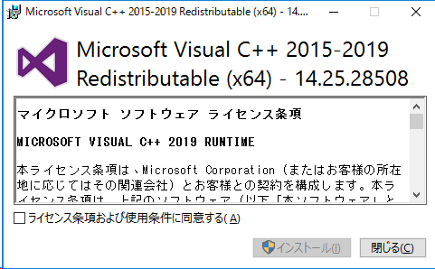

### Installing MySQL
Install the MySQL used by Exment and do its initial configuration  
Here MySQL 8.4.X is installed

1. Access the [MySQL Community Downloads](https://dev.mysql.com/downloads/mysql/) page
2. Click \[General Availability (GA) Releases\]  
   
3. Select "8.4.X" in \[Select Version\], "Microsoft Windows" in \[Select Operating System\] and "Windows (x86, 64bit)" in \[Select OS Version\]
     
   > If you use a 32-bit version of Windows in a Windows 10 environment, select "Windows (x86, 32bit)" in \[Select OS Version\]
4. Click the \[Download\] button in the "ZIP Archive" row of \[Other Downloads\] and download the mysql-8.4.xx-winx64.zip file
   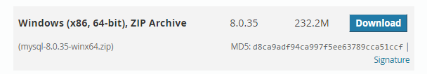
5. When \[Login Now or Sign Up for a free account.\] is shown, click \[No thanks, just start my download.\] at the bottom. The download starts
6. Right-click the downloaded ZIP file and show its properties, check "Unblock" in \[Security\] on the \[General\] tab and click \[OK\]  
   
7. Extract the contents of the ZIP file to a suitable folder (example: C:\MySQL)
8. Start an administrator Command Prompt and move to the mysql-8.4.xx-winx64\bin folder in the folder where you extracted the ZIP file
   
9.  Run the following command to initialize MySQL
    ```
    mysqld --initialize
    ```
    

    If you get an error that the Visual C++ 12.0 runtime is not found, see [The latest supported Visual C++ downloads](https://support.microsoft.com/help/2977003/the-latest-supported-visual-c-downloads), and download and install the Microsoft Visual C++ Redistributable Package for Visual Studio 2013 (vc_redist.x64.exe) from \[Update for Visual C++ 2013 Redistributable Package\](https://support.microsoft.com/help/4032938/update-for-visual-c-2013-redistributable-package) in the language of your Windows (the Japanese version (Japanese) in this example)  
    
10. Run the following command to check that MySQL starts. If "mysqld: ready for connections." is shown, it has started correctly
    ```
    mysqld --console
    ```
    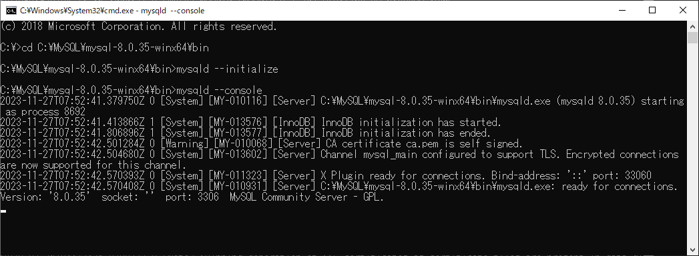
11. Press Ctrl + C to stop MySQL for now
12. Install MySQL as a Windows service. When it is installed as a service, MySQL runs automatically when Windows starts
    ```
    mysqld --install
    ```
    
13. Run the following command to start MySQL right away
    ```
    net start mysql
    ```
    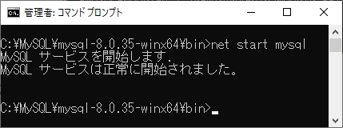
14. Check the initial value of the administrator (root) password for using MySQL  
    If the folder where you extracted MySQL is C:\MySQL, there is a file with the extension .err in C:\MySQL\mysql-8.4.xx-winx64\data. Open it with a text editor such as Notepad  
    > In the figure below, the file name is ExmentServer2.err  
    
15. Near the top of the file there is a line that says "\[Note\] A temporary password is generated for root@localhost:" (the red underline in the figure below). The string written after it (1fyr*IXeC2%w in the figure below) is the initial password. Write this password down
    
16. Go back to the administrator Command Prompt and run the following command to do the initial settings of MySQL
    ```
    mysql_secure_installation
    ```
    1. You are asked "Enter password for user root:", so enter the initial password you wrote down and press Enter
    2. "The existing password for the user account root has expired. Please set a new password." is shown  
       You are asked for the new password with "New password:", so enter the new password and press Enter. You are asked again with "Re-enter new password:", so enter the new password once more and press Enter
       > Use a password that is strong and hard to guess. We recommend meeting these requirements: 8 characters or more, at least 3 of upper case, lower case, digits and symbols, and no words as they are in a dictionary
    3. You are asked whether to use VALIDATE PASSWORD PLUGIN  
       If you set a password that is strong and hard to guess, enter a key other than "y" and press Enter
    4. You are asked "Change the password for root ?", so enter a key other than "y" and press Enter
    5. For all the remaining questions, enter "y" and press Enter
    6. When "All done!" is shown, the initial settings are finished
17. Run the following command to log in to MySQL
    ```
    mysql -u root -p
    ```
18. You are asked for the password with "Enter password:", so enter the password you set earlier and press Enter
    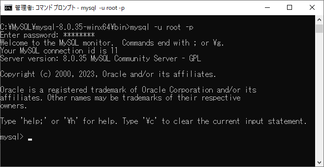
19. When the "MySQL>" prompt is shown, run the following commands in order
    > Here, the MySQL user used by Exment is "exment_user" and its password is "M!p3~S$W7fLm"  
      Decide the real user name and password yourself (use a password that is strong and hard to guess)  
      This user name and password are used in the initial settings of Exment
    ```
    CREATE DATABASE exment_database;
    CREATE USER 'exment_user' IDENTIFIED BY 'M!p3~S$W7fLm';
    GRANT ALL ON exment_database.* TO 'exment_user';
    FLUSH PRIVILEGES;
    ```
20. Enter the following and press Enter to log out of MySQL
    ```
    \q
    ```

### Preparing IIS
Prepare IIS for running Exment
1. Install the URL Rewrite module.  
   Access https://www.iis.net/downloads/microsoft/url-rewrite and click \[Install this extention\]
2. urlrewrite2.exe is downloaded. Run it and install by following the guidance on the screen
   1. Click \[Install\]  
      
   2.  Click \[I Accept\]  
      
   3.  The installation starts  
      
   4.  Click \[Finish\]  
      
   5.  Click \[Exit\]  
      
3. Open \[Internet Information Services (IIS) Manager\] from \[Tools\] of Server Manager  
   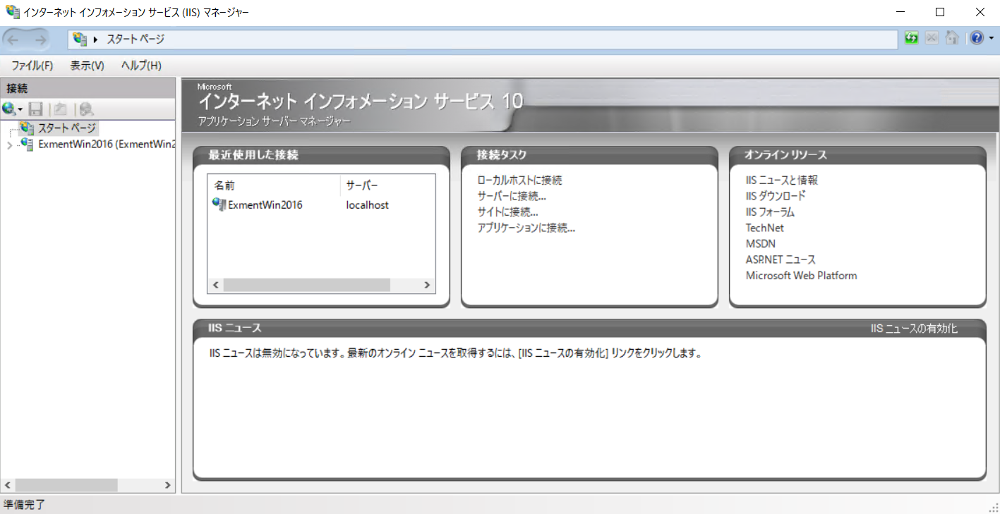
4. In the Connections pane, expand \[(server name)\] - \[Sites\] and select \[Default Web Site\]
5. In the Features View, double-click \[Handler Mappings\]
6. In the Actions pane, click \[Add Module Mapping\]
7. Enter the following in \[Add Module Mapping\] and click \[OK\]  
   - Request path: *.php  
   - Module: FastCgiModule  
   - Executable: (path of the folder where PHP was extracted)\php-cgi.exe (example: C:\PHP\php-cgi.exe)  
   - Name: any (example: PHP)  
   
8. When the confirmation message is shown, click \[Yes\]

### Installing Composer
Install the PHP library management tool (Composer) that Exment needs
1. Access the [Composer download page (https://getcomposer.org/download/)](https://getcomposer.org/download/) and download Composer-Setup.exe from the part that says "Download and run Composer-Setup.exe - it will install the latest composer version whenever it is executed"  
   
2.  Run the downloaded Composer-Setup.exe
3.  Select "Install for all users"  
   
4.  Do not check "Developer Mode", and go on  
   
5. Check that the PHP path shown in "Setting Check" is correct, and go on  
   
6. If "PHP Configration Error" is shown, check \[Create a php,ini file\] or \[Update this php.ini\] and go on  
   
7. In "Proxy Settings", specify the proxy used for the internet connection. If you do not use a proxy, go on as it is  
   
8. The confirmation screen is shown, so click \[Install\]  
   
9. When "Information" is shown, go on as it is  
    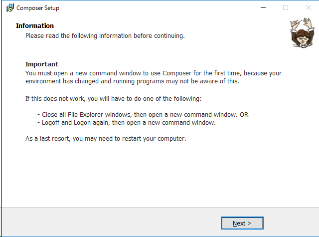
10. Click \[Finish\] to finish  
    

### Download Exment and prepare to run it

1. Download the Exment zip file (exment.zip) from the page of the Exment installation steps ([https://exment.net/docs/#/quickstart](https://exment.net/docs/#/quickstart))
2. Right-click the downloaded ZIP file and show its properties, check "Unblock" in \[Security\] on the \[General\] tab and click \[OK\]  
   
3. Extract the contents of the exment folder in the ZIP file to a suitable folder (example: C:\exment)  
     
   **Never extract it right under the "inetpub\wwwroot" folder. The setting files, in which the database settings, the mail password and so on are written, become visible from outside, and this leads to a serious leak of information**
4. Create a virtual directory  
   Open Internet Information Services (IIS) Manager, expand \[(server name)\] - \[Sites\] in the \[Connections\] pane, right-click \[Default Web Site\] and select \[Add Virtual Directory\]  
   
5. Configure the virtual directory as follows  
   In the example, the alias (the path of the URL for accessing Exment) is "exment"  
   For the physical path, set the path of the folder where you extracted the Exment ZIP file (example: C:\exment)
   - Alias: exment  
   - Physical path: C:\Exment\public  
   
6. Add "index.php" to the default documents  
   Select \[Default Web Site\] and open \[Default Document\] by double-clicking it  
   
7. In the \[Actions\] pane, click \[Add\]
8. Add index.php  
   
9.  Add a URL rewrite rule to Web.config  
   In the \[Connections\] pane, select the virtual directory added in "4." (exment in the example) and open \[URL Rewrite\] by double-clicking it  
   
10. In the \[Actions\] pane, click \[Add Rule(s)\]  
   
11. In \[Add Rule(s)\], select \[Blank rule\] of \[Inbound rules\] and click \[OK\]  
   
12. In \[Edit Inbound Rule\], create the rule as follows  
    
    - Name: any name
    - \[Match URL\]
      - Requested URL: Matches the Pattern
      - Using: Regular Expressions
      - Pattern: (.*)$
    - Conditions
      - Logical grouping: Match All
      - Click \[Add\] and add the following two conditions
        - Condition input: {REQUEST_FILENAME}  
        Type: Is Not a File
        - Condition input: {REQUEST_FILENAME}  
        Type: Is Not a Directory
    - Action
      - Action type: Rewrite
      - Action Properties
      - Rewrite URL: index.php/{R:1}
      - Append query string: ON
      - Log rewritten URL: OFF
    - Stop processing of subsequent rules: ON
13. In the \[Actions\] pane, click \[Apply\]
14. When "The changes have been successfully saved" is shown, click \[Back to Rules\]

<!-- The steps after this need checking -->

15. Set the access rights of the folder so that Laravel can write to it
    Give the write permission of the IIS run user (IIS_IUSRS) to the folder where you extracted the Exment ZIP and configured the virtual directory  
    > C:\exment in the example
    
    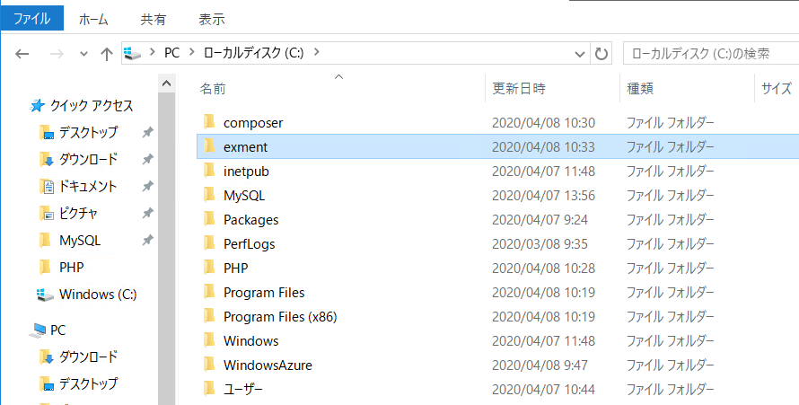

16. Add the write access permission for the exment folder to the IIS run user (IIS_IUSRS)
    1. Right-click the exment folder and select \[Properties\]
    2. Open the \[Security\] tab and click \[Edit\]
    3. In \[Permissions for exment\], click the \[Add\] button to show \[Select Users or Groups\]
    4. Enter IIS_IUSRS in the \[Enter the object names to select\] field and click \[Check Names\]
    5. When the display changes to (computer name)\IIS_IUSRS, click \[OK\]  
       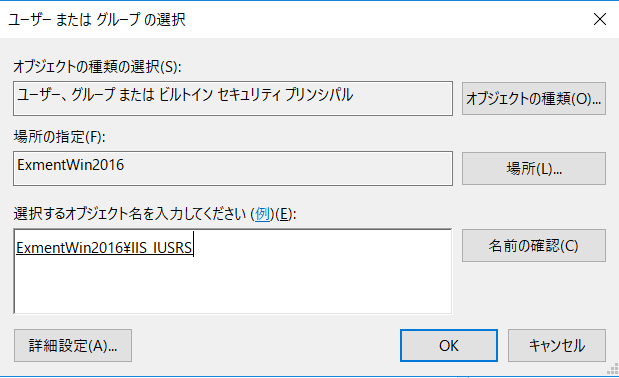
    6. You return to \[Permissions for exment\], so click IIS_IUSRS in the \[Group or user names\] field and check \[Allow\] of \[Write\] in the \[Permissions\] field  
    
    1. Click \[OK\] twice to close the properties

<!--
In fact, the write permission of IIS_IUSRS seems to be needed not only for the storage folder but also for other files and folders in the exment folder.
We do not know which resources really need how much permission at the minimum, so in the test environment we gave the write permission of IIS_IUSRS to the whole C:\exment folder and checked that the Exment web application works.
When the minimum access rights are known, this part will be revised to match.

14. Set the access rights of the folder so that Laravel can write to it
    > Give the write permission of the IIS run user (IIS_IUSRS) to the folder where you extracted the Exment ZIP and configured the virtual directory (example: C:\exment)
15. Configure the access permissions
    1. Right-click the exment folder and select \[Properties\]
    2. Open the \[Security\] tab and click \[Edit\]
    3. In \[Permissions for exment\], click the \[Add\] button to show \[Select Users or Groups\]
    4. Enter IIS_IUSRS in the \[Enter the object names to select\] field and click \[Check Names\]
    5. When the display changes to (computer name)\IIS_IUSRS, click \[OK\]  
    6. You return to \[Permissions for exment\], so click IIS_IUSRS in the \[Group or user names\] field and check \[Allow\] of \[Write\] in the \[Permissions\] field  
    7. Click \[OK\] twice to close the properties
-->

17.  Start a browser (Chrome or Microsoft Edge) and access http://localhost/(alias of the virtual directory) (example: http://localhost/exment. A site with "admin" in `ADMIN_ROUTE_PREFIX` is at http://localhost/exment/admin)  
    The installation page of Exment is shown.
> Exment does not support display in Internet Explorer. Use Chrome or Microsoft Edge to access Exment

   1. Check Language and Timezone (in the example, Language is \[Japanese\] and Timezone is \[(GMT+09:00)Japan\]) and click \[Submit\]
   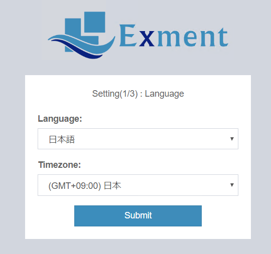

   2. Enter the settings of the database you created and click \[Submit\]
   > In the example, <br />Database \[exment_database\] <br />User Name \[exment_user\] <br />Password \[M!p3~S$W7fLm\] 

   

   3. Click \[Execute Install\]  
   
   If the installation finished normally, the initial setting screen of Exment is shown.  
   For the initial settings, see [Initial setting screen](/first_setting?id=initial-setting-screen).

18.  When the installation is finished, remove the access permission set on the exment folder

   1. Right-click the exment folder and select \[Properties\]
   > C:\exment in the example  
   2. Open the \[Security\] tab and click \[Edit\]
   3. Select \[IIS_IUSRS\] in the \[Group or user names\] field
   4. Click \[Check Names\] in \[Permissions\], and uncheck \[Allow\] of \[Write\] in the \[Permissions\] field
   
   5. Click \[OK\] twice to close the properties   

19.  Add the write access permission to some folders. The folders and files to add it to are as follows.

| Type | File or folder name | Functions that need it |
| ---- | ---- | ---- |
| Folder | storage | All functions |
| Folder | bootstrap/cache | All functions |
| File | .env | Easy installation, restore |
| Folder | config | Easy installation, restore |
| Folder | app | Easy installation |
| Folder | public | Easy installation |
| Folder | resources | Easy installation |

The following example is the steps to add the permission to the storage folder.

   1. Right-click the storage folder and select \[Properties\]
   > C:\exment\storage in the example
   2. Open the \[Security\] tab and click \[Edit\]
   3. In \[Permissions for storage\], click the \[Add\] button to show \[Select Users or Groups\]
   4. Enter IIS_IUSRS in the \[Enter the object names to select\] field and click \[Check Names\]
   5. When the display changes to (computer name)\IIS_IUSRS, click \[OK\]  
       
   6. You return to \[Permissions for storage\], so click IIS_IUSRS in the \[Group or user names\] field and check \[Allow\] of \[Write\] in the \[Permissions\] field  
    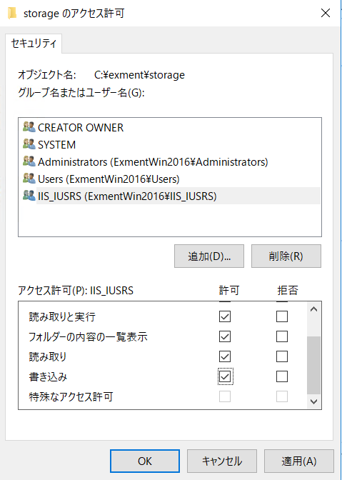
   7. Click \[OK\] twice to close the properties

20.  Add the write access permission to the folder specified by upload_tmp_dir of php.ini, so that uploaded files can be kept there for a while
   1. Right-click that folder and select \[Properties\]
   > C:\Temp in the example
   2. Open the \[Security\] tab and click \[Edit\]
   3. In \[Permissions for Temp\], click the \[Add\] button to show \[Select Users or Groups\]
   4. Enter IIS_IUSRS in the \[Enter the object names to select\] field and click \[Check Names\]
   5. When the display changes to (computer name)\IIS_IUSRS, click \[OK\]  
       
   6. You return to \[Permissions for Temp\], so click IIS_IUSRS in the \[Group or user names\] field and check \[Allow\] of \[Write\] in the \[Permissions\] field  
    
   7. Click \[OK\] twice to close the properties

   > For the initial settings after installation, see [Initial setting screen](/first_setting?id=initial-setting-screen)

   
## Correspondence when upgrading PHP version
When you change the PHP version, upgrade by the following steps.  
Note: Exment cannot be accessed during the upgrade work.  
Note: the example below is the steps for updating from PHP7.4 to PHP8.2.  
Note: the way to upgrade may differ depending on the environment, the time of installation, the version and the way of installation.  

- First, stop IIS.

- Back up the PHP run folder you use now. Any way you like is fine, such as renaming the folder or copying it to another place.

- Download the new PHP.  

   1. Access https://windows.php.net/download/
   2. Download the ZIP file of \[VC15 x64 Non Thread Safe\] of \[PHP 8.2\]  
      > If you use a 32-bit version of Windows in a Windows 10 environment, download the ZIP file of \[VC15 x86 Non Thread Safe \]
   3. Extract the contents of the ZIP file to the same path as the previous PHP.  
   Note: this assumes that the PATH is set in the environment variables.  

- Copy the php.ini file from the PHP folder of the previous version that you backed up to the PHP folder of the new version.

- If necessary, edit the php.ini file.
   1. If the GD library in the "Dynamic Extension" section is commented out, enable it. Change
        ```
        ;extension=gd
        ```
        to
        ```
        extension=gd
        ```
        (remove the ; at the beginning of the line to uncomment it)

   Note: depending on the original PHP version, it may be extension=gd2. Change it to extension=gd.  

- Start IIS.  

- Check with the Command Prompt or the like that the PHP version is 8.2.X.

~~~
php -v
~~~
