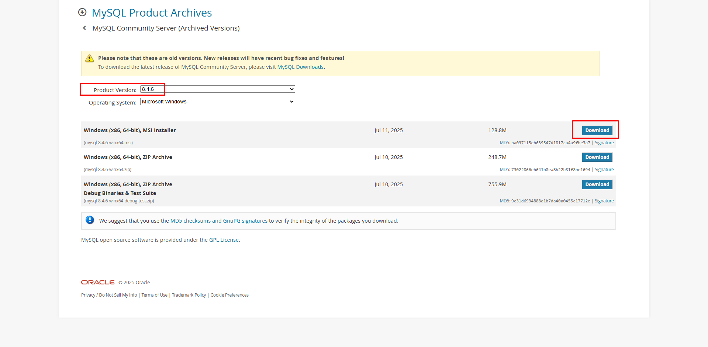
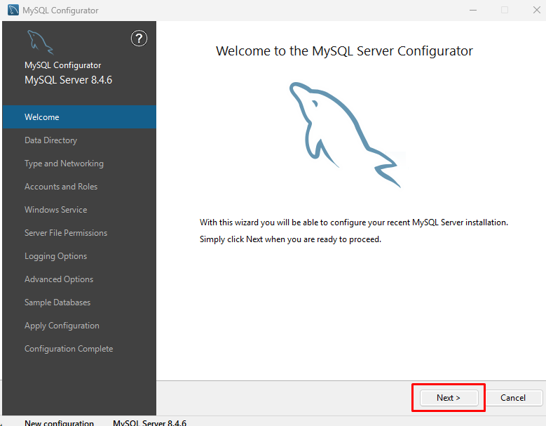
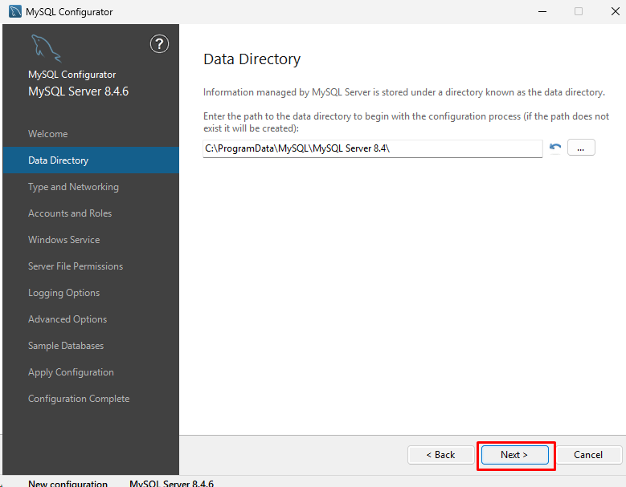
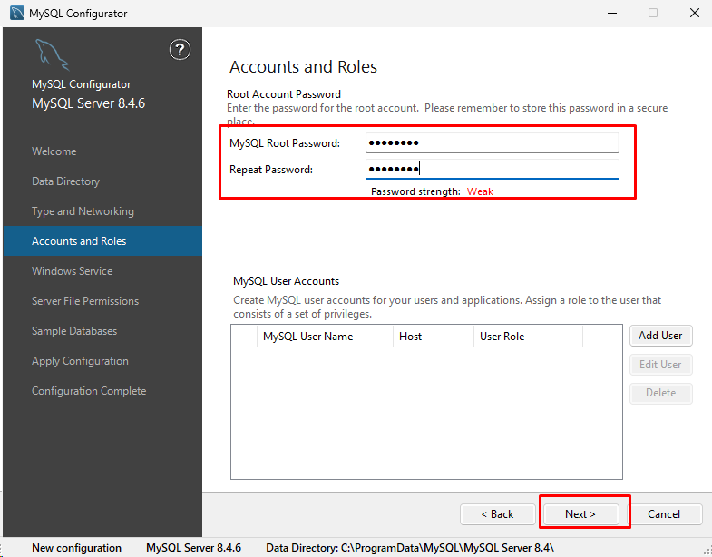

# MySQL installation procedure
These are the steps to install and set up MySQL so that Exment can use it.  
Note: the steps may differ depending on the OS, the version, the time of installation and so on.  

See one of the following, according to your server.

| Server | Where to look |
| ---- | ---- |
| Windows | "MySQL settings (Windows)" below |
| Linux | "MySQL settings (Linux)" below (the steps depend on whether MySQL5.7 is already there) |

## MySQL settings (Windows)

- Recommended: before upgrading, take a [database backup](https://dev.mysql.com/doc/refman/8.4/en/mysqldump-sql-format.html).

- (If MySQL is running) Open the Command Prompt as an administrator and stop MySQL.  
Enter "Command Prompt" in the "search bar" to the right of the Start button.  
Right-click the "Command Prompt" shown at the top, under "Best match".  
Select "Run as administrator" from the menu that appears.
   

~~~
net stop mysql57
net stop mysql80
~~~

- Open the following site and download MySQL.  
Note: MySQL Installer is provided only for the MySQL 8.0 series. For MySQL 8.1 and later (including 8.4), download MySQL Server as an MSI or a ZIP.  
[MySQL Community Server Downloads](https://downloads.mysql.com/archives/community/)  

- In Select Version, choose "8.4.X", and for the OS choose Windows (x86, 64-bit).  

- Download one of the following.
	- MSI Installer

- Run the downloaded MSI file and install by following the guidance on the screen (the wizard).
	- On the Welcome screen, click "Next".

		
	- Accept the License Agreement and click "Next".

		
	- For Setup Type, select "Complete".

		
	- Click "Install".

		
	- When the installation is finished, click "Finish".

		

- When the MSI installation is finished, MySQL Server Configurator opens by itself.
	- On "Welcome to the MySQL Server Configurator", click "Next".

		

- Data Directory: keep the first value and click "Next".

	

- Type and Networking:
	- Config Type: Development Computer
	- Connectivity: TCP/IP (the default port is 3306)
	- Click "Next".

		

- Accounts and Roles: decide the password of the root user and click "Next".

	

- Windows Service: decide a service name (example: MySQL84) and click "Next".

	

- Server File Permissions: keep the first value and click "Next".

	

- Sample Databases: skip it and click "Next".

	

- On Apply Configuration, click "Execute", and when it is finished click "Next" and "Finish".

	

- Edit my.ini. (C:\ProgramData\MySQL\MySQL Server 8.4\my.ini)

~~~
# Add the following to the end

local-infile=1
~~~

- Restart MySQL. (The service name depends on the environment)

~~~
net stop MySQL84
net start MySQL84
~~~

### Add environment variables

- From Explorer, right-click "This PC" and click "Properties".

- Click "Advanced system settings".

- Click "Environment Variables".  

- Click "Path" under "User variables" and click "Edit".  

- If there is a line "C:\Program Files\MySQL\MySQL Server 5.7\bin", delete it.

- Click "New" and add the following line.  
 "C:\Program Files\MySQL\MySQL Server 8.4\bin"   

- After entering it, close all the open dialogs with "OK".  

## MySQL settings (Linux)
These are the steps to install MySQL on Linux.  
Note: add sudo to the beginning of the commands if necessary.  
Note: if the installation destination is CentOS8, RHEL8 or the like, use the dnf command instead of yum.

The steps differ depending on whether MySQL5.7 is already installed.

| Current state | Where to look |
| ---- | ---- |
| MySQL5.7 is installed | "If MySQL5.7 exists (update from MySQL5.7 to MySQL8.4)" |
| MySQL5.7 is not installed | "If MySQL5.7 does not exist (new installation of MySQL8.4)" |

### If MySQL5.7 exists (update from MySQL5.7 to MySQL8.4)
- Delete the MySQL5.7 packages.
~~~
sudo killall mysqld; sudo killall mysqld_safe;
sudo rpm -e --nodeps mysql57-community-release
sudo yum remove mysql mysql-server mysql-client mysql-common mysql-devel mysql-community-client-plugins -y
~~~

- Install and start MySQL8.4.

Note: the rpm differs depending on the OS version.

For example, on AlmaLinux9.5, when you get
 

~~~
[root@localhost ~]# uname -a
Linux localhost.localdomain 5.14.0-503.11.1.el9_5.x86_64 #1 SMP PREEMPT_DYNAMIC Tue Nov 12 09:26:13 EST 2024 x86_64 x86_64 x86_64 GNU/Linux
~~~

the command is
 

~~~
sudo rpm -ivh https://dev.mysql.com/get/mysql84-community-release-el9-2.noarch.rpm
~~~

as above.
 

~~~
# For CENTOS STREAM

rpm -ivh https://dev.mysql.com/get/mysql84-community-release-el9-2.noarch.rpm
rpm --import https://repo.mysql.com/RPM-GPG-KEY-mysql-2023
dnf clean packages
dnf update -y

# Install and start mysql-community-server
dnf install mysql-community-server -y
systemctl start mysqld
systemctl enable mysqld
~~~

~~~
# For CENTOS8
sudo rpm -ivh https://dev.mysql.com/get/mysql84-community-release-el8-2.noarch.rpm
sudo rpm --import https://repo.mysql.com/RPM-GPG-KEY-mysql-2023

# Run this to check whether mysql-community-server exists
sudo yum search mysql-community-server

# If the command above shows a message that it does not exist, such as "Error: Unable to find a match: mysql-community-server", run the following command first
sudo yum -y module disable mysql

# Install and start mysql-community-server
sudo yum -y install mysql-community-server
sudo systemctl enable mysqld.service
~~~

- Edit my.cnf.

~~~
vi /etc/my.cnf

# Add the following to the end

local-infile=1
~~~

- Start MySQL.

~~~
sudo systemctl start mysqld
~~~

### If MySQL5.7 does not exist (new installation of MySQL8.4)
- Install and start MySQL8.4.

Note: the rpm differs depending on the OS version.

For example, on AlmaLinux9.5, when you get
 

~~~
[root@localhost ~]# uname -a
Linux localhost.localdomain 5.14.0-503.11.1.el9_5.x86_64 #1 SMP PREEMPT_DYNAMIC Tue Nov 12 09:26:13 EST 2024 x86_64 x86_64 x86_64 GNU/Linux
~~~

the command is
 

~~~
sudo rpm -ivh https://dev.mysql.com/get/mysql84-community-release-el9-2.noarch.rpm
~~~

as above.
 

~~~
# For CENTOSSTREAM

rpm -ivh https://dev.mysql.com/get/mysql84-community-release-el9-2.noarch.rpm
rpm --import https://repo.mysql.com/RPM-GPG-KEY-mysql-2023
dnf clean packages
dnf update -y

# Install and start mysql-community-server
dnf install mysql-community-server -y
systemctl start mysqld
systemctl enable mysqld
~~~

~~~
# For CENTOS 8
sudo rpm -ivh https://dev.mysql.com/get/mysql84-community-release-el8-2.noarch.rpm
sudo rpm --import https://repo.mysql.com/RPM-GPG-KEY-mysql-2023

# Run this to check whether mysql-community-server exists
sudo yum search mysql-community-server

# If the command above shows a message that it does not exist, such as "Error: Unable to find a match: mysql-community-server", run the following command first
sudo yum -y module disable mysql

# Install and start mysql-community-server
sudo yum -y install mysql-community-server
sudo systemctl enable mysqld.service
sudo systemctl start mysqld
~~~

- Check the initial password of MySQL.

~~~
cat /var/log/mysqld.log | grep -i 'temporary password'

#A log like the following is shown, so check the password
2025-03-25T04:35:28.567119Z 6 [Note] [MY-010454] [Server] A temporary password is generated for root@localhost: et5k>Y.b0eJ.
~~~

- (Optional) Disable the password policy.

~~~
vi /etc/my.cnf

#Add the following validate_password
[mysqld]
validate_password=OFF
~~~

- Restart MySQL.

~~~
sudo systemctl restart mysqld
~~~

- Do the initial settings of MySQL. Run the following command.

~~~
mysql_secure_installation

Enter password for user root: (enter the password you copied earlier)

New password: (enter the new password)
Re-enter new password: (enter the new password)

Change the password for root? : n

Remove anonymous users? : y #Remove the anonymous user accounts
Disallow root login remotely? : y # Remove the root accounts that can be accessed from other than localhost
Remove test database and access to it? : y # Remove the test database
Reload privilege tables now? : y #Reload the privilege tables
~~~

- Log in to MySQL.

~~~
mysql -u root -p(password)
~~~
- Edit my.cnf.

~~~
vi /etc/my.cnf

# Add the following to the end

local-infile=1
~~~

- Restart MySQL.

~~~
sudo systemctl restart mysqld
~~~

- Create the database and the user for Exment.  
Note: here, the database name is "exment_database" and the user is "exment_user".  
The IP address of the connection source is "192.168.137.%".

~~~
CREATE DATABASE exment_database;
CREATE USER 'exment_user'@'192.168.137.%' IDENTIFIED BY '(password for exment_user)';
GRANT ALL ON exment_database.* TO 'exment_user'@'192.168.137.%';
FLUSH PRIVILEGES;
~~~

- In the firewall settings, allow access to MySQL only from the IP address of the connection source.  
Note: here, the IP address of the connection source is "192.168.137.%".

~~~
firewall-cmd --permanent --new-zone=from_webserver
firewall-cmd --reload
firewall-cmd --permanent --zone=from_webserver --add-source="192.168.137.0/24"
firewall-cmd --permanent --zone=from_webserver --add-port=3306/tcp
firewall-cmd --zone=from_webserver --add-service=mysql
firewall-cmd --reload
~~~
