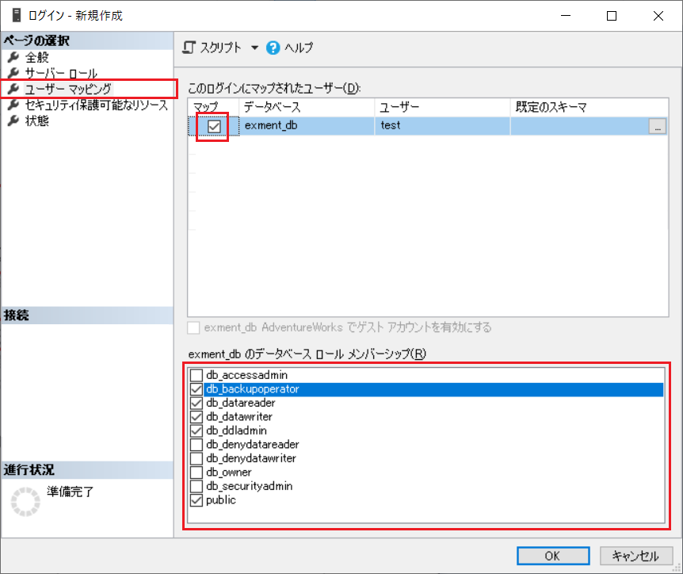

# SQL Server installation procedure
These are the steps for using SQL Server as the database of Exment.

- <span class="red bold">※Currently, the backup and restore functions are not supported.</span>
- The steps may differ depending on the OS, the version, when it was installed, and so on.

## Flow of the steps
1. **Prepare SQL Server** (install it, create a database and a user) … "SQL Server settings"
2. **Check that you can connect** … "Connection check"
3. **Connect from Exment** (install the PHP driver and install Exment) … "Exment settings"

## SQL Server settings

### Install SQL Server
1. Download SQL Server from the following site.  
※Please select the edition according to your usage, business scale, etc.  
[SQL Server Downloads](https://www.microsoft.com/en-us/sql-server/sql-server-downloads)  

2. Run the downloaded file and proceed with the installation.  
  

3. The installation is complete.

### Install SQL Server Management Studio (GUI tool)
SQL Server Management Studio is a tool for operating SQL Server on screens.

- Open the following site.  
From "Available languages", click the language you want to use, then download and install the tool.  
https://docs.microsoft.com/en-us/sql/ssms/download-sql-server-management-studio-ssms?view=sql-server-ver15#available-languages


### Additional settings (Windows)
※We have currently confirmed that the following settings are required when SQL Server is installed on Windows.

1. From the Windows Start menu, open "SQL Server Configuration Manager".  
  

2. In the left menu, click "SQL Server Network Configuration" → "Protocols for (edition name)". Then right-click "TCP/IP" and click "Enable".  
  
  
  

3. Click the Start menu button, type "Services", and run the "Services" app that appears.  
  

4. From the list of services, select "SQL Server (edition name)" and click "Restart the service".  
  


### Create a database and add a user
1. Run "SQL Server Management Studio".  
  

2. Log in.  
  

#### Create a database
1. In the left menu, right-click the "Databases" folder and click "New Database".  
  

2. Enter any database name and click OK.  
  

#### Add a user
1. In the left menu, right-click "Security" → "Logins" and select "New Login".  
  

2. Enter the login name and password, and select "SQL Server authentication". We recommend unchecking "Enforce password policy". (Please follow the policy of your company, organization, etc.)  
    

3. Select "User Mapping" at the top left.  
In the database list of "Users mapped to this login", select the database you created earlier.  
For "Database role membership", select the following.
   - db_backupoperator
   - db_ddladmin
   - db_datawriter
   - db_datareader
   - public
   - dbcreator (※Used for backing up and restoring data manually. Check this if you will back up and restore data manually.)

       

4. When everything is done, click OK.

#### Server login settings
1. In the left menu, right-click the server at the top left and select "Properties".  
 

2. In the "Security" menu, select "SQL Server and Windows Authentication mode" for "Server authentication", and click OK.

3. Click the Start menu button, type "Services", and run the "Services" app that appears.  
  

4. In the "Services" app, select "SQL Server (edition name)" again and click "Restart the service".  
  

#### Check the port
- In "SQL Server Configuration Manager", right-click "TCP/IP" and click "Properties".  
Then open the "IP Addresses" tab and check the value of "TCP Dynamic Ports" at the bottom. (You will use it later in the database settings of Exment.)  
  
  


## Connection check
Check whether you can connect to SQL Server.

1. Run "SQL Server Management Studio".  
  

2. Log in with the following settings.
    - Server name: the default server name
    - Authentication: SQL Server Authentication
    - Login: the user name of the user you created
    - Password: the password of the user you created

      

3. Confirm that you can log in successfully.  
If the settings have not been completed correctly, an error occurs.


## Exment settings
Build the environment and make the settings for connecting to SQL Server from Exment.

### Install the driver
Install the driver (the part that lets PHP connect to SQL Server). The steps differ depending on the OS of the server where Exment is installed.

#### Windows
1. Run the following command.  
A file path is shown in the result. Make a note of it.

```
php -i | find "extension_dir"
# Example result
extension_dir => C:\xampp\php\ext => C:\xampp\php\ext
```


2. From the following site, download the driver for connecting to Microsoft SQL Server from PHP.  
https://docs.microsoft.com/en-us/sql/connect/php/download-drivers-php-sql-server?view=sql-server-ver15

3. Run the downloaded EXE file. A dialog like the following appears.  


4. Paste the file path you noted in step 1, and click "OK".  


5. The dll files for connecting to SQL Server are placed in the PHP extension library folder.  


6. Open the php.ini file and write the following at the end of the file.  
※Change the file name according to the comments.

```
extension=php_pdo_sqlsrv_82_ts_x64.dll
# "82" part: the version of PHP you are using. If you are using PHP 8.3, use 83
# "ts" part: run the command "php -i | find "Thread Safety"". If it shows "enabled", enter "ts"; if it shows "disabled", enter "nts"
# "x64" part: run the command "php -v". If the first line contains "x64", enter "x64"; otherwise enter "x86"
```

7. Restart PHP. This completes the settings on Windows.


#### Linux

Follow the procedure [here](https://docs.microsoft.com/en-us/sql/connect/php/installation-tutorial-linux-mac?view=sql-server-ver15) to install the ODBC driver and the PHP driver for your OS.


### Exment settings
- After that, proceed with the installation by following the [installation steps](/quickstart).

- On the database settings screen, enter the following values.
    - Database Type : SQL Server
    - Host Name : the server name
    - Port : the port number you checked on the TCP/IP screen
    - Database : the name of the database you created
    - User Name : the user name you created
    - Password : the password of the user you created
