# SQL Server installation procedure
These are the steps for using SQL Server with Exment.  
※Various steps may differ depending on the OS, version, installation time, etc.  
<span class="red bold">※Currently, the backup and restore functions are not supported.</span>

## SQL Server settings

### Install SQL Server
- Access the following site and download SQL Server.  
※Please select the edition according to your usage, business scale, etc.  
[SQL Server Downloads](https://www.microsoft.com/en-us/sql-server/sql-server-downloads)  

- Run the downloaded file and proceed with the installation.  
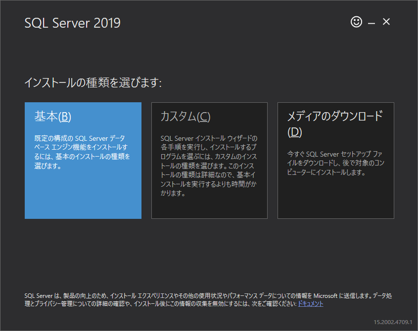  

- The installation is complete.

### Install SQL Server Management Studio (GUI tool)
- Access the following site.  
From "Available languages", click the language you want to use, then download and install the tool.  
https://docs.microsoft.com/en-us/sql/ssms/download-sql-server-management-studio-ssms?view=sql-server-ver15#available-languages


### Additional settings (Windows)
※We have currently confirmed that the following settings are required when SQL Server is installed on Windows.

- From the Windows Start menu, open "SQL Server Configuration Manager".
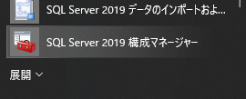  

- From the left menu, click "SQL Server Network Configuration" → "Protocols for (edition name)", then right-click "TCP/IP" and click "Enable".
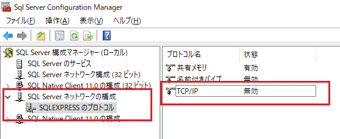  
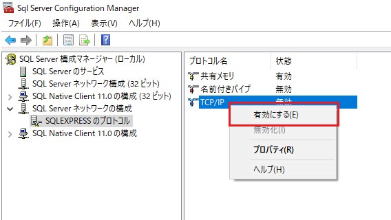  
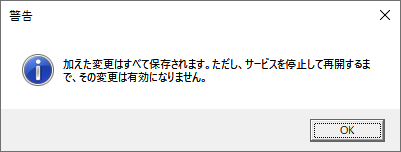  

- Click the Start menu button, type "Services", and run the "Services" app that appears.
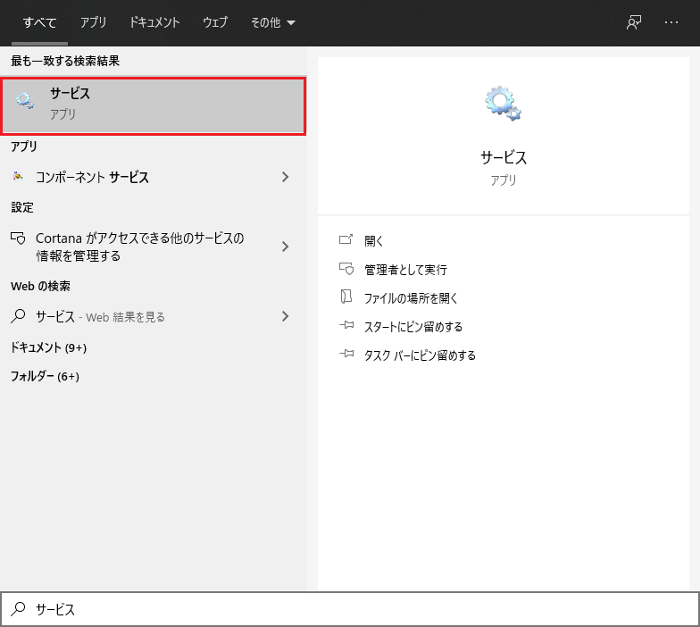  

- From the list of services, select "SQL Server (edition name)" and click "Restart the service".
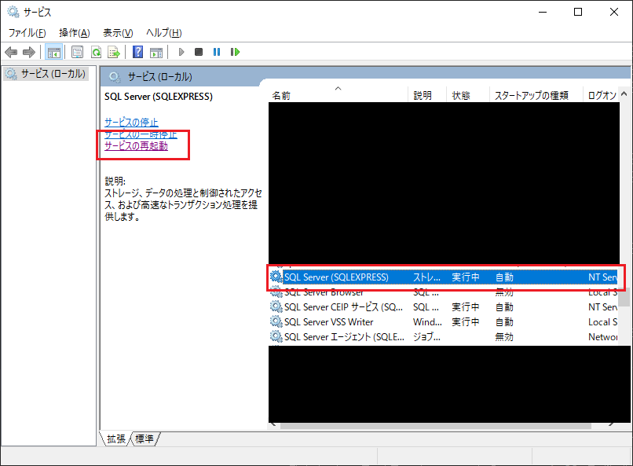  


### Create a database and add a user
- Run "SQL Server Management Studio".
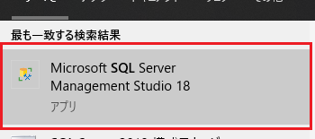  

- Log in.
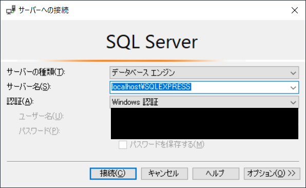  

#### Create a database
- From the left menu, right-click the "Databases" folder and click "New Database".
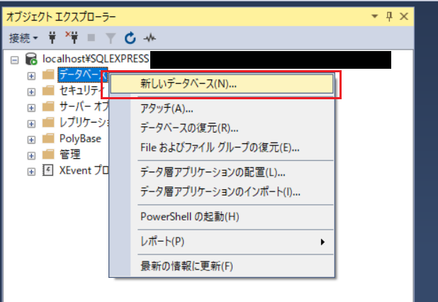  

- Enter any database name and click OK.
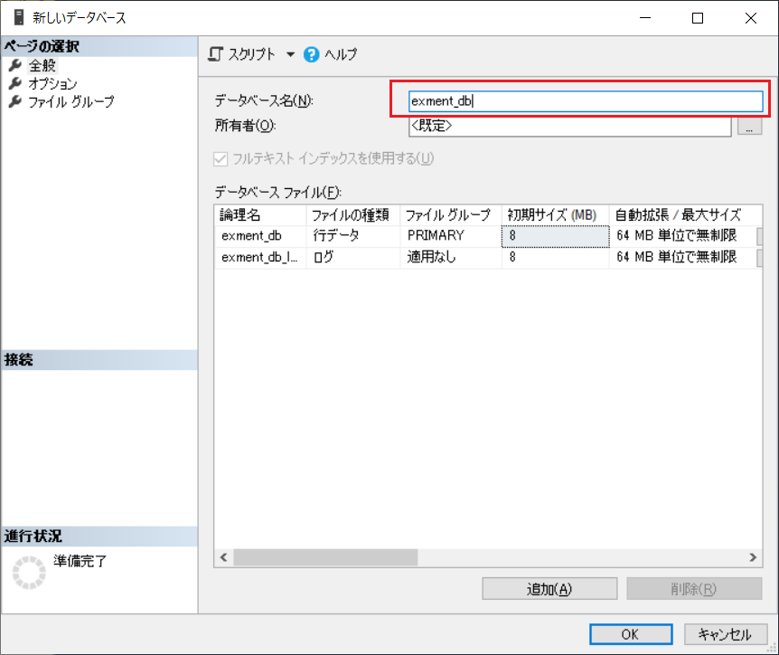  

#### Add a user
- From the left menu, right-click "Security" → "Logins" and select "New Login".
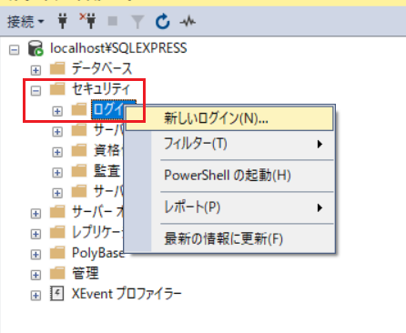  

- Enter the login name and password, and select "SQL Server authentication". We recommend unchecking "Enforce password policy". (Please follow the policy of your company, organization, etc.)
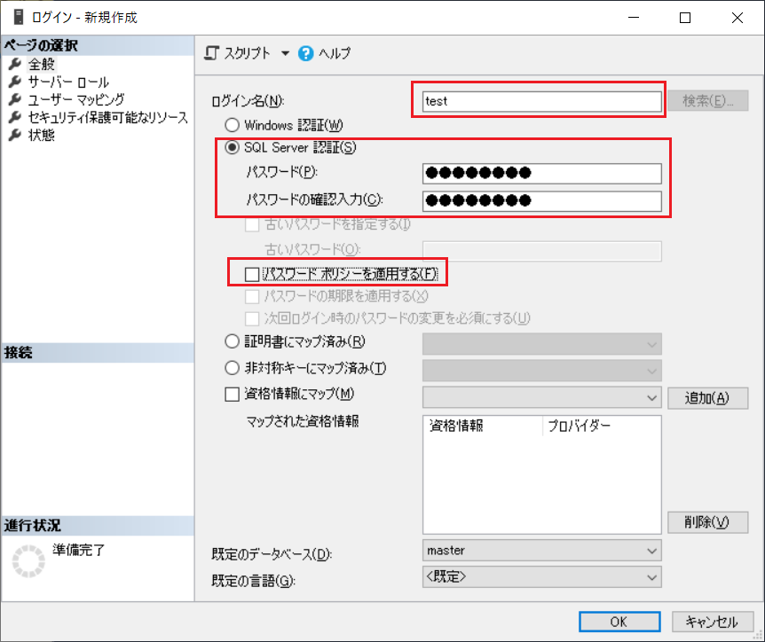    

- Select "User Mapping" at the top left.  
In the database list of "Users mapped to this login", select the database you created earlier.  
For "Database role membership", select the following.
   - db_backupoperator
   - db_ddladmin
   - db_datawriter
   - db_datareader
   - public
   - dbcreator (※Used for manually backing up and restoring data. Check this if you will back up and restore data manually.)
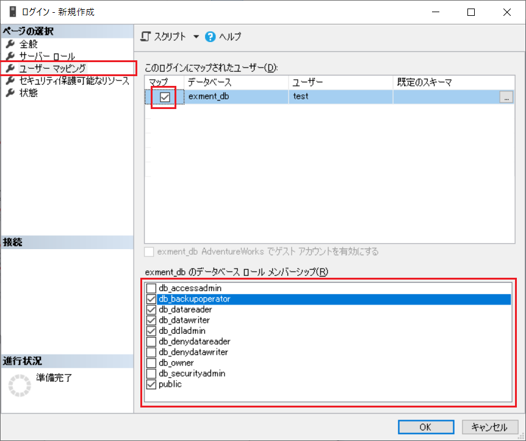    

- When everything is done, click OK.

#### Server login settings
- From the left menu, right-click the server at the top left and select "Properties".
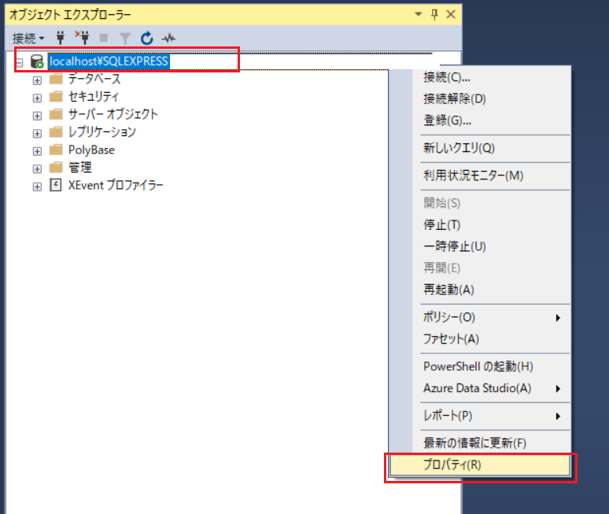 

- From the "Security" menu, select "SQL Server and Windows Authentication mode" for "Server authentication", and click OK.  

- Click the Start menu button, type "Services", and run the "Services" app that appears.
  

- In the "Services" app, select "SQL Server (edition name)" again and click "Restart the service".
  

#### Check the port
- In "SQL Server Configuration Manager", right-click "TCP/IP" and click "Properties".  
Then open the "IP Addresses" tab and check the value of "TCP Dynamic Ports" at the bottom. (You will use it later.)
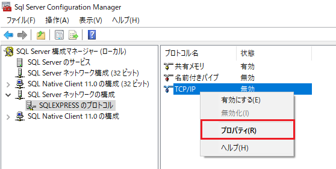  
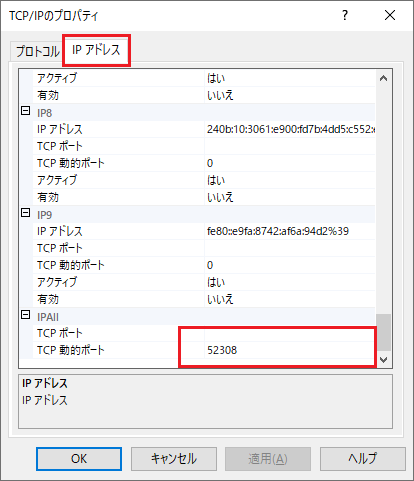  


## Connection check
Check whether you can connect to SQL Server.  

- Run "SQL Server Management Studio".
  

- Log in with the following settings.
    - Server name: the default server name
    - Authentication: SQL Server Authentication
    - Login: the user name of the user you created
    - Password: the password of the user you created

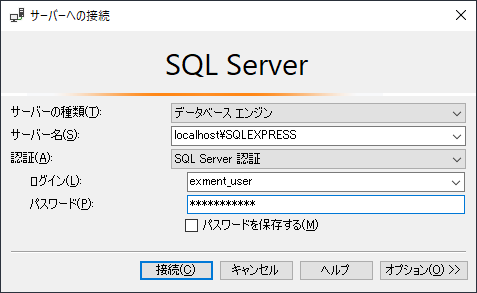  

- Confirm that you can log in successfully.  
If the settings have not been completed correctly, an error will occur.


## Exment settings
Build the environment and configure the settings for connecting to SQL Server from Exment.  

### Install the driver
The procedure for installing the driver differs depending on the OS of the server where Exment is installed.

#### Windows
- Run the following command.  
A file path is output in the result, so make a note of it.

```
php -i | find "extension_dir"
# Example result
extension_dir => C:\xampp\php\ext => C:\xampp\php\ext
```


- From the following site, download the driver for connecting to Microsoft SQL Server from PHP.  
[https://docs.microsoft.com/en-us/sql/connect/php/download-drivers-php-sql-server?view=sql-server-ver15]

- Run the downloaded EXE file.

- When you run it, a dialog like the following is displayed.  
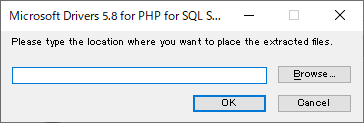

- Paste the file path from the result of the command above, and click "OK".
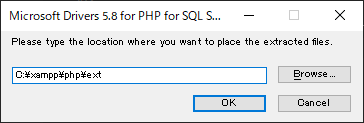

- As a result, the dll files for connecting to SQL Server are placed in the PHP extension library folder.
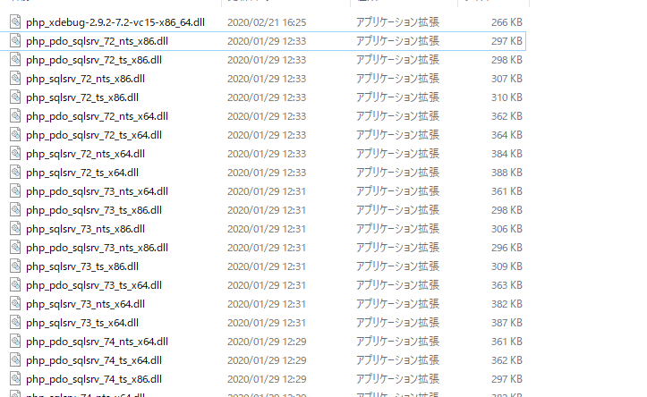

- Open the php.ini file.

- Add the following to the end of the file. ※Change the file name as appropriate, following the comments.

```
extension=php_pdo_sqlsrv_72_ts_x64.dll
# "72" part: the version of PHP you are using. If you are using PHP 7.3, use 73
# "ts" part: run the command "php -i | find "Thread Safety"". If it shows "enabled", enter "ts"; if it shows "disabled", enter "nts"
# "x64" part: run the command "php -v". If the first line contains "x64", enter "x64"; otherwise enter "x86"
```

- Restart PHP. This completes the settings on Windows.


#### Linux

Follow the procedure [here](https://docs.microsoft.com/en-us/sql/connect/php/installation-tutorial-linux-mac?view=sql-server-ver15) to install the ODBC driver and PHP driver for your OS.


### Exment settings
- After that, proceed with the installation according to the [installation procedure](/quickstart).

- On the database settings screen, enter the following values.  
    - Database Type : SQL Server
    - Host Name : the server name
    - Port : the port number you checked on the TCP/IP screen
    - Database : the name of the database you created
    - User Name : the user name you created
    - Password : the password of the user you created
