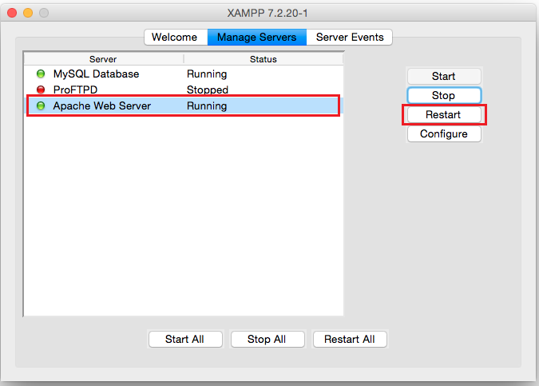

# Environment construction with XAMPP
How to build an environment that runs Exment on a Mac with XAMPP.  
XAMPP is software that installs PHP, Apache and MySQL together. We recommend it when you build a development environment from the beginning.

## Important point
- **Please use an XAMPP installation only for development and verification. We recommend that you do not use it as a production environment.** 

## Installation procedure
Go in this order.

1. Install XAMPP and start Apache and MySQL
2. Make the mysql command usable (environment variables)
3. Create a database
4. Make a URL for Exment (subdomain settings)
5. Install Exment

### XAMPP installation procedure
1. Download XAMPP from the following site.  
[XAMPP Download](https://www.apachefriends.org/jp/download.html)  

2. From "XAMPP for OS X", select the one with "PHP8.2" and download it.  

3. Proceed with the installation of XAMPP.  

4. On the screen for selecting the XAMPP components, check both and press Next.  

5. Follow the screens and press Next to finish the installation.

6. After the installation, there is an app called manager-osx in XAMPP (Other) of LaunchPad. You can start XAMPP from there.  

7. After starting XAMPP, click Manage Servers.  

8. Click the Start button of MySQL and of Apache, so that Status becomes Running.  

#### 【Important point】
- After you restart the OS, you need to start the XAMPP control panel again and start Apache again.  

### Add environment variable
To run mysql from the terminal, add the Path to .bash_profile, the setting file of the terminal.

1. Open .bash_profile with the following command.

~~~
vi .bash_profile
~~~

2. On the screen that opens, press i on the keyboard to enter the input mode (INSERT is shown at the lower left). Then enter the Path as follows.

~~~
export PATH="/Applications/XAMPP/xamppfiles/bin:$PATH"
~~~

3. To save and close, press Esc on the keyboard, then type :wq.  

4. Finally, load .bash_profile with the following command, so that the Path takes effect.

~~~
source ~/.bash_profile
~~~

#### Create database
1. After starting the XAMPP control panel, open the following URL in a web browser to access phpMyadmin.

http://localhost/phpmyadmin/index.php  

2. Click "New" in the left menu.  

3. In the "Create database" row, enter any database name in alphanumeric characters and click "Create".  

The database is now created.

### Subdomain settings
With the usual settings, you can use Exment by putting the Exment project files in the "/Applications/XAMPP/htdocs" folder.  
But as it is, there is a big problem: for example, opening the URL [http://localhost/exment/.env](http://localhost/exment/.env) shows the setting file, which contains the database information, on the screen.  
So we strongly recommend the settings that prevent this problem. Set them with the steps below.

1. Create the folder "local" in the folder "/Applications/XAMPP".  

2. Open "/Applications/XAMPP/xamppfiles/etc/extra/httpd-xampp.conf".

3. Add the following to the end of the file. **※DocumentRoot must have "/public" at the end**  

~~~
<VirtualHost *:80>
    DocumentRoot "/Applications/XAMPP/xamppfiles/htdocs"
    ServerName localhost
</VirtualHost>

<VirtualHost *:80>
  DocumentRoot "/Applications/XAMPP/local/exment/public"
  ServerName exment.localapp
</VirtualHost>

<Directory "/Applications/XAMPP/local/exment/public">
  Allow from all
  AllowOverride All
  Require all granted
</Directory>  
~~~

4. Open "/Applications/XAMPP/xamppfiles/etc/httpd.conf" and search the text for the following lines.

~~~
User daemon
Group daemon
</IfModule>
~~~

Change these lines as follows.

~~~
User (your Mac login user name)
Group daemon
</IfModule>
~~~

5. Edit "/etc/hosts".  
Enter the following command in the terminal.  
※You are asked for a password. Enter the password of the login user.

~~~
sudo vi /etc/hosts
~~~

Add the following items to the hosts file.

~~~
127.0.0.1       localhost
127.0.0.1       exment.localapp
~~~

6. Restart Apache in the XAMPP control panel.  

### Exment installation
Install Exment by following the Exment [installation steps](/quickstart).  
Exment is normally installed in the "/Applications/XAMPP/local" folder.  
Here, we assume that it was installed in the "/Applications/XAMPP/local/exment" folder.  

- During the installation, there is a screen for entering the database settings. Enter them as follows.
    - Database Type: MariaDB
    - Host Name: 127.0.0.1
    - Port: 3306
    - Database: (the database name created above)
    - User Name: root
    - Password: (blank)

