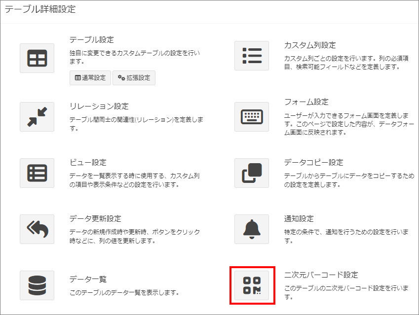
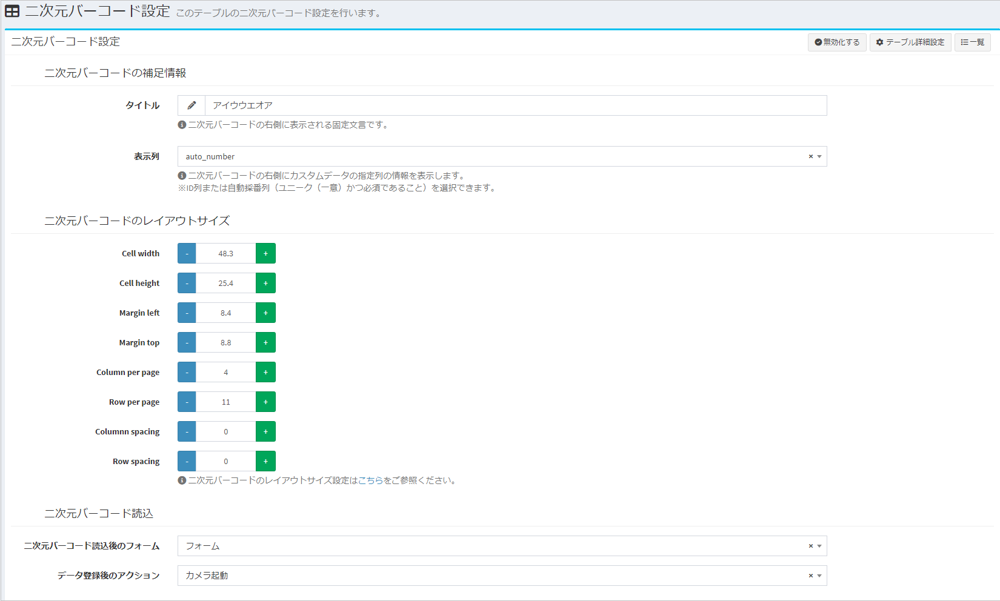
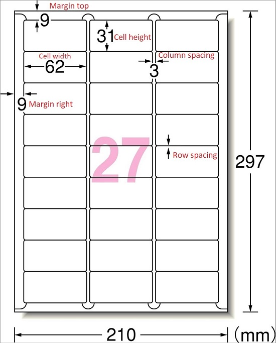
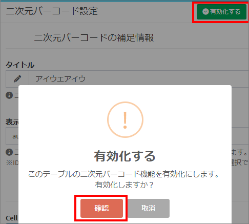
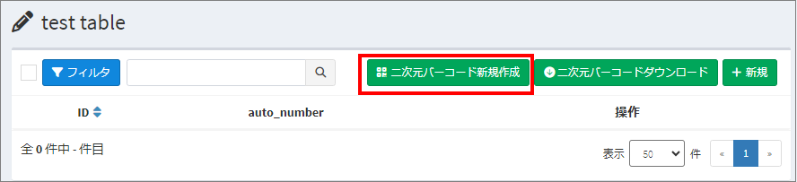
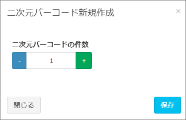
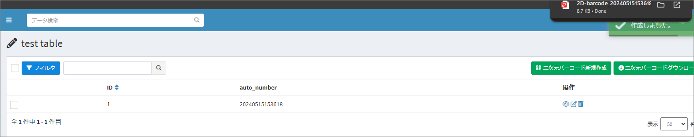
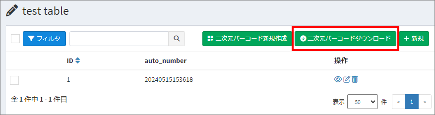
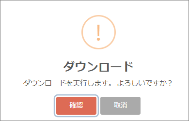
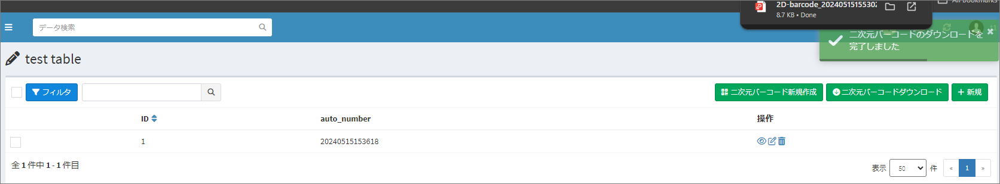

# 二次元バーコード設定
テーブルごとに、二次元バーコードのラベルの見た目と、読み込んだときの動きを決める画面の説明です。

使うまでの流れは、次のとおりです。

1. 二次元バーコード設定の画面を開く
2. 設定して保存する
3. 「有効化する」ボタンを押す
4. データ一覧から、二次元バーコードのPDFを作る

## 二次元バーコード機能の概要
二次元バーコード機能の概要は、[公式サイトの投稿](https://exment.net/release_v6-1-0/)をご覧ください。

### 必要な PHP の拡張（ラベルの PDF）
二次元バーコードのラベルの PDF を作るには、PHP の gd 拡張が FreeType 付き（`imagettftext` が使える）で入っている必要があります。入っていないと、ラベルの PDF を作るときにエラーになります。

- docker-exment をお使いの場合：docker-exment を更新し（2026-11-23 の PR #23 以降）、php のイメージを作り直してください（`docker compose build php` のあと `docker compose up -d`）。
- ほかのサーバーの場合：FreeType 付きの gd を入れてください（ふつうは、ディストリビューションの php-gd パッケージに含まれています）。使えるかどうかは、次のコマンドで確かめられます。`bool(true)` と出れば使えます。

```
php -r 'var_dump(function_exists("imagettftext"));'
```

## ページ表示
- カスタムテーブル一覧で、設定するテーブルにチェックを入れて、右上の「テーブル詳細設定」をクリックします。  


> ※ そのカスタムテーブルのデータ一覧画面やデータ登録画面から、直接移ることもできます。その場合も、右上の「テーブル詳細設定」をクリックしてください。  


- テーブル詳細設定の画面で、二次元バーコード設定のアイコンをクリックすると、二次元バーコード設定画面が出ます。  


## 二次元バーコードの設定項目


### 二次元バーコードの補足情報
二次元バーコードの右側に出す情報を設定します。

- #### タイトル
二次元バーコードの右側に出す、決まった文言を入力します。

- #### 表示列
二次元バーコードの右側に出す、カスタムデータの列を選びます。   
ID列、または自動採番列（ユニーク（一意）で、必須であること）を選べます。

### 二次元バーコードのレイアウトサイズ
二次元バーコードのレイアウトサイズを設定します。 
下の表をご覧ください。

| Case | Cell width | Cell height | Margin right | Margin top | Column per page | Row per page | Column spacing | Row spacing |
| ---- | ---- | ---- | ---- | ---- | ---- | ---- | ---- | ---- |
| 2x5 | 84 | 52 | 17 | 10.5 | 2 | 5 | 8 | 4 |
| 2x6 | 83.8 | 42.3 | 19.3 | 21.5 | 2 | 6 | 3.8 | 0 |
| 2x7 | 83 | 32 | 20 | 24 | 2 | 7 | 4 | 4 |
| 3x6 | 63.5 | 46.5 | 7.2 | 9 | 3 | 6 | 2.55 | 0 |
| 3x7 | 63.5 | 38 | 7.2 | 15.5 | 3 | 7 | 2.55 | 0 |
| 3x8 | 56 | 30 | 17 | 14.5 | 3 | 8 | 4 | 4 |
| 3x9 | 62 | 31 | 9 | 9 | 3 | 9 | 3 | 0 |
| 3x10 | 53.3 | 25.4 | 19 | 21.5 | 3 | 10 | 3.8 | 0 |
| 3x12 | 60 | 20 | 12 | 12 | 3 | 12 | 3 | 3 |
| 4x11 | 48.3 | 25.4 | 8.4 | 8.8 | 4 | 11 | 0 | 0 |



### 二次元バーコード読込
二次元バーコードを読み込んだときの動きを設定します。 

- #### 二次元バーコード読込後のフォーム
二次元バーコードを読み込んだあとに開く、登録フォームを選びます。  
そのテーブルに登録済みのカスタムフォームから選べます。 

- #### データ登録後のアクション  
データを登録したあとに出す画面を選びます。  
TOP画面、一覧画面、詳細画面、編集画面、カメラ起動画面から選べます。

設定したら、「保存」ボタンをクリックします。  

### 二次元バーコード設定を有効化する  
- そのテーブルで二次元バーコード機能を使えるようにするには、「有効化する」必要があります。一度保存してから、ページ右上の「有効化する」ボタンをクリックしてください。



## 二次元バーコード新規作成
- 二次元バーコード機能を有効化すると、そのテーブルのデータ一覧に「二次元バーコード新規作成」ボタンが出ます。  
ボタンの名前のうち「二次元バーコード」の部分は、.envファイルの「EXMENT_TEXT_QR_BUTTON_JA/EN」で変えられます。  



- 「二次元バーコード新規作成」をクリックすると、二次元バーコード新規作成画面が出ます。

- 二次元バーコードの件数を入力して保存すると、その数だけデータが作られ、二次元バーコードのPDFも出力されます。


## 二次元バーコードダウンロード
- 二次元バーコード機能を有効化すると、そのテーブルのデータ一覧に「二次元バーコードダウンロード」ボタンが出ます。  
ボタンの名前のうち「二次元バーコード」の部分は、.envファイルの「EXMENT_TEXT_QR_BUTTON_JA/EN」で変えられます。


- データを選んで「二次元バーコードダウンロード」をクリックすると、選んだデータの二次元バーコードが、PDFで出力されます。





## Exmentからカメラ画面の起動
- Exmentのダッシュボードから、二次元バーコードを読み込むためのカメラ画面を起動できます。

- ダッシュボードに、アイテム「二次元／JANバーコード」を追加する手順は、[ダッシュボード](/ja/dashboard#二次元／janバーコード)をご覧ください。
