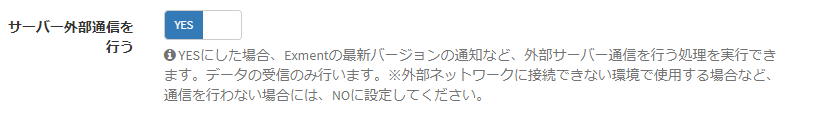

# サーバー外部通信オフ
Exmentのサーバーから、ほかのサーバーへの通信を止める設定です。  
完全なオンプレミス環境など、ほかのサーバーへ通信を行わない環境で使います。

Exmentは、次の用途で、ほかのサーバーへ通信を行うことがあります。

- Exmentに最新バージョンがあるか判定するために、パッケージシステムと通信し、最新バージョン情報を取得する

### 設定手順 
> 本手順はv1.3.0より変更になりました。

1. 左メニューから、「システム設定」画面を開きます。
2. 一覧の中の「サーバー外部通信を行う」項目を、NOにします。  

3. 保存します。これで設定は完了です。

[←追加設定一覧へ戻る](/ja/quickstart_more)