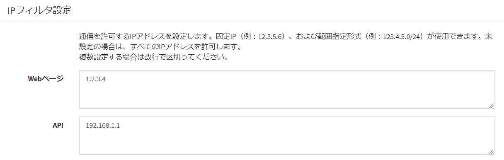

# IPフィルター
Exment の Web ページと API に、アクセスできる IP アドレスを決める設定です。

- 許可する IP アドレスだけを登録します（ホワイトリスト方式）。
- Web ページ用と API 用を、分けて登録します。たとえば「API だけ、実行できる IP アドレスを制限する」こともできます。

### 設定手順
1. Exment をエキスパートモードにします。まだエキスパートモードになっていないときは、「.env」ファイルを開き、次の値を追加します。

~~~
EXMENT_EXPART_MODE=true
~~~

2. システム設定の画面を開きます。IPフィルターの項目が追加されています。

#### 設定内容詳細

| したいこと | 入力のしかた | 例 |
| ---- | ---- | ---- |
| IP アドレスを 1 つ決めて許可する | IP アドレスをそのまま入力します | 123.4.5.6 |
| IP アドレスを範囲で許可する | サブネットマスクの形で入力します | 例1： 123.4.0.0/16 → 123.4.0.0から123.4.255.255までアクセス許可 例2： 123.4.10.0/24 → 123.4.10.0から123.4.10.255までアクセス許可 |
| localhost に作ったサーバーで、localhost からのアクセスを許可する | 「::1」と入力します | ::1 |
| 複数の IP アドレスを許可する | 改行で区切って入力します。どれか 1 つに合えば、アクセスできます | |

#### IP制限を強制的に無効にする
Web ページの IP アドレスの設定をまちがえて、アクセスできなくなったときなどに、IP 制限を止める手順です。

- 「.env」ファイルを開き、次の値を追加します。

~~~
EXMENT_DISABLE_IP_FILTER=true
~~~

#### IP 制限からはずす人（7.3.0）
Exment 7.3.0 から、Web ページの IP 制限からはずす人を選べます。出張先や自宅など、許可していない IP アドレスから使う人のための設定です。

- システム設定の［詳細設定］の「IPフィルタ設定」で、次の 3 つから選びます。何も選ばないときは、今までと同じです。

| 項目 | はずれる人 |
| ---- | ---- |
| 制限からはずすユーザー（画面） | 選んだユーザー |
| 制限からはずす組織（画面） | 選んだ組織と、その下の組織のユーザー |
| 制限からはずす役割グループ（画面） | 選んだ役割グループのユーザー（ユーザーとして、または組織から入っている人） |

- はずれるのは Web ページだけです。API・API キー・MCP は、API 用の IP 制限がそのまま効きます。
- はずす人が許可していないアドレスから使うと、ログイン履歴に「IP の制限の外（例外）」と記録されます。セッションとアドレスごとに 1 回です。
- はずす人でないユーザーが、許可していないアドレスからログインすると、ログインは断られます。ログイン履歴には「失敗（IP の制限の外）」とだけ記録されます。成功とは数えず、新しい IP アドレスのお知らせも出ません。
- IT 監査のレポートに「IP の制限からはずす人」「IP の制限の外から使ったもの」の 2 つの項目が出ます。

> [!WARNING]
> **管理者の方へ：** はずす人を 1 人でも選んでいるあいだは、許可していない IP アドレスからも、次の画面が開きます。
> - ログインの画面（ログイン画面の画像を含む）
> - パスワードを忘れたとき・パスワードの再設定・パスワードの変更の画面
> - SSO（OAuth・SAML）のログインと戻り先
>
> はずす人でないユーザーは、ログインしても中には入れません。ただし、ログインの画面は見えて、ログインを試すことはできます（ふだんのロックの設定は効きます）。はずす人を選んでいないときは、今までどおり、これらの画面も外からは開きません。
>
> インストールの画面とファイルの共有のリンクは、はずす人を選んでいても、外からは開きません。

[←追加設定一覧へ戻る](/ja/quickstart_more)
