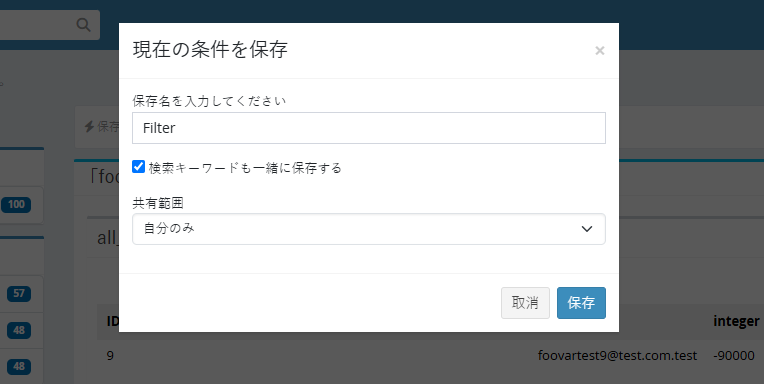

# (上級者向け)全文検索エンジン(Meilisearch)の利用
全文検索エンジン「[Meilisearch](https://www.meilisearch.com/)」を使って、Exment の検索を速くするための設定です。  
Exment は、ふつうはデータベースを検索します。Meilisearch を使うと、データがとても多い環境でも、速く検索できます。  
※この機能は、Exment v7.0.0以降で利用できます。

入れ方は 2 つあります。

| 入れ方 | 向いている場合 |
|---|---|
| [かんたんな入れ方](#かんたんな入れ方) | Exment v7.2.2以降。スクリプトを 1 回実行するだけで入れたい |
| [手で入れる場合](#手で入れる場合) | スクリプトを使わずに設定したい。設定の内容を確かめたい |

次の機能が使えます。

- フリーワード検索の高速化
- 検索結果の絞り込み(フィルタ・ファセット)
- 検索キーワードのハイライト表示
- 検索結果の並び替え(関連度順・新しい順・古い順)
- 検索条件の保存・共有
- 検索結果のエクスポート(CSV・XLSX)
- シノニム(同義語)・ストップワードの設定

  

> Exment のふつうの検索のしくみは、[検索](/ja/search)をご覧ください。


## 動作条件
Meilisearch を使うには、次の条件を満たす必要があります。

|項目|内容|
|---|---|
|Meilisearchサーバー|v1.10以降|
|PHPライブラリ|「meilisearch/meilisearch-php」(v1.10以降)のインストールが必要です。かんたんインストールのzipには、含まれています。**このライブラリは、Exmentの必須ライブラリではありません。** インストールされていない場合、Meilisearch関連のコマンドはエラーとなり、リアルタイム同期も無効になります。<br />また、このライブラリは「guzzlehttp/guzzle」と互換性のあるHTTPクライアントを必要とします。|
|キュー|「QUEUE_CONNECTION」にdatabase(もしくはredis)を設定し、マイグレーションを実行済である必要があります。<br />リアルタイム同期はキューで実行されるため、初期値のsyncのままだと、画面の処理がブロックされます。詳細は[通知処理の遅延実行](/ja/additional_queue)をご確認ください。|
|カスタムテーブル|カスタムテーブル設定で「検索可能」がYESになっており、かつ「フリーワード検索対象」がYESのカスタム列を持つテーブルのみ、インデックスの作成対象となります。|


## 注意点
- <span class="red">※Meilisearchは、インターネットに公開しないでください。</span>Exment と同じサーバー、または内部ネットワークからだけつなげるように設定してください。マスターキーは、ほかの人に知られないように、厳重に管理してください。
- **Meilisearch とキューワーカは、いつも動かしておく必要があります**。手順1と手順3で、どちらも、自動で再起動するサービスとして登録します。止まったときは、次のようになります。

|止まったもの|どうなるか|
|---|---|
|Meilisearch|検索画面は、データベースを使ったふつうの検索に切り替わります(絞り込み条件を適用している場合は検索結果が表示されず、並び順は適用されません)。|
|キューワーカ|更新した内容が、インデックスへ反映されません。|

- Meilisearch のインデックス（検索用のデータ）は、Exment のデータベースとは別に持ちます。そのため、2 つのあいだで差異が出ることがあります。手順4で、1日1回の自動修復を設定します。
- <span class="red">※「EXMENT_SEARCH_DOCUMENT」をtrueにしている場合、検索画面ではMeilisearchが使用されません。</span>添付ファイルのファイル名はインデックスに入らないため、「MEILISEARCH_GLOBAL_SEARCH」が true でも、検索画面はデータベースを使った検索になります。カスタム列「選択肢 (他のテーブルの値一覧から選択)」の入力補完は、影響を受けません。
- Meilisearch そのもののくわしい説明は、[Meilisearch公式ドキュメント](https://www.meilisearch.com/docs)をご覧ください。


## かんたんな入れ方
Exment v7.2.2以降では、スクリプトを 1 回実行するだけで、下の[手で入れる場合](#手で入れる場合)の手順1〜4を、まとめて行えます。スクリプトは、何度実行しても問題ありません(すでにあるマスターキーや設定は、そのまま使います)。

お使いの環境に合うところをご覧ください。

|環境|見るところ|
|---|---|
|Linux のサーバー(AWS の EC2 なども含みます)|下の「Linuxの場合」|
|Windows のサーバー|下の「Windowsの場合」|
|docker-exment|下の「Dockerの場合」|
|Meilisearch がすでに動いている(別のサーバーに用意した場合など)|[Exmentの設定だけを行う場合](#exmentの設定だけを行う場合)|
|AWS・Azure・レンタルサーバー|下の「AWS・レンタルサーバーの場合」|

### Linuxの場合
systemdを使用するサーバー(Ubuntu・Debian・RHEL・Amazon Linuxなど。AWSのEC2も含みます)で、Exmentのフォルダに移動し、以下のコマンドを実行します。

```
cd /var/www/exment
sudo sh vendor/exceedone/exment/resources/meilisearch/install-meilisearch.sh
```

スクリプトは、以下を行います。

1. Meilisearchのインストール(「/usr/local/bin/meilisearch」)、実行用のユーザー、新しいマスターキーを書いた「/etc/meilisearch.conf」(rootのみ読み取り可能)、サービス「meilisearch」の登録(127.0.0.1:7700でのみ待ち受けます)
1. Exmentの設定(「php artisan exment:meili-setup」。内容は[Exmentの設定だけを行う場合](#exmentの設定だけを行う場合)をご確認ください)
1. キューワーカのサービス「exment-meili-worker」の登録
1. Webサーバーのユーザーのcrontabへの、スケジューラ(php artisan schedule:run)の追加

必要に応じて、以下のオプションを指定します。

|オプション|内容|
|---|---|
|--exment-dir=フォルダ|Exmentのフォルダです。既定値は、現在のフォルダです。|
|--user=ユーザー|WebサーバーがPHPを実行するユーザーです(www-data・apache・nginxなど)。既定値は、「storage」フォルダの所有者です。|
|--php=パス|phpコマンドのパスです。Webサーバーと同じバージョンのphpを指定してください(例: --php=/usr/bin/php8.3)。既定値は、PATHにあるphpです。|
|--version=バージョン|Meilisearchのバージョンです。既定値は「v1.10.3」です。|
|--index=名前|インデックス名です。既定値は「exment_global」です。|
|--no-cron|スケジューラをcrontabに追加しません。すでに別の方法でスケジューラを実行している場合に指定します。|

### Windowsの場合
PowerShellを「管理者として実行」で開き、Exmentのフォルダで以下のコマンドを実行します。
※「C:\php\php.exe」は、IISで使用しているphpのパスに変更してください。

```
cd C:\inetpub\exment
powershell -ExecutionPolicy Bypass -File vendor\exceedone\exment\resources\meilisearch\install-meilisearch.ps1 -Php C:\php\php.exe
```

スクリプトは、以下を行います。

1. Meilisearchのインストール(「C:\meilisearch」)、新しいマスターキー(「C:\meilisearch\master-key.txt」。AdministratorsとSYSTEMのみ読み取り可能)、NSSMによるサービス「Meilisearch」の登録、インデックスの保存先のWindows Defenderのスキャン対象からの除外
1. Exmentの設定(「php artisan exment:meili-setup」)
1. キューワーカのサービス「ExmentMeiliWorker」の登録
1. タスクスケジューラへの、タスク「ExmentScheduler」(1分ごとにphp artisan schedule:run)の登録

> NSSMは、「-Nssm」でパスを指定するか、PATHもしくは「C:\nssm\nssm.exe」に配置してください。どちらもない場合、wingetがあれば自動でインストールします。
> そのほかのオプション: 「-ExmentDir」(Exmentのフォルダ)、「-Version」(Meilisearchのバージョン)、「-InstallDir」(Meilisearchのフォルダ)、「-Index」(インデックス名)、「-NoScheduler」(タスクを登録しない)、「-NoDefenderExclusion」(Windows Defenderの設定を変えない)

### Dockerの場合
[docker-exment](https://github.com/exceedone/docker-exment)をお使いの場合は、「docker-compose.meilisearch.yml」を追加するだけで、Meilisearch・キューワーカ・スケジューラのコンテナが起動します。

- docker-exmentのフォルダの「.env」に、16文字以上のマスターキーを記入します(例: 「openssl rand -hex 16」で生成した値)。

```
EXMENT_DOCKER_MEILISEARCH_MASTER_KEY=(マスターキー)
```

- 以下のコマンドを実行し、コンテナを起動したうえで、Exmentの設定を行います。

```
docker compose -f docker-compose.yml -f docker-compose.mysql.yml -f docker-compose.meilisearch.yml up -d
docker compose -f docker-compose.yml -f docker-compose.mysql.yml -f docker-compose.meilisearch.yml exec -u www-data php php artisan exment:meili-setup
```

### Exmentの設定だけを行う場合
Meilisearchがすでに動いている場合(別のサーバーに用意した場合など)は、Exmentのフォルダで以下のコマンドを実行します。手で入れる場合の「[2. Exmentの設定](#_2-exmentの設定)」を、まとめて行います。

```
php artisan exment:meili-setup --host=http://127.0.0.1:7700 --key-file=/etc/meilisearch.conf
```

このコマンドは、以下の順に実行します。途中でエラーになった場合は、エラーの内容を表示して止まります。直したあと、もう一度実行してください。

1. Meilisearchに接続できること、マスターキーが正しいこと、バージョンがv1.10以降であることの確認
1. 「.env」の設定: 「QUEUE_CONNECTION」がsyncの場合はdatabaseに変更し、「MEILISEARCH_REINDEX_QUEUE=meili-reindex」を追加します
1. キューのテーブル(jobs・failed_jobs)がない場合の作成と、「php artisan migrate」
1. システム設定の保存: ホスト・マスターキー・インデックス名・リアルタイム同期(YES)・インデックス定期修復(YES)・修復実行時刻
1. インデックスの作成。完了したら、グローバル検索をYESにします
1. 接続状態の確認(「php artisan exment:meili-health --failed」)と、動いているキューワーカの再起動の指示(「php artisan queue:restart」)

|オプション|内容|
|---|---|
|--host=URL|Meilisearchの接続先です。既定値は、現在の設定値(「http://127.0.0.1:7700」)です。|
|--key-file=ファイル|マスターキーを書いたファイルです。「MEILI_MASTER_KEY=」の行があるファイル(「/etc/meilisearch.conf」など)か、キーだけを書いたファイルを指定します。|
|--key=キー|マスターキーです。コマンドラインに書いたキーは、ほかのユーザーからも見える場合があるため、「--key-file」か、環境変数「MEILI_MASTER_KEY」の使用をおすすめします。|
|--index=名前|インデックス名です。既定値は、現在の設定値(「exment_global」)です。|
|--repair-at=HH:MM|インデックス定期修復の時刻です。既定値は、現在の設定値(「03:00」)です。|
|--skip-env|「.env」を変更しません。表示された内容を、ご自身で記入してください。|
|--skip-index|設定の保存だけを行い、インデックスを作成しません。グローバル検索はNOのままになります。|

> マスターキーは、「--key-file」・環境変数「MEILI_MASTER_KEY」・「--key」・システム設定に保存済みの値の順に探し、どれもない場合は入力を求めます。
> このコマンドは、キューワーカとスケジューラを登録しません。手で入れる場合の「[3. キューワーカの登録](#_3-キューワーカの登録)」「[4. スケジューラの設定](#_4-スケジューラの設定)」を行ってください。

### AWS・レンタルサーバーの場合
- **AWS(EC2)・Azureの仮想マシンなど**: Linux・Windowsのサーバーと同じく、上のスクリプトを使用できます。セキュリティグループなどで、ポート7700を外部に公開しないでください。
- **レンタルサーバー(Xserverなど)**: 常時実行するプログラムを動かせないため、Meilisearchをレンタルサーバーの中で動かすことはできません。Meilisearchは、常時実行できる別のサーバー(AWSのEC2など)に置き、Exmentのサーバーからのみ接続できるように設定します。そのうえで、Exmentのフォルダで「php artisan exment:meili-setup --host=(Meilisearchの接続先)」を実行してください。キューワーカは常時実行できないため、cronで1分ごとに実行します。詳細は[通知処理の遅延実行](/ja/additional_queue)をご確認ください。


## 手で入れる場合
スクリプトを使わずに設定するときや、設定の内容を確かめたいときの手順です。次の順に設定します。

1. Meilisearchサーバーのインストール
1. Exmentの設定
1. キューワーカの登録
1. スケジューラの設定


## 1. Meilisearchサーバーのインストール

### Linuxの場合
Ubuntu、ならびにsystemdを使用する環境での手順です。  
※お使いの環境にあわせて、パスやユーザー名を変更してください。

- 以下のコマンドを実行し、Meilisearchのバイナリファイルを配置します。  
Meilisearchは1ファイルで動作するため、他のライブラリのインストールは不要です。

```
curl -L -o /tmp/meilisearch \
  https://github.com/meilisearch/meilisearch/releases/download/v1.10.3/meilisearch-linux-amd64

chmod +x /tmp/meilisearch && sudo mv /tmp/meilisearch /usr/local/bin/meilisearch
```

- 以下のコマンドを実行し、バージョンが表示されることを確認します。

```
meilisearch --version
```

- 以下のコマンドを実行し、Meilisearch実行用のユーザーと、データ保存先のフォルダを作成します。

```
sudo useradd -r -s /usr/sbin/nologin meilisearch
sudo mkdir -p /var/lib/meilisearch
sudo chown meilisearch:meilisearch /var/lib/meilisearch
```

- 以下のコマンドを実行し、Meilisearchの設定ファイルを作成します。  
マスターキーは、ランダムな文字列で自動生成されます。

```
sudo tee /etc/meilisearch.conf > /dev/null << EOF
MEILI_DB_PATH=/var/lib/meilisearch/data.ms
MEILI_HTTP_ADDR=127.0.0.1:7700
MEILI_ENV=production
MEILI_MASTER_KEY=$(openssl rand -hex 16)
MEILI_NO_ANALYTICS=true
EOF

sudo chmod 600 /etc/meilisearch.conf
```

> 「MEILI_ENV=production」の場合、マスターキーは16バイト以上である必要があります。  
「openssl rand -hex 16」は32文字の文字列を生成するため、この条件を満たします。

- 以下のコマンドを実行し、生成されたマスターキーを確認します。  
**このキーは、後ほどExmentの「システム設定」に入力するため、必ず控えておいてください。**

```
sudo grep MASTER_KEY /etc/meilisearch.conf
```

- 以下のコマンドを実行し、Meilisearchをサービスとして登録します。

```
sudo tee /etc/systemd/system/meilisearch.service > /dev/null << 'EOF'
[Unit]
Description=Meilisearch search engine
After=network.target

[Service]
Type=simple
User=meilisearch
Group=meilisearch
EnvironmentFile=/etc/meilisearch.conf
WorkingDirectory=/var/lib/meilisearch
ExecStart=/usr/local/bin/meilisearch
Restart=always
RestartSec=3
NoNewPrivileges=true
ProtectSystem=full
ProtectHome=true
ReadWritePaths=/var/lib/meilisearch

[Install]
WantedBy=multi-user.target
EOF
```

> 「WorkingDirectory=/var/lib/meilisearch」の記載は必須です。  
Meilisearchはカレントディレクトリに一時フォルダを作成するため、この記載がない場合、「Permission denied」が発生し、サービスの起動と停止を繰り返します。

- 以下のコマンドを実行し、サービスの自動起動を有効にしたうえで、Meilisearchを起動します。

```
sudo systemctl daemon-reload
sudo systemctl enable --now meilisearch
```

- 以下のコマンドを実行し、「{"status":"available"}」が表示されることを確認します。

```
curl -s http://127.0.0.1:7700/health
```

### Windowsの場合
NSSM(Non-Sucking Service Manager)と、タスクスケジューラを使用する環境での手順です。  
PowerShellを「管理者として実行」で開き、以下のコマンドを実行してください。  
※お使いの環境にあわせて、パスを変更してください。

- 以下のコマンドを実行し、フォルダの作成と、Meilisearchのバイナリファイルのダウンロードを行います。

```
New-Item -ItemType Directory -Force C:\meilisearch
Invoke-WebRequest -Uri "https://github.com/meilisearch/meilisearch/releases/download/v1.10.3/meilisearch-windows-amd64.exe" `
  -OutFile C:\meilisearch\meilisearch.exe
```

- 以下のコマンドを実行し、バージョンが表示されることを確認します。

```
C:\meilisearch\meilisearch.exe --version
```

- 以下のコマンドを実行し、32文字のマスターキーを生成します。  
**このキーは、後ほどExmentの「システム設定」に入力するため、必ず控えておいてください。**

```
$key = -join (1..32 | ForEach-Object { '0123456789abcdef'[(Get-Random -Maximum 16)] })
$key
```

> 「Get-Random -Count 32」は同じ値を重複して取得しないため、16種類しかない16進数の文字では、16文字のキーしか生成できません。使用しないでください。

- [NSSM公式サイト](https://nssm.cc/download)より、NSSMをダウンロードし、「C:\nssm\」フォルダに「nssm.exe」を配置します。  
※「winget install nssm」コマンドでインストールすることもできます。

- 以下のコマンドを実行し、MeilisearchをWindowsサービスとして登録します。

```
C:\nssm\nssm.exe install Meilisearch C:\meilisearch\meilisearch.exe
C:\nssm\nssm.exe set Meilisearch AppParameters "--db-path C:\meilisearch\data.ms --http-addr 127.0.0.1:7700 --env production --master-key $key --no-analytics"
C:\nssm\nssm.exe set Meilisearch AppDirectory C:\meilisearch
C:\nssm\nssm.exe set Meilisearch AppExit Default Restart
C:\nssm\nssm.exe set Meilisearch Start SERVICE_AUTO_START
C:\nssm\nssm.exe start Meilisearch
```

> 「$key」は、1つ前の手順で生成したマスターキーです。  
PowerShellを開きなおした場合、変数の内容が失われているため、生成したキーの文字列を直接記入してください。

- 以下のコマンドを実行し、「status : available」が表示されることを確認します。

```
Invoke-RestMethod http://127.0.0.1:7700/health
```

- 以下のコマンドを実行し、インデックスの保存先フォルダを、Windows Defenderのスキャン対象から除外します。  
※スキャン対象に含まれる場合、インデックスの作成・更新が遅くなる場合があります。

```
Add-MpPreference -ExclusionPath "C:\meilisearch\data.ms"
```


## 2. Exmentの設定
Meilisearchサーバーの準備ができましたら、Exment側の設定を行います。  
※この手順は、「php artisan exment:meili-setup」でまとめて行うこともできます。詳細は[Exmentの設定だけを行う場合](#exmentの設定だけを行う場合)をご確認ください。  
以下の手順は、Linux・Windowsで共通です。

### ライブラリのインストール
- Exmentのフォルダで、以下のコマンドを実行します。

```
composer require meilisearch/meilisearch-php
```

### .envの設定
- Exmentのフォルダより、「.env」ファイルを開き、以下の設定を記入します。  
Meilisearchサーバーへの接続情報や主要な設定は、「.env」ではなく、後の手順でシステム設定画面から設定します。

```
#キュードライバー。初期値のsync(同期処理)のままだと、画面の処理がブロックされます
QUEUE_CONNECTION=database

#テーブル単位でインデックスを作成しなおす処理(処理が重い)を、カスタムデータ1件単位の同期処理とは別のキューで実行します
MEILISEARCH_REINDEX_QUEUE=meili-reindex
```

- 上記以外の設定値については、[設定値一覧](/ja/config)の「検索」をご確認ください。既定値から変更する場合のみ、記入してください。

> Meilisearchの設定ファイルは、Exmentのパッケージ内で読み込まれます。そのため、「php artisan vendor:publish」の実行は不要です。

### テーブルの作成
- 以下のコマンドを実行し、キューの情報を保持するためのテーブルと、Meilisearchで使用するテーブルを作成します。

```
php artisan queue:table
php artisan queue:failed-table
php artisan migrate
```

> 「jobs」「failed_jobs」テーブルは、Laravelのプロジェクト作成時に含まれるマイグレーションで作成される場合があります。「database/migrations」フォルダを確認し、次のとおり実行してください。
> - 「create_jobs_table」を含むファイルがある場合(Laravel 11以降で作成したプロジェクト): 両テーブルは標準のマイグレーションで作成されるため、「queue:table」「queue:failed-table」は実行せず、「php artisan migrate」のみ実行します。
> - 「create_failed_jobs_table」を含むファイルのみがある場合: 「queue:table」と「php artisan migrate」を実行します。
> - どちらもない場合: 上記3つのコマンドをすべて実行します。
>
> 「Migration already exists.」と表示された場合は、そのマイグレーションがすでに存在するため、エラーを無視して次のコマンドへ進んでください。

- 以下のコマンドを実行し、設定内容のキャッシュを削除します。  
※設定のキャッシュを使用している場合、「php artisan config:cache」を再度実行してください。

```
php artisan config:clear
```

### システム設定
- システム管理者でExmentにログインし、メニュー「管理者設定 > システム設定」を開き、「詳細設定」に切り替えます。
- 「Meilisearch（全文検索）設定」で、以下の項目を設定し、保存します。  
  

|項目|設定する値|
|---|---|
|Meilisearch ホスト|Meilisearchサーバーの接続先です。ExmentとMeilisearchが同じサーバーの場合は、「http://127.0.0.1:7700」のままにします。|
|マスター API キー|Meilisearchサーバーのインストール時に生成したマスターキーです。|
|インデックス名|「exment_global」のままにします。複数のExmentで同じMeilisearchサーバーを使用する場合は、Exmentごとに別の名前を設定してください。|
|Meilisearch でグローバル検索を有効化|YESにします。検索側の設定のため、インデックスの作成が完了した後にYESへ変更することもできます。|
|インデックスのリアルタイム同期|YESにします。更新側の設定のため、手順3で登録するキューワーカが必要です。|
|バッチサイズ（インデックス時）|「1000」のままにします。|
|インデックス定期修復|YESにします。手順4で設定するスケジューラが必要です。|
|修復実行時刻 (HH:MM)|「03:00」など、負荷の低い時刻を設定します。|
|検索フィルターの列選択|「自動 ＋ カスタム」のままにします。|

> この画面で保存した値はデータベースに保持され、「.env」の設定値よりも優先されます。マスター API キーは暗号化して保存されます。  
> これらの項目は、画面の代わりに「.env」で設定することもできます。詳細は[画面の項目を.envで設定する](#画面の項目をenvで設定する)をご確認ください。

> 1つのインデックスは、1つのExmentでのみ使用することができます。インデックスを最初に使用したExmentが、「(インデックス名)__owner」というインデックスに、所有者として記録されます。(記録される値は、「.env」の「APP_KEY」から作成した識別値です)  
> 同じMeilisearchサーバーを複数のExmentで使用する場合は、Exmentごとに別の「インデックス名」を設定してください。他のExmentが所有者として記録されているインデックスは、使用することができません。詳細は[うまく動作しない場合](#うまく動作しない場合)をご確認ください。

### インデックスの作成
- 以下のコマンドを実行し、データベースの内容からインデックスを作成します。  
※データ件数によっては、処理に時間がかかる場合があります。

```
php artisan exment:meili-index
```

- 以下のコマンドを実行し、Meilisearchとの接続状態と、登録されているドキュメント件数を確認します。

```
php artisan exment:meili-health
```


## 3. キューワーカの登録
カスタムデータの更新内容をインデックスへ反映するため、キューワーカをサービスとして登録します。  

キューワーカは、以下の2つのキューを対象にする必要があります。

- default : カスタムデータ1件単位の同期、設定の反映などを行う、処理の軽いキューです。(「MEILISEARCH_SYNC_QUEUE」の既定値)
- meili-reindex : テーブル単位でインデックスを作成しなおす、処理の重いキューです。(「.envの設定」で「MEILISEARCH_REINDEX_QUEUE」に設定した値)

※「MEILISEARCH_REINDEX_QUEUE」を設定しない場合、テーブル単位の処理も「MEILISEARCH_SYNC_QUEUE」と同じキュー(既定値:default)で実行されます。その場合、重い処理が終わるまで、カスタムデータ1件単位の同期が待たされます。  
※「MEILISEARCH_SYNC_QUEUE」「MEILISEARCH_REINDEX_QUEUE」の設定を変更した場合、「--queue=」の内容もあわせて変更してください。

### Linuxの場合
- 以下のコマンドを実行します。  
※「/var/www/exment」はExmentのインストール先フォルダ、「/usr/bin/php」はphpコマンドのパスです。お使いの環境にあわせて変更してください。

```
sudo tee /etc/systemd/system/exment-meili-worker.service > /dev/null << 'EOF'
[Unit]
Description=Exment queue worker (Meilisearch sync)
After=network.target mysql.service

[Service]
User=www-data
Group=www-data
WorkingDirectory=/var/www/exment
ExecStart=/usr/bin/php artisan queue:work --queue=default,meili-reindex --max-time=3600 --tries=3
Restart=always
RestartSec=3

[Install]
WantedBy=multi-user.target
EOF
```

- 以下のコマンドを実行し、サービスの自動起動を有効にしたうえで、キューワーカを起動します。

```
sudo systemctl daemon-reload
sudo systemctl enable --now exment-meili-worker
```

- 以下のコマンドを実行し、サービスが起動していることを確認します。

```
systemctl status exment-meili-worker --no-pager
```

### Windowsの場合
- 以下のコマンドを実行します。  
※「C:\inetpub\exment」はExmentのインストール先フォルダ、「C:\php\php.exe」はphpコマンドのパスです。お使いの環境にあわせて変更してください。

```
C:\nssm\nssm.exe install ExmentMeiliWorker C:\php\php.exe
C:\nssm\nssm.exe set ExmentMeiliWorker AppParameters "artisan queue:work --queue=default,meili-reindex --max-time=3600 --tries=3"
C:\nssm\nssm.exe set ExmentMeiliWorker AppDirectory C:\inetpub\exment
C:\nssm\nssm.exe set ExmentMeiliWorker AppExit Default Restart
C:\nssm\nssm.exe set ExmentMeiliWorker Start SERVICE_AUTO_START
C:\nssm\nssm.exe start ExmentMeiliWorker
```


## 4. スケジューラの設定
「MEILISEARCH_REPAIR_ENABLED」をtrueにした場合、「MEILISEARCH_REPAIR_AT」で設定した時刻に、インデックスの自動修復が実行されます。  
この処理を実行するためには、スケジューラの設定が必要です。**設定を行わない場合、自動修復は実行されません。**  
※すでに[タスクスケジュール](/ja/additional_task_schedule)の設定を実施済の場合、この手順は不要です。

### Linuxの場合
- 以下のコマンドを実行します。

```
sudo crontab -u www-data -l 2>/dev/null | { cat; echo "* * * * * cd /var/www/exment && php artisan schedule:run >> /dev/null 2>&1"; } | sudo crontab -u www-data -
```

### Windowsの場合
- 以下のコマンドを実行します。

```
schtasks /create /tn "ExmentScheduler" /sc minute /mo 1 /ru SYSTEM /f /tr "C:\php\php.exe C:\inetpub\exment\artisan schedule:run"
```

> 「/f」は、同じ名前のタスクがすでに登録されている場合に、確認メッセージを表示せずに上書きするオプションです。


## 画面の項目を.envで設定する
「Meilisearch（全文検索）設定」の項目は、設定を自動で配布する場合など、システム設定画面の代わりに「.env」で設定することもできます。設定キーは以下のとおりです。

|項目|「.env」の設定キー|
|---|---|
|Meilisearch ホスト|MEILISEARCH_HOST|
|マスター API キー|MEILISEARCH_KEY|
|インデックス名|MEILISEARCH_INDEX|
|Meilisearch でグローバル検索を有効化|MEILISEARCH_GLOBAL_SEARCH|
|インデックスのリアルタイム同期|MEILISEARCH_REALTIME_SYNC|
|バッチサイズ（インデックス時）|MEILISEARCH_BATCH_SIZE|
|インデックス定期修復|MEILISEARCH_REPAIR_ENABLED|
|修復実行時刻 (HH:MM)|MEILISEARCH_REPAIR_AT|
|検索フィルターの列選択|MEILISEARCH_FILTER_MODE (「自動 ＋ カスタム」がoverride、「カスタムのみ」がmanual)|

<span class="red">※システム設定の「詳細設定」画面は、保存するたびに、変更していない項目も含めて上記のすべての項目をデータベースに書き込みます。それ以降、これらの項目は画面で保存した値が優先され、「.env」の値は無視されます。</span>  
これらの項目を「.env」で管理する場合は、以下の点にご注意ください。

- 「Meilisearch でグローバル検索を有効化」「インデックスのリアルタイム同期」「インデックス定期修復」「検索フィルターの列選択」は、空の状態で保存することができません。一度でも画面を保存すると、この4項目は常に画面の値が使用されるため、変更は画面で行ってください。
- 「Meilisearch ホスト」「マスター API キー」「インデックス名」「バッチサイズ（インデックス時）」「修復実行時刻 (HH:MM)」は、画面で空にして保存すると、再び「.env」の値が使用されます。
- 「.env」を変更したのに反映されない場合は、画面に値が保存されていないかをご確認ください。
- 上記以外の設定値については、「.env」でのみ設定することができます。


## 日本語の検索精度について
Meilisearchでは、検索を行う前に、文章を単語に分割する処理(分かち書き)を行います。  
日本語のデータを扱う場合、この処理を正しく行うために、「MEILISEARCH_LOCALES」の設定が使用されます。

- 既定値は「jpn」です。日本語のみを扱う場合、記入は不要です。
- 値は、ISO-639-3の言語コードを、カンマ区切りで記入します。(例:「jpn」「jpn,eng」)
- 「MEILISEARCH_LOCALES=」のように空にした場合、この設定はインデックスから削除され、Meilisearchが自動的に言語を判定します。
- この設定を使用するには、Meilisearch v1.10以降が必要です。
- 設定を変更した場合、「php artisan exment:meili-settings」を実行してください。Meilisearchが自動的に分割しなおすため、インデックスの作成しなおしは不要です。

「MEILISEARCH_LOCALES」と、辞書設定(シノニム・ストップワード)は、処理を行う段階が異なります。両方を組み合わせて使用してください。

|設定|段階|処理内容|
|---|---|---|
|MEILISEARCH_LOCALES|前|文章を単語に分割します。|
|シノニム・ストップワード|後|分割された単語に対して、同義語の展開や、除外の処理を行います。|


## 管理画面
Meilisearchに関連する画面は、以下のとおりです。  
※URLの「admin」の部分は、「ADMIN_ROUTE_PREFIX」の設定により異なります。詳細は[URLに含む「admin」の変更・削除](/ja/additional_prefix)をご確認ください。

|画面|URL|内容|
|---|---|---|
|システム設定|/system|「詳細設定」の「Meilisearch（全文検索）設定」より、接続先やマスターキー、各種フラグを設定します。|
|検索フィルター設定|/meili-filter|検索結果画面のサイドバーに表示する、絞り込み条件を設定します。|
|検索辞書設定|/meili-dictionary|シノニム(同義語)、ストップワードを設定します。|

※「検索フィルター設定」「検索辞書設定」は、初期状態ではメニューに表示されません。上記のURLから直接アクセスするか、[メニュー設定](/ja/menu)でシステムメニューとして追加してください。この2つは、「MEILISEARCH_GLOBAL_SEARCH」がtrueの場合のみ、メニュー設定の選択肢に表示されます。

- 「検索フィルター設定」では、テーブルと列を選択し、フィルタ種別(一致・範囲)、追加/除外、エイリアスなどを設定します。  
  

- 「検索辞書設定」では、種別(類義語・ストップワード)と単語を登録します。  
  


## 動作確認
- Exmentにログインし、ページ上部の検索バーより、単語を入力して検索を行います。
- 検索結果が表示されることを確認します。
- カスタムデータを新規作成・更新した後、再度検索を行い、更新した内容が検索結果に反映されることを確認します。  
※反映されない場合、キューワーカが実行されているかをご確認ください。

- コマンドラインから検索を実行することもできます。画面のようなユーザー権限による絞り込みを行わず、Meilisearchに直接問い合わせて応答時間を表示するため、問題がMeilisearch自体にあるのか、画面側にあるのかを切り分けることができます。

```
php artisan exment:meili-search "キーワード" --limit=5 --highlight --facets
```

※特定のテーブルのみを対象にする場合、「--table=(テーブル名)」を指定します。


## 検索画面の機能
「MEILISEARCH_GLOBAL_SEARCH」がtrueの場合、検索結果画面で以下の機能を使用することができます。

- 絞り込み : サイドバーで、テーブル、列の値、日付・数値の範囲などにより、検索結果を絞り込みます。対象とする列は、「検索フィルター設定」画面で変更することができます。
- 並び替え : 「関連度順」「新しい順」「古い順」で並び替えます。
- 検索条件の保存 : 「現在の条件を保存」より、絞り込み条件(任意で検索キーワードも)を保存し、次回以降は「保存した検索」から呼び出すことができます。  
    - 共有範囲は、「自分のみ」「ロールグループ」「組織」「すべてのユーザー」から選択します。「すべてのユーザー」への共有は、システム管理者のみ行うことができます。
    - 1人のユーザーが保存できる件数は、「MEILISEARCH_SAVED_SEARCH_LIMIT」(既定値50)までです。

      

- エクスポート : テーブルごとに、検索結果をCSVもしくはXLSXで出力します。出力対象の件数が上限(「MEILISEARCH_PERMISSION_SCAN_CAP」(既定値1000)と、インデックスの「maxTotalHits」設定のうち、小さい方の値)以上の場合はエラーとなるため、検索条件を絞り込んでください。  
※件数は、閲覧権限による絞り込みを行う前の、すべての検索結果(ヒット)の件数で判定します。そのため、閲覧できるデータが上限より少ない場合でも、エラーとなることがあります。


## インデックスの再作成・修復
データベースとインデックスの間で差異が発生した場合や、大量のデータをインポート・削除した場合など、インデックスを修復する場合の手順です。

### 差異の修復
「exment:meili-reconcile」コマンドでは、以下の2つの処理を行います。

1. インデックスの対象となっているテーブルについて、不足しているドキュメントを追加し、不要なドキュメント(データベースから削除済のデータ)を削除します。
1. インデックスの対象ではなくなったテーブル(「検索可能」をNOに変更した、フリーワード検索対象の列がなくなった、テーブル自体を削除した、など)のドキュメントを、インデックスからすべて削除します。  
※「--table」を指定して実行した場合、この処理は行われません。

<span class="red">※このコマンドでは、インデックスからドキュメントの削除が行われます。</span>  
削除される内容を事前に確認する場合、「--dry-run」を指定して実行してください。

- 以下のコマンドを実行し、データベースとインデックスの差異を確認します。「--dry-run」を指定した場合、確認のみを行い、修復は行いません。

```
php artisan exment:meili-reconcile --dry-run
```

- 以下のコマンドを実行し、差異の修復を行います。

```
php artisan exment:meili-reconcile
```

- 特定のテーブルのみを修復する場合、「--table」を指定します。

```
php artisan exment:meili-reconcile --table=(テーブル名)
```

### インデックスの再作成
- インデックスをすべて作成しなおす場合、以下のコマンドを実行します。  
「--fresh」を指定した場合、すべてのドキュメントを作成しなおすため、実行時に確認メッセージが表示されます。  
※作成しなおしている間も、既存のインデックスで検索を行うことができます。作成が完了した時点で、新しいインデックスに切り替わります。

```
php artisan exment:meili-index --fresh
```

> バッチ処理などで、確認メッセージを表示せずに実行する場合、「--force」をあわせて指定してください。  
> 確認メッセージを表示できない環境(cronなど)で「--force」を指定しなかった場合、コマンドはエラーとなります。
>
> ```
> php artisan exment:meili-index --fresh --force
> ```

- 作成しなおしている間に更新されたカスタムデータは、新しいインデックスに含まれていません。完了後、以下のコマンドを実行し、差異を修復してください。

```
php artisan exment:meili-reconcile
```

### 設定のみの反映
- 「検索辞書設定」画面でシノニム・ストップワードを保存した場合、設定はキューを経由して、自動的にインデックスへ反映されます。コマンドの実行は不要です。  
※キューワーカが停止している場合は反映されません。その場合は、以下のコマンドを実行してください。
- 「.env」で「MEILISEARCH_LOCALES」「MEILISEARCH_PERMISSION_SCAN_CAP」「MEILISEARCH_MAX_FACET_VALUES」を変更した場合は、以下のコマンドを実行してください。インデックスを作成しなおすことなく、設定を反映することができます。  
※「--show」を指定した場合、現在の設定内容を表示します。

```
php artisan exment:meili-settings
php artisan exment:meili-settings --show
```


## システムのアップデート時・設定変更時
キューワーカは長時間起動プロセスであるため、リスタートしない限り、コードや設定の変更を反映しません。  
Exmentのアップデートを実施した場合、ならびにMeilisearchの設定(「.env」の「MEILISEARCH_」で始まる設定値、もしくは「システム設定(詳細設定)」の「Meilisearch（全文検索）設定」)を変更した場合、以下のコマンドを実行し、キューワーカを再起動してください。

- Linuxの場合

```
sudo systemctl restart exment-meili-worker
```

- Windowsの場合

```
C:\nssm\nssm.exe restart ExmentMeiliWorker
```


## うまく動作しない場合
|症状|考えられる原因|
|---|---|
|「.env」を修正しても反映されない|「管理者設定 > システム設定(詳細設定)」で保存した値が優先されています。画面上の設定をご確認ください。|
|キューワーカが起動しない|キュー用のテーブル(jobs・failed_jobs)が作成されていません。「2. Exmentの設定」の「コマンドの実行」を参照し、テーブルを作成してください。|
|データを更新しても検索結果が変わらない|「MEILISEARCH_REALTIME_SYNC」がfalseになっているか、キューワーカが停止しています。サービスの状態と、「php artisan exment:meili-health --failed」で失敗したジョブをご確認ください。|
|列の設定を変更しても検索結果が変わらない|インデックスを作成しなおす処理が、完了していません。ログに「gave up after 3 attempts」が出力されていないかを確認し、「php artisan exment:meili-index」を実行してください。|
|ログに「reindex ... skipped: the queue connection is 'sync'」と出力される|「QUEUE_CONNECTION」がsyncのため、処理が中止されています。「php artisan exment:meili-index」を実行するか、キューをdatabase・redisに変更し、キューワーカを実行してください。|
|エクスポート時に「出力対象が多すぎます（上限 N 件）」と表示される|検索結果の件数が、上限(「MEILISEARCH_PERMISSION_SCAN_CAP」(既定値1000)と、インデックスの「maxTotalHits」設定のうち、小さい方の値)以上になっています。件数は閲覧権限で絞り込む前のヒット件数で判定します。件数を減らさずにエラーとしているため、検索条件を絞り込むか、設定値を大きくしたうえで「php artisan exment:meili-settings」を実行してください。|
|日本語の検索で、検索結果が表示されない場合がある(漢字とカタカナが連続している場合など)|分かち書きの設定が適用されていません。「php artisan exment:meili-settings --show」で設定内容を確認し、「MEILISEARCH_LOCALES」が空になっていないか、Meilisearchがv1.10以降であるかをご確認ください。|
|インポート・一括削除の後にデータに差異がある、もしくは「検索可能」をNOに変更したテーブルが検索結果に表示される|インデックスのドキュメントが不足している、もしくは残っています。「--table」を指定せずに「php artisan exment:meili-reconcile」を実行してください。|
|自動修復が実行されない|スケジューラの設定が行われていないか、「MEILISEARCH_REPAIR_ENABLED」がfalseになっています。|
|Meilisearchのサービスが起動と停止を繰り返す(Linux)|サービスの設定ファイルに「WorkingDirectory=/var/lib/meilisearch」の記載がありません。|
|コマンドの実行結果やログに「Meilisearch index '(インデックス名)' belongs to another Exment installation」と出力される|設定しているインデックスを、別のExmentが所有者として使用しています。同じMeilisearchサーバーで、別のExmentが同じインデックス名を使用している場合や、「.env」の「APP_KEY」を変更した場合に発生します。この状態では、「exment:meili-index」「exment:meili-reconcile」コマンドはエラーとなり、データの更新内容もインデックスへ反映されません。また、検索はデータベースを使用して行われます。<br />「システム設定(詳細設定)」の「インデックス名」を、他のExmentと重複しない名前に変更して保存した後、「php artisan exment:meili-index」を実行し、キューワーカを再起動してください。「APP_KEY」を変更したことが原因の場合は、「APP_KEY」を元の値に戻すことでも解消します。|

- Linuxの場合、以下のコマンドで、Meilisearchのエラー内容を確認することができます。

```
sudo journalctl -u meilisearch -n 50 --no-pager
```

- 以下のコマンドで、同期に失敗したジョブの件数を確認することができます。

```
php artisan exment:meili-health --failed
```


[←追加設定一覧へ戻る](/ja/quickstart_more)
