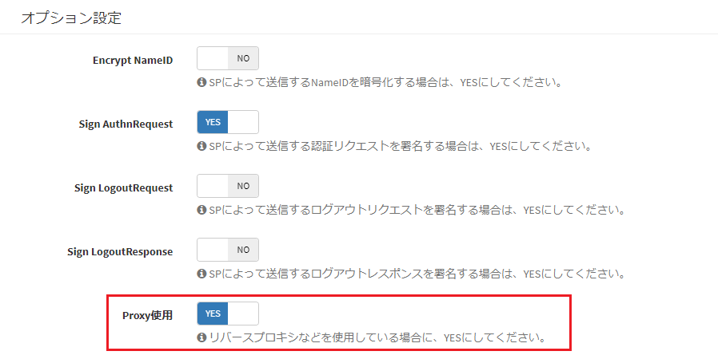

# リバースプロキシを採用している場合の設定
Exment のサーバーの前に、リバースプロキシ（Web のリクエストを先に受けて、Web サーバーへ渡すサーバー）を置いているときの設定です。  
Exment 側の設定と、リバースプロキシサーバー側の設定の、2 つを行います。

> 本手順は、v3.7.2より、一部見直しを行いました。

## はじめに
クラウドサービスのロードバランサーなど、Web リクエストを受け付けるサーバー(サービス。以下、リバースプロキシサーバー)と、Web サーバーが別のことがあります。  
とくに、次のような設定にすることがあります。  

- インターネットから、リバースプロキシサーバーの通信 : HTTPS通信
- リバースプロキシサーバーから、Webサーバーの通信 : HTTP通信


このような構成にするときに必要な、リバースプロキシサーバーと Exment の追加の設定を、下に書きます。  


### 設定手順 - Exment

- .env ファイルを直します。

~~~
# （すでにある値の追記）リバースプロキシサーバーまでのURL。"admin"は不要
APP_URL=https://XXXX.com 

# インターネット⇔リバースプロキシサーバーをHTTPS、リバースプロキシサーバー⇔Webサーバーの通信をHTTPにする場合、新規追加する
ADMIN_HTTPS=true

# 上記の"APP_URL"の値をURL生成に使用する
ADMIN_USE_APP_URL=true

# Proxyを許可するリバースプロキシサーバーのIPアドレス。複数のIPアドレスが想定される場合、カンマ区切り
# ※IPが不定の場合や、ゾーン設定によりリバースプロキシサーバー以外はアクセスがない場合などは、"*"で指定も可能
ADMIN_TRUST_PROXY_IPS=172.0.1.1,172.0.1.2
#ADMIN_TRUST_PROXY_IPS=*

# AWS ELBの場合、以下の値を追加する
ADMIN_TRUST_PROXY_HEADERS=HEADER_X_FORWARDED_AWS_ELB
~~~

- [SAML認証](/ja/login_saml)を使っているときは、「オプション設定」で、「Proxy使用」を YES にしてください。



### 設定手順 - リバースプロキシサーバー

- リバースプロキシサーバー(ロードバランサー、Nginxなど)から Web サーバーへ転送するときに、次のヘッダーを付ける必要があります。  
ヘッダーが付いているかを、ご確認ください。  
※これらは、リバースプロキシサーバーまでのアクセスの情報を伝えるヘッダーです。Web サーバー側で読み取って使います。  
    - X-Forwarded-Host : リバースプロキシサーバーのホスト名
    - X-Forwarded-For : クライアントのIPアドレス
    - X-Forwarded-Proto : httpもしくはhttps
    - X-Forwarded-Port : リバースプロキシサーバーまでのポート

- 例：nginxの場合

```
    location / {
        proxy_set_header X-Forwarded-Host localhost;
        proxy_set_header X-Forwarded-For XXXX;
        proxy_set_header X-Forwarded-Proto https;
        proxy_set_header X-Forwarded-Port 10443;
    }
```

- ※確かめるために、リクエストの値・ヘッダーの値を出したいときは、ルートフォルダの「.env」に次の行を足します。storage/logs/laravel.log に出ます。

```
EXMENT_DEBUG_MODE_REQUEST=1
```


[←追加設定一覧へ戻る](/ja/quickstart_more)