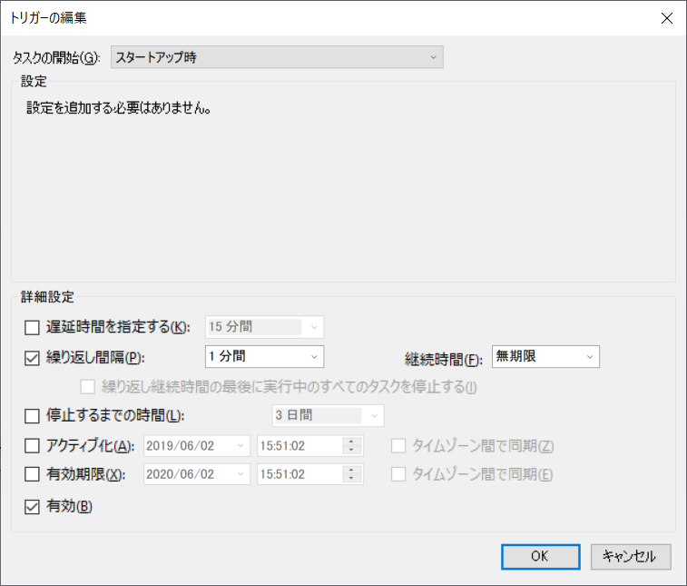
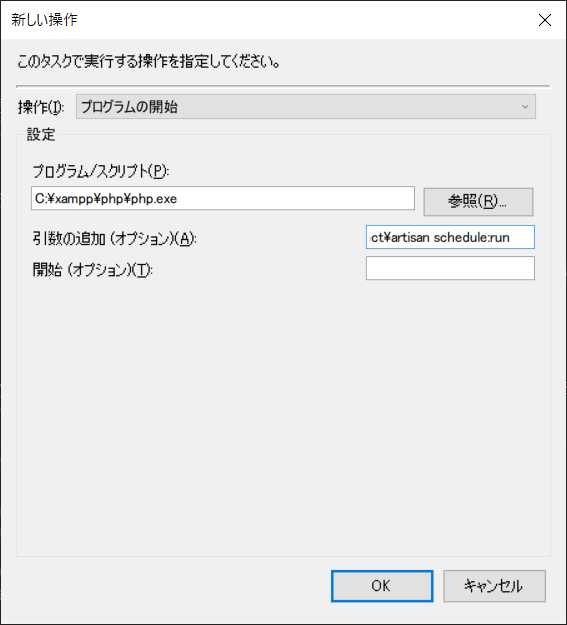
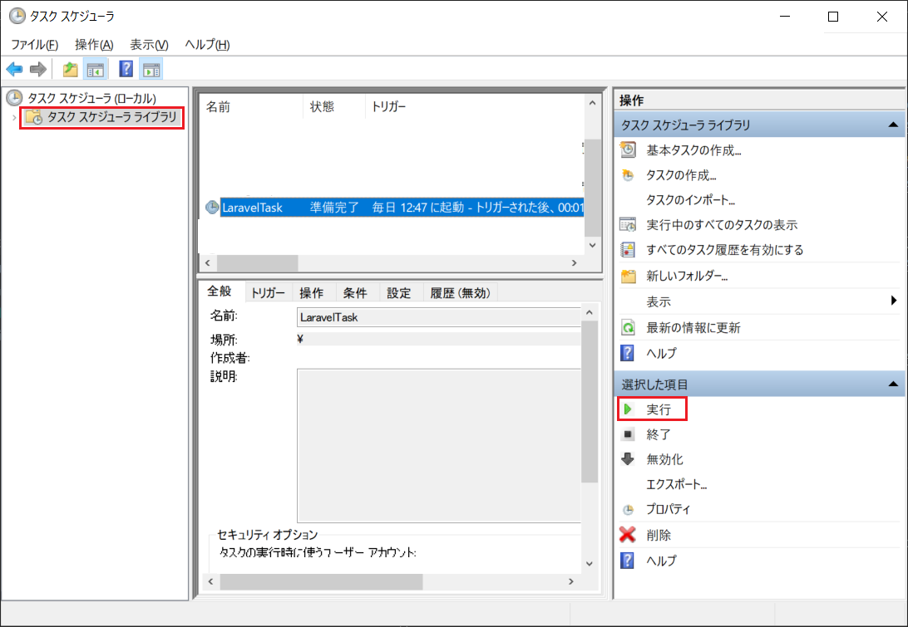

# タスクスケジュール
決まった時刻に、Exment の処理を自動で動かすための設定です（タスクスケジュール）。  
サーバー側で、追加の設定が必要です。Linux と Windows で、手順が違います。

タスクスケジュールは、次のことに使われます。

- データベースやファイルを、毎日、決まった時間にバックアップする。  
- 通知の設定に合わせて、条件に合うデータの関係者に、決まった時刻にメールを送る。
- 地震の情報を毎分確かめて、条件に合う地震があれば、[安否確認](/ja/safety_check)を自動で送る(「exment:safetywatch」コマンド)。
- 全文検索エンジン(Meilisearch)を使っているとき、データベースとインデックスの差異を、1日1回、自動で修復する(「exment:meili-reconcile」コマンド)。  
※「MEILISEARCH_REPAIR_ENABLED」がtrueのときだけ、「MEILISEARCH_REPAIR_AT」の時刻に実行されます。くわしくは、[全文検索エンジン(Meilisearch)のページ](/ja/additional_meilisearch)をご覧ください。

### 設定手順(Linux)
**(1) 次のコマンドを実行します。**

~~~
crontab -e
~~~

**(2) Cron の設定画面が出るので、次の内容を書きます。**

これで、artisan schedule コマンドが毎分実行されます。そのあとは、Exment が、決まった時間にタスクを実行します。  
※下は一例です。OS やサービスによって、書きかたや設定が違うことがあります。

~~~
# 通常のLinux
* * * * * cd /(Exmentのルートディレクトリ) && php artisan schedule:run >> /dev/null 2>&1

# Xserver(管理画面で選んだ PHP と同じ版を、フルパスで。下記は PHP 8.3 の場合)
* * * * * cd /(Exmentのルートディレクトリ) && nice -n 15 /usr/bin/php8.3 artisan schedule:run >> /dev/null 2>&1

# さくらインターネット
* * * * * cd /(Exmentのルートディレクトリ); php artisan schedule:run >> /dev/null 2>&1
~~~

> **レンタルサーバー（Xserver など）では**：cron の `php` は、管理画面で選んだ PHP と違う、サーバーの標準の PHP になることがあります。管理画面と同じ版の PHP を、フルパスで書いてください（[レンタルサーバー](/ja/install_rental)）。

### 設定手順(Windows)
- 次のコマンドを実行し、php.exe ファイルがある場所（パス）をコピーします。  

~~~
where php
// C:\xampp\php\php.exe
~~~

- windowsメニューで、「task」と入力し、タスクスケジューラを起動します。  


- タスクスケジューラで、「タスクの作成」をクリックします。


- 「全般」タブで、次のように設定します。（「名前」は、好きな名前でかまいません）


- 「トリガー」タブをクリックします。トリガーを 2 つ作ります。  
    (1)「新規」ボタンをクリックします。  
    そのあと、次のように入力します。  
    - タスクの開始：スタートアップ時
    - 繰り返し間隔：1分間
    - 継続時間：無期限
    - 「有効」にチェック  
    終わったら「OK」をクリックします。  


    (2)もう一度、「新規」ボタンをクリックします。  
    そのあと、次のように入力します。  
    - タスクの開始：タスクの作成/変更時
    - 繰り返し間隔：1分間
    - 継続時間：無期限
    - 「有効」にチェック  
    終わったら「OK」をクリックします。  


- 「操作」タブで、「新規」ボタンをクリックします。  
そのあと、次のように入力します。
    - 操作：プログラムの開始
    - プログラム/スクリプト：先ほどコピーしたphpまでのパス
    - 引数の追加： (Exmentのルートディレクトリ)/artisan schedule:run


- 「設定」タブで、「スケジュールされた時刻にタスクを開始できなかった場合、すぐにタスクを実行する」にチェックします。


- ノート PC のときは、「条件」タブで、「コンピューターをAC電源で使用している場合のみタスクを開始する」のチェックを外します。 


- ここまでの設定が終わったら、OK をクリックします。  
ユーザーの資格情報を入力する画面が出るので、パスワードを入力してください。  


- 最後に、「タスク スケジューラ ライブラリ」で、作ったタスクを選び、「実行」をクリックしてください。 


これで設定は終わりです。


## うまく動作しない場合の検証(v4.0.6以降)
うまく動かないときは、次の 2 つの方法で、どこに原因があるかを確かめてください。

| 方法 | 分かること |
| ---- | ---- |
| ログ出力 | cron やタスク スケジューラから、スケジュールが呼ばれているか |
| 直接コマンドを実行 | 通知やバックアップの設定そのものが正しいか |

### ログ出力
ログを出しながら確かめることをおすすめします。  
v4.0.6 で、スケジュール実行のためのデバッグログを追加しました。次の手順で、確かめてください。

#### 設定手順 
- .env ファイルに、次の内容を追加し、保存します。

~~~
EXMENT_DEBUG_MODE_SCHEDULE=true
~~~

- これで、スケジュールを定義したとき・実行したときに、/storage/logs/laravel.log にログが出るようになります。  
タスクスケジュールの設定が正しければ、1 分おきにログが出ます。


#### 出力ログ内容

- Exment schedule debug defined.  
→下のログの出力と、スケジュールの設定が終わったときに出るログです。  
→このログが出ていないときは、スケジュールの定義や呼び出しが、正しく終わっていないことがあります。cron の設定や、タスク スケジューラの設定を見直してください。

- Exment schedule debug everyMinute called.  
→毎分出るログです。スケジュールの定義が正しく終わっていれば、毎分出ます。  
→このログが出ていないときは、スケジュールの定義や呼び出しが、正しく終わっていないことがあります。cron の設定や、タスク スケジューラの設定を見直してください。

- Exment schedule debug hourly called.  
→毎時 0 分に出るログです。スケジュールの定義が正しく終わっていれば、毎時出ます。  
Exment の本来のスケジュールのコマンドと、同じ定義です。まずは、このログが出ているかを確かめてください。

- Exment schedule command called.  
→Exment のスケジュールコマンドが実行を始めたときに出るログです。このログが出ていれば、少なくともスケジュールコマンドは正しく実行されています。  
このログが出ているのに、通知やバックアップが思ったとおりに実行されないときは、設定値を見直してください。


#### 注意点
このログは、「スケジュールからの実行か、ふつうのコマンドの実行か」を区別できません。ふつうのコマンドを実行したときにも、ログが出ます。  
スケジュールを確かめるとき以外は、設定値 EXMENT_DEBUG_MODE_SCHEDULE を削除してください。


### 直接コマンドを実行
通知やバックアップが正しく動かないときは、Exment のスケジュールのコマンドを自分で実行して、確かめる方法もあります。  
次のコマンドを実行してください。

```
php artisan exment:schedule
```

このコマンドは、次のことを行います。どちらも、本来は 00 分でないと動きませんが、コマンドを直接実行すると、すぐに実行されます。

- 通知（時間の経過）で、「通知時間」が合っている通知の実行。
- 自動バックアップで、「自動バックアップ開始時間(時)」が合っているバックアップの実行。

このコマンドで思ったとおりに動いたときは、何かの理由で、スケジュール（cron やタスク スケジューラ）のほうが正しく動いていない可能性があります。  
原因を探すときの参考にしてください。


[←追加設定一覧へ戻る](/ja/quickstart_more)