# バックアップ・リストア
Exmentのデータを保存しておく「バックアップ」と、保存したデータで元に戻す「リストア」のしかたです。

| したいこと | 見るところ |
|---|---|
| 今すぐバックアップを取る | 手動バックアップ実行 |
| 毎日など、決まった時刻に自動でバックアップを取る | 自動バックアップ実行 |
| バックアップから元に戻す | リストア |
| コマンドで行う | (上級者向け)コマンドによるバックアップ・(上級者向け)コマンドによるリストア |

## 概要
バックアップとリストアは、たとえば次のようなときに使います。

- 大きなデータ更新の前にバックアップを取っておき、うまくいかなかったときに元に戻す。
- 毎日バックアップを取っておき、予期しない障害に備える。
- 今ある環境から別の環境に全データを移行する。（実施前に、必ず動作確認をお願いいたします。）

バックアップ対象は、以下の通りです。
- データベース
- プラグインファイル
- 添付ファイル
- ログファイル
- 設定ファイル

## 注意
- 別の環境に移行するときは、環境によっては、正常に完了しないことがあります。  
特に、別のOS(WindowsやLinux)、別の種類のデータベース(MySQLやMariaDB)、別のバージョンのデータベースに移行するときは、さまざまな要因で、正常に完了しないことがあります。  
必ず事前に、確認を行ってください。

- 事前の確認として、主に次のことをおすすめします。
    - 移行先を、開発環境などで実施する。
    - テーブル定義のみを作成した段階で、移行を試す。
    - データベースの種類、データベースのバージョンを揃える。

- 現在、SQLServerでは、自動のバックアップ・リストアが非対応です。  
[バックアップ・リストア（SQL Server）](/ja/backup_sqlserver)の手順で、手動でのバックアップ・リストアをお願いします。

## 画面
- 左メニューより、「管理者設定 > バックアップ」を選択します。  
もしくは、以下のURLにアクセスしてください。  
http(s)://(ExmentのURL)/backup  
これにより、バックアップ画面が表示されます。
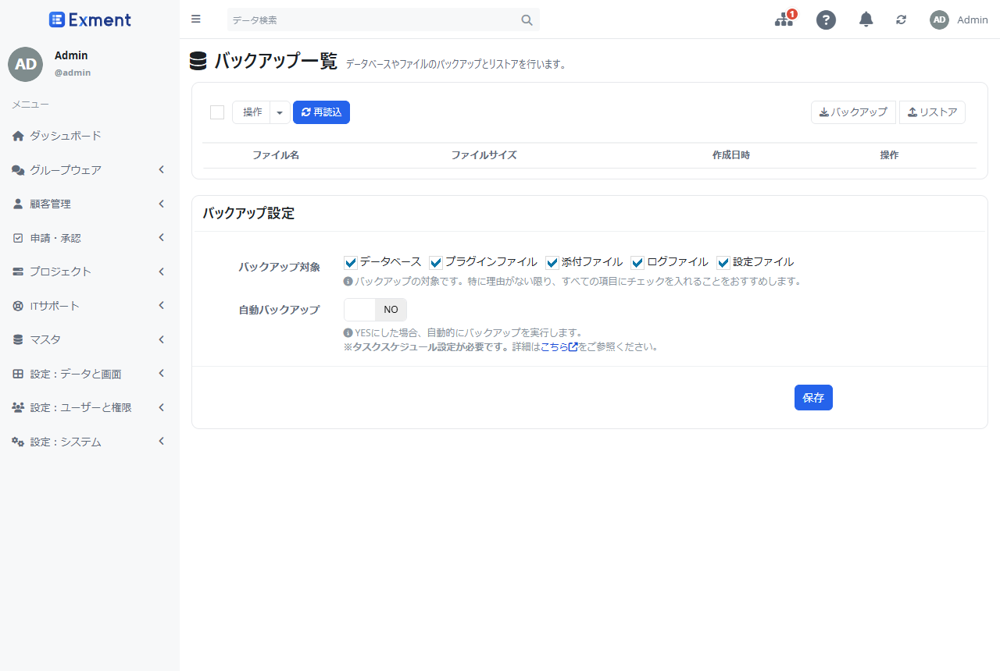

> ※URL は、「/admin」が付かない標準の設定（v7.2.1 以降に新しくインストールしたサイト）の場合です。`.env` の `ADMIN_ROUTE_PREFIX` に値がある場合（前の版で入れたサイトは「admin」）は、サイトの URL のあとにその値を足してください（例：`http(s)://(ExmentのURL)/admin/backup`）。詳しくは[URLに含む「admin」の変更・削除](/ja/additional_prefix)をご覧ください。

## バックアップ
バックアップの方法は、「手動」と「自動」の2種類です。

### 手動バックアップ実行
好きなときに、手動でバックアップを取る手順です。

- ページ右上の［バックアップ］ボタンをクリックします。  
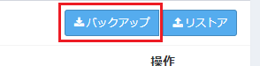  

- 確認ダイアログが表示されますので、［確認］をクリックし、そのままお待ち下さい。  
**※バックアップは非常に時間がかかります。そのまま操作せずお待ち下さい。**
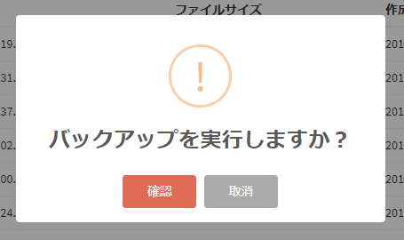  

- 完了すると、メッセージが表示されます。  
バックアップ一覧に、作成日時が実行した日時のファイルができます。
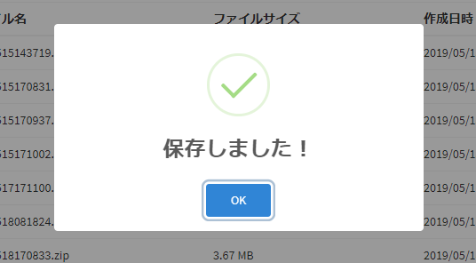  
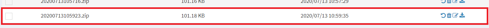  

- 作成したバックアップファイルは、ダウンロードできます。  
バックアップの行の［ダウンロード］リンクをクリックしてください。  
  

- 作成したバックアップのファイル名は、変更できます。  
バックアップの行の［ファイル名編集］リンクをクリックしてください。  
※半角カナ、記号、を含む名前は設定できません。
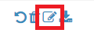  
- ファイル名を入力後、［送信］ボタンをクリックしてください。
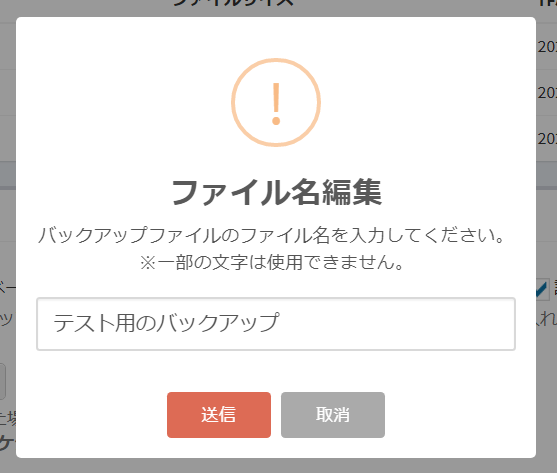  

- 完了するとメッセージが表示され、バックアップ一覧のファイル名が変わります。
  

  

### 自動バックアップ実行
決まった時刻に、自動でバックアップを取れます。  
定期的にバックアップを取っておくと、データを大きくまちがえて更新してしまったときなどにも、復元できます。  
**※事前に、[タスクスケジュール](/ja/additional_task_schedule)設定を行う必要があります。**

例として、「夜間3時」に「1日おき」に、「7世代分のバックアップ」を取る設定のしかたです。  

- 「バックアップ設定」より、「自動バックアップ」の選択を「YES」にします。
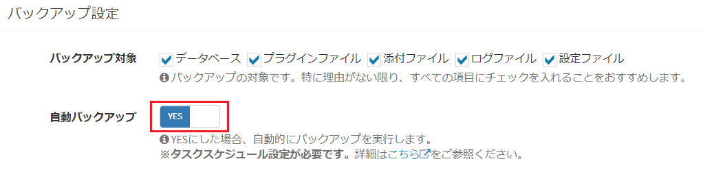  

- オプションの設定を変更します。
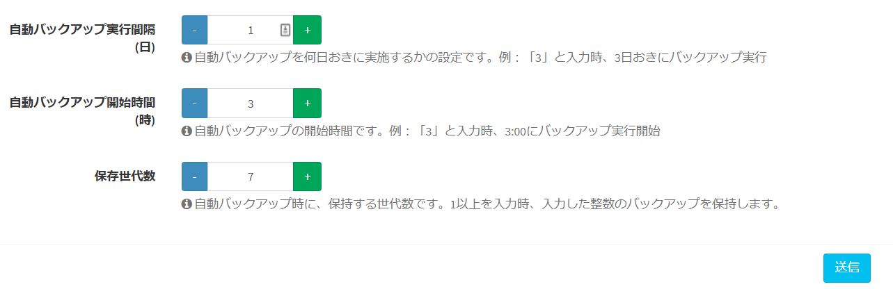  

- その後、ページ下部の［保存］ボタンをクリックします。  

<h3 id="backup_command"><a href="#/ja/backup?id=backup_command" data-id="backup_command" class="anchor">(上級者向け)コマンドによるバックアップ</a></h3>

コマンドでもバックアップできます。プロジェクトのルートディレクトリで、以下のコマンドを実行してください。

~~~
php artisan exment:backup
~~~

- 「--target=」を指定しない場合は、すべての対象(データベース、プラグインファイル、添付ファイル、ログファイル、設定ファイル)をバックアップします。
- 対象を絞り込む場合は、「--target=」に、以下のキーをカンマ区切りで指定します。
    - database : データベース
    - plugin : プラグインファイル
    - attachment : 添付ファイル
    - log : ログファイル
    - config : 設定ファイル

~~~
# 例：データベースと添付ファイルのみバックアップする場合
php artisan exment:backup --target=database,attachment
~~~

## リストア
データをリストア(復元)する方法は、「バックアップ一覧から選択」と「アップロード」の2種類です。  

### リストア時の注意
- バックアップを取ったときのExmentのバージョンと、現在インストールされているExmentのバージョンがちがうときは、リストアのあと、データベースの最新化が必要です。  
例： 
    - バックアップ時点のバージョン：v1.1.6 
    - 現在のバージョン：v1.2.0  
    →データベースの最新化が必要  
    
その場合、リストア後、以下のコマンドを実行してください。  

~~~
php artisan exment:update
~~~

- リストアのあとは、自動でサインアウトされます。バックアップされていたユーザーのIDとパスワードでログインしてください。  

- v4.1.0より、リストアの実施中は、メンテナンスモードになります。  
リストアが終わると、メンテナンスモードは自動で解除されます。万が一何らかの理由でメンテナンスモードが解除されなくなった場合、[メンテナンスモードの解除](/ja/troubleshooting?id=メンテナンスモードの解除)の手順で、メンテナンスモードを解除してください。

### バックアップ一覧から選択
過去に実施したバックアップ一覧から、リストアするファイルを選択して、データを復元する方法です。  

- バックアップ一覧から、［リストア］リンクをクリックします。  
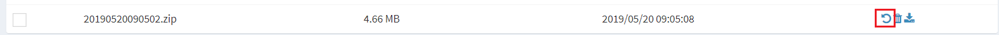  

- 確認ダイアログが表示されますので、［確認］をクリックし、そのままお待ち下さい。  
**※リストアは非常に時間がかかります。そのまま操作せずお待ち下さい。**
  

- 完了メッセージが表示されれば、バックアップした時点の環境に戻っています。  
自動でログインページに移ります。  
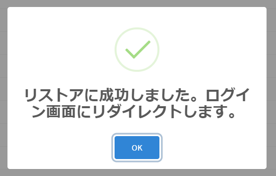  

### アップロード
手元（ローカル）に保存しているバックアップをExmentにアップロードして、データを復元する方法です。  
**※アップロードファイルの容量が大きすぎると、正常に完了しない場合があります。** その場合、下の[容量が大きくてアップロードできない場合](#容量が大きくてアップロードできない場合)をご覧ください。  

- ページ右上の［リストア］ボタンをクリックします。  
  

- ファイルアップロードのダイアログが表示されますので、ローカルにダウンロードしたバックアップファイルを選択し、「送信」をクリックします。  
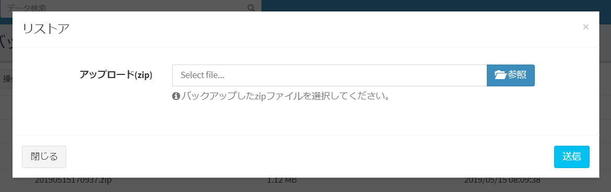  

- 「送信」ボタンをクリックしたら、そのままお待ち下さい。  
**※リストアは非常に時間がかかります。そのまま操作せずお待ち下さい。**

- 完了メッセージが表示されれば、バックアップした時点の環境に戻っています。
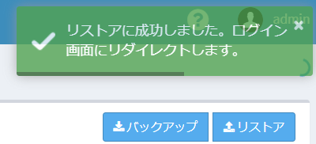  

### 容量が大きくてアップロードできない場合
「アップロード」でリストアするとき、バックアップファイルの容量が大きすぎると、リストアに失敗することがあります。  
そのときは、次のどちらかの手順でリストアを行ってください。  

#### (1)アップロード上限を変更する

- [PHP設定値変更](/ja/additional_php_ini)の手順で、アップロード上限サイズを変更してください。

#### (2)サーバーに直接バックアップファイルを配置する

- ダウンロードしたバックアップファイルを、サーバーの以下のパスに配置します。  

~~~
(プロジェクトのルートディレクトリ)/storage/app/backup/list
~~~

- バックアップ画面をリロードします。  

- バックアップ一覧に、配置したバックアップファイルが追加されています。上の「バックアップ一覧から選択」の手順で、リストアを行ってください。

### バックアップ画面やコマンドで、エラーが表示される場合
バックアップ画面やコマンドで、以下のようなメッセージが表示される場合があります。

  

このエラーが出るときは、バックアップ・リストアに必要な設定が、サーバーにされていないことがあります。  
[トラブルシューティング](/ja/troubleshooting#バックアップ・リストアに失敗する)をご確認いただき、サーバー設定を変更してください。

### リストア後、カスタムデータなどを初期化する場合
リストア後、保存していたExmentのカスタムデータなどをリフレッシュし、データを1から作成することができます。  
詳細は[カスタムデータのリフレッシュ](/ja/refresh_data)をご参照ください。

### SQL Serverを使用している場合
SQLServerを使用している場合、現状Exmentでは画面からのバックアップ／リストアに対応しておりません。手動で作業を行っていただく必要があります。  
詳細は[バックアップ・リストア（SQL Server）](/ja/backup_sqlserver)をご参照ください。

<h3 id="restore_command"><a href="#/ja/backup?id=restore_command" data-id="restore_command" class="anchor">(上級者向け)コマンドによるリストア</a></h3>

コマンドでもリストアできます。

- ダウンロードしたバックアップファイルを、サーバーの以下のパスに配置します。  

~~~
(プロジェクトのルートディレクトリ)/storage/app/backup/list
~~~

- プロジェクトのルートディレクトリで、以下のコマンドを実行してください。

~~~
php artisan exment:restore (zipファイル名)
~~~

- zipファイル名を省略した場合は、バックアップ一覧が表示されますので、リストアするファイルを選択してください。
- 実行前に、確認メッセージが表示されます。確認メッセージを表示せずに実行する場合は、「--yes」を指定してください。

~~~
# 例：確認メッセージを表示せずにリストアする場合
php artisan exment:restore (zipファイル名) --yes
~~~

<h3 id="change_backup_target"><a href="#/ja/backup?id=change_backup_target" data-id="change_backup_target" class="anchor">(上級者向け)バックアップ先の変更</a></h3>

通常、バックアップファイルは、Webサーバーの中に置かれます。  
バックアップファイルを別の場所に置くこともできます。別の場所に置いておけば、Webサーバーが故障して起動できなくなっても、その場所からバックアップファイルをダウンロードして、Exmentを復元できます。

※設定方法手順は[ファイルの保存先変更](/ja/additional_file_saveplace)に移動しました。

### 注意事項
- サーバーによっては、バックアップ先を変更できないことがあります。  
特にレンタルサーバーの場合、**提供会社の設定により、FTPなどを制限している場合がございます**。あらかじめご了承ください。