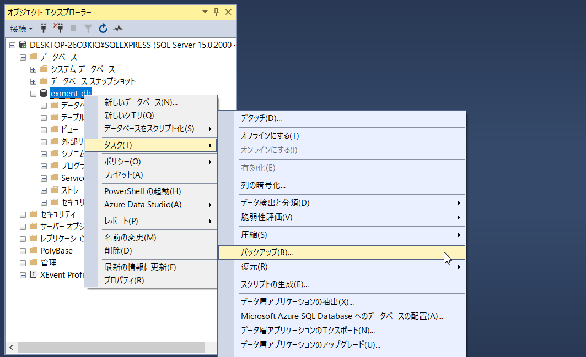
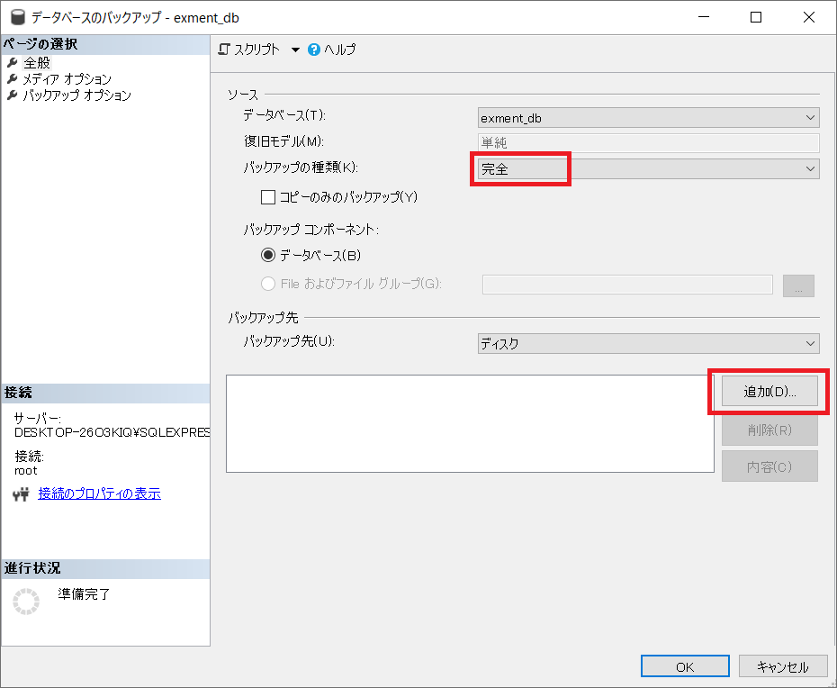
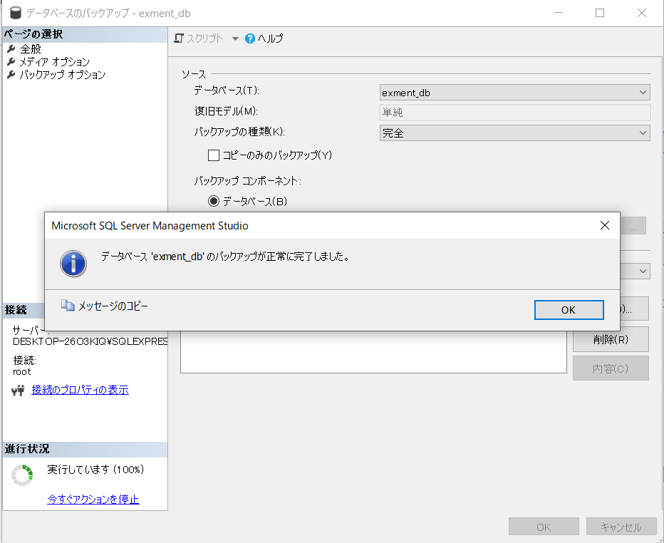
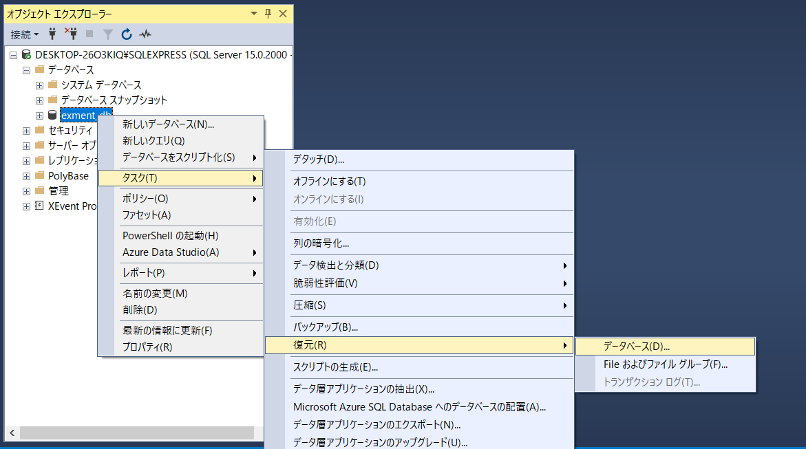
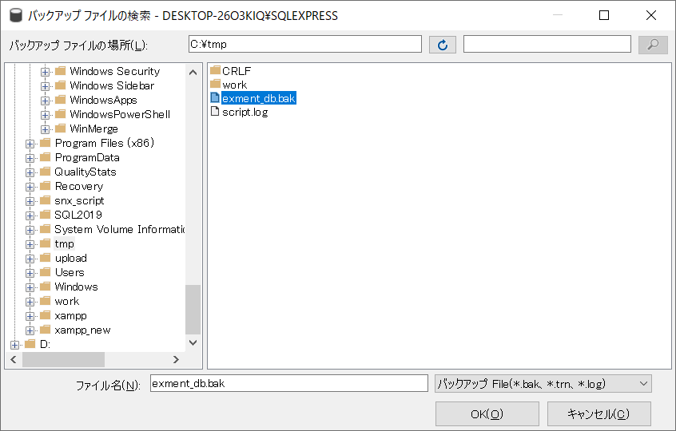
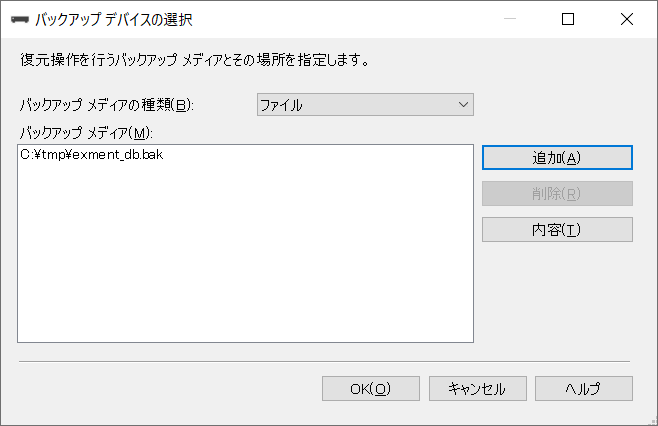
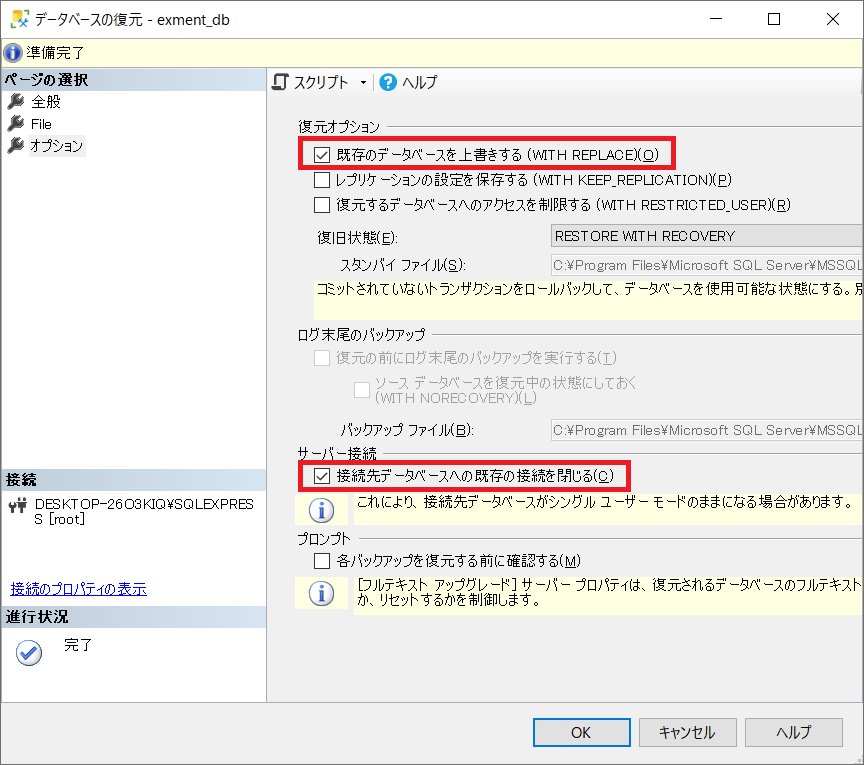
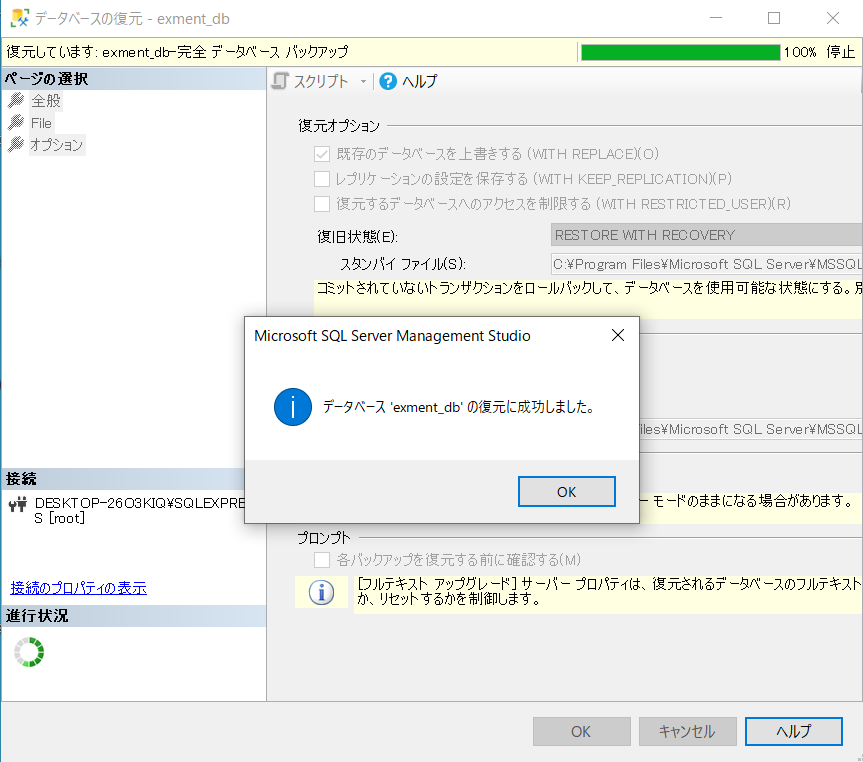

# バックアップ・リストア（SQL Server）
データベースに SQL Server を使っているときに、Exment のデータを手作業でバックアップ／リストア（元に戻すこと）する手順です。  

## 概要
SQL Server を使っているときは、Exment の画面からのバックアップ／リストアはできません。次の 2 つを、手作業で行ってください。

| 対象 | 方法 |
| ---- | ---- |
| データベース | Microsoft SQL Server Management Studio (SSMS)で、バックアップとリストアを行います |
| ファイル（下の 4 つ） | エクスプローラーなどで、フォルダごと別の場所に保存します。必要なときに元に戻します |

- プラグインファイル
- 添付ファイル
- ログファイル
- 設定ファイル

## データベースのバックアップ
SQL Server のバックアップを取る手順です。  
好きなときに実行してください。  

- Microsoft SQL Server Management Studio (SSMS)を起動します。  
**※必ず、sysadmin のサーバーロール、db_owner のデータベースロール、db_backupoperator のデータベースロールの、どれかを持つメンバーでログインしてください。**
  

- バックアップするデータベースを右クリックして、タスク→バックアップを選びます。  
  

- データベースのバックアップ画面で「バックアップの種類：完全」を選び、バックアップ先の追加をクリックします。  
  

- バックアップ先の選択ダイアログが出るので、好きなフォルダとファイル名を決めて、OK ボタンをクリックします。  
  

- データベースのバックアップ画面に戻って、OK ボタンをクリックしてください。バックアップが始まります。終わると、メッセージが出ます。   
  

- 決めたバックアップ先に、バックアップファイル（.bak）ができていることを確かめてください。

## 各種ファイルのバックアップ
次のファイルは、サーバーの決まったフォルダにあります。エクスプローラーなどで、別のフォルダや外部メディアに、フォルダごと保存してください。
  
~~~
プラグインファイル：(プロジェクトのルートディレクトリ)/storage/app/plugins
添付ファイル　　　：(プロジェクトのルートディレクトリ)/storage/app/admin
ログファイル　　　：(プロジェクトのルートディレクトリ)/storage/logs
設定ファイル　　　：(プロジェクトのルートディレクトリ)/config
.envファイル　　　：(プロジェクトのルートディレクトリ)/.env
~~~
    
**※.env ファイルは、Laravel の大切な設定が入っているファイルです。バックアップしておくことをおすすめします。ただし、リストアのときに、そのまま置きかえないでください**。

## データベースのリストア
SQL Server のバックアップを元に戻す手順です。  
必ず、Exment を使っているユーザーがいないことを確かめてから、行ってください。  

- Microsoft SQL Server Management Studio (SSMS)を起動します。  
**※必ず、sysadmin か dbcreator のサーバーロールを持つメンバー、またはデータベースの所有者 (dbo)でログインしてください。**
  

- リストアするデータベースを右クリックして、タスク→復元→データベースを選びます。  
  

- データベースの復元画面で「ソース：デバイス」を選び、「...」をクリックして、バックアップデバイスの選択ダイアログを開きます。  
  

- 追加ボタンをクリックすると、バックアップファイルの検索ダイアログが出ます。元に戻したいバックアップファイルを選んで、OK をクリックします。  
  

- バックアップデバイスの選択ダイアログに、選んだファイルが追加されていることを確かめて、もう一度 OK をクリックします。  
  

- データベースの復元画面に戻ります。「ページの選択：オプション」を選んで、オプションタブを開きます。「復元オプション：既存のデータベースを上書きする」と「サーバー接続：接続先のデータベースへの既存の接続を閉じる」にチェックを入れて、OK をクリックします。  
  

- 復元が終わると、メッセージが出ます。  
  

### リストア時の注意
- バックアップを取ったときの Exment のバージョンと、いまインストールされている Exment のバージョンが違うときは、リストアのあとに、データベースを新しくする必要があります。  
例： バックアップ時点のバージョン：v1.1.6 現在のバージョン：v1.2.0  →データベースの最新化が必要  
そのときは、リストアのあとに、次のコマンドを実行してください。  

~~~
php artisan exment:update
~~~
    
**※新しいバージョンの Exment でバックアップしたデータベースを、古いバージョンの Exment にリストアすることはできません**。

## 各種ファイルのリストア
保存しておいたファイルを、エクスプローラーなどで、フォルダごと元に戻します。  

- プラグインファイルと添付ファイルは、データベースのデータとつながっています。同じときにバックアップしたものを、データベースといっしょにリストアしてください。
- ログファイルは、そのまま上書きせず、別の名前をつけて、同じフォルダに保存しておくことをおすすめします。
  
~~~
プラグインファイル：(プロジェクトのルートディレクトリ)/storage/app/plugins
添付ファイル　　　：(プロジェクトのルートディレクトリ)/storage/app/admin
ログファイル　　　：(プロジェクトのルートディレクトリ)/storage/logs
設定ファイル　　　：(プロジェクトのルートディレクトリ)/config
~~~
