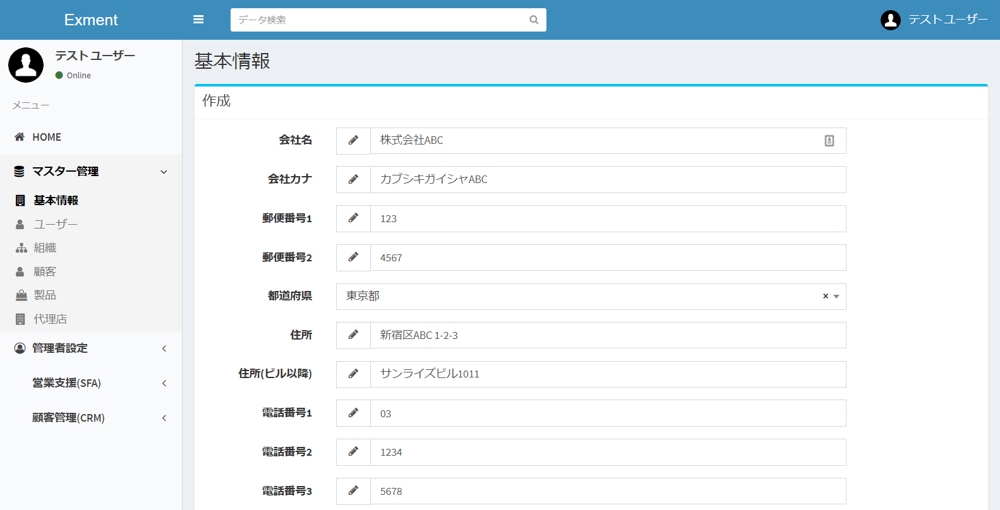

# 基本情報
このシステムを使う会社の基本情報（会社名・住所・ロゴなど）を管理します。

## 画面表示
左のメニューの「基本情報」を押します。  
または、次の URL を開いてください。  
http(s)://(ExmentのURL)/data/base_info  
システムに登録されている情報が出ます。  

> ※URL は、「/admin」が付かない標準の設定（v7.2.1 以降に新しくインストールしたサイト）の場合です。`.env` の `ADMIN_ROUTE_PREFIX` に値がある場合（前の版で入れたサイトは「admin」）は、サイトの URL のあとにその値を足してください（例：`http(s)://(ExmentのURL)/admin/oauth/token`）。詳しくは[URLに含む「admin」の変更・削除](/ja/additional_prefix)をご覧ください。

## 編集
内容を入力して、保存してください。
