# カスタム列管理
カスタムテーブルの列（「カスタム列」）を作る・直す・消すページです。列は、「顧客名」「郵便番号」「住所」のような、データの 1 つ 1 つの項目です。  

- 列の作り方：下の「設定画面」→「列の新規追加」→「保存」の順にご覧ください。
- どんな種類の列があるか：下の「列種類」をご覧ください。
- 項目ごとの説明：下の「記入項目の詳細(共通)」「記入項目の詳細説明(列種類別)」をご覧ください。  

## 設定画面
- カスタムテーブル一覧で、設定したいテーブルにチェックを1つ入れ、右上の「テーブル詳細設定」を押します。  

- または、メニューから設定したいテーブルを選んだあと、同じように右上の「テーブル詳細設定」を押します。  
※そのテーブルをメニューに出す設定が、先に必要です。  
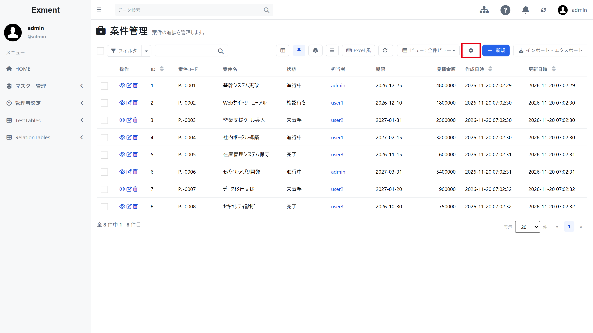
- 出てきたテーブル詳細設定の画面で、カスタム列のアイコンを押します。

- これで、そのカスタムテーブルの列の一覧が出ます。  
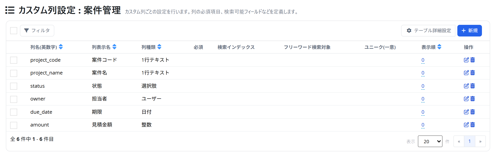

## 列の新規追加
- 「カスタム列設定」画面で、ページの右上の［新規］ボタンを押します。

- カスタム列の新規追加画面が出ますので、必要な項目を入力します。
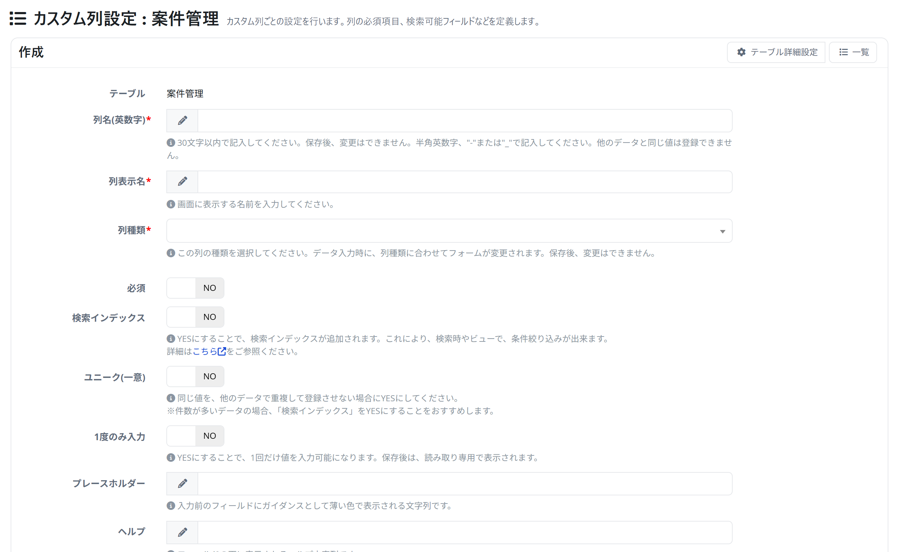

## 保存
設定を入力したら、［送信］を押してください。

## 編集
列を直したいときは、その行の［編集］リンクを押してください。  
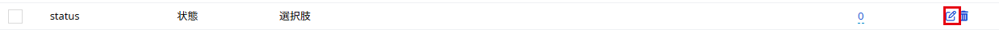

## 削除
列を消したいときは、その行の［削除］リンクを押してください。  
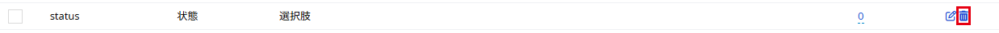
**※ただし、システムでインストールしている列は削除できません。**

## 記入項目の詳細(共通)
- 列名(英数字)：システムで使用する列の名称です。英数字、または「-」「\_」で記入します。設定できるのは1度のみで、変更できません。  
**※以下の名前は使用できません。**  
id,suuid,parent_id,parent_type,created_at,updated_at,deleted_at,created_user,updated_user,deleted_user

### 列表示名
画面に表示する、列の名前です。

### ほかの言語の名前（v7.3.0 以降）
列の設定画面の「ほかの言語の名前」に、ユーザーが選べる言語ごとの入力欄があります（サイトの言語は除きます）。  
言語を選んでいるユーザーには、その言語の名前が表示されます。空のときは、上で入力した名前が表示されます。  
くわしくは [名前を言語ごとに持つ](/ja/name_locales) を見てください。

## 列種類
列の種類です。ここで選んだ種類によって、データを登録するときの入力欄の形が決まります。

> カスタム列ごとの、システムの仕様詳細は、[カスタム列リファレンス](/ja/column_reference)をご確認ください。

#### 1行テキスト
1行テキスト(テキストボックス)です。  

#### 複数行テキスト
複数行テキスト(テキストエリア)です。  

#### テキストエディタ
テキストエディタを使用したデータ入力ができます。
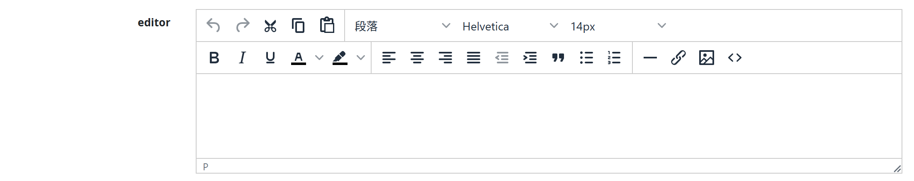
#### URL
URLが入力できるフォームになります。  

#### メールアドレス
メールアドレスが入力できるフォームになります。  

#### 整数
整数のみ入力できるフォームになります。また、データ登録時に、項目の左右に［＋］［－］ボタンを表示して、クリックで値を上下することができます。  

#### 小数
小数のみ入力できるフォームになります。パーセント表示をYESにすることで、データ表示の際に%表示されます。  

#### 通貨
通貨の入力ができるフォームになります。表示形式は４種類（￥・円・＄・€）から選ぶことができます。

#### 日付
日付のフォームになります。データ登録時に、カレンダーから日付を変更することができます。  

#### 時刻
時間のフォームになります。データ登録時に、時計から時刻を変更することができます。  

#### 日付と時刻
日時のフォームになります。データ登録時に、カレンダーと時計から日時を変更することができます。  

#### 選択肢
選択肢のフォームになります。値と見出しが同じ選択肢一覧になります。  

#### 選択肢 (値・見出しを登録)
選択肢のフォームになります。値と見出しが異なる選択肢一覧になります。  

#### 選択肢 (他のテーブルの値一覧から選択)
選択肢のフォームになります。選択肢が他のテーブルの項目となる、選択肢を作成します。  

#### YES/NO
「YES」と「NO」を切り替えるスイッチを作成します。データ登録時、YESだと1、NOだと0と登録されます。  

#### 2値の選択
2つの値を切り替えるスイッチを作成します。データ登録時の値も変更できます。  

#### 自動採番
UUIDやランダム文字列などの値を、データ作成時に作成します。  

#### 画像
画像をアップロードするフォームになります。  
※データ一覧画面やデータ詳細画面では、画像はリンク付きで表示されます。リンク(aタグ)にはclass「image-link」が付いているため、[プラグイン(スクリプト)](/ja/plugin_quickstart_script)や[プラグイン(スタイル)](/ja/plugin_quickstart_style)で、画像のリンクだけを対象に処理や見た目を変更できます。

#### ファイル
ファイルをアップロードするフォームになります。  

#### ユーザー
システムのユーザーを選択する選択肢になります。  

#### 組織
システムの組織を選択する選択肢になります。  

## 記入項目の詳細(共通)
- ##### 列名(英数字)
システムで使用する列の名称です。英数字、または「-」「_」で記入します。設定できるのは1度のみで、変更できません。  
**※以下の名前は使用できません。**  
id,suuid,parent_id,parent_type,created_at,updated_at,deleted_at,created_user,updated_user,deleted_user

- ##### 列表示名
画面に表示する、列の名前です。

- ##### 列種類
[列種類の一覧](#列種類)から、データ登録に使用する列を選択します。

- ##### 必須
この列を必須にするかどうかを選びます。YESにすると、データの入力画面で必須項目になり、入力していないとエラーが出ます。  

- ##### 検索インデックス
下記の「[検索インデックス](#検索インデックス-1)」をご参照ください。  

- ##### フリーワード検索対象
検索インデックスがYESの場合に表示されます。  
下記の「[フリーワード検索対象](/ja/column#フリーワード検索対象詳細)」をご参照ください。  

- ##### ユニーク(一意)
YESにすると、データを登録するときに、ほかのデータと同じ値を登録できなくなります。いくつかの列の組み合わせで重複を防ぎたいときは、[複合ユニークキー設定](/ja/table.md?id=複合ユニークキー設定)をご参照ください。  

- ##### 1度のみ入力
YESにすると、新規登録のときにだけ入力できる列になります。データを編集するときは、表示だけになります。

- ##### 初期値
入力欄に、はじめから入れておく値です。  

- ##### プレースホルダー
入力欄が空のときに、うすい字で出しておく文字列（プレースホルダー）です。  

- ##### ヘルプ
入力欄の下に、説明として出す内容です。

- ##### 表示順
カスタム列の一覧画面における表示順位を指定します。

- ##### 既定のフォーム・ビューに追加する
YESにすると、列を新しく作るときに、既定のフォーム・ビューにもその列を追加します。列を新しく作るときにだけ設定できます。あとから変えるときは、それぞれ[フォーム画面](/ja/form.md)・[ビュー画面](/ja/view.md)から変更してください。

- ##### 見出し列に追加する
作成するカスタム列を見出し列に追加することができます。  
※カスタム列を新しく作るときにだけ出る設定です。あとから変えるときは、[見出し表示列設定](/ja/table.md#見出し表示列設定)で変えてください。

- ##### セルの表示
データ一覧で、この列の値をどのような見た目（色・タグ・バッジなど）で表示するかを設定します。  
「表示プリセット」から選択します。詳細は[表示プリセット](/ja/cell_style_preset.md)をご参照ください。

## 記入項目の詳細説明(列種類別)
- ##### 最大文字数(1行テキスト,複数行テキスト)
入力できる文字数の上限です。こえるとエラーになります。  

- ##### 使用可能文字(1行テキスト)
チェックを入れた種類の文字だけを、入力できるようになります。
どれにもチェックを入れていないときは、すべての種類の文字を入力できます。

- ##### サジェスト入力(1行テキスト)
同じカスタム列にすでに登録されている値の中から、入力した内容に合うものを、入力の候補として出します。
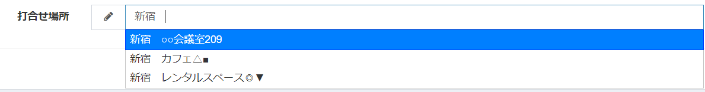

- ##### 正規表現(1行テキスト)
入力した内容を、正規表現（文字の並びのルールを書く書き方）でチェックできます。くわしくは[正規表現](#正規表現)をご覧ください。

- ##### 最小値(整数、小数)
入力できる値の最小値です。これより小さい値を送信すると、エラーになります。空欄のときは、最小値のチェックをしません。  

- ##### 最大値(整数、小数)
入力できる値の最大値です。これより大きい値を送信すると、エラーになります。空欄のときは、最大値のチェックをしません。  

- ##### 計算式(整数、小数、通貨)
くわしくは、下の[計算式](#計算式)をご覧ください。

- ##### 選択肢(選択肢, 選択肢 (値・見出しを登録))
入力欄に候補として出す選択肢を登録します。1 行に 1 つずつ、改行で区切って登録します。  
列種類が「選択肢 (値・見出しを登録)」のときは、カンマで区切って、1列目に値、2列目に見出しを書きます。  

↓  
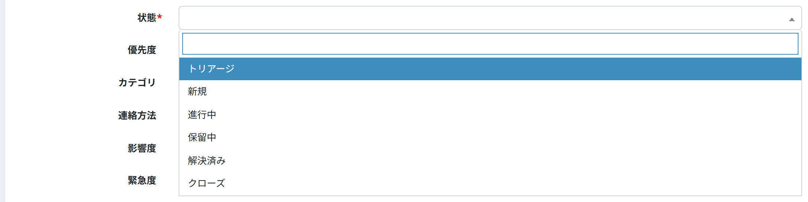  
フォームでデータを保存すると、1列目の値がデータベースに保存されます。  

- #####  ラジオボタン・チェックボックス形式で表示（YES/NO、選択肢、選択肢 (値・見出しを登録)）
選択肢、選択肢 (値・見出しを登録)の列で複数選択がNOの場合には、ラジオボタン形式でフォームに表示することができます。
 

YES/NOの列、または、選択肢、選択肢 (値・見出しを登録)の列で複数選択がYESの場合には、チェックボックス形式でフォームに表示することができます。

- ##### 自由に入力可能にする(選択肢)
YESにすると、列設定に登録していない選択肢も、自由に入力して登録できるようになります。  

>[ラジオボタン・チェックボックス形式で表示](/ja/column#radio_buttom)をYESにしている場合には、この設定は不可になります。

- ##### 初期値種類（日付、時刻、日付と時刻、ユーザー）
データを新規登録するときの、初期値の種類を決められます。  
・日付、時刻、日付と時刻の列では、［指定の日時］もしくは［データ入力実施の日時］が初期値として設定できます。  
・ユーザー列では、［指定のユーザー］もしくは［ログインユーザー］が初期値として設定できます。

- ##### 対象テーブル(選択肢 (他のテーブルの値一覧から選択))
選択肢の候補として出すテーブルを決めます。  

>選択肢として一覧に表示される文言は、[見出し表示列設定](/ja/table#見出し表示列設定)で変更できます。

- ##### 選択肢を都度検索する(選択肢 (他のテーブルの値一覧から選択)、ユーザー、組織）
通常、データ編集画面の選択肢は、画面読み込み時に、すべての候補を一覧表示します。  

この設定をYESにすることで、はじめは選択肢を読み込まず、ユーザーの入力値でデータを検索し、候補を絞り込みます。  

入力フォームに、文字列を入力することで、サーバーでデータ検索を行い、結果を候補表示します。

> この設定に関わらず、データの総件数が100件以上の場合は、パフォーマンス向上のために、絞り込みを行う設定になります。  
なお、この上限値は、[設定値](/ja/config#カスタムデータ)により変更できます。  

- ##### 採番種類（自動採番）
データ登録時に、採番を行う種類を選択します。
- フォーマット  
ユーザーが指定したフォーマットで採番を登録します。
- ランダム(ライセンスコード)    
5文字×5で25文字のランダム文字列を登録します。
- ランダム(UUID)  
合計32桁のランダム文字列を登録します。

- ##### 桁数(自動採番)
自動採番時に、データとして登録する桁数になります。不足分は0埋めで登録します。  

- ##### 権限をもたないユーザー・組織も表示する(ユーザー・組織)
テーブルへのアクセス権限をもつユーザー・組織だけを出すか、すべてのユーザー・組織を出すかを決めます。

- ##### 「私が担当」ボタンを表示する(ユーザー)
YESにすると、データの登録・編集画面で、この列の横に［私が担当］ボタンが表示されます。ボタンをクリックすると、ログイン中のユーザーが選択されます。  
※「複数選択を許可する」がYESの場合は、選択済みのユーザーに、ログイン中のユーザーが追加されます。

- ##### クリップボードからの貼り付けを受け付ける(画像、ファイル)
YESにすると、データの登録・編集画面で、Ctrl+Vで貼り付けた画像（スクリーンショットなど）が、この列のファイルとして追加されます。ファイル名は「paste-(年月日)-(時分秒)-(連番)」になります。  
※「複数選択を許可する」がYESの場合は、選択済みのファイルに追加されます。NOの場合は、貼り付けた画像に置き換わります。  
※テキストエディタ内で貼り付けた場合は、従来どおり本文に入ります。また、テキストボックスにテキストを貼り付けた場合は、ファイルとして追加されません。  
※画面に、この設定がYESの列が複数ある場合は、先頭の列に追加されます。

- ##### 複数選択を許可する
画像・ファイルや、選択肢の種類の項目で、いくつも選べるようにするときに、YESにしてください。  

## 自動採番フォーマットのルール
列種類を「自動採番」、採番種類（自動採番）を「フォーマット」にすると、自分で決めたルールで、番号を自動で付けられます。  

設定できるパラメータ変数は、以下のページをご確認ください。  
[パラメータ変数](/ja/params)

## 検索インデックス
「検索インデックス」は、データの検索を速くするために、あらかじめデータベースに設定しておくものです。「インデックス」は「索引」ともいいます。  
Exment では、検索インデックスをYESにした列でだけ、一部の機能を使えます。
    

YESにした場合、以下の機能が有効になります。  
- [カスタムビュー](/ja/view)の「表示条件」設定で、「対象列」に表示される  
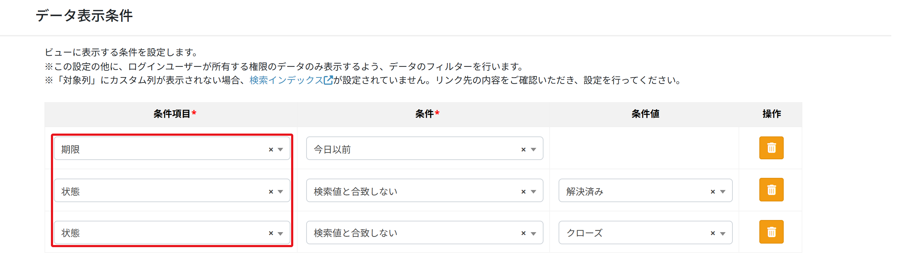    

- [カスタムビュー](/ja/view)の「並べ替え」設定で、「対象列」に表示される  
    

- [データ一覧](/ja/data_grid)の「フィルタ」設定の項目に表示される  
    

- [データ一覧](/ja/data_grid)の「ソート」を行うアイコンが表示される
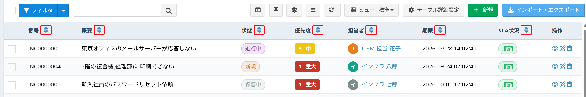    

- ページ上部の検索バーで、ユーザーがワードを記入した時、データ検索の検索対象となる。各種コードや各種名称など、検索画面で検索させたい列の場合、YESとしてください。  

- **フリーワード検索対象**を設定することができます。  
YESにすることで、検索バーに文字列を入れて検索を行う際に、検索対象となります。

※1 つのテーブルに「検索インデックス」をとても多く設定すると、データの新規作成や更新が遅くなることがあります。  
1 つのテーブルに設定できる「検索インデックス」は、推奨10件まで、最大20件までです。  
※なお、検索インデックスの上限値は、[設定値](/ja/config#検索インデックス件数)で変更できます。

## ラベルで使用する
> 本設定方法は、v1.3.0にて[カスタムテーブルの拡張設定](/ja/table#見出し表示列設定)に変更されました。

## 正規表現
> この設定は、[エキスパートモード](/ja/additional_expert)を有効にしていた場合のみ表示されます。

カスタム列種類が「1行テキスト」のときは、正規表現で入力内容をチェックできます。  

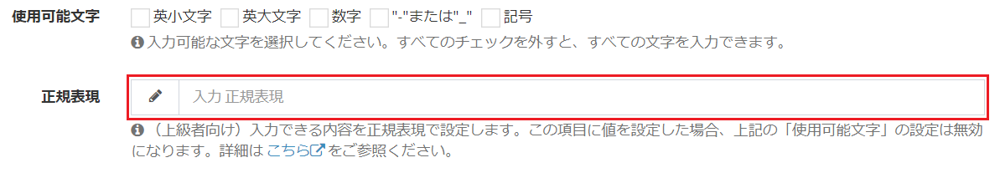  

#### 正規表現の例
~~~
# 電話番号  
^0\d{2,3}-\d{1,4}-\d{4}$

# 郵便番号  
^\d{3}-\d{4}$

# ひらがなのみ
^[ぁ-ん]+$

# カタカナのみ
^[ァ-ヴ]+$
~~~

#### その他
- 正規表現を設定していた場合、「使用可能文字」は無効になります。  
- 正規表現の判定には、PHPの関数を使っています。正規表現の例をさがすときは、PHPの正規表現でさがしてください。  
- 文頭と文末に付ける「/」や、文末の「u」は不要です。  
- 正規表現の内容については、お問い合わせの対象外になります。ご了承ください。

## 計算式
カスタム列種類が「整数」「小数」「通貨」のときは、計算式を設定できます。  
データ入力画面で項目を入力すると、設定した計算式で、自動で計算されます。  

### 設定方法
- カスタム列種類が「整数」「小数」「通貨」の場合、「計算式」項目が表示されるので、クリックします。  
    

- 計算式用のダイアログが表示されます。  
  

- 計算式を入力してください。式は、右の列のボタンを押して入力するか、手で入力します。
※入力できる変数は、後述します。
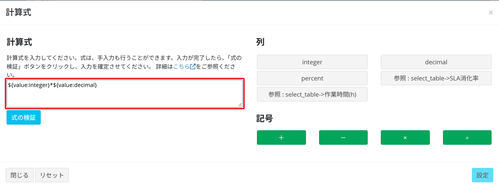  

- 入力が終わったら、「式の検証」ボタンを押して、入力を確定してください。
  

- ※入力した式にまちがいがあると、エラーが出て、設定できません。
  

- 正しい式を入力したあと、「設定」ボタンを押すと、ダイアログが閉じて、式が設定されます。
  

- 設定後、データ入力画面で、計算式が実行されます。(以下例は、列3に、列1 × 列2 を設定)
  

### 使用できる式・変数

#### 通常の演算子
- +, -, *, /  
※半角で入力してください。掛け算が"×"、割り算が"÷"でないことにご注意ください。

- カッコ()

#### 変数
※変数は、「計算式」ダイアログの右の列にあるボタンから入れることをおすすめします。

- 別の列の値
- 参照先のテーブルの列値
- 親テーブルの列値
- 子テーブルの列の合計値
- 子テーブルの件数

| 項目 | 例 | 説明 |
| ---- | ---- | ---- |
| ${value:(列名)} | ${value:mitsumori_zeigaku} | 同一テーブル内の、他の値が設定されます。 (例：見積明細テーブルに対し、見積額${value:mitsumori_zeigaku}と記入した場合、項目「見積額」に入力されている値が設定される)  |
| ${select_table:(列名).(参照先のテーブルの列名)} | ${select_table:client.client_shikiri} | 同一テーブル内の、列種類「他のテーブルの値一覧から選択」「ユーザー」「組織」の場合、参照先の列の値が設定されます。 (例：「契約情報(contract)」テーブルに「顧客(client)」列があり、「顧客情報(client)」テーブルを参照している場合、${select_table:client.client_shikiri}と設定すれば、「顧客情報(client)」テーブルの顧客仕切値(client_shikiri)に入力されている値が設定される)  |
| ${parent:(列名)} | ${parent:mitsumori_value} | 親テーブルの、他の値が設定されます。 (例：見積テーブルと見積明細テーブルが1:nリレーションで、見積明細テーブルの列に対し、親テーブル列の見積額${parent:mitsumori_value}と記入した場合、親データ「見積額」に入力されている、列「見積額」の値が設定される)  |
| ${sum:(子テーブル名).(子テーブルの列名)} | ${sum:mitsumori_detail.mitsumori_zeigaku} | 1:nリレーションが行われており、親子データを同時に入力するフォームの場合、子テーブルの、指定の列の値の合計値が設定されます。 (例：見積テーブルと見積明細テーブルが1:nリレーションで、見積テーブルの列に対し、子テーブル列の見積明細額${sum:mitsumori_detail:mitsumori_zeigaku}と記入した場合、子データ「見積額」の、全データの合計で入力されている値が設定される)  |
| ${count:(子テーブル名)} | ${count:mitsumori_detail} | 1:nリレーションが行われており、親子データを同時に入力するフォームの場合、子テーブルの件数が設定されます。 (例：見積テーブルと見積明細テーブルが1:nリレーションの場合、子テーブルの件数が設定される)  |

### 循環式になった場合
次のように設定すると、計算がいつまでも終わらなくなります。    

- 列calc1：計算式「${value:calc2} + 2」
- 列calc2：計算式「${value:calc1} + 2」

「列calc1の値を入れる」→「列calc2の値に、calc1の値 + 2を入れる」→「列calc1の値に、calc2の値 + 2を入れる」→「列calc2の値に、calc1の値 + 2を入れる」...となり、計算が完了しません。  

このような計算式を設定しているときに、データ入力画面で値を入力すると、次のようなアラートが出ます。  
そのときは、計算式の設定を見直してください。
  

### 0除算が発生した場合
計算式によっては、0除算（0 で割ること）が起きることがあります。  
そのときは、結果の項目は空欄になります。

### その他
計算式ロジックは、画面でのデータ入力時に対応しております。  
現在、APIやプラグインといった機能でのデータ登録では対応しておりません。ご了承ください。