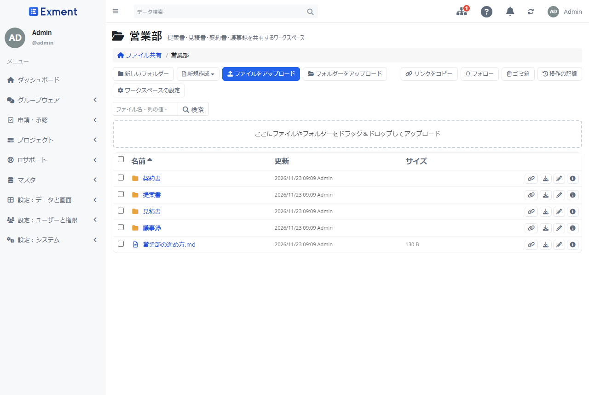

# Exmentのコンセプト

## Exment とは
Exment は、**プログラムを書かずに、自社の業務に合ったアプリを作れる Web データベース**です。  
顧客リスト・案件・申請・資産台帳——いま Excel や紙、メールの添付でばらばらに管理しているデータを、1 か所に集めます。だれが・どこから開いても、同じ最新のデータで仕事ができます。

> 最初は「空っぽの箱」です。そこに、管理したいものに合わせてテーブル（表）を足していくと、その会社のための業務システムになります。顧客を足せば顧客管理に、申請を足せばワークフローに。**使い方は、会社の数だけあります。**

## 3 つの特長
### 1. 作れる —— プログラムなしで
- 画面の操作だけで、テーブル・項目・入力フォーム・一覧（ビュー）を作れます。
- 一覧は、表・カレンダー・カンバン・ガントチャート・グラフで見られます。
- テンプレート（顧客管理・申請パックなど）を選べば、すぐに使い始められます。

### 2. 回せる —— チームで、安全に
- 申請 → 承認・差し戻しの**ワークフロー**、期限やデータの変更の**通知**（メール・Slack・Microsoft Teams・LINE）。
- 役割グループで、だれが何を見られる・直せるかを決められます。操作ログも残ります。
- ダッシュボードで、今の数字をひと目で。スマートフォンのブラウザーでも使えます。

### 3. つながる —— ほかのシステムや AI と
- API で、ほかのシステムとデータをやり取りできます。ユーザーごとの API キーも作れます。
- **AI（MCP）**：Claude などの AI から、ユーザーの権限のままデータを読めます。
- 公式プラグイン（プロジェクト管理・サポートデスク・Groupware）が無料で同梱。プラグインで機能を足せます。

## Excel との違い
| | Excel・ファイル | Exment |
|---|---|---|
| 最新のデータ | ファイルがコピーされて、どれが最新かわからない | いつも 1 つ。みんなが同じデータを見る |
| 同時に使う | 開いている人がいると直せない | 何人でも同時に入力できる |
| 権限 | ファイルごと。行や列ごとは難しい | 役割グループで、テーブル・データごとに |
| 履歴 | 上書きで消える | 変更の履歴・操作ログが残る |
| 承認・通知 | メールや紙で回す | ワークフローと通知で自動に |
| 探す | ファイルを開いて探す | キーワード検索・絞り込み・並べ替え |

## たとえば、こんな使い方
**顧客管理**：取引先と担当者をまとめて、だれでも同じ情報を見られるように。

**ファイル共有**：部署ごとのワークスペースに、提案書・見積書・契約書を。版の管理と権限付き。

ほかにも、申請・承認（稟議・経費精算・休暇）、案件管理、資産・備品の管理、問い合わせ管理、日報など。どんな業務も、テーブルを足すところから始められます。くわしくは[機能マップ](https://exment.net/feature-map/)を。

## ずっと使える、オープンソース
- **無料のオープンソース**（GPL-3.0）。自社のサーバーに入れれば、**ユーザーが増えても料金は増えません**。
- データは自社のサーバーに。サーバーを用意したくないときは、Exment SaaS も選べます。
- 有償のサポートで、導入から運用まで相談できます。

## 次の一歩
- [デモ](https://exment.net/demo-env/)で触ってみる
- [インストールの流れ](/ja/quickstart)を見る
- [Exment のメリット](https://exment.net/merit/)・[ほかのサービスとの比較](https://exment.net/compare/)
