# ダッシュボード
Exmentへのログイン時や「HOME」「左上に表示のサイト名」をクリックした際に表示される画面です。  
表示方法を自由にカスタマイズすることで、Exmentで管理している情報を様々な形式にて表示できます。  
### ダッシュボードの表示例
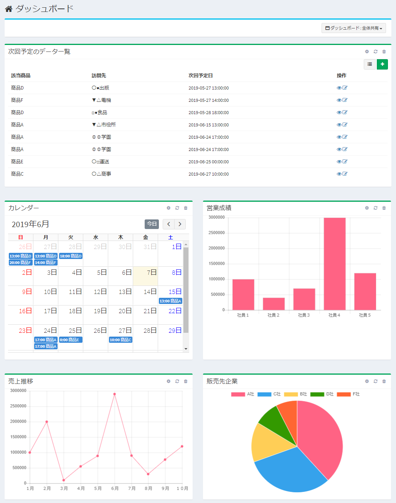

## ダッシュボードの新規作成
- ダッシュボード画面右上にある「ダッシュボード新規作成」をクリックします。  
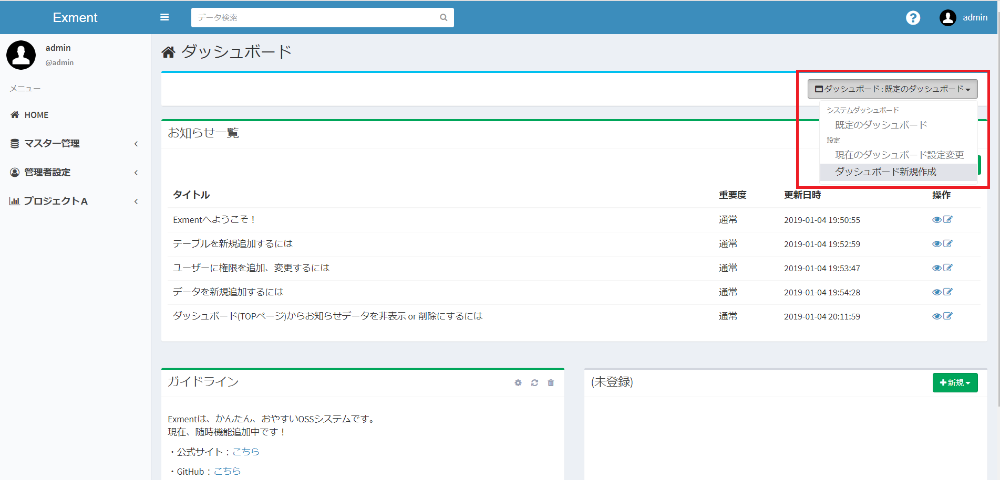
  
- ダッシュボードに必要事項を設定していきます。  
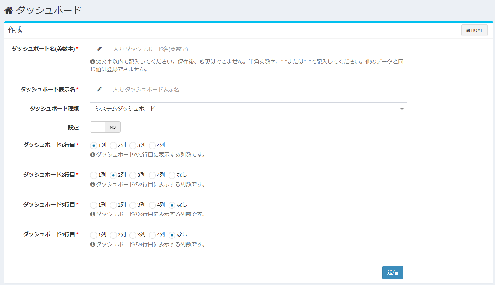

## ダッシュボードの設定項目
#### ダッシュボード名(英数字)
ダッシュボードの名称を表します。  
保存後に変更することは出来ません。

#### ダッシュボード表示名
ダッシュボードを選択する際、画面に表示する名前です。  
日本語の設定が可能で、保存後も変更することが出来ます。

#### ダッシュボード種類
「システムダッシュボード」「ユーザーダッシュボード」どちらかを選択します。  

- 「システムダッシュボード」  
システム管理者のみが設定を行えます。全ユーザーが利用可能なダッシュボードになります。  

- 「ユーザーダッシュボード」  
システム管理者以外でも設定を行えるダッシュボードの設定です。作成したユーザーのみが利用可能なダッシュボードになります。    

※「システムダッシュボード」を後から「ユーザーダッシュボード」に変更することはできません。  
**システム管理者が作成した「ユーザーダッシュボード」**に関しては、後から「システムダッシュボード」に変更することが可能です。  
※[ユーザーダッシュボード無効](/ja/config.md?id=ユーザーダッシュボード無効)の設定を行うことで、一般ユーザーにはダッシュボードの作成が行えなくなります。

#### 既定
「YES」「NO」どちらかを選択します。  
ダッシュボードを複数作成している場合、ダッシュボードを開いた際に表示されるのは「YES」に設定しているダッシュボードになります。  
※一覧から選択することで「NO」に設定しているダッシュボードも表示することが出来ます。  
※「既定」を「YES」に設定できるのは、１つのダッシュボードのみです。  
2つ以上のダッシュボードで「YES」とした場合、最後に「YES」に設定したダッシュボード以外は「NO」に変更されます。

#### 列数の選択
ダッシュボードの各行に表示する列数を選択します。  
1行あたり最大4列まで表示することが可能です。  
※列数と１つあたりの表示面積は反比例します。  

### １行に４列表示している例
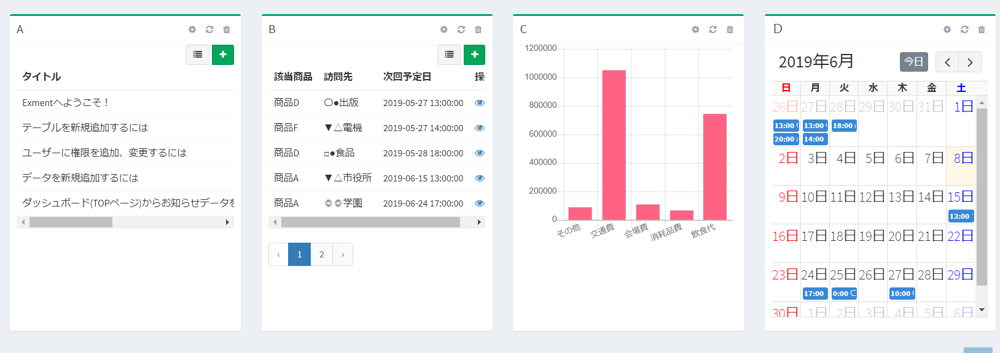  

## ダッシュボードフィルターの設定
ダッシュボード上部に、すべてのチャートをまとめて絞り込める「フィルターバー」を表示できます。  
地域・商品・担当者などの条件ごとにビューを作らなくても、1つのダッシュボードで条件を切り替えて集計結果を確認できます。  
※フィルターバーの使い方は[フィルターバーで絞り込む](#フィルターバーで絞り込む)をご確認ください。

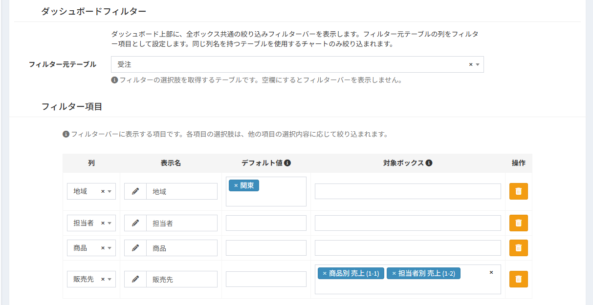

#### フィルター元テーブル
フィルターの選択肢を取得するテーブルを選択します。  
空欄にするとフィルターバーは表示されません。

#### フィルター項目
フィルターバーに表示する項目を、1行に1つずつ設定します。「新規」で行を増やせます。

| 設定 | 内容 |
|---|---|
| 列 | フィルター元テーブルの列から、絞り込みに使う列を選択します。 |
| 表示名 | フィルターバーに表示する名前です。空欄の場合は列名を表示します。 |
| デフォルト値 | ダッシュボードを開いたときに最初から選択される値です。一覧から選ぶ項目は保存値をカンマ区切りで、「から」「まで」の範囲で指定する項目は「最小~最大」の形式で指定します（片側だけでも指定できます）。空欄の場合は未選択で表示します。 |
| 対象ボックス | このフィルターで絞り込むチャートを選択します。空欄の場合は、同じ列名を持つすべてのチャートが絞り込まれます。選択肢には保存済みのチャートのみ表示されるため、チャートを追加した後に設定画面で選択してください。 |

> フィルターで絞り込まれるのは、**フィルター項目と同じ列名の列を持つテーブル**を使用しているチャートのみです。  
> 該当しないチャートには「フィルター対象外」と表示されます。

> 件数の多いテーブルでも快適に操作できるよう、フィルター項目に使う列は[カスタム列設定](/ja/column.md?id=検索インデックス-1)で「検索インデックス」を有効にすることをお勧めします。

> [テンプレート](/ja/template.md)でダッシュボードをエクスポート・インポートすると、フィルターバーの設定（対象ボックスを含む）もそのまま引き継がれます。

# 表示するアイテムを選択
作成したダッシュボードの各列右上［新規］にある  
「データ一覧」「システム」「チャート」「カレンダー」  
この4種類から表示したいアイテムを選ぶことが出来ます。  

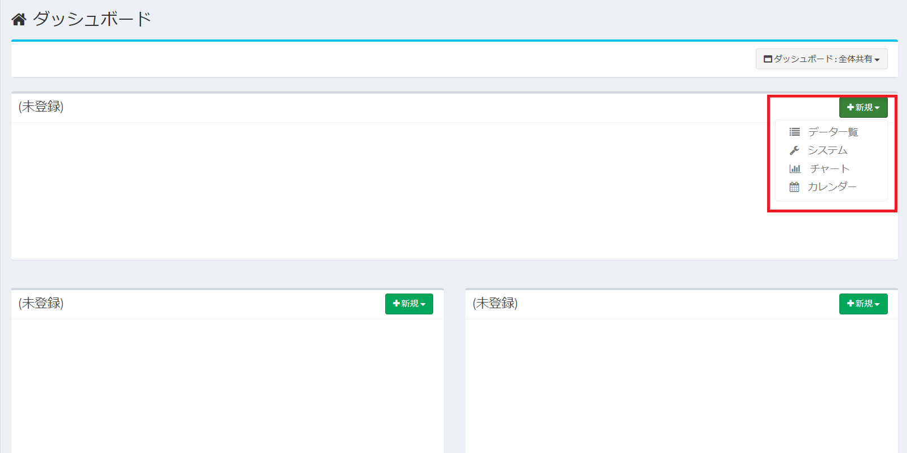  

次に、アイテムごとの具体的な表示内容を設定していきます。

## データ一覧
Exmentで管理している情報の中から、任意のテーブル、ビューを指定することでダッシュボードにデータ一覧を表示することが出来ます。

### データ一覧の表示例
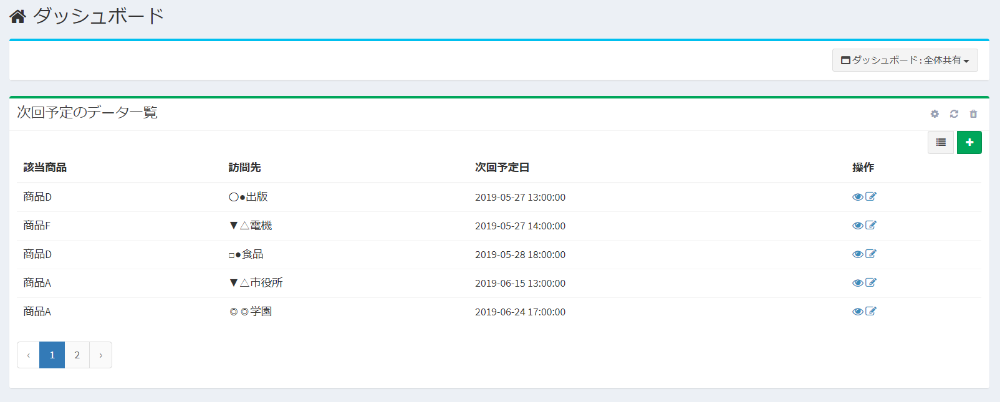

### データ一覧の設定項目
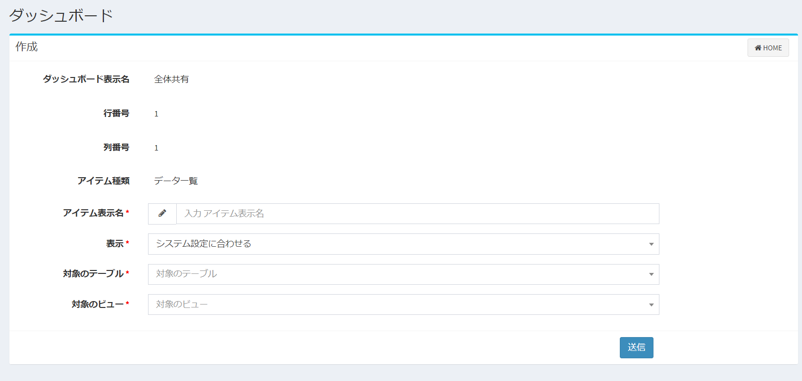
#### アイテム表示名
画面に表示するアイテムの名前を入力します。

#### 表示
一度に何件のデータを表示するか選択します。

#### 対象のテーブル
[カスタムテーブル設定](/ja/table.md)で作成済のテーブルの中から表示する対象を選びます。

#### 対象のビュー
選択した対象のテーブル内にある[ビュー](/ja/view.md)の中から表示する対象を選びます。  
※カレンダービュー・カンバンビュー・ガントチャートビュー・条件ビューは選択できません。システムダッシュボードの場合は、システムビューのみ選択できます。  

## システム
ダッシュボードにシステムに関する表示を行うことが出来ます。  
※現在は「ガイドライン」「Exment新着情報一覧」「エディター」「HTML」「通知一覧」「二次元／JANバーコード」が表示可能です。

### システムの設定項目

#### アイテム表示名
画面に表示するアイテムの名前を入力します。

#### 表示アイテム
表示するアイテムを選択します。

- ##### ガイドライン
システムに関する案内表示が出来ます。  
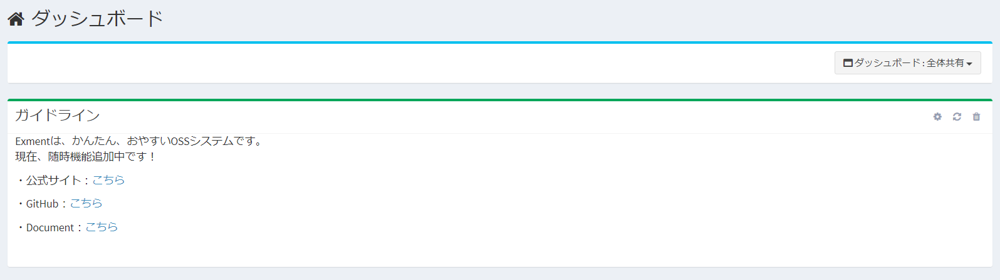

- ##### Exment新着情報一覧
Exment公式サイトより、新着情報を取得し表示します。
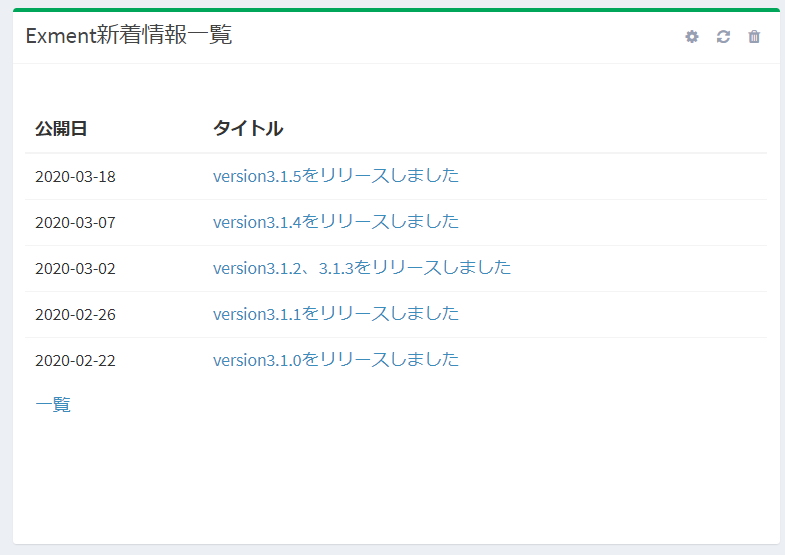

- ##### エディター
自由に本文を入力し、画面表示します。
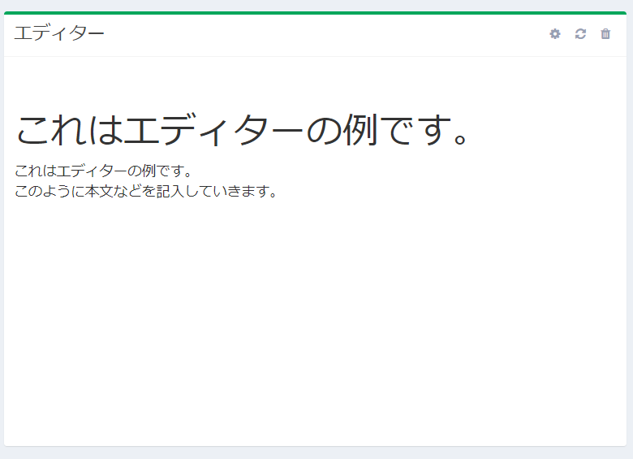

- ##### HTML
HTML形式で内容を入力し、画面表示します。※スクリプトも実行されます。
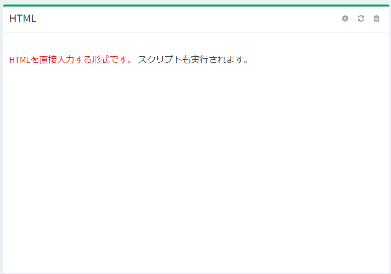

- ##### 二次元／JANバーコード
二次元／JANバーコード読込ボタンを表示します。  
「二次元／JANバーコード読込」ボタンの「二次元／JANバーコード」の表示名を.envファイルの「EXMENT_TEXT_SCAN_BUTTON_JA/EN」で変更できます。  

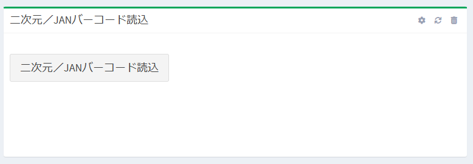

## チャート
Exmentのビュー（ビュー・全件ビュー・集計ビューなど）によって管理しているデータを、棒グラフ・折れ線グラフ・円グラフをはじめとする18種類のグラフに変換してダッシュボードに表示することが出来ます。  
表示中のグラフは、画面上で種類の切替・絞り込み・並び替えなどが行えます（[ダッシュボードの操作](#ダッシュボードの操作)）。  
※詳細は[チャートの設定内容](#チャートの設定内容)をご確認ください。

### 棒グラフの表示例

### 折れ線グラフの表示例  

### 円グラフの表示例

### チャートの設定項目
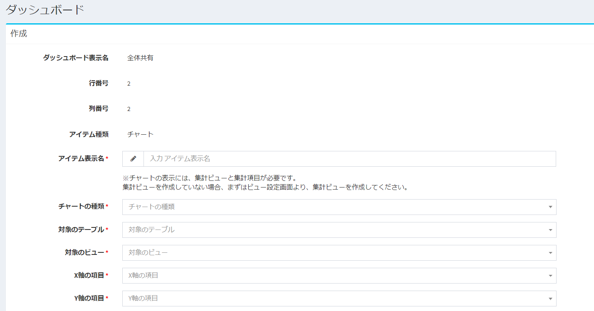

#### アイテム表示名
画面に表示するアイテムの名前を入力します。

#### チャートの種類
以下の18種類から、グラフの種類を1つ選択します。

| 分類 | グラフの種類 |
|---|---|
| 基本 | 棒グラフ、折れ線グラフ、円グラフ |
| 単一系列 | 横棒グラフ、エリアグラフ、ドーナツグラフ、レーダーチャート、ファネルグラフ、ゲージ、散布図 |
| 複数系列 | グループ棒グラフ、積み上げ棒グラフ、複数折れ線グラフ、ヒートマップ、積み上げエリアグラフ、ツリーマップ、サンバースト、箱ひげ図 |

「複数系列」のグラフは、横軸の項目ごとに複数の系列を表示します（例：月ごとの売上を商品別に表示）。

複数系列のグラフを使用するには、集計ビューを2列以上でグループ化する必要があります。グループ列のうち、[系列の項目](#系列の項目（複数系列）)で選択した列（既定は2列目）が系列、それ以外の最初の列が横軸になります。

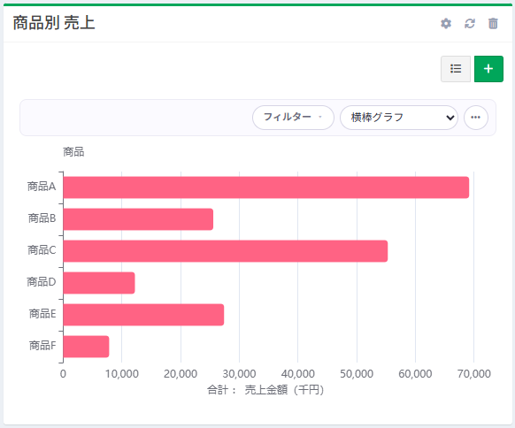

横棒グラフ

エリアグラフ

ドーナツグラフ

レーダーチャート

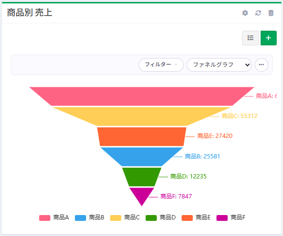

ファネルグラフ

ゲージ

散布図

グループ棒グラフ

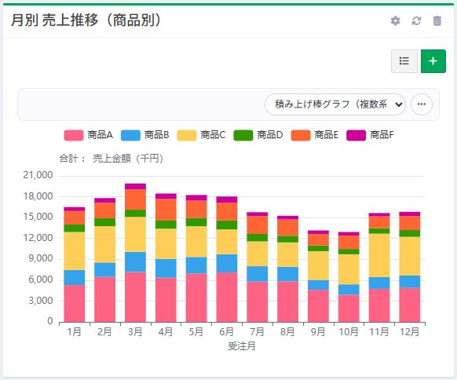

積み上げ棒グラフ

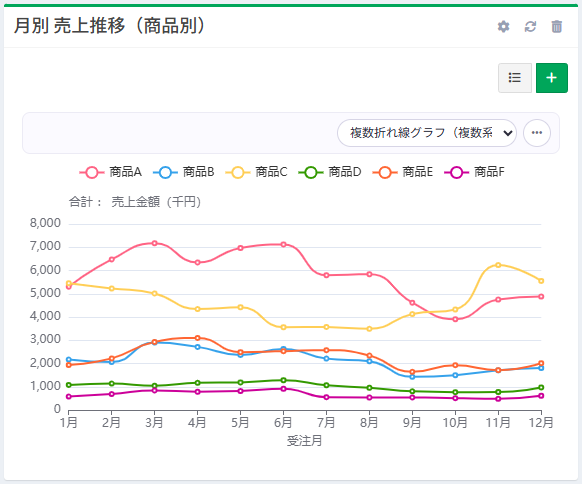

複数折れ線グラフ

ヒートマップ

積み上げエリアグラフ

ツリーマップ

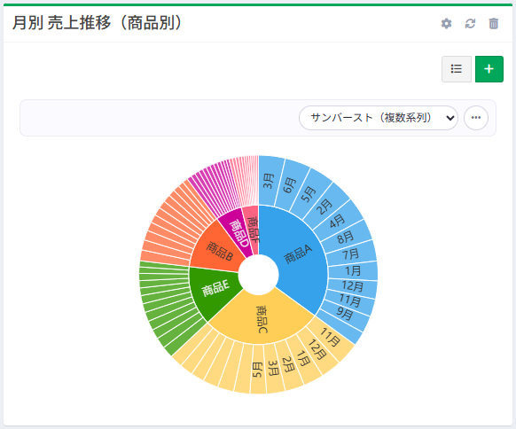

サンバースト

箱ひげ図

#### 対象のテーブル
[カスタムテーブル設定](/ja/table.md)で作成済のテーブルの中から表示する対象を選びます。  
※閲覧権限のあるテーブルが選択肢として表示されます。

#### 対象のビュー
選択した対象のテーブル内にあるビュー（ビュー・全件ビュー・集計ビューなど）の中から表示する対象を選びます。  
※カレンダービュー・カンバンビュー・ガントチャートビュー・条件ビューは選択できません。システムダッシュボードの場合は、システムビューのみ選択できます。  
※複数系列のグラフを使用する場合は、集計ビューを選択してください。  

#### X軸の項目
グラフとして表示するX軸（横軸）を選択します。  
※詳細は[チャートの設定内容](#チャートの設定内容)をご確認ください。  

#### Y軸の項目
グラフとして表示するY軸（縦軸）を選択します。  
※詳細は[チャートの設定内容](#チャートの設定内容)をご確認ください。  

#### 系列の項目（複数系列）

複数系列のグラフを選択した場合のみ表示される設定です。

集計ビューのグループ列の中から、系列として使用する列を選択します。未選択の場合は、2列目のグループ列が系列になります。

#### チャートフィルター項目

このチャートだけを絞り込むための列を選択します。複数選択できます。

選択した列は、チャートの**フィルター**ボタンから絞り込みに使用できます（[チャートフィルターで絞り込む](#チャートフィルターで絞り込む)）。

列を選択しない場合、**フィルター**ボタンは表示されません。

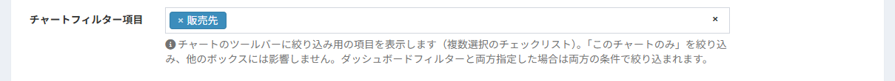

#### グラフ種類に応じたその他のオプション

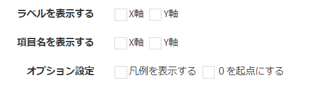

選択したオプションがグラフに反映されます。

※**ラベルを表示する**、**項目名を表示する**、**０を起点にする**は、棒グラフ・折れ線グラフでのみ使用できます。

## カレンダー
Exmentのカレンダービューによって管理しているデータを、  
「月別」「リスト」  
2種類の表示形式の内、任意の形式にてダッシュボードに表示することが出来ます。
>表示される文言は、[見出し表示列設定](/ja/table#見出し表示列設定)で変更できます。

### 月別の表示例
  

### リストの表示例
  

### カレンダーの設定項目

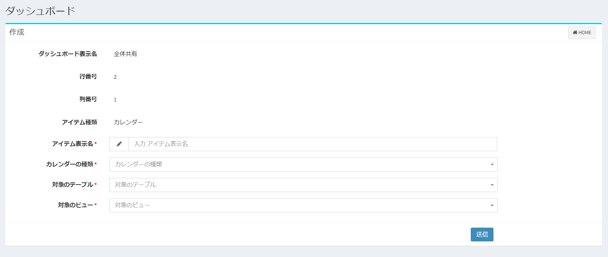  

#### アイテム表示名
画面に表示するアイテムの名前を入力します。

#### カレンダーの種類
「月別」「リスト」  
この2種類から表示したいカレンダーを選びます。

#### 対象のテーブル
[カスタムテーブル設定](/ja/table.md)で作成済のテーブルの中から表示する対象を選びます。  
※カレンダービューを設定しているテーブルのみが選択肢として表示されます。

#### 対象のビュー
選択した対象のテーブル内にあるカレンダービューの中から表示する対象を選びます。  

## チャートの設定内容
チャート(グラフ)で設定するX軸、Y軸の項目は、対象ビューの内容によって異なります。  

### 対象ビューが全件ビュー、標準ビューの場合

#### X軸の項目
X軸の選択肢には、以下の2種類が表示されます。いずれかを選択してください。

- 「データ見出し」項目。  
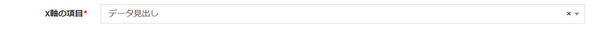  

選択することで、[カスタムテーブル設定の見出し表示列設定](/ja/table#見出し表示列設定)が、X軸に表示されます。  

  

- [カスタムビュー設定の「表示列選択」](/ja/view#表示列選択)に表示されている項目。選択することで、選択した列の値が、X軸に表示されます。  
  

#### Y軸の項目
Y軸の選択肢には、以下の1種類が表示されます。いずれかを選択してください。

- [カスタムビュー設定の「表示列選択」](/ja/view#表示列選択)に表示されている項目のうち、以下の列種類。選択することで、選択した列の値が、Y軸に表示されます。
    - 整数
    - 小数
    - 通貨

### 対象ビューが集計ビューの場合

#### X軸の項目
X軸の選択肢には、以下の1種類が表示されます。

- 「データ見出し」項目。  
  

選択することで、[カスタムビュー設定の「グループ列選択」](/ja/view?id=グループ列選択)で設定した値が、X軸に表示されます。  
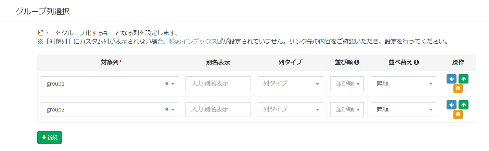  
  

#### Y軸の項目
Y軸の選択肢には、以下の2種類が表示されます。いずれかを選択してください。

- [カスタムビュー設定の「グループ列選択」](/ja/view?id=グループ列選択)に表示されている項目のうち、以下の列種類。選択することで、選択した列の値が、Y軸に表示されます。
    - 整数
    - 小数
    - 通貨

  

  

- [カスタムビュー設定の「集計列選択」](/ja/view#集計列選択)に表示されている項目。選択することで、選択した列の値が、Y軸に表示されます。

  

  

## ダッシュボードの共有
作成したダッシュボードを、他のユーザー・組織に共有します。  
※共有対象となるのは「ユーザーダッシュボード」のみです。（「システムダッシュボード」は最初から全てのユーザーに公開されています。）  

#### 共有方法
- ダッシュボードの設定変更画面に「共有」ボタンが表示されているので、クリックします。  
※新規作成時にはこのボタンは表示されません。
  

- ダッシュボードの共有ダイアログが表示されます。
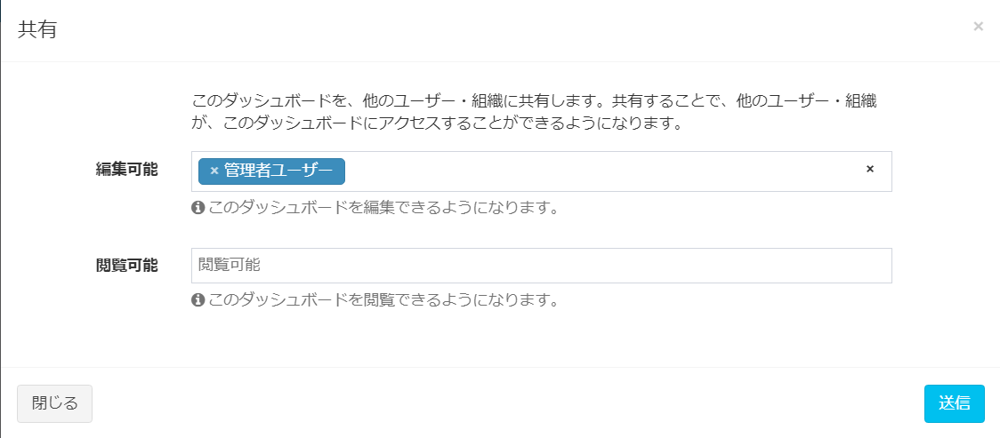  

- 共有したいユーザーまたは組織を追加して、「送信」をクリックし、共有を完了させます。  
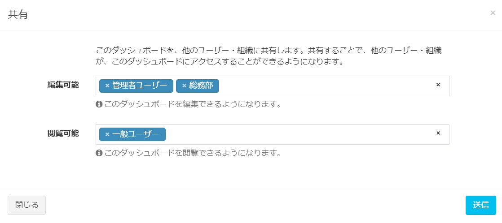  

# ダッシュボードの操作

ダッシュボード上で、チャートの絞り込み、グラフ種類の切替、データの並び替えを行えます。色の変更を除き、これらの操作によってダッシュボードの設定、チャートの設定、データは変更されません。

| 操作 | できること | 対象 |
|---|---|---|
| [フィルターバー](#フィルターバーで絞り込む) | ダッシュボード上のチャートをまとめて絞り込みます | ダッシュボード全体 |
| [グラフのクリック](#グラフをクリックして絞り込む) | クリックした値をフィルターバーで選択します | ダッシュボード全体 |
| [チャートフィルター](#チャートフィルターで絞り込む) | 1つのチャートだけを絞り込みます | チャート単位 |
| [グラフ種類の切替](#グラフの種類を切り替える) | 同じデータを別の種類のグラフで表示します | チャート単位 |
| [「⋯」メニュー](#「⋯」メニュー) | 並び替え、値ラベルの表示、データのエクスポートを行います | チャート単位 |
| [色の変更](#グラフの色を変更する) | 棒・扇形などの色を変更します | チャート単位 |

## フィルターバーで絞り込む

[ダッシュボードフィルターの設定](#ダッシュボードフィルターの設定)を行うと、ダッシュボード上部にフィルターバーが表示されます。

フィルターバーで値を選択すると、そのフィルターの対象となっているすべてのチャートに同じ条件が適用されます。

※フィルター元テーブルの閲覧権限がないユーザーには、フィルターバーは表示されません。

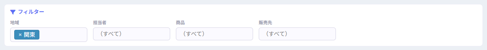

#### 値を選択する

フィルター項目をクリックし、一覧から値を選択します。複数の値を選択できます。

他のフィルターで値を選択すると、一覧にはその条件に該当するデータがある値だけが表示されます。例えば「地域」で「関東」を選択すると、「担当者」には関東の担当者だけが表示されます。

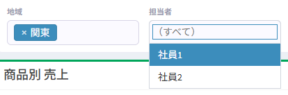

日付・日時の列は、一覧ではなく「から」「まで」の範囲で指定します。数値の列も、選択肢が多すぎる場合は範囲での指定になります。

> 選択肢が多すぎて表示できない場合は、先に他のフィルターで値を選択して絞り込んでください。

#### 絞り込みを解除する

「リセット」をクリックすると、[デフォルト値](#フィルター項目)の状態に戻ります。

デフォルト値を設定していない場合は、すべての絞り込みが解除されます。

#### フィルター対象外のチャート

フィルターバーの影響を受けないチャートには「フィルター対象外」、一部のフィルター項目が適用されないチャートには「適用外のフィルター」と表示されます。

選択したフィルターが表示中のデータにどう反映されているかを確認できます。

> 絞り込みの条件はURLに保持されます。ブラウザの「戻る」「進む」で以前の条件に戻せます。また、URLを共有すると、同じ条件のダッシュボードを他のユーザーに見てもらえます。

> 最後に選択した条件はユーザーごとに記憶され、次にダッシュボードを開いたときも同じ条件で表示されます。

## グラフをクリックして絞り込む

グラフの棒・扇形などをクリックすると、その値がフィルターバーで選択され、他のチャートが絞り込まれます。

クリックしたチャートはすべての値を表示したまま、選択した値を濃く、それ以外の値を薄く表示します。

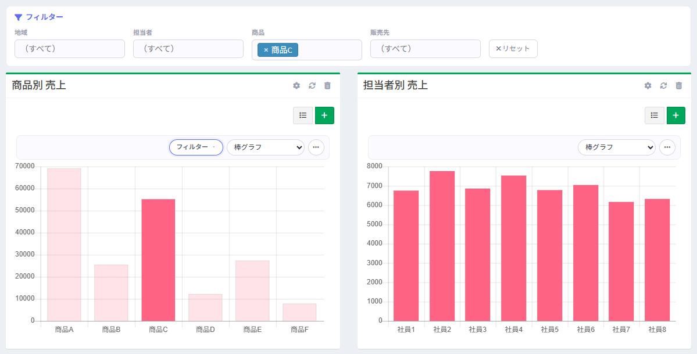

| 操作 | 結果 |
|---|---|
| 値をクリック | その値だけを選択します。 |
| 選択中の値（その値だけを選択している場合）をもう一度クリック | 選択を解除します。 |
| Ctrl（Macは⌘）を押しながらクリック | 値を追加で選択します。選択済みの値をクリックした場合は、その値だけを選択から外します。 |

※グラフの横軸の列が、フィルターバーの項目に含まれている場合に利用できます。  
※集計ビューのチャートで利用できます。横軸の列が「から」「まで」の範囲で指定する項目（日付の列など）や複数選択の列の場合は利用できません。  
※レーダーチャート・ゲージ・ツリーマップ・サンバースト・箱ひげ図では利用できません。  
※フィルターバーで値を選択した場合、横軸がそのフィルター項目に対応するチャートは絞り込まれず、選択した値が強調表示されます。

## チャートフィルターで絞り込む

チャートフィルターは、そのチャートだけに適用されます。他のチャートには影響しません。

チャートに[チャートフィルター項目](#チャートフィルター項目)を設定すると、チャート右上に「フィルター」ボタンが表示されます。

「フィルター」をクリックし、表示したい値を選択します。

ボタンには、絞り込み中の項目数が表示されます。「リセット」をクリックすると、チャートフィルターの条件が解除されます。

選択肢が8件を超える場合は、一覧の上に検索欄が表示され、目的の値を探せます。

日付・日時の列は、一覧ではなく「から」「まで」の範囲で指定します。数値の列も、選択肢が多すぎる場合は範囲での指定になります。

※チャートフィルターはフィルターバーと併用できます。その場合は、両方の条件で絞り込まれます。  
※チャートフィルターの選択は、ページを再読込（F5）すると解除されます。

## グラフの種類を切り替える

チャート右上のグラフ種類の選択欄から、同じデータを別の種類のグラフで表示できます。

選択したグラフの種類はユーザーごとに記憶され、次にダッシュボードを開いたときも同じ種類で表示されます。

元のグラフの種類を選び直すと、切替が解除され、元の種類に戻ります。

※単一系列のグラフは単一系列のグラフどうし、複数系列のグラフは複数系列のグラフどうしでのみ切り替えられます。たとえば、棒グラフはドーナツグラフや散布図に切り替えられますが、積み上げ棒グラフ（複数系列）には切り替えられません。

## 「⋯」メニュー

チャート右上の「⋯」をクリックすると、メニューが表示されます。

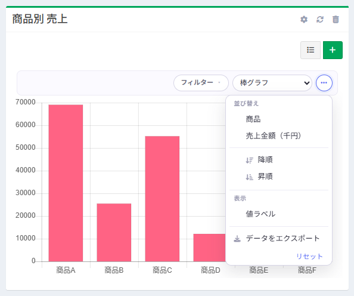

| メニュー | 内容 |
|---|---|
| 並び替え | 横軸の項目または値で、昇順・降順に並び替えます。 |
| 値ラベル | 棒や点などの上に値を表示します。棒グラフ・折れ線グラフ・円グラフ・横棒グラフ・エリアグラフ・散布図・グループ棒グラフ・積み上げ棒グラフ・複数折れ線グラフ・積み上げエリアグラフでのみ表示されます。 |
| データをエクスポート | 表示中のデータをCSVファイルでダウンロードします。 |
| 色をリセット | 変更した色を元に戻します。色を変更できるユーザーに、色を変更している場合のみ表示されます。 |
| リセット | 並び替えと値ラベルを元の設定に戻します。 |

※並び替えと値ラベルの設定は、ユーザーごとに記憶されます。  
※表示できるメニュー項目がないチャートには、「⋯」は表示されません。

## グラフの色を変更する

ダッシュボードの編集権限があるユーザーは、グラフの棒・扇形などを右クリックして色を変更できます。

「テーマの色」「標準の色」から選ぶか、「その他の色...」で任意の色を指定します。「自動」を選ぶと元の色に戻ります。

棒グラフ・円グラフなどは、棒・扇形ごとに色を変更できます。折れ線グラフ・エリアグラフなど1色で描くグラフや、複数系列のグラフは、系列ごとに色を変更できます。

「その他の色...」を選ぶと、任意の色を指定できるパレットが開きます。

パレットをクリックするか、RGBの値を入力します。↕でHSL・HEXの入力に切り替えられます。「決定」をクリックすると色が反映されます。

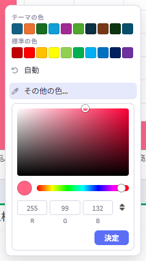

※変更した色はチャートの設定に保存され、すべてのユーザーに同じ色で表示されます。  
※閲覧のみのユーザーは色を変更できません。  
※ヒートマップ・箱ひげ図は色の変更に対応していません。
