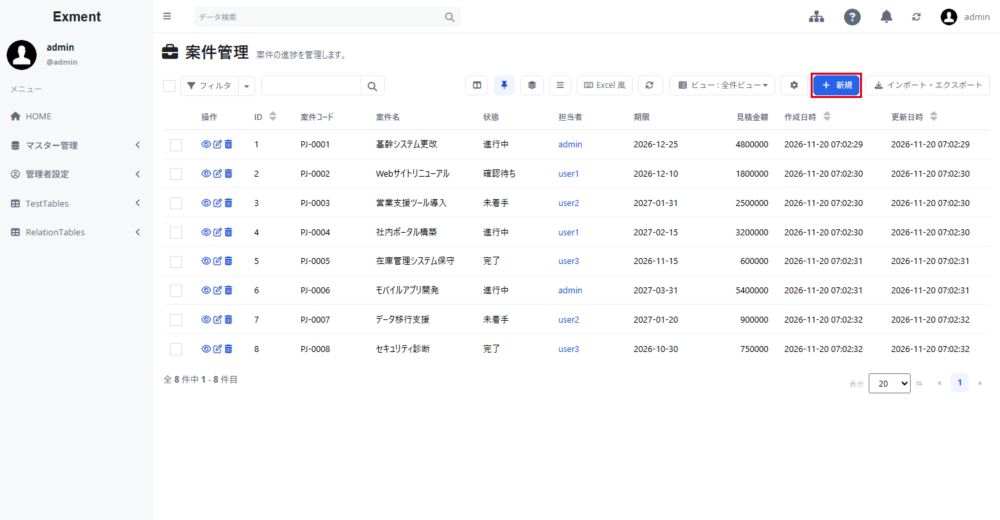
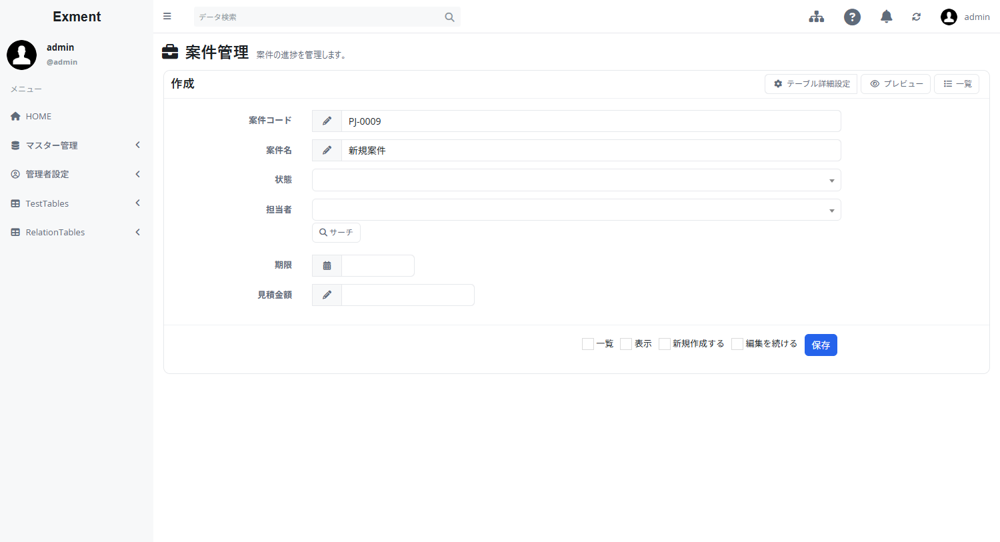
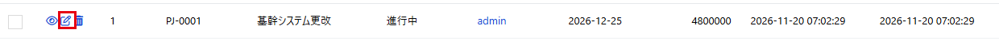
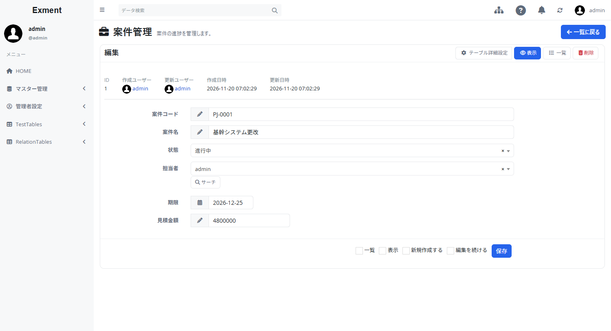
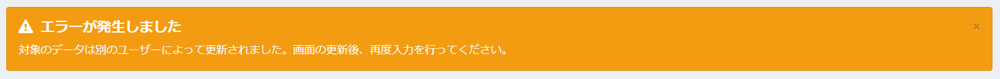
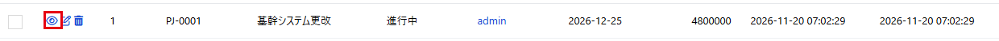
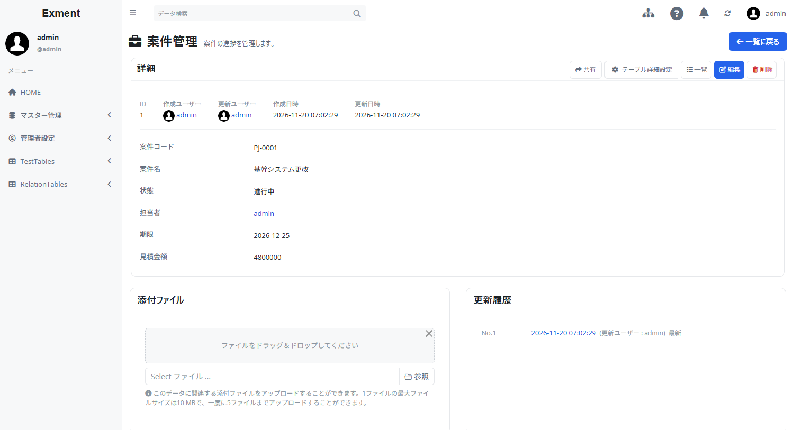
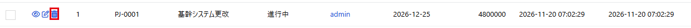

# データ
テーブルに入っているデータを、一覧で見る・新しく追加する・編集する・表示する・削除する画面の説明です。  
テーブルはシステム管理者が作ります。ユーザーは、そのテーブルに値を入力して保存します。

| したいこと | 見るところ |
|---|---|
| データを一覧で見る | [データ一覧](/ja/data?id=データ一覧) |
| データを追加する | [データの新規追加](/ja/data?id=データの新規追加) |
| データを直す | [データの編集](/ja/data?id=データの編集) |
| データの中身を見る | [データの表示](/ja/data?id=データの表示) |
| データを消す | [データの削除](/ja/data?id=データの削除) |
| データをコピーして作る | [データのコピー](/ja/data?id=データのコピー) |

## データ一覧
そのテーブルに保存しているデータの一覧です。  
一覧に出るのは、自分が作成したデータと、自分に権限が割り当てられているデータです。

※「すべてのデータを編集・閲覧する権限」をユーザーや組織に登録すると、上の条件に関係なく、すべてのデータが出ます。  
  
  
一覧画面のくわしい説明は、[データ一覧](/ja/data_grid.md)をご覧ください。  

## データの新規追加
1. ページ右上の［新規］リンクをクリックします。  

※ログインユーザーが、そのテーブルの「編集」権限を持っていないときは、このボタンは出ません。  
権限の割り当て方は、左メニューの[役割グループ・権限設定](/ja/role_group.md)をご覧ください。  

2. データの新規作成画面が出ます。  

  
新規追加の画面のくわしい説明は、[データフォーム](/ja/data_form.md)をご覧ください。  

### 保存の前に内容を確かめる（プレビュー）
新規作成画面のページ右上にある［プレビュー］ボタンをクリックすると、入力中の内容を保存せずに、別ウィンドウで確かめられます。  
フォームのブロックごとに、項目名と値の一覧で出ます。

- ［プレビュー］ボタンは、データの新規作成画面にだけ出ます。編集画面には出ません。  
- プレビューでは、データは保存されません。入力を変えたあとで表示を新しくするには、元の画面でもう一度［プレビュー］ボタンをクリックしてください。  
- 子テーブルのブロックは、プレビューには出ません。

## データの編集
1. 編集したい行の［編集］リンクをクリックします。  

※ログインユーザーが、そのテーブルの「編集」権限を持っていないときは、このリンクは出ません。  
権限の割り当て方は、左メニューの[役割グループ・権限設定](/ja/role_group.md)をご覧ください。  

2. データの編集画面が出ます。  

  
編集画面のくわしい説明は、[データフォーム](/ja/data_form.md)をご覧ください。  

> データを更新するとき、すでにほかのユーザーが同じデータを更新していた場合は、次のエラーメッセージが出ます。

## データの表示
1. 表示したい行の［表示］リンクをクリックします。  

2. データの表示画面が出ます。  

  
表示画面のくわしい説明は、[データ詳細](/ja/data_details.md)をご覧ください。  

## データの削除
- 削除したい行の［削除］リンクをクリックします。  

## データのコピー
※［コピー］リンクを出すには、設定値を変える必要があります。[カスタムデータのコピーリンクを表示する](/ja/config?id=カスタムデータのコピーリンクを表示する)をご覧ください。  

1. コピーしたい行の［コピー］リンクをクリックします。  

2. 選んだデータの内容が入った状態で、編集画面が出ます。  

3. 必要なところを直して、保存します。  

コピーされるもの・されないもの：

- コピーされるのは、フォームの上にある項目だけです。  
- 自動採番、ファイル、画像などは、コピーされません。  
