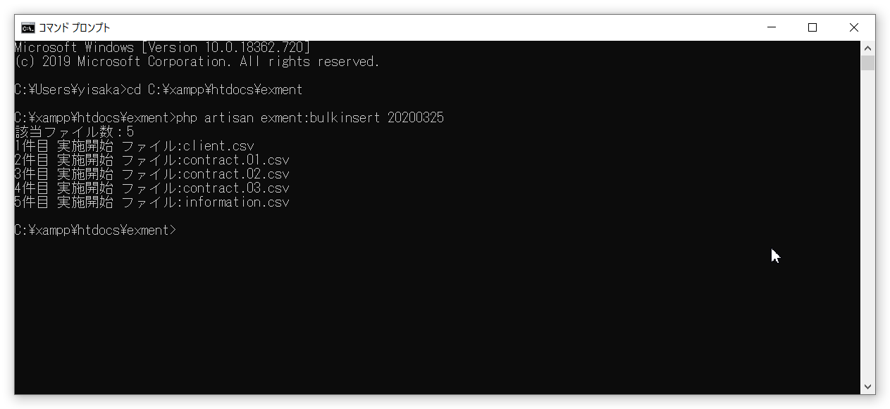

# 大量データ一括投入
csvファイルで用意した大量のデータを、サーバーのコマンドで、カスタムテーブルにまとめて入れる機能です（バルクインサート。1000件以上も可能）。  
速さを重視しているため、細かなエラーチェックは行いません。

流れは、次のとおりです。

1. csvファイルを作る（「データの準備」）
2. サーバーのフォルダーに置いて、コマンドを実行する（「操作方法」）

## 注意点
バルクインサートは、速さを重視しています。そのため、次の点にご注意ください。

- **作成したcsvやデータの内容に不備があっても、細かなエラーチェックは行いません。** ファイルは、作るときによく確かめてください。問題が起きたときは、データの一部を画面からのインポートで入れてみるなどして、ご確認ください。

- [通常のインポート](/ja/data_import_export)でできる「[別テーブルのデータの指定方法変更](/ja/data_import_export#別テーブルのデータの指定方法変更)」は、この機能ではできません。idを列に書いて、インポートしてください。

## データの準備
はじめに、インポート用のcsvファイルを作ります。

| 決まり | 内容 |
| ---- | ---- |
| 1行目 | カスタムテーブルの列名 |
| 2行目以降 | 投入するデータ |
| ファイル名 | **「(カスタムテーブルの名前).csv」** (例：client.csv)。1つのテーブルに入れるデータが複数のファイルに分かれるときは、 **「(カスタムテーブルの名前).連番.csv」** (例：client.01.csv)のように連番を付けます |
| 文字コード | <strong>UTF-8</strong>（BOM無し） |

**EXCELでファイルを作ると、文字コードは、はじめはシフトJISになります。必ず先に、テキストエディタなどで文字コードを変換してください。**  

### カスタムテーブルの列名として使用できる値
| 項目 | 説明 |
| ---- | ---- |
| id | 主キー(数値) ※指定したい場合のみ入力 |
| parent_type | 親テーブルの名前 ※子テーブルのデータの場合のみ入力 |
| parent_id | 紐づいている親データのID ※子テーブルのデータの場合のみ入力 |
| deleted_at | データの削除日時 ※指定したい場合のみ入力 |
| deleted_user_id | データの削除したユーザーID ※指定したい場合のみ入力 |
| value.(カスタム列の列名) | カスタム列設定で登録した列名。必ず先頭にvalue.をつけてください |

- 特に理由がなければ、csvファイルに書くのはカスタム列だけにしてください（そのほかの項目は、自動で入ります）。  
- **通常のインポートと違い、既存のデータと同じidを指定しても、更新は行われません。**  

#### サンプルファイル（client.csv）
- 顧客テーブル（client）にデータを入れるサンプルです。顧客コード(client_code)と顧客名(client_name)を入れ、3件目のデータにだけ、削除日時(deleted_at)と削除ユーザーID(deleted_user_id)を入れています。  

~~~
value.client_code,value.client_name,deleted_at,deleted_user_id
CUST001,テスト顧客名００１,,
CUST002,テスト顧客名００２,,
CUST003,テスト顧客名００３,2019/3/20,2
CUST004,テスト顧客名００４,,
CUST005,テスト顧客名００５,,
CUST006,テスト顧客名００６,,
CUST007,テスト顧客名００７,,
CUST008,テスト顧客名００８,,
CUST009,テスト顧客名００９,,
~~~

## 操作方法

1. サーバーの次の場所に、作業用のフォルダを作ります。フォルダ名は、今回の作業の内容がわかるものや、日付などがおすすめです。  

~~~
(プロジェクトのルートディレクトリ)/storage/app/bulkinsert/(フォルダ名)
~~~

2. 作ったcsvファイル（複数可）を、そのフォルダに置きます。

#### フォルダの配置例
  

3. コマンドラインで、次のコマンドを実行します。
~~~
php artisan exment:bulkinsert {フォルダ名}
~~~

#### コマンド実行例
  
