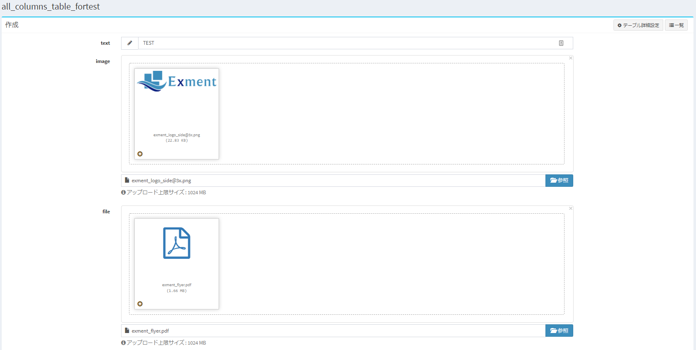
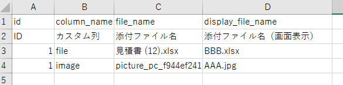

# データインポート・エクスポート（コマンド）
テーブルのデータを、サーバーのコマンドでインポート・エクスポートする方法の説明です。

| したいこと | コマンド | 見るところ |
|---|---|---|
| データをファイルに出す | `php artisan exment:export` | 「データエクスポート」 |
| データを、決めた件数ごとに分けて出す | `php artisan exment:chunkexport` | 「データエクスポート(chunkモード)」 |
| ファイルからデータを入れる | `php artisan exment:import` | 「データインポート」 |
| 「画像」「ファイル」列に、ファイルをまとめて入れる | `php artisan exment:file-import` | 「データインポート - 画像・ファイル列の添付ファイル取込」 |
| データの添付ファイル（ドキュメント）を、まとめて入れる | `php artisan exment:document-import` | 「データインポート - ドキュメント(添付ファイル)一覧」 |

> データのインポート・エクスポートの概要については、[データインポート・エクスポート](/ja/data_import_export)をご確認ください。

## データエクスポート
テーブルのデータを、コマンドでファイルにエクスポート（出力）します。  
ファイルの形式は、csv、xlsxです。  


### 操作方法

- コマンドラインで、次のコマンドを実行します。

~~~
php artisan exment:export (テーブル名)

# 例
php artisan exment:export information
~~~

- このコマンドを実行すると、フォルダ「(Exmentのルートフォルダ)/storage/app/export/(実行日時：yyyyMMddHHiiss)」に、csvデータが出力されます。

### コマンドの引数

```
php artisan exment:export (テーブル名) {--action=default} {--type=all} {--page=1} {--count=} {--format=csv} {--view=} {--dirpath=} {--add_setting=0} {--add_relation=0} {--add_comment=0}
```

- ##### テーブル名  
(必須)出力する対象のテーブル名(英数字)。

- ##### action  
(オプション)エクスポートを実施する方法。
    - default : すべてのシステム列・カスタム列を出力。既定値。
    - view : 指定のビュー形式で出力。

- ##### type  
(オプション)エクスポートするデータの種類(件数)。
    - all : 全データ。既定値。
    - page : 指定のページ。

- ##### page    
(オプション)typeがpageの場合、ページ番号。整数。未指定の場合、1ページ目を出力。

- ##### count    
(オプション)typeがpageの場合、出力する最大データ件数。未指定の場合、対象のビューで指定されているデータ件数。

- ##### format  
(オプション)エクスポートするファイル形式。
    - csv : CSV形式。既定値。
    - xlsx : Xlsx(Excel)形式。

- ##### view  
(オプション)出力対象のビュー。idかsuuidで指定。未設定の場合、全件ビューで出力。

- ##### dirpath  
(オプション)エクスポートするフォルダパス。フルパス。未設定の場合、(Exmentのルートフォルダ)/storage/app/export/(実行日時：yyyyMMddHHiiss)。

- ##### add_relation  
(オプション)リレーションデータも出力するかどうか。既定値は0(出力しない)。Xlsx形式、ならびにactionがdefaultの場合でのみ有効。

- ##### add_setting  
(オプション)設定データも出力するかどうか。既定値は0(出力しない)。Xlsx形式、ならびにactionがdefaultの場合でのみ有効。

- ##### add_comment  
(オプション)各データのコメントも出力するかどうか。既定値は0(出力しない)。1を指定すると、シート(CSV形式の場合はファイル)「comment」に、コメントを出力します。actionがdefaultで、カスタムテーブル設定の「コメント使用」がYESのテーブルの場合でのみ有効。

~~~
# 例：コメントも含めて、Xlsx形式で出力
php artisan exment:export information --format=xlsx --add_comment=1
~~~


<h2 id="export_chunk"><a href="#/ja/data_cmd_import_export?id=export_chunk" data-id="export_chunk" class="anchor"><span>データエクスポート(chunkモード)</span></a></h2>

決めた件数(既定値：1000件)ごとに、データを分けて出力します。大量のデータを出力するときに、1つのファイルの行数を少なくできます。  


### 操作方法

- コマンドラインで、次のコマンドを実行します。

~~~
php artisan exment:chunkexport (テーブル名)

# 例
php artisan exment:chunkexport information
~~~

- このコマンドを実行すると、フォルダ「(Exmentのルートフォルダ)/storage/app/export/(実行日時：yyyyMMddHHiiss)」に、csvデータが出力されます。


### コマンドの引数

```
php artisan exment:chunkexport (テーブル名) {--action=default} {--start=1} {--end=1000} {--count=1000} {--seqlength=1} {--delimiter=} {--format=csv} {--view=} {--dirpath=}
```

- ##### テーブル名  
(必須)出力する対象のテーブル名(英数字)。

- ##### action  
(オプション)エクスポートを実施する方法。
    - default : すべてのシステム列・カスタム列を出力。既定値。
    - view : 指定のビュー形式で出力。

- ##### start  
(オプション)出力を開始するファイル番号。エクスポートが途中で終了してしまった場合、指定の連番からエクスポートを再開することもできます。未指定の場合、1。

- ##### end  
(オプション)出力を終了するファイル番号。未指定の場合、1000。

- ##### count    
(オプション)1ファイルに出力する最大データ件数。未指定の場合、1000。

- ##### seqlength    
(オプション)連番の0埋めの桁数。例として「3」と入力した場合、"001", "002"のように連番を出力。未指定の場合、1。

- ##### delimiter    
(オプション)ファイル名の、テーブル名と連番の間に入れる文字。未指定の場合、「.」(ピリオド)。

- ##### format  
(オプション)エクスポートするファイル形式。
    - csv : CSV形式。既定値。
    - xlsx : Xlsx(Excel)形式。

- ##### view  
(オプション)出力対象のビュー。idかsuuidで指定。未設定の場合、全件ビューで出力。

- ##### dirpath  
(オプション)エクスポートするフォルダパス。フルパス。未設定の場合、(Exmentのルートフォルダ)/storage/app/export/(実行日時：yyyyMMddHHiiss)。


### 出力仕様

- ファイル名は、 **「(カスタムテーブルの名前).連番.csv」** (例：client.1.csv)のように、連番で出力されます。

```
#例
client.1.csv
client.2.csv
client.3.csv

#例(seqlength=3と指定した場合)
client.001.csv
client.002.csv
client.003.csv
```

- データの件数やcountオプションに関係なく、1回の実行で出力できるファイルは、最大1000件です。


## データインポート
決めたフォルダに置いたファイルから、カスタムテーブルに、データをまとめて入れます。

- 使えるファイルは、画面からのインポートと同じ形式のEXCELファイルまたはcsvファイルです。  
- 画面では制限されている、5000件を超えるデータも入れられます。  

### 注意点
- ZIP形式に圧縮したCSVファイルは、取り込めません。  

- 画面からのインポートと同じエラーチェックを行います。そのため、大量のデータを入れると、とても時間がかかることがあります。  

- データは、100件ずつ取り込みます。たとえば、最初の100件を正しく登録したあと、次の100件のデータに不備があると、そこでファイルの処理を取りやめます。すでに登録された100件は、元に戻せません。手で削除するか、ファイルから登録済みのデータを除くなどしてください。  

- <span class="red">コマンドによるインポートでも、件数がとても多いデータは、メモリが足りずにエラーになることがあります。</span>  
現在、改善を進めています。大量のデータを取り込むときは、[大量データ一括投入](/ja/data_bulk_insert)をご利用ください。

- csvで取り込むときは、今は、そのテーブルのデータだけを取り込めます。リレーションデータも取り込むときは、xlsxで取り込んでください。


### データの準備
はじめに、インポート用のファイルを作ります。くわしくは[テンプレート出力](/ja/data_import_export?id=テンプレート出力) をご覧ください。  

- 取込み可能なcsvファイルの文字コードは<strong>UTF-8</strong>です。  

- ファイル名は、次のどれかの形式にしてください。  
※フォルダの中のファイルは、名前の順に取り込まれます。そのため、リレーションしているデータを同時に取り込むときなど、取り込む順番が大事なときは、3.の方法で、取り込む順に連番を付けてください。

    1. 「(カスタムテーブルの名前).csv」    ※例：client.csv
    2. 「(カスタムテーブルの名前).(連番).csv」   ※例：client.1.csv、client.002.csv
    3. 「(連番).(カスタムテーブルの名前).csv」   ※例：01.client.csv、02.estimate.csv

- <span class="small">v3.8.0未満では、「<span class="bold">連番<span class="red">#</span>(カスタムテーブルの名前).csv</span>」のファイル名でもインポートできました。  
v3.8.0で、[インポート時のライブラリを変更](/ja/update/v3_8)したため、このファイル名ではインポートできなくなりました。  
連番を付けてインポートするときは、「<span class="bold">連番<span class="red">.</span>(カスタムテーブルの名前).csv</span>」の形式に変えて、インポートしてください。</span>

### 操作方法

- サーバーの次の場所に、作業用のフォルダを作ります。フォルダ名は、今回の作業の内容がわかるものや、日付などがおすすめです。  

~~~
(プロジェクトのルートディレクトリ)/storage/app/import/(フォルダ名)
~~~

- 作ったcsvファイルまたはEXCELファイル（複数可）を、そのフォルダに置きます。

#### フォルダの配置例
  

- コマンドラインで、次のコマンドを実行します。
~~~
php artisan exment:import {フォルダ名}
~~~

#### コマンド実行例
  


### 実行完了後
- 取り込みが終わったら、"storage/app/import"フォルダに置いたファイルは、必要に応じて削除してください。（※自動では削除しません。）


<h2 id="import_file"><a href="#/ja/data_cmd_import_export?id=import_file" data-id="import_file" class="anchor"><span>データインポート - 画像・ファイル列の添付ファイル取込</span></a></h2>
カスタム列種類が「画像」「ファイル」の列に、添付ファイルをまとめて登録できます。下の画面の部分です。  

  

### 仕様
- すでに添付ファイルが登録されているカスタム列に、新しく添付ファイルを取り込むと、前のファイルは削除されます。


### 取込データの準備

- サーバーの次の場所に、作業用のフォルダを作ります。フォルダ名は、今回の作業の内容がわかるものや、日付などがおすすめです。  

~~~
(プロジェクトのルートディレクトリ)/storage/app/file-import/(フォルダ名)
~~~

- 作ったフォルダの中に、「files」フォルダを作ります。

- 「files」フォルダに、インポートしたい添付ファイルをすべて置きます。

### インポート情報記入
- インポート用のファイルを作ります。次のリンクから、インポート用ファイルをダウンロードしてください。  
    - [xlsx形式](https://exment.net/downloads/template/file_import_ja.xlsx)
    - [csv形式](https://exment.net/downloads/template/file_import_ja.csv)

- 取込み可能なcsvファイルの文字コードは<strong>UTF-8</strong>です。  

- ファイル名は、次のどれかの形式にしてください。  
※フォルダの中のファイルは、名前の順に取り込まれます。そのため、リレーションしているデータを同時に取り込むときなど、取り込む順番が大事なときは、3.の方法で、取り込む順に連番を付けてください。

    1. 「(カスタムテーブルの名前).csv」    ※例：client.csv
    2. 「(カスタムテーブルの名前).(連番).csv」   ※例：client.1.csv、client.002.csv
    3. 「(連番).(カスタムテーブルの名前).csv」   ※例：01.client.csv、02.estimate.csv

- xlsxの場合、ファイル名は自由です。シート名を、次の形式にしてください。  

    1. 「(カスタムテーブルの名前)」    ※例：client

- シートに値を書きます。下の「取込項目一覧」に従って、書いてください。

- 作ったインポート用のファイルは、「(プロジェクトのルートディレクトリ)/storage/app/file-import/(フォルダ名)」に置いてください。

#### 取込項目一覧

  

##### id(ID)  
添付ファイルを取り込む先の、カスタムデータのIDです。データを登録したときに自動で連番が付く、正の整数です。  

##### column_name(列名)  
添付ファイルを取り込む先の、カスタム列の英数字名です。(例：estimate_file, avatar)  

##### file_name(添付ファイル名)  
「files」フォルダに置いた、添付ファイルの名前を書いてください。

##### display_file_name(添付ファイル名（画面表示）)  
添付ファイルを画面に出すとき・ダウンロードするときの、ファイル名です。※書かなくてもかまいません。書かないときは、file_nameの値が、ダウンロードするときのファイル名になります。

### 取込前のフォルダ構成
取り込むときのフォルダの構成は、次のようになります。

```
(プロジェクトのルートディレクトリ)/storage/app/file-import/(フォルダ名)
    - インポート用ファイル(例：client.csv)
    - files
        - 取込ファイル(例：添付ファイル1.pdf)
        - 取込ファイル(例：添付ファイル2.pdf)
        - 取込ファイル(例：添付ファイル3.jpg)
```

### 操作方法

- コマンドラインで、次のコマンドを実行します。
~~~
php artisan exment:file-import {フォルダ名}
~~~

### 実行完了後
- 実行が終わると、"storage/app/file-import"フォルダに置いた添付ファイルは、アプリケーションからダウンロードできる場所にコピーされます。  
"storage/app/file-import"フォルダに置いたファイルは、必要に応じて削除してください。（※自動では削除しません。）


<h2 id="import_document"><a href="#/ja/data_cmd_import_export?id=import_document" data-id="import_document" class="anchor"><span>データインポート - ドキュメント(添付ファイル)一覧</span></a></h2>
カスタムデータのドキュメント(添付ファイル)に、ファイルをまとめて登録できます。下の画面の部分です。  

  

### 仕様
- 同じカスタムデータに、複数の添付ファイルを追加できます。すでに添付ファイルが登録されていても、前のファイルは削除されません。


### 取込データの準備

- サーバーの次の場所に、作業用のフォルダを作ります。フォルダ名は、今回の作業の内容がわかるものや、日付などがおすすめです。  

~~~
(プロジェクトのルートディレクトリ)/storage/app/document-import/(フォルダ名)
~~~

- 作ったフォルダの中に、「documents」フォルダを作ります。

- 「documents」フォルダに、インポートしたい添付ファイルをすべて置きます。

### インポート情報記入
- インポート用のファイルを作ります。次のリンクから、インポート用ファイルをダウンロードしてください。  
    - [xlsx形式](https://exment.net/downloads/template/document_import_ja.xlsx)
    - [csv形式](https://exment.net/downloads/template/document_import_ja.csv)

- 取込み可能なcsvファイルの文字コードは<strong>UTF-8</strong>です。  

- ファイル名は、次のどれかの形式にしてください。  
※フォルダの中のファイルは、名前の順に取り込まれます。そのため、リレーションしているデータを同時に取り込むときなど、取り込む順番が大事なときは、3.の方法で、取り込む順に連番を付けてください。

    1. 「(カスタムテーブルの名前).csv」    ※例：client.csv
    2. 「(カスタムテーブルの名前).(連番).csv」   ※例：client.1.csv、client.002.csv
    3. 「(連番).(カスタムテーブルの名前).csv」   ※例：01.client.csv、02.estimate.csv

- xlsxの場合、ファイル名は自由です。シート名を、次の形式にしてください。  

    1. 「(カスタムテーブルの名前)」    ※例：client

- シートに値を書きます。下の「取込項目一覧」に従って、書いてください。

- 作ったインポート用のファイルは、「(プロジェクトのルートディレクトリ)/storage/app/document-import/(フォルダ名)」に置いてください。

#### 取込項目一覧

  

##### id(ID)  
添付ファイルを取り込む先の、カスタムデータのIDです。データを登録したときに自動で連番が付く、正の整数です。  

##### file_name(添付ファイル名)  
「documents」フォルダに置いた、添付ファイルの名前を書いてください。

##### display_file_name(添付ファイル名（画面表示）)  
添付ファイルを画面に出すとき・ダウンロードするときの、ファイル名です。※書かなくてもかまいません。書かないときは、file_nameの値が、ダウンロードするときのファイル名になります。

### 取込前のフォルダ構成
取り込むときのフォルダの構成は、次のようになります。

```
(プロジェクトのルートディレクトリ)/storage/app/document-import/(フォルダ名)
    - インポート用ファイル(例：client.csv)
    - documents
        - 取込ファイル(例：添付ファイル1.pdf)
        - 取込ファイル(例：添付ファイル2.pdf)
        - 取込ファイル(例：添付ファイル3.jpg)
```

### 操作方法

- コマンドラインで、次のコマンドを実行します。
~~~
php artisan exment:document-import {フォルダ名}
~~~

### 実行完了後
- 実行が終わると、"storage/app/document-import"フォルダに置いた添付ファイルは、アプリケーションからダウンロードできる場所にコピーされます。  
"storage/app/document-import"フォルダに置いたファイルは、必要に応じて削除してください。（※自動では削除しません。）
