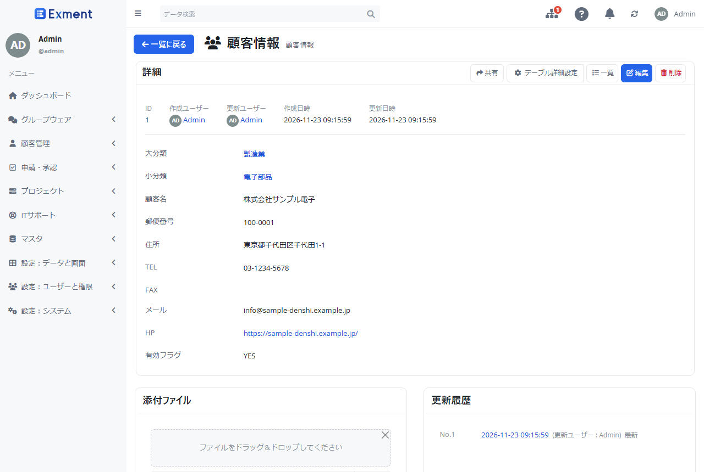
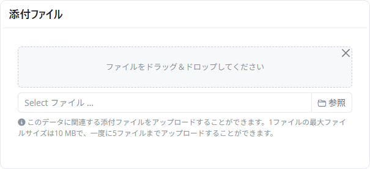
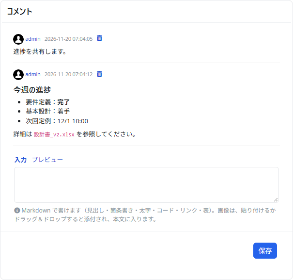
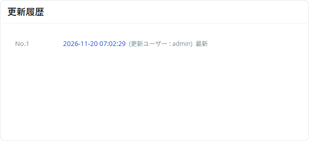
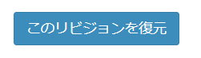
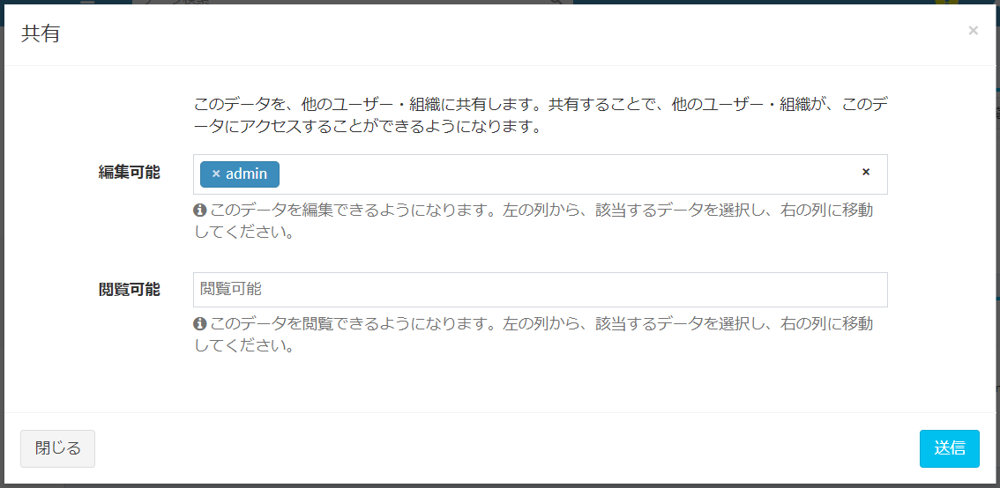
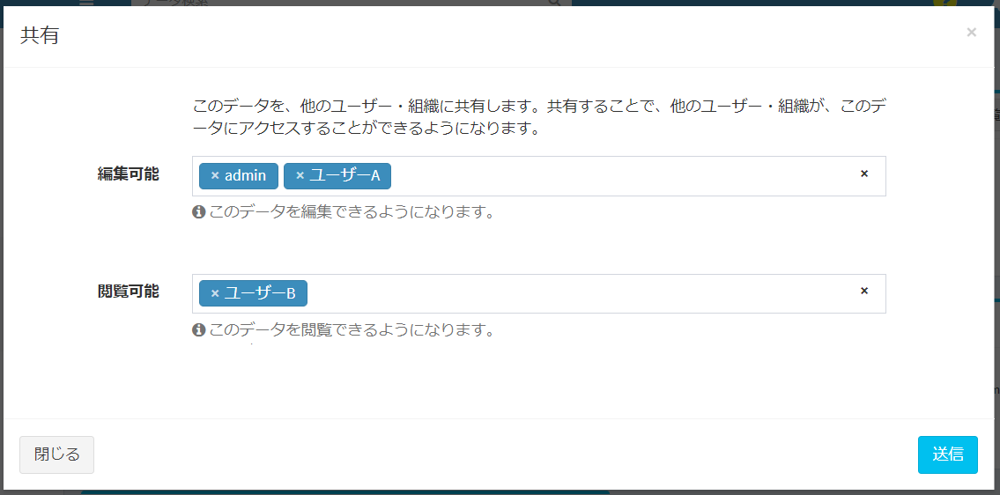

# データ詳細
データ1件の中身を見る画面の説明です。[データ一覧](/ja/data_grid.md)で見たいデータをクリックすると、開きます。  

- データ一覧に出るのは、ビュー設定の[表示列選択](/ja/view?id=表示列選択)で指定した内容です。  
- データ詳細に出るのは、[フォーム優先順位設定](/ja/form#フォーム優先順位設定)の優先順に従って、当てはまったフォームの項目です。  

データ詳細の画面には、次の4種類の情報が出ます。  

- 内容の詳細  
- 添付ファイル  
- コメント  
- 更新履歴  

## 内容の詳細

- データとして登録している内容を、くわしく表示します。

## 一覧に戻る
データの詳細と編集の画面では、見出し（テーブル名）の行の右に、［← 一覧に戻る］ボタンが表示されます。クリックすると、そのテーブルのデータ一覧に戻ります（右上の［一覧］ボタンと同じ行き先です）。

※v7.1.0より利用できます。ボタンの色は、「クラシック」のデザインでは青、「モダン」のデザインでは[サイトスキン](/ja/system_setting?id=サイトスキン)のアクセント色です。

## 添付ファイル
  

データ詳細画面に、ファイルを添付できます。  

1. ［参照］ボタンをクリックして、添付したいファイルを選びます。  
2. ［Upload］ボタンをクリックします。  

添付したファイルは、［削除］ボタンで削除できます。

#### 差し替えと前の版（v7.2.0以降）
添付したファイルの横の［差し替え］を押してファイルを選ぶと、新しいファイルに差し替えられます。  
前のファイルは「前の版」として残ります。差し替えたファイルの横に出る「版 2」などの表示を押すと、前の版の一覧が出て、そこから開けます。  

- 前の版は、1つの添付ファイルに10個まで残ります。超えた分は、古いものから消えます。数は、`.env` の `EXMENT_DOCUMENT_VERSION_LIMIT` で変えられます。  
- 添付ファイルを削除すると、その前の版も一緒に消えます。  

## コメント
  

- コメントを入力して［送信］ボタンをクリックすると、データにコメントを付けられます。
- コメントした日時とユーザー名は、自動で入ります。
- コメントは、［削除］ボタンで削除できます。  

※削除できるのは、ログインしているユーザー自身のコメントだけです。  
画像の例では、user としてログインしているため、admin のコメントには［削除］ボタンが出ていません。

#### Markdown と画像（v7.1.0以降）
コメントは Markdown で書けます。見出し・箇条書き・太字・コード・リンク・表（GitHub Flavored Markdown）が使えます。改行は、そのまま改行として表示されます。

- コメント入力欄の［入力］［プレビュー］で、表示を確認してから送信できます。
- 画像（PNG・JPEG・GIF・WebP）は、入力欄に貼り付けるか、ドラッグ＆ドロップすると、データの添付ファイルとしてアップロードされ、コメントに `` の形で入ります。大きさの上限は、初期値で10MBです（[設定値](/ja/config?id=コメントに貼り付けられる画像の最大サイズ)で変更できます）。
- 本文（カスタム列「エディタ」）に `)` と書いた画像も、データの詳細画面で画像として表示されます（一覧ではこれまでどおり文字のままです）。APIの「ドキュメント(添付ファイル)の作成」で返される url をそのまま書いても表示されます。

※**v7.1.0に更新する前に書かれたコメントは、これまでどおりの文字のまま表示します**（Markdown として読みません）。更新後に書いたコメントから、Markdown として表示します。  
※コメントに書いた HTML は、HTML としては出さず、文字として表示します。外部サイトへのリンクは、新しいタブで開きます。  
※画像が表示されるのは、ログインしていて、そのファイルが付いているデータを見られるユーザーだけです。SVG の画像と、他のサイトの画像は、コメントでは画像として表示せず、リンクとして表示します。  
※APIでコメントを一覧・追加・削除することもできます。詳細は[APIリファレンス](https://exment.net/reference/ja/webapi.html)をご確認ください。

#### メンション（＠でメンバーに通知）
コメントの中でユーザーを指定して、そのユーザーに通知できます。

- コメント入力欄で「@」（全角の「＠」も可）を入力すると、ユーザーの候補が表示されます。  
続けて文字を入力すると候補が絞り込まれます。候補をクリック（または↑↓キーで選択してEnterキー）すると、「@ユーザーコード」が入力されます。  
- コメントを送信すると、指定したユーザーに、システム内アラート（ページ右上の通知アイコン）で「コメントであなたが呼ばれました：（データの見出し）」という通知が送られます。通知の本文には、コメントの内容が表示されます。

※「@」は、行の先頭か、空白の直後に入力した場合に候補が表示されます。  
※候補に表示されるのは、ユーザーコードが登録されているユーザーです。一度に表示される候補は最大20件です（設定値 `EXMENT_API_DEFAULT_DATA_COUNT` に従います）。  
※通知が送られるのは、そのデータを閲覧する権限のあるユーザーのみです。また、自分自身を指定しても通知は送られません。

## 更新履歴

  

- 更新履歴が出るのは、テーブル設定の[データ変更履歴使用](/ja/table?id=データ変更履歴使用)をYESにしているときです。
- データを編集すると、編集した日時とユーザー名が自動で入ります。
- 更新履歴の日時をクリックすると、リビジョン画面に移ります。

#### リビジョン
  
- 「リビジョン選択」で、履歴の中から、比べたいデータを選びます。
- 左側に「選択した履歴データ」、右側に「最新のデータ」が出ます。内容が違う項目には、背景色が付きます。
- ページの下にある［このリビジョンを復元］ボタンをクリックすると、選んだ履歴の内容に戻ります。

  

## データ共有

> データ共有設定については、はじめに[Exmentにおける役割・権限の概要](/ja/permission)のページをご確認ください。

保存しているデータを、ほかのユーザー・組織に共有します。  
※[役割グループ設定](/ja/role_group)で、「データ共有」権限があるときだけ使えます。

#### 共有方法
1. データ詳細画面の［共有］ボタンをクリックします。
  

2. データ共有のダイアログが出ます。
  

3. 共有したいユーザーを追加して、［送信］をクリックします。これで共有できます。  
  

※システム管理者が、[通知設定](/ja/notify)で「データ新規作成・更新・共有・コメント」の通知を設定しておくと、共有したユーザーに通知できます。
