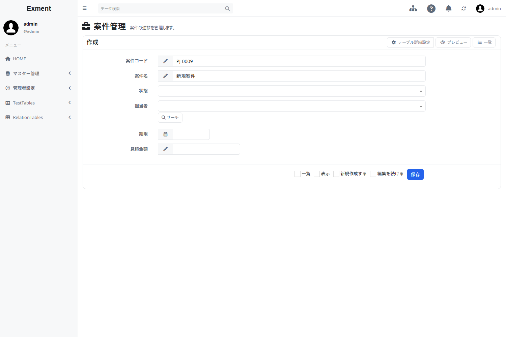
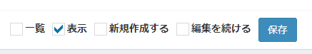

# データ登録
データを新しく作るとき・編集するときに使う、フォーム画面の説明です。

- フォームに出る項目は、[カスタム列設定](/ja/column.md)、カスタムフォーム、[関連テーブル](/ja/relation.md)の設定で決まります。  
- 思ったとおりに出ていないときは、上のページで設定を直してください。  

## 機能一覧
  

##### ［ページ移動］ボタン  
今表示しているカスタムテーブルの、設定を変える画面に切り替えます。

##### ［一覧］ボタン
データ一覧画面に切り替えます。  
※v7.1.0以降は、見出しの行の右の［← 一覧に戻る］ボタンからも戻れます。くわしくは[一覧に戻る](/ja/data_details?id=一覧に戻る)をご覧ください。

##### ［表示］ボタン  
データを閲覧する画面に切り替えます。

##### ［削除］ボタン
表示しているデータを削除します。  
※削除したデータは、[削除済データ](/ja/deleted_data)から元に戻せます。

##### フォーム項目  
データの値を変えます。  
出る項目は、[カスタム列設定](/ja/column.md)、カスタムフォーム、[関連テーブル](/ja/relation.md)の設定で決まります。  
思ったとおりに出ていないときは、上のページで設定を直してください。  

##### 子テーブル  
[関連テーブル](/ja/relation.md)で、1:nまたはn:nの設定をしていると、関連テーブルに設定したテーブルのデータも、一緒に追加・変更できます。くわしくは、下の「子テーブル」をご覧ください。

## 機能詳細  

### 子テーブル
[関連テーブル](/ja/relation.md)で、1:nまたはn:nの設定をしていると、関連テーブルに設定したテーブルのデータも、一緒に追加・変更できます。  
例：表示しているテーブルが「契約」、子テーブルが「契約明細」の場合、請求日や顧客情報を登録するのと同時に、その契約の明細データも追加・変更できます。  
  
  
※子テーブルのデータの表示のしかたは、「通常フォーム形式」と「テーブル形式」の2種類です。  
形式は、カスタムフォーム画面で切り替えます。  
  
##### ［新規］ボタン  
子テーブルのデータを1件追加します。  
  
##### ［削除］ボタン  
選んだ子テーブルのデータを削除します。  

### データ保存後の遷移先
  
保存ボタンの左に、チェックボックスが出ます。  
チェックを入れると、データを保存したあとに開く画面が変わります。

| チェック | 保存のあとに開く画面 |
|---|---|
| 一覧 | そのデータの一覧画面（チェックを1つも入れないときも、一覧画面です） |
| 表示 | そのデータの詳細画面 |
| 新規作成する | そのテーブルのデータの、新規作成画面 |
| 編集する | そのデータの編集画面（もう一度表示します） |

- 「新規作成する」「編集する」にチェックを入れて保存すると、次にフォームを表示したときも、はじめから「新規作成する」「編集する」にチェックが入っています。  
- v3.9.1より、チェックの既定値を指定できるようになりました。くわしくは[データ保存後の既定リダイレクト先](/ja/system_setting#データ保存後の既定リダイレクト先)をご覧ください。
