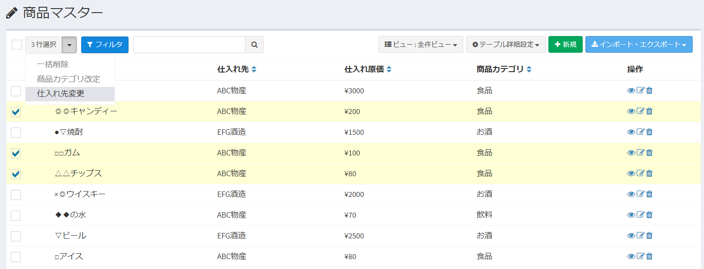
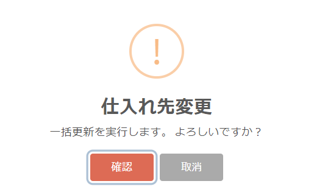

# データ一覧
テーブルに保存しているデータを、一覧で見る画面の説明です。

- 一覧に出るのは、自分が作成したデータと、自分に権限が割り当てられているデータです。  
- 「すべてのデータを編集・閲覧する権限」をユーザーや組織に登録すると、上の条件に関係なく、すべてのデータが出ます。権限について、くわしくは[役割・権限](/ja/permission.md)をご覧ください。

## 機能一覧
  

※データ一覧では、表示する列の切り替え・列固定・グループ化・その場編集などもできます。くわしくは[データ一覧の操作ツール](/ja/data_grid_tools.md)をご覧ください。

##### 自動更新  
右上にある5つの操作アイコンの一番右です。選んだ間隔（オフ・30秒・1分・5分）で、一覧を読み込み直します。くわしくは[データ一覧の操作ツール](/ja/data_grid_tools.md)をご覧ください。

##### フィルタ  
今表示しているデータ一覧を絞り込みます。くわしくは、下の「フィルタ」をご覧ください。

##### ビュー  
今表示しているカスタムテーブルの、ビューのボタンです。くわしくは、下の「ビュー」をご覧ください。  

##### インポート・エクスポート  
今表示しているカスタムテーブルのデータをエクスポートする、またはデータをインポートするボタンです。くわしくは[データインポート・エクスポート](/ja/data_import_export.md)をご覧ください。

##### 一覧  
データ一覧です。  
出る行は、ユーザーの権限、ビューの絞り込み設定、一覧画面のフィルタ設定で絞り込まれます。  
出る列は、ビューの列設定で変わります。  

##### 一括更新  
選んだ複数の行のデータを、まとめて更新します。  
先に[一括更新設定](/ja/mass_update.md)で、一括更新する列と更新値を設定しておく必要があります。

## 機能詳細  

### フィルタ
今表示しているデータ一覧を絞り込みます。  
  
［フィルタ］ボタンをクリックすると、絞り込みの項目が出ます。  

- 絞り込みに使える項目は、次のように決まります。  
  - ビューで「フィルタ」項目を指定している場合（[カスタムビュー](/ja/view.md)の「ビューの「フィルタ」項目指定」）は、その項目だけです。  
  - 指定していない場合は、システム項目（ID・作成日時・更新日時など。ただし[システム設定](/ja/system_setting.md)の「データ一覧のフィルタ非表示」でチェックしたものを除く）、子テーブルの親テーブル、ワークフローを設定しているテーブルのワークフローの状態、コメントを使用している場合のコメント、およびカスタム列設定で「検索インデックス」をONにしている列です。
[カスタム列設定のマニュアルはこちら](/ja/column.md)

- それぞれの項目にキーワードを入力して［サーチ］ボタンをクリックすると、当てはまる行だけが出ます。  

- フィルタを元に戻すには、［リセット］ボタンをクリックしてください。

- 管理者以外のユーザーが絞り込むときは、そのユーザーが権限を持つデータの中から絞り込みます。権限を持たないデータは、フィルタの対象になりません。  

- フィルタは、表示しているビューの絞り込み条件に、追加でかかります。

- テキスト系の列では、入力したキーワードが値の先頭に一致するか（前方一致）、一部に一致するか（部分一致）は、[システム設定](/ja/system_setting.md?id=データ検索方法)の「データ検索方法」に従います。初期値は前方一致です。

>選択肢として出る項目のうち、リレーションの設定がある項目は、[見出し表示列設定](/ja/table#見出し表示列設定)で文言を変えられます。

### ビュー
今表示しているカスタムテーブルの、ビューのボタンです。  
ボタンには、今表示しているビューの名前が出ます。  
クリックすると、ビューのメニューが出ます。
  

##### システムビュー  
システムで登録しているビューの一覧が出ます。  
項目をクリックすると、そのビューに切り替わります。

##### 設定 - 現在のビュー設定変更  
今表示しているビューの設定を変えます。  
項目をクリックすると、そのビューの設定変更画面に切り替わります。  
※テーブルの管理者権限を持つユーザーにだけ、この項目が出ます。  

##### 設定 - ビュー新規作成  
ビューを新しく作ります。  
項目をクリックすると、ビューの新規作成画面に切り替わります。  
※テーブルの管理者権限を持つユーザーにだけ、この項目が出ます。  

### 一括更新
選んだ複数のデータを、まとめて更新します。  
各行の左にあるチェックボックスで行を選ぶと、左上に、選んでいる行数と ▼ のアイコンが出ます。
  

- ▼ のアイコンをクリックすると、一括削除と、作成済みの一括更新設定が、選択肢として出ます。  

- 更新したい内容の選択肢をクリックすると、一括更新してよいかを確かめるメッセージが出ます。確認ボタンをクリックしてください。[一括更新設定](/ja/mass_update.md)で指定している列が、更新値に変わります。
  