# データインポート・エクスポート
テーブルのデータを、ファイル（csv・xlsx）に出す（エクスポート）、ファイルから入れる（インポート）ための画面の説明です。

| したいこと | 見るところ |
|---|---|
| データをファイルに出す（すべての列） | [データエクスポート](/ja/data_import_export?id=データエクスポート) |
| 今見ているビューの形で、ファイルに出す | 「データエクスポート(ビュー)」 |
| ファイルからデータを入れる | 「データインポート」 |
| コマンドでインポート・エクスポートする | [コマンドによるデータインポート・エクスポート](/ja/data_cmd_import_export) |
| 大量のデータを、コマンドでまとめて入れる | [大量データ一括投入](/ja/data_bulk_insert) |

## データエクスポート・インポート機能の種類
- エクスポート・インポートの機能は、今は次の種類があります。
    - エクスポート  
    保存しているテーブルのデータを、すべての列についてエクスポート（出力）します。  

    - エクスポート(ビュー)  
    今表示しているビューの形で、テーブルのデータをエクスポート（出力）します。  

    - インポート  
    csv、xlsxのファイルから、テーブルのデータをインポート（入力）します。  

- テーブルのデータ一覧画面で［インポート・エクスポート］ボタンをクリックすると、次のメニューが出ます。
  

>使わない項目は、[設定値](/ja/config#インポート・エクスポート)で、出さないようにできます。

## データエクスポート
テーブルのデータを、ファイルにエクスポート（出力）します。  
ファイルの形式は、csv、xlsx(推奨)です。  

### 操作方法
- データ一覧画面を表示します。
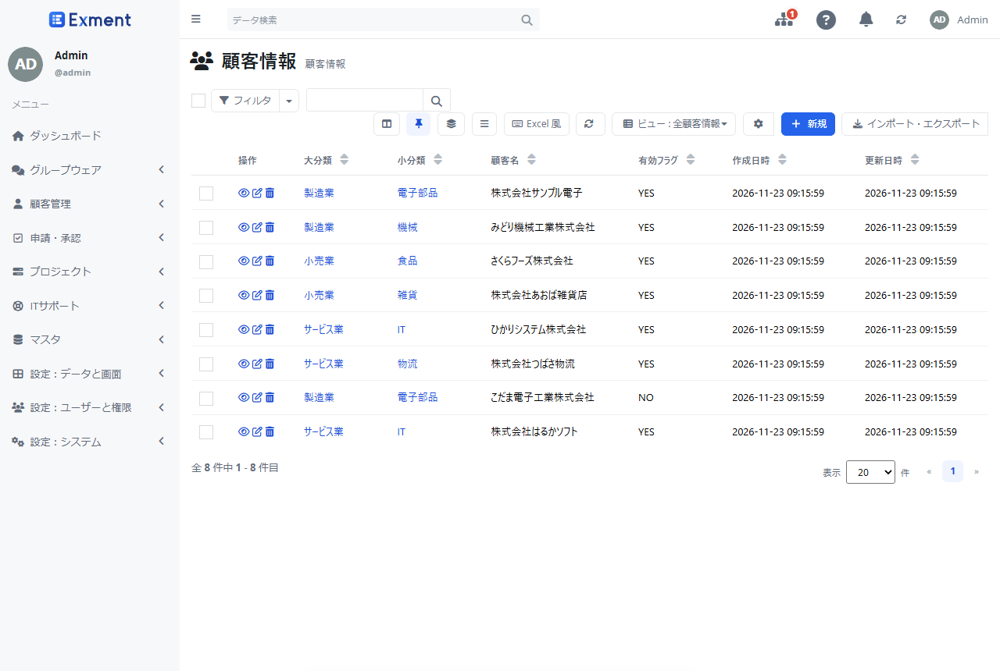  

- ページ右上に［インポート・エクスポート］ボタンが表示されるので、クリックします。  
  

- メニューが表示されるので、出力したい項目を選択してください。  
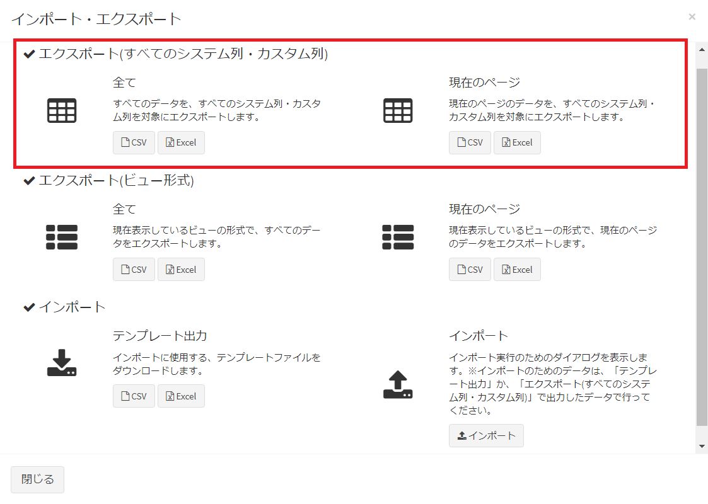  
    - 全て  
    そのテーブルの全データを出力します。  
    ※ただし、**ログインユーザーが権限のないデータは出力されません。**  
    
    - 現在のページ  
    今開いているページのデータ一覧を出力します。

    - 全件(コメント付き)  
    そのテーブルの全データと、それぞれのデータのコメントを出力します。  
    コメントは、Excel形式ではシート「comment」に、CSV形式ではファイル「comment」に出力されます。  
    ※カスタムテーブル設定の「コメント使用」がYESのテーブルでだけ出ます。  
    ※コメントの出力は、見るためのものです。インポートのとき、「comment」のシート(ファイル)は取り込まれません。

- ［CSV］または［Excel］ボタンをクリックすると、データがファイルでダウンロードされます。  
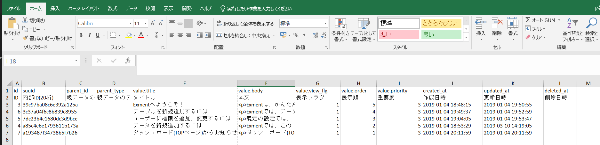

### 出力項目一覧
##### ID  
データを登録したときに、自動で連番が付く、正の整数です。

##### 内部ID(20桁)
データを登録したときに、自動で付く、20桁の英数字です。画面にはあまり出ません。データの移行などで使います。  

##### 親データのID  
そのテーブルを、リレーション設定の「1:n」のnとして登録しているときの、親テーブルのidです。リレーション設定がないときは、空欄です。  

##### 親データのテーブル名  
そのテーブルを、リレーション設定の「1:n」のnとして登録しているときの、親テーブル名（英数字）です。リレーション設定がないときは、空欄です。  

##### カスタム列一覧  
カスタム列として登録している値が、列ごとに出力されます。  

##### 作成日時、更新日時、削除日時  
データを作成した日時、更新した日時、削除した日時が、それぞれ出力されます。  

### 1:nリレーションのエクスポート
- リレーション設定の「1:n」の「1」として登録しているテーブルでデータエクスポートをすると、**リレーションしている「n」のデータ一覧も、同時にエクスポートされます。**  

例：「契約情報」を1、「契約明細情報」をnとして、リレーション設定を保存している場合  
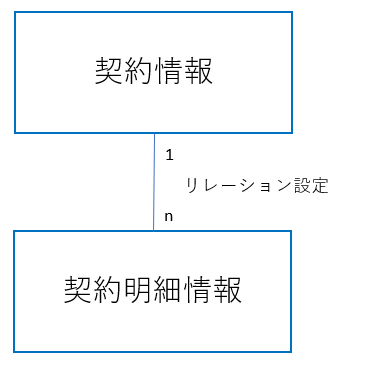  
- 「契約情報」画面で、データのエクスポートを実行した場合（※画像の「顧客」はテストデータです）  
  
- 「契約情報」と、「契約明細情報」のデータの両方が出力されます。
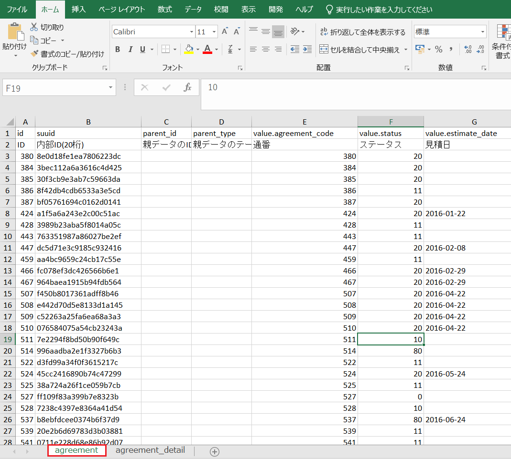  
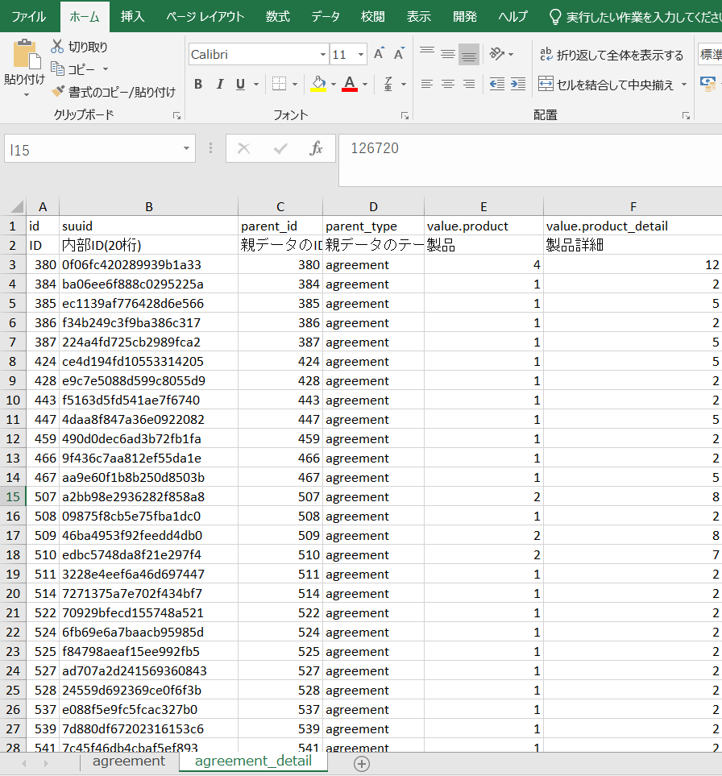  
- 「n」のデータ一覧の「親データのID」「親データのテーブル名」には、リレーション先の親テーブルのID、テーブル名が出力されます。

### n:nリレーションのエクスポート
- リレーション設定の「n:n」の、大元のnとして登録しているテーブルでデータエクスポートをすると、**リレーション先の「n」との関連情報も、同時にエクスポートされます。**  

例：「組織情報」と「ユーザー情報」をn:nとして、リレーション設定を保存している場合  
  
- 「組織情報」画面で、データのエクスポートを実行した場合、  
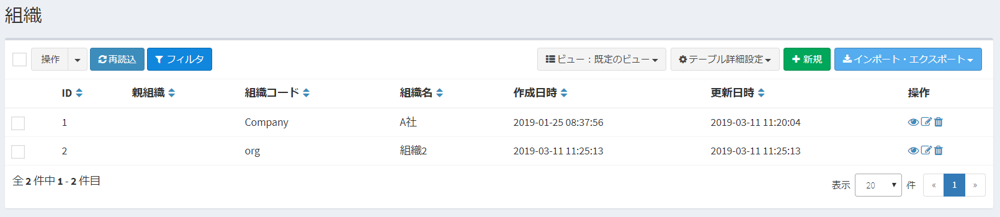  
- 「組織情報」のデータが出力されます。さらに、「ユーザー情報」と「組織情報」を関連付けるデータも出力されます。
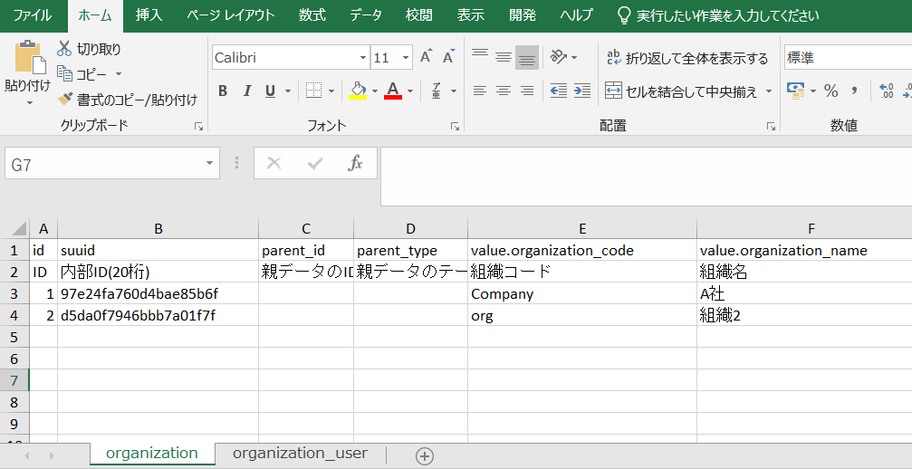  
  
- 「parent_id」には親となる組織情報のID、「child_id」には子となるユーザー情報のIDが出ます。  

### その他特記事項
- CSV形式、Excel形式のどちらも、1行目が列名（英数字）、2行目が列表示名（日本語）です。CSV形式でも、ヘッダーは2行です。ご了承ください。  
- CSV形式で出力したファイルは、文字コードがUTF-8、改行コードがLF、BOMなしです。  
- リレーション設定によって複数のデータが出力されるときは、Excel形式では複数のシートになり、CSV形式では複数のcsvファイルをzipにまとめます。  

### エクスポート時の、出力値の変更
エクスポートのとき、「親データのID」、「選択肢 (他のテーブルの値一覧から選択)」、「ユーザー」、「組織」の列には、ふつうは参照先のテーブルのデータのIDが出力されます。これを、**参照先のカスタム列の値にすることができます。**  
その手順を、下に書きます。  

#### parent_id(親データのID)の場合
1. リレーション設定画面を開きます。

2. 「エクスポート時のキー列」に、エクスポートのときに出力したいカスタム列を設定して、保存します。  

3. そのあとデータをエクスポートすると、出力値が、idのかわりに、選んだカスタム列の値になります。 

※通常時
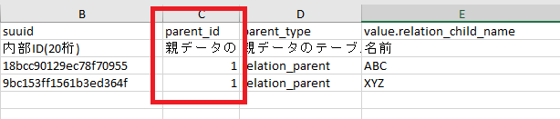  
  
※「エクスポート時のキー列」指定時
  

#### 「選択肢 (他のテーブルの値一覧から選択)」、「ユーザー」、「組織」の場合
1. その列の、カスタム列設定画面を開きます。

2. 「エクスポート時のキー列」に、エクスポートのときに出力したいカスタム列を設定して、保存します。  

3. そのあと参照元のテーブルでデータをエクスポートすると、出力値が、idのかわりに、選んだカスタム列の値になります。 

※通常時
  
  
※「エクスポート時のキー列」指定時
  

## データエクスポート(ビュー)
テーブルのデータを、今表示しているビューの形で、ファイルにエクスポート（出力）します。  
ファイルの形式は、csv、xlsx(推奨)です。  

### 操作方法
- データ一覧画面を表示します。
  

- ページ右上に［インポート・エクスポート］ボタンが表示されるので、クリックします。  
  

- メニューが表示されるので、出力したい項目を選択してください。
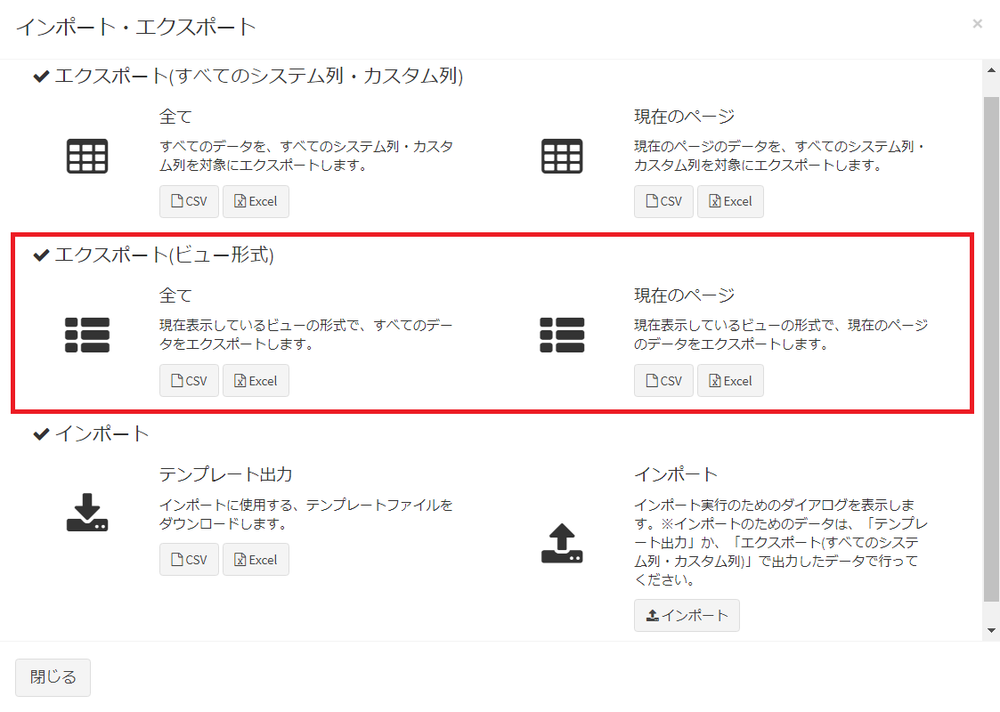  
    - 全て  
    そのテーブルの全データを出力します。  
    ※ただし、**ログインユーザーが権限のないデータは出力されません。**  

    - 現在のページ  
    今開いているページのデータ一覧を出力します。

- ［CSV］または［Excel］ボタンをクリックすると、データがファイルでダウンロードされます。今表示しているビューの項目が、そのまま出力されます。  
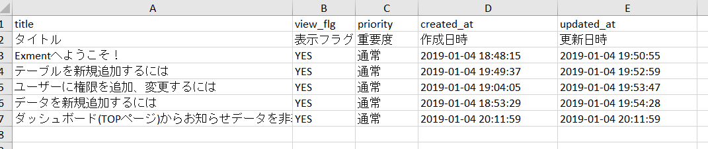

## データインポート
ファイルから、テーブルのデータをインポート（入力）します。  
ファイルの形式は、csv、xlsx(推奨)です。データは、Exmentが決めた形式に合わせて、先に作っておく必要があります。

流れは、次のとおりです。

1. テンプレートを出力する（「テンプレート出力」）  
2. テンプレートに、取り込みたいデータを書く（「取込項目一覧」）  
3. インポートを実行する（「データインポート実行」）

> 今は、パフォーマンスの都合で、1度にインポートできる件数を5000件までにしています。  
5000件を超えるデータを1度に登録するときは、[大量データ投入](/ja/data_bulk_insert)をご検討ください。

### 操作方法

#### テンプレート出力
データを取り込むための、テンプレートのファイルを出力します。

- データ一覧画面を表示します。
  

- ページ右上に［インポート・エクスポート］ボタンが表示されるので、クリックします。  
  

- インポートのテンプレート出力の中から、［CSV］または［Excel］をクリックします。
  

- データ取り込み用のCSVまたはExcelファイルがダウンロードされます。  
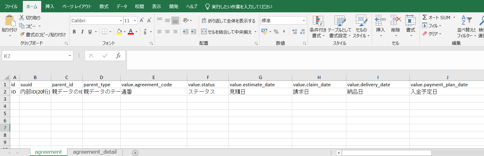  
※ファイルの形式は、「エクスポート」で出力したときと同じです。  
テンプレートは、データが0件で出力されます。

- 出力したテンプレートに、取り込みたいデータを書いてください。

### 取込項目一覧
##### ID  
データを登録したときに、自動で連番が付く、正の整数です。  
取り込むときにこのIDを自分で決めたいときだけ、書いてください。  
決めなくてよいときは、空欄にしてください。取り込むときに、システムが自動で値を入れます。  

##### 内部ID(20桁)  
データを登録したときに、自動で付く、20桁の英数字です。画面にはあまり出ません。  
取り込むときにこの内部IDを自分で決めたいときだけ、書いてください。  
決めなくてよいときは、空欄にしてください。システムが自動で値を入れます。  

##### 親データのID  
ふつうは、空欄にします。  
取り込むテーブルを、リレーション設定の「1:n」のnとして登録しているときは、親テーブルのidを入力してください。  
  
※はじめの設定では、親テーブルのデータのIDを指定しますが、**カスタム列を指定して取り込むこともできます**。くわしくは「[別テーブルのデータの指定方法変更](#別テーブルのデータの指定方法変更)」をご覧ください。  

##### 親データのテーブル名  
ふつうは、空欄にします。  
そのテーブルを、リレーション設定の「1:n」のnとして登録しているときは、親テーブル名（英数字）を入力します。  
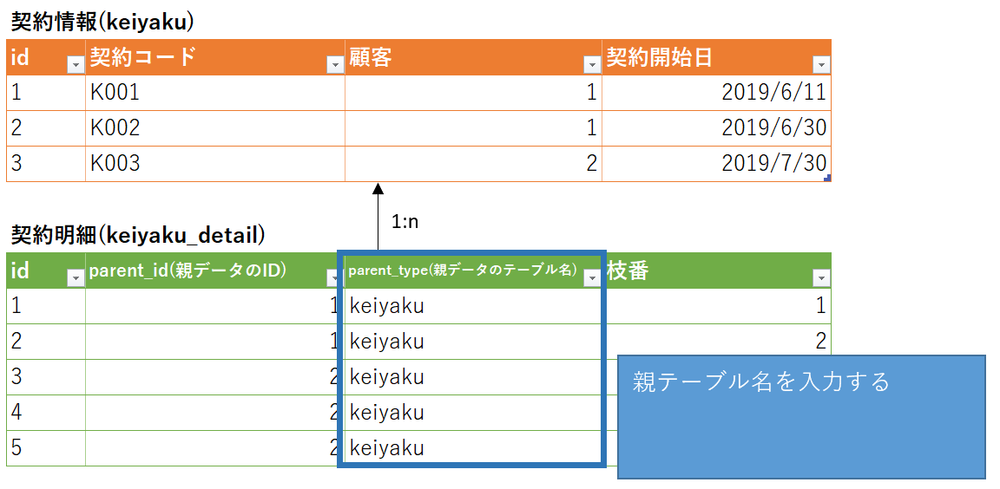  

##### カスタム列一覧  
カスタム列として登録する値を書いてください。  
※列の種類によって、値の書き方が違います。下の「[インポート時のカスタム列入力方法](#インポート時のカスタム列入力方法)」をご確認ください。

##### 作成日時、更新日時、削除日時  
ふつうは、空欄にします。  
データを作成した日時、更新した日時、削除した日時を自分で決めたいときだけ、書いてください。  
空欄のときは、取り込むときに、システムが自動で値を入れます。

### データインポート実行
画面から、インポートを実行します。

- データ一覧画面を表示します。
  

- ページ右上に［インポート・エクスポート］ボタンが表示されるので、クリックします。  
  

- 「インポート(CSV)」または「インポート(Excel)」の中から、「インポート」をクリックします。
  

- インポートダイアログが出ます。  
  

- 「インポートファイル」で、データを書いた取込用テンプレートファイルを選びます。  

- 「主キー」で、取り込むときに新規か更新かを見分けるための主キーを選びます。  
くわしくは、下の「主キーの種類」をご確認ください。

- 設定できたら、ダイアログの［送信］をクリックします。

- 取込データに問題があったときは、「エラーメッセージ」に、ヘッダーより後の行番号と、エラーの内容が出ます。
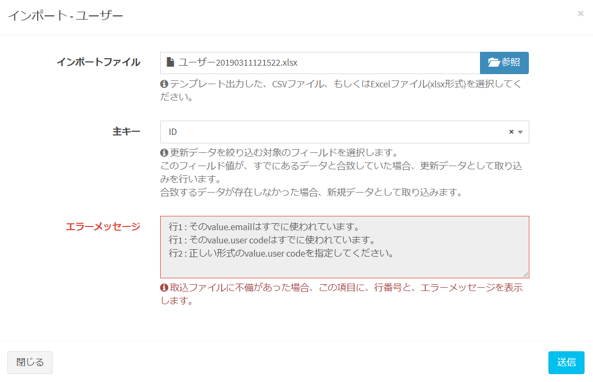
※ カスタム列の設定で「[必須](/ja/column?id=記入項目の詳細共通)」にしている項目に値が入っていないと、インポートは成功しません。取込用テンプレートファイルに入力もれがないか、ご確認ください。
- 取り込みが正しく終わると、ダイアログが閉じて、データが読み込み直されます。

### 新規追加データ、更新データの判定方法
取り込むとき、1行ごとに、新しく追加するデータか、今あるデータを更新するデータかを見分けます。  
その見分け方を書きます。

- 取り込むときの画面で、見分けるために使う「主キー」の列を指定します。（ここでは「ID」とします）  
※主キーは、取り込むときに選びます。下の「主キーの種類」をご覧ください

- 取り込むとき、システムは、取込データのID列の値を見ます。
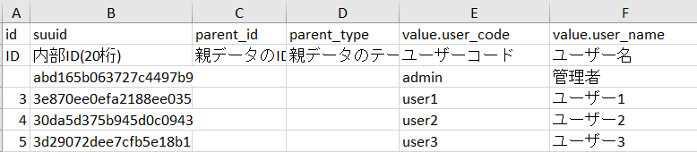  

    - 取込データのIDが空欄のときは、新しく追加するデータとして扱います。
  

    - 取込データのIDに値があるときは、すでに登録しているデータの中に、同じIDのデータがあるかを探します。  
  
    同じIDのデータがあれば、そのデータを、取込データの内容で更新します。  
    なければ、取込データを新しく追加します。そのとき、IDは取込データのIDになります。  

### 主キーの種類

- ##### ID(おすすめ)  
システムが自動で付ける整数です。ほかのテーブルとのリレーションなどにも使います。  
手軽で、先に値を入れておきやすい項目です。ただし、自動で連番を付ける項目のため、環境から環境へ移行するときに、思わぬズレが出ることがあります。

- ##### 内部ID(20桁)  
データを保存するときに、システムが自動で付ける20桁の英数字です。  
環境から環境へ移行するときは、更新するデータをはっきりさせるため、この内部IDを使うことをおすすめします。  

- ##### ユニーク(一意)列  
カスタム列の設定で「ユニーク(一意)」にしている列は、主キーとして選べます。(例：Eメールアドレス、ユーザーコード)    

### インポート時のカスタム列入力方法
カスタム列の種類によって、インポートのときの値の書き方が違います。  
下の内容をご確認ください。

##### 選択肢 (値・見出しを登録)  
データベースに登録する「値」、または画面に出ている「見出し」を入力してください。  

##### 選択肢 (他のテーブルの値一覧から選択)、ユーザー、組織  
**参照先のテーブルのID**を入力してください。  
  
※はじめの設定では、参照先のテーブルのデータのIDを指定しますが、**カスタム列を指定して取り込むこともできます**。くわしくは「[別テーブルのデータの指定方法変更](#別テーブルのデータの指定方法変更)」をご覧ください。  

##### YES/NO  
「YES」または「NO」、もしくは「1」または「0」を入力してください。  

##### 2値の選択  
カスタム列画面で入力した、「2値の選択」の表示または値を入力してください。  
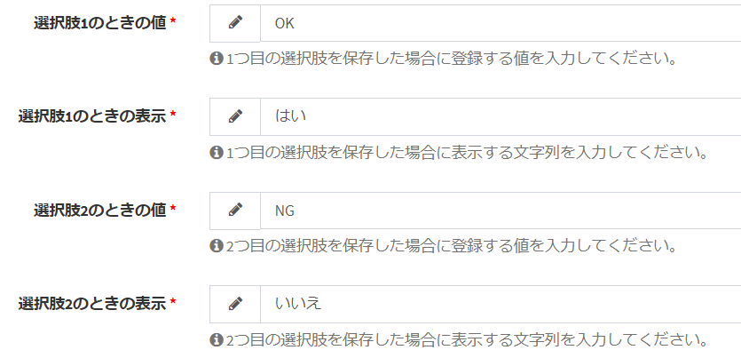  

##### それ以外  
登録する値をそのまま入力してください。  

### 別テーブルのデータの指定方法変更
インポートのとき、「親データのID」、「選択肢 (他のテーブルの値一覧から選択)」、「ユーザー」、「組織」の列には、ふつうは参照先のテーブルのデータのIDを書きます。これを、**カスタム列の値で指定して取り込むことができます。**  
その手順を、下に書きます。  

#### parent_id(親データのID)の場合
1. リレーション設定画面を開きます。

2. 「インポート時のキー列」に、インポートのときに値を探すのに使うカスタム列を設定して、保存します。  
※指定できるのは、カスタム列設定で「検索インデックス」に指定している列だけです。  
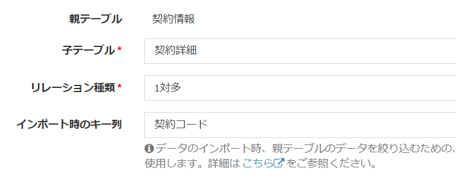

3. そのあと、子テーブルで取込用のExcelファイルをダウンロードします。「##setting##」シートに、子テーブル名、「parent_id」、指定した親テーブルのカスタム列名が出力されています。  
  

4. このシートの内容は変えずに、子テーブルのシートに、取込データを書いてください。  
そのとき、「parent_id」列には、**インポート時のキー列**で登録したカスタム列の値を書きます。  
下の例では、親テーブル「契約情報」の、「契約コード」の値を入力します。
  
  

5. そのあと、インポートを実行します。

#### 「選択肢 (他のテーブルの値一覧から選択)」、「ユーザー」、「組織」の場合
1. その列の、カスタム列設定画面を開きます。

2. 「インポート時のキー列」に、インポートのときに値を探すのに使うカスタム列を設定して、保存します。  
※指定できるのは、カスタム列設定で「検索インデックス」に指定している列だけです。  

3. そのあと、参照元のテーブルで取込用のExcelファイルをダウンロードします。「##setting##」シートに、参照元のテーブル名、「value.」 + 参照元のカスタム列名、参照先のカスタム列名が出力されています。  
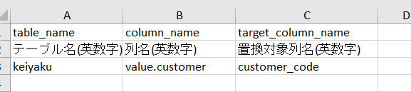  

4. このシートの内容は変えずに、参照元のテーブルのシートに、取込データを書いてください。  
そのとき、参照元のカスタム列には、**インポート時のキー列**で登録した、参照先のカスタム列の値を書きます。  
下の例では、参照先のテーブル「顧客マスター」の、「顧客コード」の値を入力します。
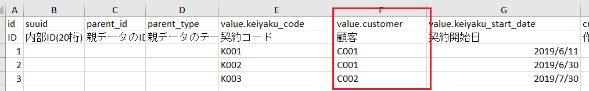  
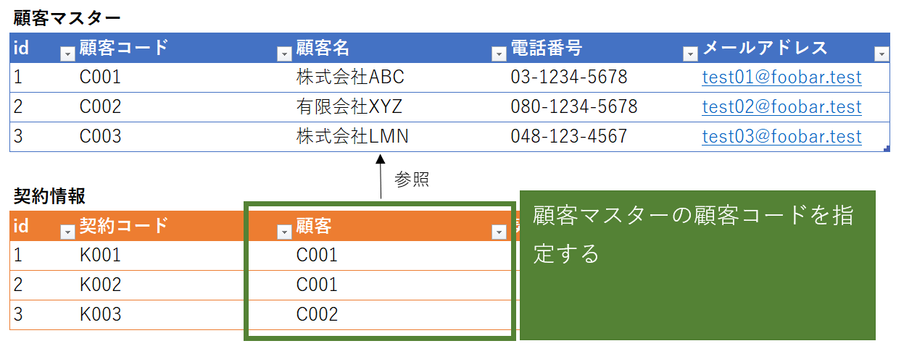  

5. そのあと、インポートを実行します。

#### 注意点
- Excel形式での取り込みだけに対応しています。CSV形式には、今は対応していません。

