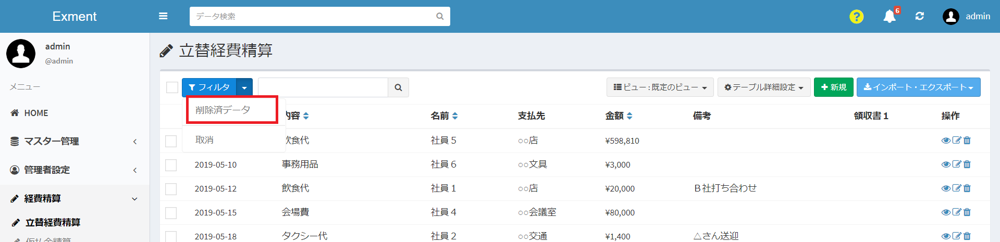
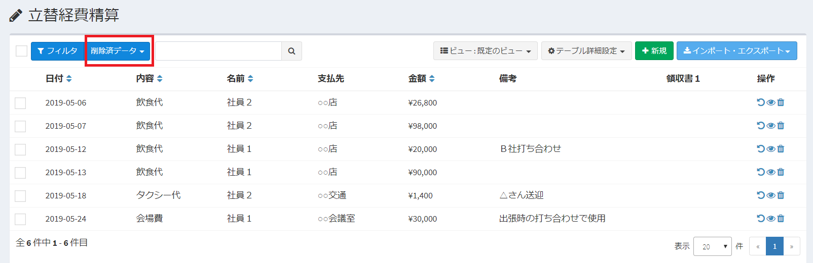
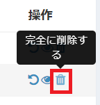

# 削除済データ
削除したデータを一覧で見て、元に戻す（復元）・完全に削除する、の操作をする画面の説明です。

- 削除済データを表示できるのは、削除データの表示権限を持つユーザーだけです。
- 編集権限のあるユーザーは、データの復元や完全削除ができます。  

※権限について、くわしくは[役割グループ](/ja/role_group.md)をご覧ください。

## 一覧表示
  

1. データ一覧画面の左上［フィルタ］の右横にある▼マークから、「削除済データ」を選びます。
2. 表示が変わり、そのテーブルの削除済データが一覧で出ます。

  

## 詳細表示

- 削除済データ一覧にあるデータは、詳細を表示できます。  
- 表示したいデータの行、または操作列にある表示アイコンをクリックしてください。

  

- データ詳細画面では、削除ユーザーと削除日時を確かめられます。

  

## 復元

- 削除済データは、データ一覧画面へ戻せます（復元）。
- 復元の方法は３つあります。
    - データ詳細画面にある［復元］ボタンを使う。
      
    - 削除済データ一覧画面で、操作列にある［復元］アイコンを使う。
      
    - 削除済データ一覧画面で、復元したいデータにチェックを入れ、削除済データ画面の左上にある▼マークから、「復元」を選ぶ。
      

※データを復元できるのは、そのデータの編集権限が付いているユーザーだけです。

## 完全に削除

- 削除済データは、完全に削除できます。完全に削除したデータは、削除済データ一覧からも消えます。
- 完全に削除する方法は３つあります。
    - データ詳細画面にある［完全に削除する］ボタンを使う。
      
    - 削除済データ一覧画面で、操作列にある［完全に削除する］アイコンを使う。
      
    - 削除済データ一覧画面で、完全に削除したいデータにチェックを入れ、削除済データ画面の左上にある▼マークから、「完全に削除する」を選ぶ。
      

※データを完全に削除できるのは、そのデータの編集権限が付いているユーザーだけです。

## データ一覧画面に移動

- 削除済データ一覧の画面で、［削除済データ▼］をクリックして「取消」を選ぶと、そのテーブルのデータ一覧画面に移ります。

  

#### 権限設定
- 削除済データを表示するには、そのデータの表示権限がユーザーに必要です。
- 削除済データを復元する・完全に削除するには、そのデータの編集権限がユーザーに必要です。

※権限の設定については、[役割グループ](/ja/role_group.md)をご覧ください。
