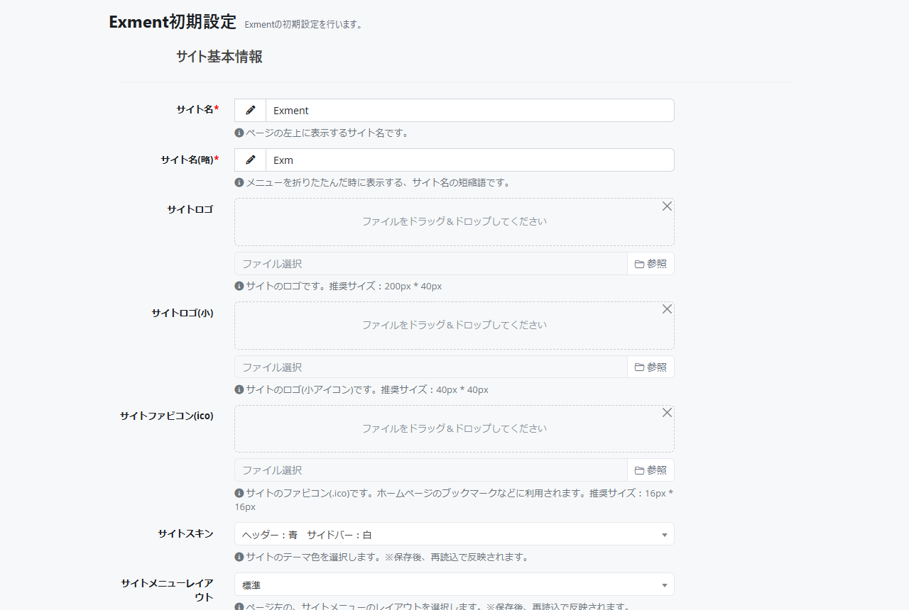
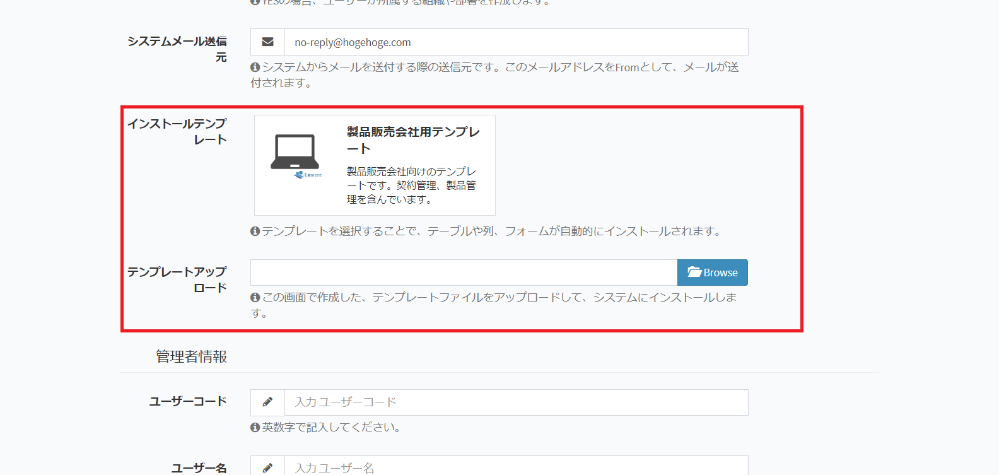

# 初期設定
インストールのあと、最初に行う設定の手順です。サイトの情報と、最初の管理者のログイン ID などを決めます。

手順は、次の 4 つです。

1. Exment のページにアクセスする
2. 初期設定画面で、必要な情報を入力する
3. 使いたいテンプレートを選ぶ
4. 「送信」ボタンを押す

## URLアクセス
Exment のページにアクセスします。  
http(s)://(あなたのサイトURL)  

> ※URL は、「/admin」が付かない標準の設定（v7.2.1 以降に新しくインストールしたサイト）の場合です。`.env` の `ADMIN_ROUTE_PREFIX` に値がある場合（前の版で入れたサイトは「admin」）は、サイトの URL のあとにその値を足してください（例：`http(s)://(ExmentのURL)/admin/oauth/token`）。詳しくは[URLに含む「admin」の変更・削除](/ja/additional_prefix)をご覧ください。

## 初期設定画面
インストールが正しく終わっていると、Exment の初期設定画面が出ます。

システムの設定に必要な情報を入力してください。  
※項目のくわしい説明は、[システム設定](/ja/system_setting)をご覧ください。

## テンプレート設定
Exment には、あらかじめテンプレートが用意されています。  
テンプレートを選ぶと、そのテンプレートに入っているテーブル・列・フォーム・メニュー・権限が、まとめてインストールされます。  
別の Exment でエクスポートしたテンプレートを、この画面からアップロードすることもできます。  
くわしくは、[テンプレート](/ja/template.md)をご覧ください。

一覧には、はじめからシステムに入っているテンプレートと、これまでにインポートしたテンプレートが出ます。  
インストールしたいテンプレートを選んでください。  

## 初期設定完了
必要な項目を入力して「送信」ボタンを押すと、設定が保存され、Exment を使えるようになります。

## その他の追加設定
ここまでの作業で、Exment を使い始められます。ただし、一部の機能を使うには、追加の設定が必要です。  
次のページをご確認ください。  
- [追加設定](/ja/quickstart_more)
