# カスタムフォーム
Exmentの[データフォーム画面](/ja/data_form.md)（データを入力する画面）に出す項目や、その並べ方を決めるページです。項目の配置（ボックスのレイアウト）、隠しフィールド、データ連動設定などを変えられます。  
ここで設定した内容が、各テーブルの[データフォーム画面](/ja/data_form.md)に反映されます。

- 画面の開き方：下の「ページ表示」「フォーム編集」
- 項目の並べ方：下の「カスタムフォームの設定項目」
- ほかのテーブルから選んだデータの値をコピーする：下の「データ連動設定」
- 選んだ値に合わせて、別の選択肢をしぼり込む：下の「関連絞り込み設定」
- 条件によって、使うフォームを切り替える：下の「フォーム優先順位設定」

## ページ表示
- カスタムテーブル一覧で、設定するテーブルにチェックを入れて、右上の「テーブル詳細設定」を押します。  
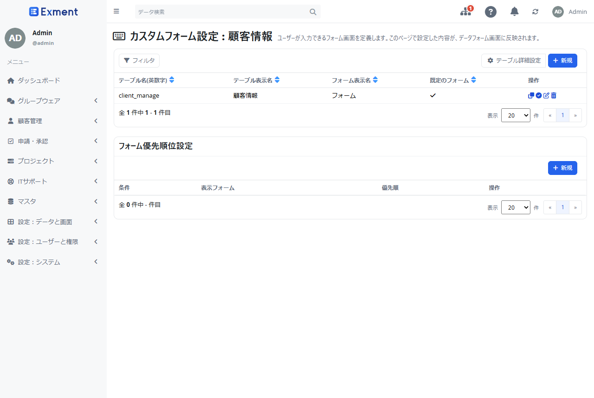
> ※ そのカスタムテーブルのデータ一覧画面やデータ登録画面から、直接開くこともできます。そのときも、右上の「テーブル詳細設定」を押してください。  
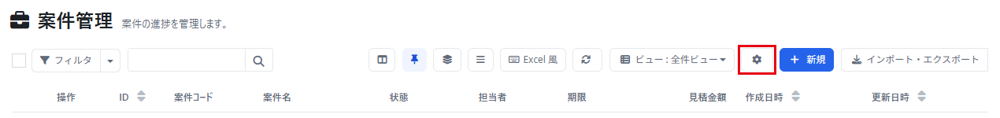
- 出てきたテーブル詳細設定の画面で、フォーム設定のアイコンを押すと、フォームの一覧が出ます。  
※テーブルごとに1つ、はじめから既定のフォームが作られています。
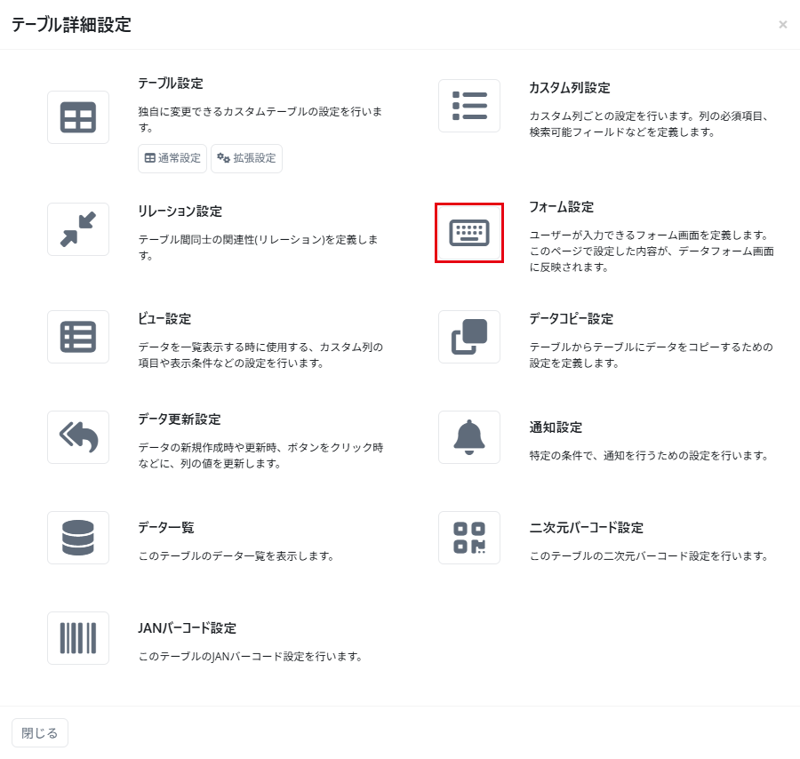
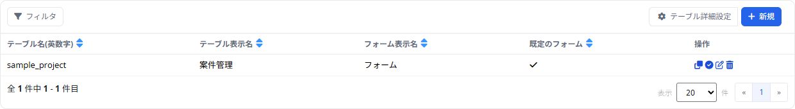

## フォーム編集
フォームを直すときは、そのフォームの［編集］リンクを押します。  
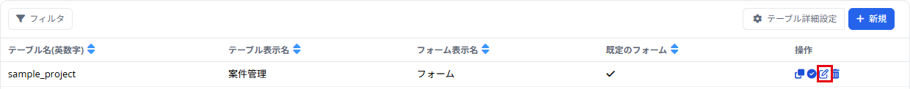

## カスタムフォームの設定項目
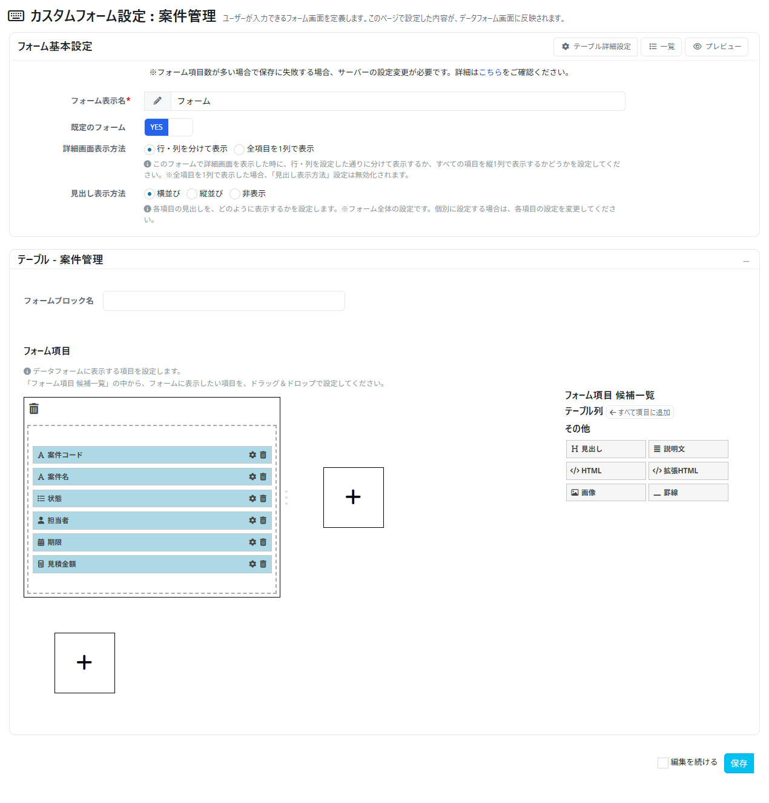

### フォーム基本設定
フォームの基本情報を入力します。

- ##### フォーム表示名
フォームの名称を入力します。  

- ##### 既定のフォーム
このフォームを既定のフォームにするときは、YESにしてください。  
[フォーム優先順位設定](#フォーム優先順位設定)が設定されているときは、そちらが優先されます。

- ##### 詳細画面表示方法
[データ詳細画面](/ja/data_details)での項目の出し方を選びます。この画面で決めた行・列のレイアウトに合わせるか、シンプルな縦1列にするかです。  

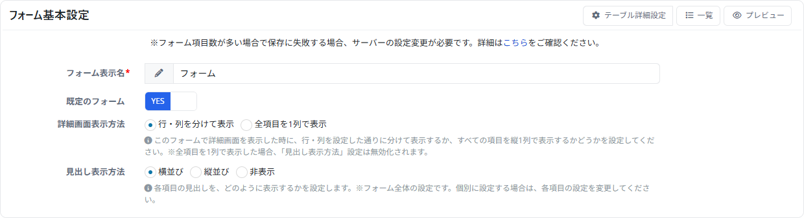

- ##### 見出し表示方法
各項目の見出しを、どのように出すかを決めます。  
※フォーム全体の設定です。項目ごとに変えるときは、各項目の設定を変えてください。

### フォームブロック設定
フォームのブロックを設定します。  
ブロックはデータのまとまりで、ふつうは1テーブルにつき1つです。  
ただし、1:nのリレーション設定があるときは、子テーブルのデータも同じ画面で入力できます。子テーブルブロックの「使用する」をチェックして、設定してください。

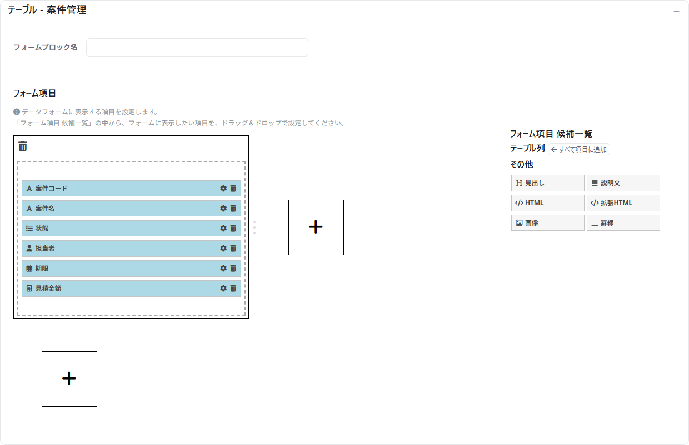

#### フォームブロック項目
※以下はすべて、子テーブルの設定項目です。

- ##### フォームをテーブル形式にする  
子テーブルの入力欄を、テーブル（表）の形で出します。

- ##### 子テーブルデータの読み込みを最適化する  
YESにすると、編集画面を表示したあとで、この子テーブルの行を自動的に読み込みます。子テーブルの行が多いデータで、編集画面が出るまでの時間を短くします。既定値はNOです。  
既存のデータを編集するとき、「フォームをテーブル形式にする」がYESの1対多のブロックで使用できます。読み込みが終わるまでは保存できません。  
「フォームをテーブル形式にする」をNOにしてフォームを保存すると、この設定もNOになります。  
※v7.1.0より利用できます。

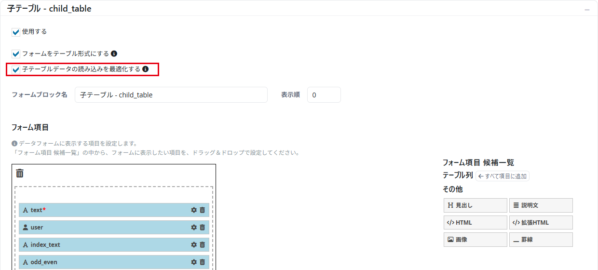

- ##### フォームブロック名  
フォームの各ブロックに表示する名称です。  

- ##### 表示順  
子テーブルがいくつかあるときに、出す順番を決められます。  


#### フォーム項目
入力フォームに出す項目を選んで、並べます。  
項目は、下の「フォーム項目 候補一覧」から選べます。

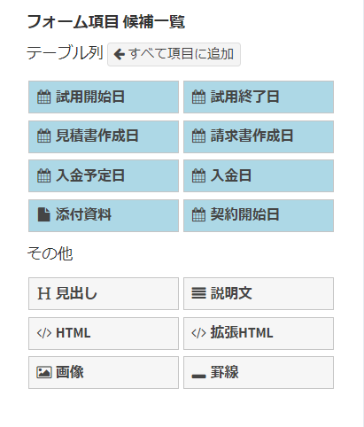

フォームには、1～4列までのボックスを置けます。  
このボックスの中に、フォーム項目を置いていきます。

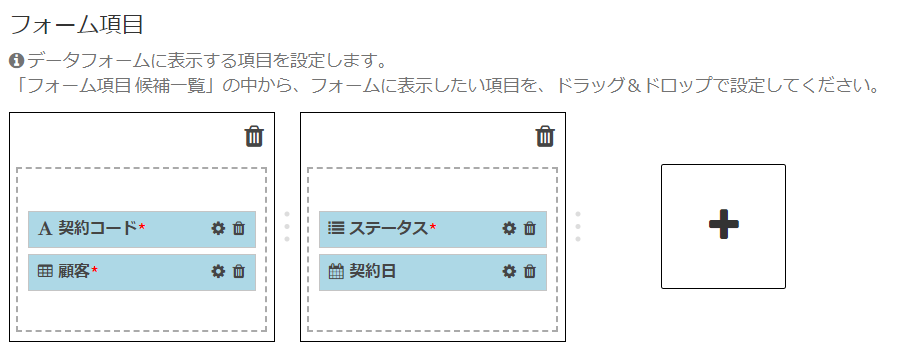

ボックスでは、次の操作ができます。  

- ボックスの隣にある「+」ボタンを押すと、今の行に新しい列を追加します。  


- ボックスの下にある「+」ボタンを押すと、新しい行を追加します。（次の行がすでにあるときは、その行に新しい列を追加します）  


- ボックスの右側の余白をドラッグ＆ドロップすると、ボックスの大きさを変えられます。  
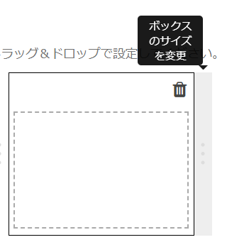

- ボックスの右上にあるゴミ箱アイコンを押すと、ボックスを削除します。  


ボックスの行や列を増やす・減らす、幅を変えることで、たとえば次のようなレイアウトを作れます。  

- 1列 - 2列


- 3列 - 1列
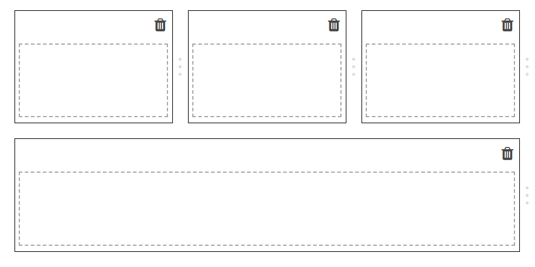

- 1列 - 2列 - 1列
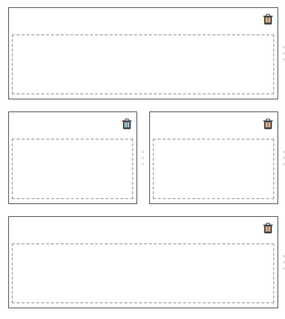


### フォーム項目 候補一覧  
フォームに追加できる項目の候補です。  
「テーブル列」と「その他」の2種類があります。  


#### テーブル列  
カスタムテーブルに設定されたカスタム列の項目です。  
「フォーム項目」のボックスにドラッグ＆ドロップすることで、データフォームに配置されます。カスタム列の種類や[フォーム項目詳細](#フォーム項目詳細)の設定に応じて挙動は異なりますが、通常は項目の値を編集、または表示することができます。

#### その他  
見出し・説明文・HTML など、データとはつながっていない、フォームに出すだけの項目です。  
「フォーム項目」のボックスにドラッグ＆ドロップすることで、データフォームに配置されます。

- ##### 見出し：
フォームに見出し形式で表示されます。

- ##### 説明文：
フォームに説明文を表示します。HTMLは使用できません。

- ##### HTML：
フォームにHTMLを表示します。  
※安全のため、`<script>`・`<iframe>` のタグと `id` 属性は出力されません（v6.2.15 以降）。画面でスクリプトを動かすときは、[スクリプトプラグイン](/ja/plugin_quickstart_script)をお使いください。  

- ##### 拡張HTML：
HTMLに加えて、[パラメータ](/ja/params)で指定した形式の文字列を使用できます。画面描写時に、保存済データの値で置き換えて、HTMLを作成できます。  
※「HTML」と同じく、`<script>`・`<iframe>` のタグと `id` 属性は出力されません（v6.2.15 以降）。  
例：
```
<h4>ID：${id}、会社コード：${value:company_code}</h4>
```
※列の値を置き換えるのは、画面描写時のみです。データ編集画面で、対象の列の値を編集しても、連動して値は変更されませんので、ご注意ください。  
※スクリプトも使用できます。<span class="red">（scriptタグを入力すると、画面描写時にスクリプトが実行されますので、十分ご注意ください）</span>

- ##### 画像：
フォームに画像を表示します。

- ##### 罫線：
フォームに罫線を表示します。


#### フォーム項目詳細
ボックスに追加した項目は、次のようなラベルで出ます。  
- カスタム列の設定で必須にした項目は、名前の横に赤いマークが付きます。  
- ラベルの右のゴミ箱アイコンを押すと、ボックスからその項目が削除されます。  
- ラベルの右の歯車アイコンを押すと、詳細設定ダイアログが出ます。  


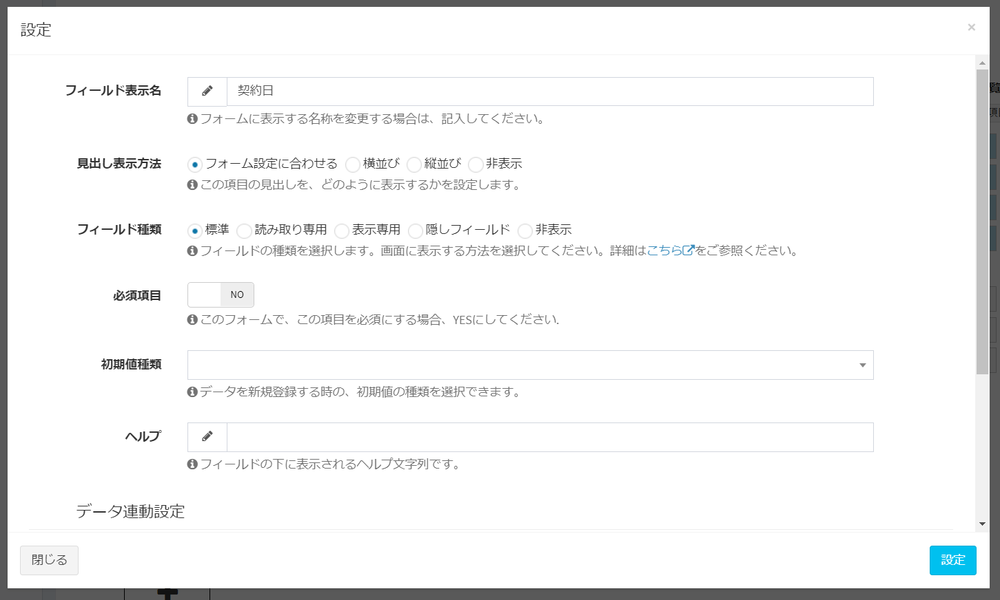

##### 見出し表示形式
項目ごとに、見出しの出し方を決められます。
（フォーム全体の設定よりも優先されます）

##### フィールド種類
データフォーム画面での出し方を決めます。次の 4 つがあります。

| 種類 | 画面での見え方 | ユーザーが値を変える | 計算フィールド・データ連動設定から使う |
|---|---|---|---|
| 読み取り専用 | グレーアウトで出る | できない | できる |
| 表示専用 | テキストとして出る | できない | できない |
| 隠しフィールド | 出ない（隠しフィールド(hidden)として追加される） | - | できる |
| 非表示 | 出ない（保存の直前に、システムの中で追加される） | - | - |

- 読み取り専用：  
チェックを行うと、ユーザーが値を変更することができません。システムや計算フィールド、[データ連動設定](#データ連動設定)からのみ、値を変更・取得することができます。  
設定すると、フォームでは以下のように、グレーアウトで表示されます。  
  
- 表示専用：  
チェックを行うと、ユーザーが値を変更することができません。システムや計算フィールド、[データ連動設定](#データ連動設定)からも、値を変更・取得することができません。  
設定すると、フォームでは以下のように、テキストとして表示されます。  
  
- 隠しフィールド：  
チェックを行うと、項目が画面に表示されず、隠しフィールド(hidden)として追加されます。  
計算フィールド、[データ連動設定](#データ連動設定)で使用したいが、画面には表示したくない場合に、この設定を使用します。  

- 非表示：  
チェックを行うと、項目は画面に追加されません。データ保存直前に、システム内部で追加されます。  
画面に存在しないので、計算フィールドやデータ連動設定で使用することはできません。  
内部のパラメータ値など、改ざんや修正を行わせたくない項目に、この設定を使用してください。


##### データ連動設定(項目)  
[データ連動設定](#データ連動設定)を参照してください。  

##### 関連絞り込み設定(項目)  
[関連絞り込み設定](#関連絞り込み設定)を参照してください。  


## データ連動設定
フォームの中に、ほかのテーブルのデータを選ぶ項目があるときに、選んだデータの内容を、フォームの別の項目にコピーできます。  
例：「契約」フォーム内の「顧客」を選択した際に、「顧客」データ内の「顧客名」の値を、「契約」フォーム内の「顧客名」にコピーする。

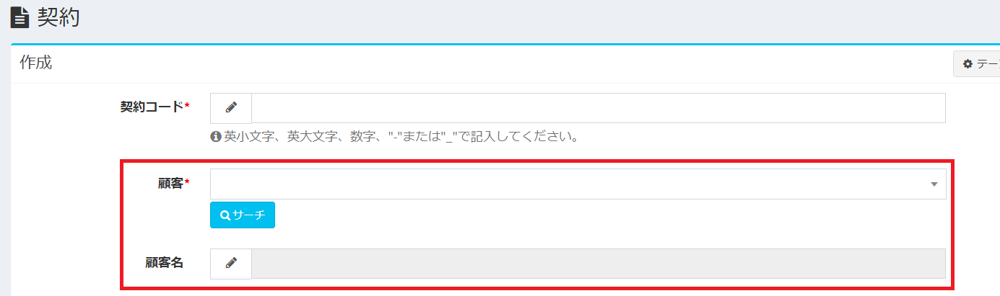
「契約」フォームに「顧客」選択肢と「顧客名」1行テキストがあり、  
  
 
「顧客」選択時に、 

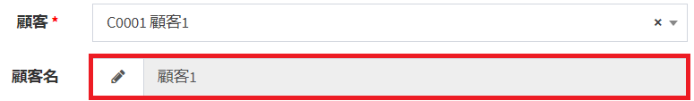
「顧客名」テキストに、値が自動的にセットされる  


<br />  

#### 手順
- カスタムフォーム画面を開きます。  
フォーム項目の、「顧客名」の設定アイコンを押します。  
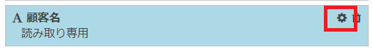

- 開いたダイアログに「データ連動設定」の項目があります。  
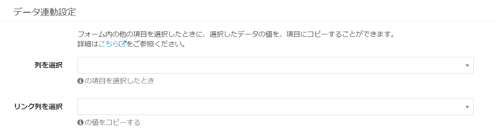

- 「列を選択」で、コピーのきっかけ（トリガー）になるカスタム列を選びます。  
**※ 同じフォーム内にある、列種類が「選択肢 (他のテーブルの値一覧から選択)」、「ユーザー」、「組織」の列が選択できます。**
この例では「顧客」を選びます。  


- 「列を選択」を選ぶと、2つ目の項目「リンク列を選択」の選択肢が出ます。  
「列を選択」で選んだテーブルのカスタム列が、一覧で出ます。  
この例では「顧客名」を選びます。  
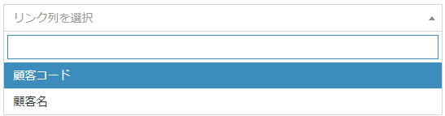

- 最後に［設定］ボタンを押します。  
ダイアログが閉じて、［データ連動設定］ボタンの隣に「設定済」と出ます。  


- ページの下の［送信］ボタンを押して、設定を保存してください。


## 関連絞り込み設定
列種類が「選択肢 (他のテーブルの値一覧から選択)」、「ユーザー」、「組織」の場合に、同一フォーム内にある別の項目の選択に応じて、選択肢を絞り込みます。対象テーブルの親テーブルまたは参照先テーブルの列が同一フォーム内に存在する場合のみ、設定できます。  

#### 例
「顧客情報」テーブルと「担当者情報」テーブルに1:nのリレーションが設定されている、かつ「契約情報」テーブルに、「顧客」列と「担当者」列が存在する。  
「顧客」列を選択した際に、「担当者」列の選択肢候補を、選択した「顧客」を親とする担当者だけに絞り込みたい。

  

以下のようなデータがあり、
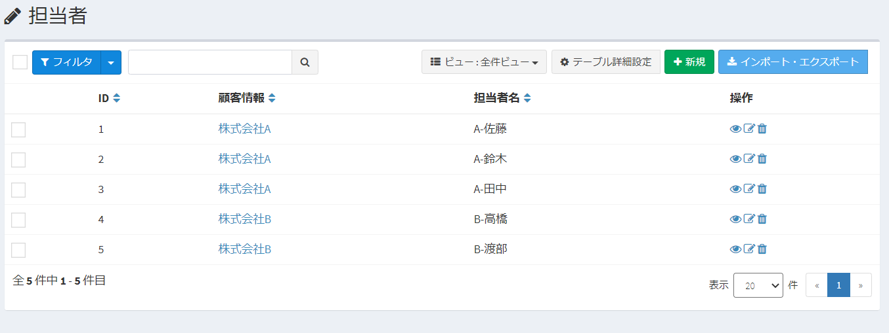  

契約情報画面で、
 

「顧客」で「株式会社A」を選択したら、株式会社Aに所属する担当者を選択肢候補とし、
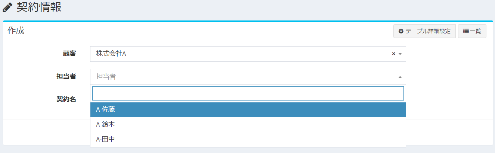  

「顧客」で「株式会社B」を選択したら、株式会社Bに所属する担当者を選択肢候補とする。
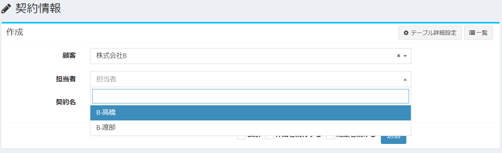  

#### 手順
- カスタムフォーム画面を開きます。  
フォーム項目の、「担当者」列の設定アイコンを押します。  
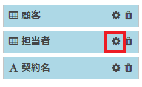

- 開いたダイアログに「関連絞り込み設定」の項目があります。  
選択肢に出るのは、同じフォームの中で、選んだ列の親になる列の一覧です。  
この例では、「担当者」テーブルの親テーブルである、「顧客」テーブルの列が選択肢に出ます。  
※「関連絞り込み設定」ボタンは、カスタム列が「選択肢 (他のテーブルの値一覧から選択)」「ユーザー」「組織」の場合に表示されます。
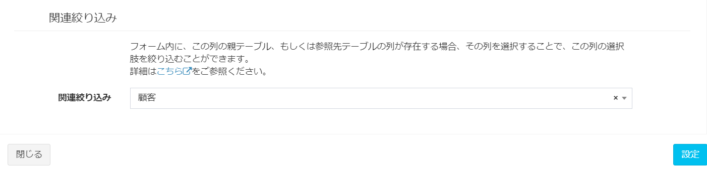

- 設定したら、「設定」ボタンを押します。  


#### v3.3.1未満の仕様について
<span class="small">v3.3.1未満では、この設定画面が表示されず、すべての1:n親子関係・参照関係のもつフィールドで、選択肢の絞り込みを行っていました。  
その結果、時に不必要な絞り込みや予期せぬ不具合を引き起こしていたこともあり、v3.3.1にて、絞り込みの実施有無を選択できるように設定を追加しました。  
v3.3.1未満からv3.3.1以上にアップデートする際には、互換性を保つため、「すべての1:n親子関係・参照関係のもつフィールドで、選択肢の絞り込みを行う」という設定を引き継いでいます。  
アップデート時の仕様の詳細は、[こちら](/ja/patch/relation_filter)をご参照ください。</span>


## フォーム優先順位設定
条件と優先度を決めておくと、データの作成やデータ詳細画面で使うフォームを、条件によって切り替えられます。  

### 新規作成
フォーム優先順位設定の右にある［新規］ボタンから作ります。


### 設定画面
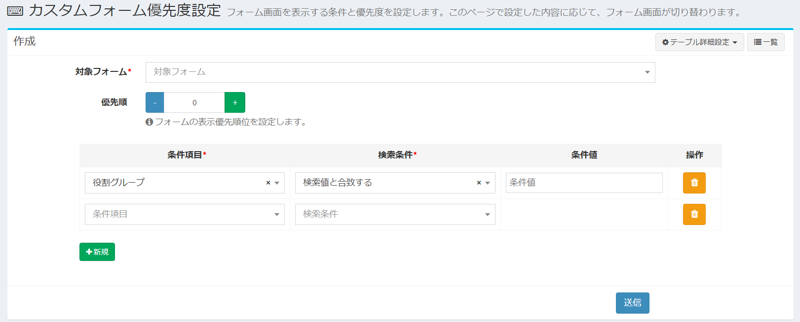

##### 対象フォーム  
条件に合うときに使いたいフォームを選びます。

##### 優先順  
フォームを使う優先順位を決めます。
いくつものフォーム表示条件に合うデータでは、優先順位の高いフォームで画面を出します。

##### 条件項目  
表示条件として使用する列です。

##### 検索条件  
条件の内容を選びます。
「条件項目」で選んだ列の種類（「日付」「ユーザー」など）によって、選べる内容が変わります。

##### 条件値  
検索条件とくらべる値を入力します。

##### ［削除］ボタン  
フォームの表示条件を削除します。

##### ［新規］ボタン  
フォームの表示条件を新規追加します。