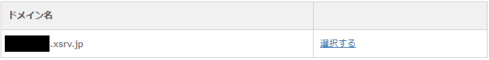
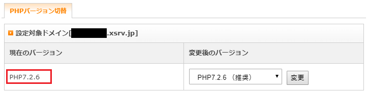
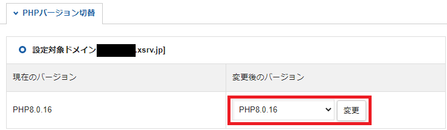
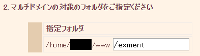
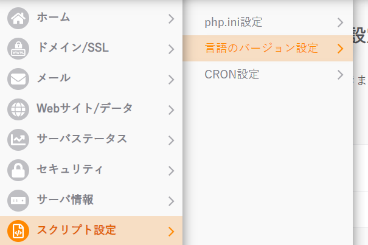

# レンタルサーバーによる環境構築
レンタルサーバーに Exment を入れる手順です。手軽に環境を作って運用したいときの選択肢です。  
Xserver と、さくらインターネットの手順を説明します。

| お使いのサーバー | 見るところ |
|---|---|
| Xserver | [Xserverの場合](/ja/install_rental?id=xserverの場合) |
| さくらインターネット | [さくらインターネットの場合](/ja/install_rental?id=さくらインターネットの場合) |

どちらも、おおまかな流れは同じです。

1. Exment 用の MySQL（データベース）を作る
2. SSH でサーバーにつなぎ、composer を入れる
3. Web に公開されないフォルダーに、Exment を入れる
4. Exment の「public」フォルダーだけを、Web に公開する
5. [インストール手順](/ja/quickstart)のとおりに、設定を終わらせる

## レンタルサーバーで構築を行う際の注意点
- Exment には、次の環境が必要です。
    1. PHP 8.2以上
    1. MySQL 8.0以上(推奨：8.4)  
    または MariaDB 10.11以上  
  特に MySQL のバージョンは、レンタルサーバーによっては条件を満たしていない場合があります。  
  お使いのレンタルサーバーが条件を満たしているか、先にご確認ください。

- レンタルサーバーには、Web に公開するフォルダーが決まっています（/home/username/www や、 /public_html など）。  
このフォルダ直下に、Exmentをインストールしたフォルダをそのまま入れないでください。データベースの設定値や、メールのパスワードなどが記載された設置ファイルなどが外部公開され、致命的な情報流出に繋がります。  
このページの手順は、公開すべきフォルダーだけを Web に公開するようになっています。この手順のとおりに公開してください。

- レンタルサーバーでは、SSH でつないだあと、最初に composer を入れ、それから Exment をインストールします。

- レンタルサーバーの環境や、サーバー側のバージョンなどによっては、このページの手順で正常に設定できない場合があります。

- このページは、Exment をレンタルサーバーで動かすための手順だけを書いています。  
SSH、データベースの作成、Linux のコマンドなど、一般的な IT の知識については書いていません。ご了承ください。

## レンタルサーバーによるインストール手順

### Xserverの場合
※X10プランで動作確認を行っています。

<iframe width="560" height="420" src="https://www.youtube.com/embed/RB6i0F2fev0" frameborder="0" allow="accelerometer; autoplay; encrypted-media; gyroscope; picture-in-picture" allowfullscreen></iframe>

**(1) MySQL を作る**

あらかじめ、Exment 用の MySQL を作っておきます。

**(2) コマンドで使う PHP を、管理画面と同じ版にする**

Xserver では、管理画面で設定する PHP と、SSH でつないでコマンドを実行したときの PHP の版が、違う場合があります。  
そこで、コマンドで使う PHP の版を設定します。

1. Xserver の管理画面で、「PHP Ver.切替」をクリックします。  
そのあと、対象のドメインを選びます。  
  
  

2. 「PHPバージョン切替」に今のバージョンが書いてあるので、メモします。  
  

3. Xserver に SSH でつなぎます。

4. 次のコマンドで、Xserver に入っている PHP を調べます。  
結果の中から、メモしたバージョンの PHP のパスをコピーします。

~~~ bash
find /opt/php-*/bin -type f -name 'php'

## /opt/php-8.2.9/bin/php ←今回の例ではこちら
~~~

5. フォルダーを作り、PHP へのシンボリックリンク（別の場所にあるファイルを指す、近道のようなもの）を作ります。

~~~
mkdir $HOME/bin
ln -s /opt/php-8.2.9/bin/php $HOME/bin/php
~~~

6. bashrc ファイルを直して、この PHP にパスを通します。

~~~ bash
vi ~/.bashrc

## 以下を最終行に記載し、「:wq!」で保存する
export PATH=$HOME/bin:$PATH

## 修正を反映させる
source ~/.bashrc
~~~

7. PHP の版を確かめます。管理画面に書いてあるバージョンになっていれば、できています。

~~~ bash
php --version
~~~

**(3) composer を入れる**

~~~ bash
cd ~
curl -sS https://getcomposer.org/installer | php -- --install-dir=$HOME/bin/
## 名前変更
mv $HOME/bin/composer.phar $HOME/bin/composer
## 確認
composer --version
# Composer version 2.6.5 2023-10-06 10:11:52
~~~

**(4) Exment を入れる**

決して「$HOME/(ドメイン名)/public_html」フォルダ直下にはインストールを行わないでください。データベースの設定値や、メールのパスワードなどが記載された設置ファイルなどが外部公開され、致命的な情報流出に繋がります。  
ここでは、「$HOME/(ドメイン名)/laravel」フォルダーを作り、その中に Exment を入れます。

~~~ bash
cd ~/(ドメイン名)
mkdir laravel
cd laravel
wget https://exment.net/downloads/ja/exment.zip
unzip exment.zip
rm exment.zip
~~~

**(5) public フォルダーだけを公開する**

「$HOME/(ドメイン名)/public_html」を、いま作った「$HOME/(ドメイン名)/laravel/exment/public」フォルダーへのシンボリックリンクにします。  
こうすると、Laravel の本体や設定値は Web に公開されるフォルダーの外に置いたまま、laravel の public フォルダーだけが public_html にあることになります。

~~~ bash
## デフォルトのpublic_htmlの削除
rm -r $HOME/(ドメイン名)/public_html
ln -s $HOME/(ドメイン名)/laravel/exment/public $HOME/(ドメイン名)/public_html
~~~

**(6) インストールを進める**

これで、Exment を開く準備ができました。  
[インストール手順](/ja/quickstart)のとおりに、設定を終わらせてください。  
※v7.2.1 以降は、この URL で Exment が開きます。`.env` の `ADMIN_ROUTE_PREFIX` に「admin」があるサイト（前の版で入れたサイト）は、URL の末尾に「/admin」を付けてください。  

#### コマンドと cron で使う PHP
Xserver では、Web（管理画面の「PHP Ver.切替」で選んだ PHP）と、SSH や cron で `php` と打ったときの PHP が違います。

- SSH で `php` と打つと、`~/bin/php`（上でリンクした PHP）が動きます。リンクしていないときは、サーバーの標準の PHP（古い版のことがあります）が動きます。
- cron は `~/.bashrc` を読みません。`php` だけだとサーバーの標準の PHP（8.0 など）が動き、Exment は動きません。

そのため、artisan のコマンドと cron は、**管理画面と同じ版の PHP を、フルパスで**動かしてください。

- 例（PHP 8.3 のとき）：`/usr/bin/php8.3`、または上の `find` で見つけた `/opt/php-8.3.x/bin/php`
- 管理画面で PHP の版を変えたら、`~/bin/php` のリンクと、cron のパスも同じ版に変えます。

[タスクスケジュール](/ja/additional_task_schedule)は、Xserver の管理画面の「Cron設定」で、次のように設定します（`(サーバーID)` と `(ドメイン名)` は自分のものに）。

~~~
* * * * * cd /home/(サーバーID)/(ドメイン名)/laravel/exment && nice -n 15 /usr/bin/php8.3 artisan schedule:run >> /dev/null 2>&1
~~~

キュー（[通知処理の遅延実行](/ja/additional_queue)）は、レンタルサーバーでは常に動くワーカーを置けません。`.env` の `QUEUE_CONNECTION` は `sync`（インストールしたときの値）のままにしてください。`database` にするときは、cron で毎分、たまったジョブを片付けます。

~~~
* * * * * cd /home/(サーバーID)/(ドメイン名)/laravel/exment && nice -n 15 /usr/bin/php8.3 artisan queue:work --stop-when-empty --max-time=50 >> /dev/null 2>&1
~~~

#### PHPバージョンアップ時の対応
PHP のバージョンを変えるときは、次の手順で行ってください。

- バージョンアップの作業中は、Exment にアクセスできなくなります。
- 下の例は、PHP7.4 から PHP8.2 へアップデートする手順です。
- 環境や導入した時期、バージョンやインストールの方法によって、手順が違う場合があります。

1. Xserver の管理画面で、「PHP Ver.切替」をクリックします。  
そのあと、対象のドメインを選びます。

2. 「PHPバージョン切替」で、新しいバージョンに切り替えて「変更」をクリックします。  
  

3. Xserver に SSH でつなぎます。

4. 次のコマンドで、今の PHP のバージョンを確かめます。  
（この時点では、古いバージョンが表示されます。）

~~~ 
php --version
~~~

5. PHP へのシンボリックリンクを外します。

~~~
unlink $HOME/bin/php
~~~

6. 「PHPバージョン切替」で選んだバージョンのパスを調べます。

~~~ bash
find /opt/php-*/bin -type f -name 'php'

## /opt/php-8.2.9/bin/php  ←今回の例ではこちら
~~~

7. 調べたパスに、シンボリックリンクを作ります。

~~~
ln -s /opt/php-8.2.9/bin/php $HOME/bin/php
~~~

8. PHP のバージョンを確かめます。新しいバージョンになっていれば成功です。

~~~ 
php --version
~~~

### さくらインターネットの場合
※スタンダードプランで動作確認を行っています。  
※さくらインターネットでは、「composer」の実行が、途中で終わってしまう場合があります。  
そのため、「nice -n 20 composer」のように、「nice -n 20」を付けて実行します。

**(1) MySQL を作る**

あらかじめ、Exment 用の MySQL を作っておきます。

**(2) 公開するフォルダーを変える**

1. さくらインターネットの管理メニューの「ドメイン/SSL設定」で、変えたいドメインを選びます。  
  

2. 「マルチドメインの対象のフォルダ」で、指定フォルダを変えます。ここでは「/exment」とします。  
  

**(3) SSH でつなぎ、シェルとパスを設定する**

1. お使いの ID とパスワードで、SSH でつなぎます。

2. シェルを変えます。

~~~
which bash
#  /usr/local/bin/bash

chsh -s /usr/local/bin/bash
# Password:  ## パスワード入力する
# chsh: user information updated
~~~

3. .bash_profile を直します。

~~~ bash
vi .bash_profile

## 以下を記載し、「:wq!」で保存する
PATH=$PATH:$HOME/bin:$HOME/usr/local/bin
export PATH
~~~

4. いちど SSH を切って、もう一度 SSH でつなぎます。

**(4) composer を入れる**

~~~ bash
cd ~
mkdir -p usr/local/bin/
curl -sS https://getcomposer.org/installer | php -- --install-dir=usr/local/bin/
## 名前変更
mv usr/local/bin/composer.phar usr/local/bin/composer
## 確認
nice -n 20 composer --version
# Composer version 2.6.5 2023-10-06 10:11:52
~~~

**(5) Exment を入れる**

決して「$HOME/www/」フォルダ直下にはインストールを行わないでください。データベースの設定値や、メールのパスワードなどが記載された設置ファイルなどが外部公開され、致命的な情報流出に繋がります。  
ここでは、「$HOME/laravel」フォルダーを作り、その中に Exment を入れます。

~~~ bash
cd ~
mkdir laravel
cd laravel
wget https://exment.net/downloads/ja/exment.zip
unzip exment.zip
rm exment.zip
~~~

**(6) public フォルダーだけを公開する**

「$HOME/www/exment」を、いま作った「$HOME/laravel/exment/public」フォルダーへのシンボリックリンクとして作ります。  
こうすると、Laravel の本体や設定値は Web に公開されるフォルダーの外に置いたまま、laravel の public フォルダーだけが www フォルダーの中にあることになります。

~~~
ln -s $HOME/laravel/exment/public $HOME/www/exment
~~~

**(7) インストールを進める**

これで、Exment を開く準備ができました。  
[インストール手順](/ja/quickstart)のとおりに、設定を終わらせてください。  
※v7.2.1 以降は、この URL で Exment が開きます。`.env` の `ADMIN_ROUTE_PREFIX` に「admin」があるサイト（前の版で入れたサイト）は、URL の末尾に「/admin」を付けてください。  

#### PHPバージョンアップ時の対応
PHP のバージョンを変えるときは、次の手順で行ってください。

- バージョンアップの作業中は、Exment にアクセスできなくなります。
- 環境や導入した時期、バージョンやインストールの方法によって、手順が違う場合があります。

1. さくらインターネットの管理画面で、「スクリプト設定」→「言語のバージョン設定」をクリックします。  
  

2. 「PHPのバージョン」で、新しいバージョンに切り替えて「保存」をクリックします。  
  

3. さくらインターネットに SSH でつなぎます。

4. PHP のバージョンを確かめます。新しいバージョンになっていれば成功です。

~~~ bash
php --version
~~~
